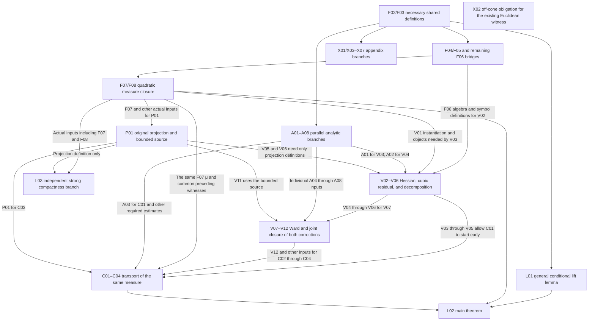

# Burnett Paper Formalization: Overall Plan for the Remaining Work

> Translation note: This is the complete English counterpart of the historical [Chinese work plan](WORK-PLAN.zh-CN.md). Its dated plans, handoffs, and evidence remain historical records; statements about what was “current” belong to their recorded stage. Consult the bilingual goal documents, [English](GOAL.en.md) and [Chinese](GOAL.zh-CN.md), for the current goal status and documentation rules. Translating or reading this plan does not itself resume a paused mathematical goal.

On 2026-11-17, the user updated the [goal continuation rules](GOAL.en.md): once a PR is ready, automatically advance subsequent branches and PRs that do not depend on its merge into main. Waiting for a human merge alone no longer pauses the entire goal; stop only when an actual dependency blocks progress and no independent task remains, a user decision is required, or a blocker is confirmed. Unconditional historical instructions to “pause once the PR is ready” retain their historical meaning; current execution follows the new rule. Merges into main remain human operations.

Updated: 2026-11-16 (revised after adversarial review). This document arranges the order, parallel execution, interfaces, and delivery of the remaining work. Actual mathematical status remains governed by [scope.json](scope.json) and its applicable evidence; registered slice relationships are governed by [slices.json](slices.json).

Section 4 preserves the early three-track task agreement, and Sections 10–15 preserve earlier delivery records. Section 18 governs the mathematical continuation described here, with independent subsequent PRs advanced automatically under the latest GOAL rules above. Mathematical status still comes from scope and its applicable evidence; do not restart the initial investigations.

## 1. Goal, Starting Point, and How to Use This Plan

The final goal follows `paper-results` 1.2: all formal mathematical results in this paper, the important unnumbered results included under that standard, and their required definitions and proof dependencies must be closed in Lean. Seventeen formal results and three mandatory unnumbered results have currently been identified, but this count is not an independently verified upper bound on scope. Continue checking independent assertions and necessary dependencies in the source; refer substantive boundary ambiguities to the user. Paper-specific code and alternative proofs are allowed. Mathlib submission requirements are not added by default, and unrelated background or every optional proof route is not certified sentence by sentence.

The user selected trust policy A: only the three foundational axioms `propext`, `Classical.choice`, and `Quot.sound` are accepted in the final result. Suitable proofs from the pinned library may be reused directly. Unformalized results from the literature may serve as explicit conditional interfaces during development, but must be supplied before completion. Do not conceal a key estimate, the existence of a defect measure, or transport itself in structure fields and call the result a proof of the paper.

This plan starts from the following position:

| Item | Verified status on 2026-11-16 |
| --- | --- |
| Locked paper | `paper/burnett.tex`, 3475 lines; SHA256 `e5e9fc351bbd5540884dc7f2fec42cdba94d591a2d4f5ebb4a409f316823904e` |
| Code baseline | The user merged PR #5; main is `242eebe9d87ef62c15efab8df7741051f0aed260`; [the actual main CI for that commit](https://github.com/Oho1e/Burnett-conjecture/actions/runs/43807809558) succeeded |
| Pinned environment | Lean 4.24.0; mathlib `f897ebcf72cd16f89ab4577d0c826cd14afaafc7`; mathematical standard 1.2, skill/project workflow 1.3.1 |
| Organizational inventory | 46 slices: 32 proof units, 6 assembly units, 5 specification units, and 3 context units; 135 relationships |
| Existing proofs | Relevant F06 pointwise real/complex Hermitian algebra, gauge, and physical-quotient conclusions; the formal X02 proposition `prop:cubic` and its supporting results |
| Remaining work | The other 16 numbered results; 3 mandatory unnumbered results; necessary dependencies including the geometric integration of F06 and the common closure of the quadratic measures |
| Machine evidence and semantics | 102 registered targets and 33 Lean sources; 174 inventory entries to detect omissions. The user delegated confirmation of the reviewed local F06/X02 mathematical interpretations to the lead and independent agents; this must not be recorded as the user personally reading Lean, and it does not automatically cover future conclusions |
| Whole-paper status | `development`, with whole-paper `verified=false`; the final independent coverage check of the source scope, required definitions, and dependencies remains incomplete |

Use status sources by domain: scope continues to manage mathematical scope and proof status. Wording in old frozen handoffs that PR5 awaited merging or that its merge operator remained undecided is a pre-merge snapshot. This candidate synchronized AGENTS, README, the project fields in scope, and the next X02 instructions, while preserving old handoffs as history. The verified PR5 merge commit and its main CI in this table update the remote facts observed at that time. On each continuation, still verify the actual main, applicable receipts, and latest user instructions. This factual update neither grants further remote merge or release authority nor rewrites old frozen evidence.

Reading order: first consult the overall arrangement in Section 3, then the immediate tasks in Section 4. When executing a slice, consult the complete dependency table in Section 6 and the original slice work packet. Section 5 explains parallel branches and common-closure responsibilities; Sections 7–9 prescribe delivery, review, and continuation for each round.

This is an adjustable work order, not a schedule or a guarantee of success. Stages may overlap: advance a consumer once its actual direct inputs are ready, without waiting for the entire preceding stage. The existing estimate of 60–110 subsequent PRs is only a low-confidence engineering budget. It assigns no fixed PR numbers, and PR, target, or slice counts must not be used to calculate whole-paper completion percentages.

## 2. How to Decide Whether Work Can Start or Is Complete

| Relationship type | Meaning for execution order |
| --- | --- |
| `proof-input` | Closing the consumer under the paper’s assumptions requires the corresponding actual proof. Explicitly marked conditional derivations may proceed before all inputs are available, preserving the missing premises. Additional unclosed premises introduced during development must eventually be eliminated; they cannot elevate the paper’s result to proved status |
| `definition` | Obtain the required object, notation, and exact meaning first; the entire slice containing the definition need not already be proved |
| `specification` | First agree on the target, test class, quantifiers, or conventions; a specification does not prove its conclusions |
| `application` | A general conditional lemma may be proved independently first; the source slice supplies its premises when it is applied. For example, L01 need not wait for the proof of C04 transport |
| `explanation` | A relationship for understanding and navigation, not automatically a proof prerequisite. For example, X04 need not wait until X03 is proved |

Judge “this round’s interface investigation is complete,” “a conditional lemma is complete,” “a paper result is complete,” “a common-closure group is complete,” and “the entire paper is complete” separately. Maintain actual status only in the existing scope/review records; this document does not create another status database.

Every result consumed downstream must at least have retrievable actual Lean declarations and important definitions, exact assumptions, provenance, applicable machine checks, and semantic verification. If a slice has partial proofs, reuse only the applicable parts. A new context must not treat the entire parent slice as complete.

A slice’s type is not a completion criterion. For example, although V05 is classified as `specification`, its actual decomposition and convergence properties still require proofs. Stabilizing its definitions only permits downstream work to start; it does not provide those properties.

The registered graph is structurally acyclic. This describes only the relationships between slices; it does not close external foundational proofs or replace the common-closure groups’ checks of shared witnesses and parameters.

## 3. Overall Order and Work Tracks That May Overlap

The table below gives the recommended order. Row numbers identify work layers; they do not impose a global barrier requiring all tasks to wait together.

| Layer | Tasks and recommended order | Deliverables and downstream use |
| --- | --- | --- |
| 0: Freeze the starting point and agree on necessary specifications | F01; F02 → F03; check the F05 object specification, A01 analytic conventions, and V01 target specification; continually check result scope and necessary dependencies against the locked source; consult X10 when actually cited | The objects, notation, quantifiers, pinned environment, and consumer interfaces actually needed in this round. The V01 specification may be extracted first; instantiation on a positive physical measure still depends on F07. Do not treat a specification as a proof. Advance scope checking incrementally using applicable existing evidence; do not make rereading the entire paper a prerequisite for every round |
| 1: Immediate vertical delivery and bottleneck diagnosis | X02 off-null-cone obligation; F02/F03 geometric definition integration; check the eight external interface categories in consumer-priority order | Complete a definite unproved result while identifying major foundational-library gaps affecting the main track early. Run the three tasks in parallel; see Section 4 |
| 2Q: Quadratic construction | F04 → F05; the remaining F06 geometric bridge may proceed in parallel with them; bring the three together → F07 → F08 | Construct the same defect and positive physical measure from the original vacuum sequence; close `thm:quadratic` and `cor:base-marginal`. Pointwise F06 success does not replace the F05/F07 measure proofs |
| 2A: Analytic tools | After agreeing on the necessary A01 definitions, advance the A01 commutator proof, A02, A04, and A06 in parallel; then A02 → A03, A04 → A05, A06 → A07, and finally A01/A06/A07 → A08 | Actual Fourier/multiplier, freezing, near-angle summation, correction, and adjoint estimates; this track may run alongside 2Q. A02’s registered input consists of A01 definitions, so do not mechanically wait for all of A01. Check additional dependencies when actually invoking further proofs |
| 3: Projection, Hessian, and complete cubic residual | Advance P01 and V01 after F07; advance V02 when its necessary specifications and F06 inputs are available; V02/F05/A01 → V03; V03/V02/A02/F05 → V04; implement V05 from the P01/V04 definitions; V02/F05/F06/P01 definitions → V06 | The actual bounded source for the original projection, Hessian compression, complete cubic energy, physical/gauge decomposition, and screen interface. Independent parts of the P01 proof, V04, and V06 may proceed in parallel |
| 4: Ward, near/far, and the two corrections | V04/V05/V06/A04/A05 → V07; V08 and V09 may then run in parallel; V08 plus A08 and other inputs → V10; P01/V08/V10/A07/A08 → V11; all relevant terms → V12 | Close the classification of gauge legs, near-angle terms, the physical far-angle correction, and the low-gauge transport correction within the same frozen energy. Preserve the CUBIC-CLOSE common integration task |
| 5: Variable background and transport of the same measure | C01 may start once A03/V03/V04/V05 are ready, without waiting for V12; once V12 and the other inputs are ready → C02 → C03; common assembly → C04 | Patchwise localization, nonlocal tails, actual source estimates for both corrections, and the correct limit order; close `thm:variational-transport` |
| 6: Lift, main theorem, and strong compactness | General conditional lemmas for L01 may proceed independently once the F02 objects are in place; F07/C04/L01 → L02. L03 may proceed independently once F05/F06/F07/F08 and the P01 projection definition are available | Close `lem:lift`, `thm:main`, and `cor:strong`. L03 does not wait for transport. L01 must not circularly use the existence conclusions of the main theorem or the main transport track |
| X: Independent appendix results | X01, X03, X04, X05, and X07 may run in parallel as shared definitions and their individual tools become ready; X05 → X06; finish X02 through the immediate task | Close formal appendix results and approved examples separately; success of the main theorem does not complete them automatically. The explicit kinetic representation in X05 must not be proved circularly from the main theorem |
| 7: Final whole-paper scope and evidence closure | Consolidate the independent scope checks that have advanced since the starting point, including X08; verify the actual consumers of necessary identities such as X09, then review the current mapping, dependency closure, confirmations, and machine evidence | This layer is final closure, not the first occasion to check scope or necessary identities. Only once every main track and appendix result is complete may a whole-paper completion statement tied to fixed paper/code versions be prepared. Do not release a tag merely because main is green |

The table shows only the main starting relationships. See Section 6 for all direct inputs, including the complete relationships for multi-input tasks such as V10, V12, and C02–C04.



This diagram shows only the major relationships between work tracks, not all 135 edges. Aggregate nodes must not be used wholesale as start conditions. For example, M supplies P01 with actual inputs including F07, without requiring F08 to be completed first. A supplies V03/V04 only with the results each needs, without requiring A08 first. P supplies V05/V06/L03 only with projection definitions; the complete bounded source is used later in V11 and elsewhere. C01 may start before V12. The V02 specification and algebraic preparation also need not wait for the entire measure group. Existing Euclidean modeling for X02 may advance independently of global geometric definitions.

## 4. Tasks That Can Be Assigned Directly in the Next Round

### N1: X02 Fixed Fourier Off-Null-Cone Obligation

The target is `unnum:cubic-off-null-gradient-localization`, locked to source line 3193. See [cubic-off-null-localization.md](../statements/cubic-off-null-localization.en.md) for its precise scope. Reuse the same `fSequence` and `wSequence` as `prop:cubic`, preserving the quantifier order: every fixed smooth compactly supported χ, fixed δ, and fixed Fourier cutoff are chosen before n tends to infinity.

First try explicit modulation frequencies, Plancherel, and L² tail integrals: derive all positive and negative modulation frequencies and gradient coefficients from the actual functions, control translated Fourier tails on a fixed off-cone region, and finally prove that the actual multiplier’s whole-space L² norm tends to zero. Cover sharp-cone orthogonal projections and smooth bounded angular cutoffs; implement the a.e. zero-frequency convention and Fourier normalization explicitly.

Starting actions: export the X02 work packet, read the existing counterexample modules and the statement above, check the L² Fourier, Plancherel, modulation-shift, and tail-integral interfaces in the pinned mathlib source, then make a minimal type/proof probe. N1 produces this round’s Fourier probes and supplies them for N3 to reuse. The coordinator arranges a single implementation of any Fourier bridge shared across tasks. This round added the EXT-HARMONIC→X02 consumer location to the slice inventory and regenerated the work packet; that location does not turn a route suggestion into a proved interface. Similar library names or missing caches do not establish that a theorem exists or does not exist.

Delivery must also prove that the difference between `A(χ∇hₙ)` and `A(∇(χhₙ))` is controlled by `A((∇χ)hₙ)` and tends to zero. Do not commute χ with a nonlocal projection or omit the projection’s whole-space tails. If the route instead uses source smallness in the existing H¹ graph-closure dual, supply the bridge to the actual Fourier-weighted negative norm; merely changing notation is insufficient.

Completion criterion: actual corresponding Lean theorems, the same witness, and the bridge between the two localization formulations pass machine checks, and independent reverse review confirms coverage of the agreed fixed-projection conclusion; only then update the existing scope item. Before that it remains unproved. The user already selected the fixed Fourier scope; do not ask again whether to extend it to general position-dependent Ψ⁰ operators.

### N2: Shared Geometric Definitions from F02/F03 to F04/F06

For the immediate work, stabilize only the minimal objects needed by actual consumers: four-dimensional coordinate indices, metric and inverse metric, admissible sequences, connection/Ricci, volume density, cotangent variables, and test conventions. Integrate the existing F06 `Fin 4` real/complex tensor definitions with those objects. Explain how actual Lorentz geometric data supply the invertible frame required by the algebra; do not describe a pointwise model already supplied with a frame as a result on an arbitrary manifold.

Starting actions: export the F02, F03, F04, and F06 work packets; compare [main-interface.md](../statements/main-interface.en.md) with the actual types in the existing algebra; first write chartwise interfaces and immediately necessary bridges, then list the coordinate-change, auxiliary-metric-change, and local-to-global gluing obligations and their consumers.

Delivery criterion: the shared definitions have compilable actual instances and genuine bridges to the existing algebra modules, usable by the next F04 or F06 proof. A definition package does not claim the main theorem or all of F06 complete. A pointwise frame does not automatically give a global smooth frame. Essential geometric objects cannot be placeholders with arbitrary fields satisfying the desired conclusion.

### N3: Audit External Lean Dependencies by Consumer

Reuse the evidence classification in [library-audit.md](library-audit.en.md). Inspect actual source, imports, and types at the current pin instead of inferring library support from mathematical terminology. N3 reuses N1’s Fourier/L² investigations and probes. In this round, prioritize independent investigation of F05 microlocal extraction/localization and the exact A01/P01 commutator bounds, then cover other categories as consumers become ready. Do not duplicate N1’s initial investigation. State the review scope whenever evidence needs independent verification.

| External interface | Actual requirements to check first | Main consumers |
| --- | --- | --- |
| EXT-HARMONIC | First check actual L² Fourier/Plancherel/modulation; then multipliers, Littlewood–Paley, bilinear symbols, and the required finite seminorms | X02, A01–A08, P01, V/C branches |
| EXT-DEFECT | Positive Hermitian bundle-valued microlocal extraction along the same subsequence, all classical angular tests, and system localization | F05, V03, C02 |
| EXT-COMM | First-order energy commutators, the P01 whole-space gradient-form Calderón bound, bilinear high-slot adjoints, and exact exponents | A01, P01, A06–A08, V11 |
| EXT-MEASURE | Hermitian densities, Radon–Nikodym, disintegration, weighted pushforwards, support, and separation by moment tests | F05/F07/F08, L01, appendix |
| EXT-GEOMETRY | Connection/curvature differences, actual variations, Lie derivatives, coordinate naturality, Cauchy surfaces, and flows | F02/F04/F06, V02–V04, L01, X01/X04/X06/X07 |
| EXT-COMPACTNESS | Rellich duality, weak-star subsequences, limit identification, interpolation, and subsequence contradiction for the whole sequence | F04/F05, C02, L03, X05/X06 |
| EXT-ODE | Smooth local ODEs, comparison, Gronwall, parameter limits, and null geodesic flow | L01, X04–X06 |
| EXT-LIFT | A Cauchy-invariant scale on a background that need not be affinely complete, an s⁻²-weighted full-momentum lift, and local second moments | L01, L02 |

“Main consumers” is scheduling guidance; maintain formal interface ownership and actual new consumers in the original inventory. In particular, check the gradient-form L² norm bound for `Π∂b` required by P01. A proved A01 commutator energy pairing does not automatically provide that bound, and adding a global boundedness assumption on the complete field is not an acceptable workaround.

For interfaces that have been resolved, deliver a concrete conclusion—“directly usable,” “bridge required,” or “new proof required”—together with actual imports/declarations/types, applicable conditions, and probe evidence. If an interface has not been located or its exact signature remains unclear, retain “to be checked,” recording the search scope and missing evidence. Do not upgrade uncertainty into library nonexistence or a need to reprove a theorem merely to assign a category. For a specific literature theorem, inspect the exact version and full statement before matching it; an existing citation is not an existing Lean proof.

When a major interface is missing, split foundational proof tasks by the smallest actual consumer while other ready branches continue. Missing library proofs are implementation obstacles. Refer choices to the user only when an actual mathematical discrepancy requires strengthening the paper’s assumptions or changing scope. Investigation findings will affect later task granularity and the PR budget.

## 5. Parallel Branches and Common-Closure Responsibilities

### Branches That May Advance Early

| Branch | Starting conditions and order | Boundaries to preserve |
| --- | --- | --- |
| Strong compactness L03 | Advance once F05/F06/F07/F08 and the P01 projection definition are in place | Does not depend on C04 transport or require the P01 bounded-source proof first; still verify the actual Parseval/tail tools. Preserve quantifiers over every open region, every chart and χ, and the entire original sequence |
| Lift L01 | Prove the general conditional lemma once the F02 objects and the geometric/measure tools it uses are ready | F07/C04 supply application data, not prerequisites that the L01 proof must await. Supply moments and transport for the same measure when applying L02. Do not add affine completeness |
| X01 | Euclidean model geometry and the X07 intrinsic curvature bridge | The integrated proof establishes exact harmonicity, admissibility, and finite but diverging tensor L² norms on the paper's fixed compact set. Verify the registered modules with the X07 curvature bridge now on main. [Statement and evidence](../statements/harmonic-shear.en.md) |
| X03 and X04 | May start separately once the relevant F02 objects are ready; close the X03 moment example and the X04 actual-metric construction separately | X03→X04 is explanatory. Do not make it a reason to wait serially or substitute the rotating-tensor example for the geometric counterexample. Do not add a vacuum approximation conclusion |
| X05 → X06 in the manuscript | The manuscript develops the general two-polarization construction before the multiscale example. The delivered X06 Lean proof constructs the explicit multiscale measure directly, and the X05 Lean proof reuses the coordinate Hamiltonian and integration lemmas introduced with X06. | X05 constructs the full-momentum representation independently of the main theorem. X06 proves multiscale vacuum, the derivative-scale lower bound, and the exact zero-source coordinates. |
| X07 | Local convergence, weak derivatives, and the intrinsic full-curvature bridge from PR #19 | The independently reviewed proof of full Riemann flatness of the limit entered `main` in PR #22. [Statement and evidence](../statements/flat-rigidity.en.md) |
| X08, X09, X10 | Continually check scope and consumers through X08 from the starting point; handle necessary X09 identities according to actual consumers; check X10 literature when needed | X08 scope decisions do not await the F07 mathematical proof, while its implementation retains its actual inputs. X08 is not an approved additional certification set. When it contains a necessary dependency or independent result, check it under the standard and refer substantive ambiguities to the user. Do not mechanically make context into Lean theorems |

### Five Common-Closure Points

| Group | Final integration location | Main checks when combining local results |
| --- | --- | --- |
| Q-CLOSE: F04/F05/F06/F07 | F07 | The same global subsequence, complete angular covariance, Hermitian positive density and Ricci kernel, and actual positive physical measure. Finite second moments do not replace naturality of the full angular object |
| CUBIC-CLOSE: V04–V12 | V12 | Coverage of all gauge-leg and frequency-position classes in V07; both V08/V10 corrections must be exact, Hermitian, and suitable for the rough commutator estimates; account for every numerical coefficient, cutoff, adjoint, and remainder in the same complete energy |
| TRANSPORT-CLOSE: F05/F07/A03/A05/A08/P01/V03/V04/V12/C01–C04 | C04 | The same σ, μ, subsequence, and tests; actual compatibility of the projected equation, nonlocal tails, local volume factors, parameters, and limit order. Do not splice independently existing witnesses into a single object |
| MAIN-CLOSE: F07/C04/L01/L02 | L02 | Start from the paper’s vacuum assumptions and use the same global μ; construct ν on every globally hyperbolic open U, checking local second moments, full-momentum tests, and all quantifiers |
| STRONG-CLOSE: F05/F06/F08/P01/L03 | L03 | P01 supplies only definitions here; uniform positivity constants on the compact unit null-cone bundle, projection tails, and re-extraction from every subsequence yield the two-way statement for the entire original sequence |

The common-closure groups retain their responsibilities from the original [slices.json](slices.json). Parallelization must not cause an unproved interface to depend on its own consumer’s conclusion.

### Objects and Parameters That Must Remain Shared Across Slices

- The subsequence and defect object extracted in F05 persist through F07, the V/C branches, and L02. Do not choose a new arbitrary witness for each test, patch, or downstream slice while still calling it “the same μ.”
- The original P01 physical projection and actual scalar divergence equation persist through V11 and C03. Do not replace them with a convenient projection or a different source equation without proving equivalence.
- Keep analytic conventions, Fourier normalization, real/complex Hermitian pairings, trilinear symmetrization, exponents, and finite symbol-class seminorms consistent across the A/V/C branches.
- Use the proved X02 counterexample to check the applicability of analytic interfaces: quadratic characteristic localization alone is not sufficient to make an arbitrary cubic energy vanish. Actual Einstein cubic closure still requires the complete vertex, Ward classification, and correction estimates.
- Fix finite p*>3 and κ, then fix δ, η, and the patch scale ℓ. For fixed n, first restore upper-frequency and angular truncations; then, at fixed δ and ℓ, let n→∞, followed by ℓ→0 and finally δ→0. Follow [dependencies.md](dependencies.en.md) for the precise truncation-restoration order and constant dependencies. Do not require a second-derivative scale or extra endpoint estimates absent from the paper.
- Retain each patch’s local volume factor before summing using bounded overlap. Do not charge the entire chart norm to every patch, or describe a quantity small at fixed ℓ as uniformly small in ℓ.

## 6. Execution Locations and Direct Dependencies for All 46 Slices

The following table follows the locked source order; **it does not require serial execution by row**. It expands the current 135 edges: the proof column contains `proof-input` relationships, the definition/specification column preserves the original types, and the final column contains only application or explanation relationships. External foundational proofs absent from this inter-slice graph must still be checked as described in Section 4. An empty inter-slice input list does not mean that no mathematical dependencies exist.

| Slice / source lines | Track | Task in this slice | Proof inputs | Definition/specification inputs | Application/explanation relationships |
| --- | --- | --- | --- | --- | --- |
| **F01** · 1–89 | 0: objects/conventions | Source identity and scope | — | — | — |
| **F02** · 90–168 | 0: objects/conventions | Admissible geometry and main-target specification | — | — | — |
| **F03** · 169–351 | 0: objects/conventions | Notation and contraction conventions throughout the paper | — | F02 (definition) | — |
| **F04** · 352–389 | 2Q: quadratic construction | Connection/Ricci differences and H⁻¹ compactness | — | F02 (definition); F03 (definition) | — |
| **F05** · 390–429 | 2Q: quadratic construction | Common defect and Ricci kernel | F04 | F02 (definition) | — |
| **F06** · 430–466 | 2Q: quadratic construction | Ricci/B algebra, physical quotient, and geometric bridge | — | F05 (definition); F03 (definition) | — |
| **F07** · 467–486 | 2Q: quadratic construction | Positive measure and quadratic theorem | F04, F05, F06 | F02 (definition) | — |
| **F08** · 487–518 | 2Q: quadratic construction | Base marginal and disintegration | F07 | — | — |
| **A01** · 519–600 | 2A: analytic tools | Analytic conventions and first-order commutators | — | F03 (definition) | — |
| **A02** · 601–735 | 2A: analytic tools | Cubic continuity and coefficient differences | — | A01 (definition) | — |
| **A03** · 736–892 | 2A: analytic tools | Coefficient/test freezing | A02 | A01 (definition) | — |
| **A04** · 893–1025 | 2A: analytic tools | Angular caps, partitions, and phase gaps | — | A01 (definition) | — |
| **A05** · 1026–1245 | 2A: analytic tools | All-scale and near-angle summation | A04 | A01 (definition) | — |
| **A06** · 1246–1379 | 2A: analytic tools | Low-angle extension and spherical harmonics | — | A01 (definition) | — |
| **A07** · 1380–1475 | 2A: analytic tools | Correction operators and high-slot adjoints | A06 | — | — |
| **A08** · 1476–1591 | 2A: analytic tools | Normal-form pairing and truncation restoration | A07, A06, A01 | — | — |
| **P01** · 1592–1719 | 3: projection/variation | Original physical projection and whole-space source | F05, F06, F07 | F02 (definition) | — |
| **V01** · 1720–1744 | 3: projection/variation | Transport specification and measure instantiation | F07 | F02 (definition) | — |
| **V02** · 1745–1809 | 3: projection/variation | Hessian and kernel compression | F06 | V01 (specification); F05 (definition) | — |
| **V03** · 1810–1905 | 3: projection/variation | Commutator and complete cubic residual | V02, F05, A01 | F07 (definition) | — |
| **V04** · 1906–2010 | 3: projection/variation | Cubic action and cyclic vertex | V03, V02, A02, F05 | — | — |
| **V05** · 2011–2052 | 3: projection/variation | IR-compatible physical/gauge decomposition | — | P01 (definition); V04 (definition) | — |
| **V06** · 2053–2108 | 3: projection/variation | Screen and its own physical phase | V02, F05, F06 | P01 (definition) | — |
| **V07** · 2109–2262 | 4: Ward/corrections | Complete Ward classification | V04, V05, V06, A04, A05 | — | — |
| **V08** · 2263–2342 | 4: Ward/corrections | Low-gauge transport correction | V07, V05, V06, A06 | — | — |
| **V09** · 2343–2503 | 4: Ward/corrections | Angular gain in near terms | V04, V06, V07, A04, A05 | F03 (definition) | — |
| **V10** · 2504–2556 | 4: Ward/corrections | Physical far correction | V04, V07, V08, V06, A04, A08 | — | — |
| **V11** · 2557–2591 | 4: Ward/corrections | Common energy estimates for both corrections | P01, V08, V10, A07, A08 | — | — |
| **V12** · 2592–2642 | 4: Ward/corrections | Complete accounting of the frozen energy | V04, V05, V07, V08, V09, V10, V11, A04 | — | — |
| **C01** · 2643–2730 | May run alongside the later part of 3 | Localization, freezing, and patch volume | A03, V03, V05, V04 | F02 (definition); F03 (definition) | — |
| **C02** · 2731–2842 | 5: transport closure | Same defect and projection tails | C01, F05, V06, A02, V12, F06, V07 | — | — |
| **C03** · 2843–2942 | 5: transport closure | Actual scalar equation and patch summation | C01, C02, P01, V09, V11, V12 | — | — |
| **C04** · 2943–2986 | 5: transport closure | Global transport of the same μ | C01, C02, C03, V03, V12, F05, F07, V04 | V01 (specification) | — |
| **L01** · 2987–3045 | Independent lift branch | Conditional full-momentum lift lemma | — | F02 (definition) | C04 (application); F07 (application) |
| **L02** · 3046–3062 | 6: main theorem assembly | Assembly of all main-theorem quantifiers | F07, C04, L01 | F02 (specification) | — |
| **L03** · 3063–3115 | Independent strong compactness branch | Strong compactness of the whole sequence | F07, F08, F06, F05 | P01 (definition) | — |
| **X01** · 3116–3172 | X: appendix branch | Divergent flat source in harmonic coordinates | — | F02 (definition); P01 (definition) | — |
| **X02** · 3173–3212 | 1: immediate priority | Trilinear counterexample and fixed off-cone obligation | — | — | — |
| **X03** · 3213–3240 | X: appendix branch | Rotating null-moment tensor counterexample | — | F02 (definition) | — |
| **X04** · 3241–3304 | X: appendix branch | Actual-metric counterexample without a transport representation | — | F02 (definition) | X03 (explanation) |
| **X05** · 3305–3359 | X: appendix branch | Explicit Rosen two-polarization representation | — | F02 (definition) | — |
| **X06** · 3360–3387 | X: appendix branch | Multiscale Rosen construction and zero-source coordinates | X05 | F03 (definition); P01 (definition) | — |
| **X07** · 3388–3424 | X: appendix branch | Full-curvature flat rigidity | — | F02 (definition) | — |
| **X08** · 3425–3446 | Scope review from the start; closure in 7 | Scope check of the three examples | F07 | F02 (definition) | — |
| **X09** · 3447–3463 | Implement according to consumers | Necessary auxiliary identities | F07 | F02 (definition) | — |
| **X10** · 3464–3475 | 0 and citation checks as needed | References and closing context | — | — | — |

## 7. Specific Arrangements for Each Multi-Agent Round

The coordinator first reads the current main, scope, slices, and applicable evidence, then selects a small number of ready tasks that remove actual bottlenecks. N1/N2/N3 have immediate priority; subsequent scheduling follows delivered interfaces. Parallelism depends on tool capacity, dependencies, and integration cost, with no fixed number of agents or track quotas.

An existing slice work packet plus a few supplementary paragraphs is sufficient to hand off a task: this round’s exact subgoal, source location, available actual declarations, missing inputs, exclusively owned output files, expected deliverable, and evidence location. Do not require multiple new task forms. Forward implementers may exchange construction ideas. Independent reverse review is assigned to an agent who did not participate in that construction; the reviewer first reads the mathematical meaning from the actual types and important definitions, then compares it with the paper.

The coordinator integrates shared geometric definitions, library entry points, scope, the slice inventory, and dependency locks. Use separate worktrees for separate branches. When sharing a checkout, agents must not switch its branch independently. Arrange exclusive write access for changes to the public `.lake` or dependencies. Checks that read frozen dependencies and write their own output directories may run in parallel. Do not copy caches from another worktree or modify shared dependency sources.

Submit a result for independent review as soon as it is checkable, while other ready tasks continue. When review raises an objection, first check the actual source and assumptions; the implementer and reviewer may challenge one another where necessary. An unresolved correctness issue is not removed by majority agreement. Renaming a role does not turn self-review into independent review.

When continuing task assignments, verify whether the worker is still running. A finished task must be explicitly reassigned to restart it; sending a notification alone does not mean work has begun. Record progress only after the coordinator observes actual task state or new output, to avoid waiting for an unstarted task. Such a delay occurred in this round and was corrected by explicit reassignment and separate file ownership; no review that did not happen was retroactively recorded.

## 8. From Slice to PR: Delivery and Checks

Organize each PR around mathematical results that can be independently consumed and reviewed. A slice may span several PRs, and several closely related small slices may be delivered together. Integrate new proofs, actual library entry points, paper-target registration, relevant scope status, and necessary mathematical explanations in the same candidate. Do not merge code first and leave it invisible to the checker indefinitely. Auxiliary lemmas need not each become a paper audit target, but must belong to the actual proof dependencies of reviewed results; independently defined objects or computations receive their own applicable checks.

The basic order is: feature branch/isolated implementation → actual Lean check → freeze this round’s source → independent reverse review → coordinator integration → CI for an actual merge candidate against the latest main → hand off the ready PR. Follow the explicit choice of merge operator for that round. This document does not authorize agents to merge remotely, enable auto-merge, delete branches, or release tags. After the user reports a merge, check the actual squash/main commit and its push CI; record that round’s integration as complete only after success.

Existing entry points that can be used directly:

```powershell
# Run these commands at the paper project's root; replace X02 with the current slice ID.
python scripts/prepare_slice.py X02 --repo .
python scripts/check_slices.py --repo .

# Use when mathematical code or related project inputs changed and a complete local candidate check is needed.
$env:PATH = 'D:\Chatpgt\Lean形式化\.tools\lean-4.24.0-windows\bin;' + $env:PATH
python scripts/check_project.py --repo . --lake 'D:\Chatpgt\Lean形式化\.tools\lean-4.24.0-windows\bin\lake.exe'
```

Use applicable incremental checks during local implementation, then a complete check for candidate delivery. A planning/layout-only change does not trigger reconstruction of all mathematical evidence. Add maintenance negative cases and independent tool review according to impact only when checkers, CI, or dependency-boundary tools change.

Record machine checks, axiom audits, semantic review, confirmation, PR readiness, actual merge, and main CI separately. Existing evidence may be reused after its current applicability is checked. A green old PR is not evidence for a new main. If main CI fails, first repair the affected integration while other independent implementations may continue. Do not delete difficult targets or relax protection to restore green checks. Follow [github-workflow.md](github-workflow.en.md) and [parallel-workflow.md](parallel-workflow.en.md) for detailed execution.

## 9. Decisions for the User and Updates to This Plan

Refer specific source passages, alternatives, and consequences to the user only when an ambiguous source condition needs a materially different precise interpretation, a proof requires an extra assumption or a changed conclusion, the inclusion of an unnumbered result raises a substantive scope question, or a proposed change to the pinned environment, trust policy, or final certification scope exceeds existing authorization. Ordinary development otherwise defaults to continuing independent work. On 2026-11-16, the user further instructed this goal to stop and wait when a human decision is needed or a blocker is confirmed; that round’s instruction takes precedence, so preserve the current evidence and stop at the concrete handoff point. Do not repeat questions about the settled trust policy A, X03/X06 targets, or the X02 fixed Fourier scope.

After independent review, submit new mathematical interpretations to the user/author for confirmation under this project’s agreement and actual delegation. Existing delegated F06/X02 confirmations carry forward only within their applicable scope and versions; they do not confirm future results or the whole paper. The final tag still requires complete scope and dependency closure, independent semantic and coverage reviews, required confirmations, and evidence for the actual versions.

Each round updates only the affected next steps, dependency judgments, route choices, and evidence entry points in this document. Update mathematical status in the original scope and keep detailed derivations in the original proof records. Reasons to rearrange work include changed shared definitions, new foundational-interface findings, a counterexample/source gap, user changes to scope, or a substantial change in implementation cost. A local change triggers review of relevant consumers only, preserving unrelated verified results.

No Lean proofs were added during drafting and adversarial review of the original plan; mathematical progress from this round’s formal execution appears below. The locked paper, mathematical standard, and dependency locks remain unchanged. No existing scope or trust choice needs to be asked again.

## 10. Continue Directly from the First Foundational Candidate

This section preserves the exact continuation point when the first candidate was delivered. See Section 11 for this round’s subsequent progress on density, L² Fourier, and connection differences.

This round added 35 supporting targets. See [first foundational proofs](../statements/initial-foundations.en.md), [independent readback](../statements/initial-foundations-review.en.md), and [dependency investigation](dependency-audit-round1.en.md) for actual scope. The candidate’s 137 targets and 47 Lean sources passed the local combined check. Every declaration still covers only its actual scope; before merging, this round’s main-track integration must not be called complete.

- **N1**: Proved the four-component whole-space off-cone Fourier energy for the same f/w, every original real C∞c cutoff, and fixed δ; implemented the actual L² cutoff-position bridge. Next construct the Schwartz→actual L² density bridge, isometric extension, and sharp/smooth projections precisely identified by the dependency investigation, then instantiate the proved result to close the source-line-3193 parent target.
- **N2**: Integrated an actual nondegenerate bilinear form and a given orthonormal basis into the old F06 certificate, including a nonempty model. This does not provide a smooth/global choice. Continue checking the representation of actual Lorentz geometric data, supply the basis/coordinate bridges needed by consumers, and advance the actual F04 connection/Ricci differences. Address local smoothness or uniformity only when relevant consumers need it; do not additionally require a global smooth frame.
- **N3**: Proved a common subsequence for countably many tests. F05/A01/P01 still have precisely identified analytic interfaces to investigate. Continue the minimal necessary steps, including actual PDO-test boundedness, dense-test extension, positivity, and the system kernel. Do not equate this round’s countable extraction or RMK components with complete defect-measure extraction.

Once independent readback and the current merge-candidate CI are complete, hand off this candidate as a feature PR; the final merge follows that round’s selected operator. Continue afterward from the actual new main and the exact gaps above. Do not repeat frozen initial probes or local proofs that remain applicable, or treat supporting-target counts as a whole-paper completion percentage.

## 11. Second Construction Batch and the Next Handoff

This section preserves the second local candidate before PR6 was merged. The user has since merged PR6; see Section 12 for the then-current facts and the added DenseTests work.

This round created the successor branch `formalization/l2-fourier-extension` from the reviewed PR6 head `d143c3709466bd2900e098c573c1691d987226da`, without changing the main track. An actual read-only observation at 2026-11-16T11:19:13Z showed that PR6 remained unmerged, main remained `242eebe9d87ef62c15efab8df7741051f0aed260`, and the original PR6 candidate CI passed. This round’s successor code does not inherit that old CI.

For the implementation and unclosed boundaries, see [second-batch mathematical explanation](../statements/second-foundations.en.md), [independent readback](../statements/second-foundations-review.en.md), and [frozen bindings](../statements/second-foundations-source-bindings.json). The new construction comprises 9 modules, 36 registered supporting targets, and the source-line-3193 parent target. This is dependency registration, not a whole-paper completion percentage.

- **X02**: Actually constructed Schwartz→actual L² density, the Fourier isometric equivalence, actual fixed bounded multipliers, and sharp-cone orthogonal projections. All four components of the same f/w, every fixed original χ, fixed δ/symbol, and both cutoff positions are connected to physical whole-space L². Zero frequency and noncompact output tails are handled. Later consumers should start from the actual parent declaration and its binding; do not continue listing the proved Fourier energy or actual projections as open mathematical interfaces. Judge author confirmation, combined machine checks, and main-track integration separately from their actual receipts.
- **F04**: Implemented exact local metric connection differences, the actual Ricci difference for torsion-free coordinate connection fields, and the bridge to the old F06 symbol. Next instantiate actual connection fields uniformly from local metric regularity, supply uniform inverse-metric bounds and Eₙ estimates, then implement integration by parts against compactly supported tests, weak Ricci identification, and H⁻¹ compactness under nested cutoffs. **Exact quadratic Ricci correction = −old B** is already a Lean theorem; preserve the minus sign in later weak-moment assembly. Algebraic identities do not close this entire slice.
- **F05/A01/P01**: Have countable common extraction and an actual range≤ker tool for positive semidefinite densities. Next construct uniform bounds and positive-functional/dense-extension results for actual operator tests, then obtain local measures and the same global witness. System a.e. compression to zero and covariance/Gram transformations require separate proofs. This round’s actual fixed Fourier multipliers may be reused, but do not provide variable-coefficient PDOs, Calderón commutators, or Rellich compactness.

Local cache corruption encountered in this round was repaired using the pinned source, without adding mathematical assumptions or changing locks. Submit new results for rolling actual readback by an agent uninvolved in their construction once frozen. The coordinator integrates library entry points, registration, explanations, and candidate checks.

**Main-track integration handoff at that time (now updated by Section 12)**: no agent authorization existed for the final PR6 merge. Once this round’s local candidate is reviewable, hand off the precise ready PR6 version and the successor outputs together, asking whether the user will merge this instance personally or explicitly authorize an agent. Do not infer authorization from earlier human merges of 3/4/5. Under the user’s stopping condition for this round, preserve outputs, stop the goal, and await instructions at this decision point. After the decision, check the actual new main/CI, recalculate the successor diff, and prepare the new PR and its actual combined CI against main. Local success must not be described as a new PR or main already being green.

## 12. Continuation After the PR6 Merge

This section records the second-batch handoff before PR7 was merged. The user has since merged PR7; see Section 13 for the subsequent facts and next steps.

The user manually merged PR6. Actual main is `b4b27302556c62617798a46a22e744035fcd4602`; [its push CI](https://github.com/Oho1e/Burnett-conjecture/actions/runs/43861529888) succeeded. Its tree exactly matches reviewed d143, and the downloaded actual 137-target/47-source inputs match the old PR6 candidate receipt item by item. The PR6 operator question recorded in Section 11 is settled and should not be asked again.

After preserving a reference to the original local second-batch 67fa, only its own increment was rebased onto the actual new main; the original nine sources and entire candidate tree remained unchanged. Parallel work then obtained F05 `DenseTests`: from an explicit uniform opNorm bound and convergence on Dense D, construct the actual unique CLM limit, convergence at every point, the same C norm bound, and a nonnegative limit under vanishing errors. E need not be complete. This is not operator-norm convergence and does not supply the original PDO sup-bound/Gårding input. The new source separately passed actual compilation, six type/axiom queries, and independent readback.

The second candidate now has 10 new modules, 38 supporting targets plus the source-line-3193 parent, for totals of 176 targets, 247 inventory entries, and 57 Lean sources. Actual source bindings and independent readback remain in the original second-foundations records; old 67fa/174-target evidence and reports retain their historical identity. DenseTests does not close F05. See [the two extensions and interfaces](dependency-audit-round2.en.md) for the next minimal work: first verify actual smooth PDO tests and finite symbol-seminorm bounds, then prove positivity under vanishing errors and a fixed-support order-unit C⁰ bound, and only then extend to actual whole C_c while preserving common support and connect RMK. None of these steps may be skipped.

First prepare a new PR integrating the checked second-batch registration, entry points, governance status, and exact explanations, and obtain combined CI and input evidence against actual main. The agent remains prepare-only for the final merge and hands it to a human. The user’s manual merge of 6 does not expand future agent merge authority. Once ready, preserve the work and wait for merge instructions under the user’s stopping condition; do not ask again about the settled PR6 operator. New interpretation confirmation and the whole-paper final conditions remain separate. Main-track integration does not produce a verified tag.

Continue mathematical work from Section 11: F04 local regularity/inverse bounds/Eₙ → weak limits/H⁻¹, and the actual F05 analytic inputs above. Reuse proved Fourier and general extension tools directly according to their hashes.

## 13. Local Control and the Next Input After the PR7 Merge

This section preserves the local-control handoff before PR8 was merged. See Section 14 for the subsequent main and next steps.

The user manually merged PR7 into main `d5c3d06e55c39776716f1fc2e4baddebd032ab00`. Its [main push CI](https://github.com/Oho1e/Burnett-conjecture/actions/runs/43870473532) succeeded. Actual artifact14227532345 contains 176 targets/57 sources, and all project/target inputs match reviewed 2ac; the fingerprint is e2da0f479ce345fc7f118a554669b125851958d0154d64f9584568486b557da2. Local main was fast-forwarded. Do not ask again about the PR7 operator; this human operation does not expand future agent merge authority.

This batch on the new feature branch `formalization/f04-inverse-local-analysis` has 9 new modules and 24 supporting targets, bringing totals to 200 targets, 271 inventory entries, and 66 Lean sources. See [local control](../statements/local-metric-control.en.md), [independent readback](../statements/local-metric-control-review.en.md), and [bindings](../statements/local-metric-control-source-bindings.json) for the exact mathematics and frozen versions. The 78 public declarations across nine sources have actually passed independent checks, using only the three axioms. Obtain machine-combination and remote-CI evidence separately for the current version; do not inherit old 176-target green evidence.

F04 can now consume actual matrix/FiberMetric inverse perturbation and absorption, continuous inverses and compact-set B, and actual inverse control from uniform convergence of the original metric components; local background C¹ gives actual Γ continuity/compact-set G; Christoffel/covariant-jet norm constants are 6/8 and the error constant is 192. The final `metricConnectionError_uniform_of_coordinate_bounds` actually combines these inputs and removes intermediate B/G/J, small-perturbation, and Γ-continuity assumptions. An actual Lp∞ bridge on general measurable sets also has a separate proof; MemLp must still be obtained in actual consumers.

**The next essential bridge from the original conditions**: D in source lines 91–105 is ∇ʳ, and the norm is the physical r norm. Derive the current raw coordinate hypotheses from the actual auxiliary connection, comparison of r and coordinate tensor norms on a fixed compact set, and chart pullback. Renaming the two descriptions does not identify them. To promote an a.e. first-derivative bound to a pointwise bound on K, use the original assumption and continuity on a larger fixed compact neighborhood containing K; an L∞ bound on an arbitrary, possibly null K does not directly imply a bound at every point of K. Local C⁰ uniformity, actual dV, measurability/MemLp of E, and identification with the physical norm must also be closed. This is an incomplete proof interface, not an acceptable extra source assumption; no ambiguity requiring the user to change the conditions has been found.

Then perform integration by parts against fixed tests for the original vacuum sequence, weak Ricci identification, and H⁻¹ compactness under nested cutoffs. All of F04 and the quadratic closure group remain OPEN. Local coordinate E uniform convergence does not replace them.

F05 additionally has an actual positive C_c functional, fixed-support C⁰/order-unit bounds on a subspace, and actual Urysohn constants. Continue actual smooth PDO-test uniform bounds, positivity under vanishing errors, smooth-subspace cutoffs and common-support-preserving approximation, and compatible positive linear extension to all C_c before instantiating RMK and a common global measure. The four local bounds are not PDO positivity or measure existence.

Deliver the frozen supporting code, entry points, registration, and explanations together in a feature PR, adding the current complete check and actual combined CI against main. Once ready, preserve the human-merge handoff and wait under the user’s stopping condition. Do not auto-merge, delete branches, or release tags. After notification of a merge, first verify actual main and push CI, then continue from the original-condition bridge in this section rather than repeatedly redoing proved local algebra.

## 14. Actual Auxiliary Norms and Continuation After the PR8 Merge

This section preserves the state before PR9 delivery. The user has merged PR9; see Section 15 for the subsequent facts and next steps.

The user manually merged PR8 into main `0fa26471900c596e4b6767609be43cb6e94befc1`. Its [push CI](https://github.com/Oho1e/Burnett-conjecture/actions/runs/43889680267) succeeded. Actual artifact14235474654 contains 200 targets/66 sources, with complete target and project inputs matching reviewed 8d09; the entire main tree matches, and the input fingerprint is 634a389d3e8cc6dac1f7b4d7a3a325235d7e8185bed27e2b57d325527588e544. The old PR8 handoff remains historical; do not request an operator again or expand agent merge authority.

This batch on `formalization/f04-auxiliary-r-norm` adds 8 modules and 27 supporting targets, for totals of 227 targets, 298 inventory entries, and 74 Lean sources. See [auxiliary r control](../statements/auxiliary-r-control.en.md), [independent readback](../statements/auxiliary-r-control-review.en.md), and [bindings](../statements/auxiliary-r-control-source-bindings.json) for exact mathematics and source identity. All 85 explicit declarations actually passed independent complete-source/type/axiom checks, using only the three foundational axioms. Obtain new-combination and remote-CI evidence separately for the current candidate.

Actual inputs now available to consumers:

- The covariant rank-two/rank-three tensor norms for positive definite r matrices use actual full ordered contractions by inverse r. Gram positivity and inversion, the sqrt energy and actual Hilbert norm correspondence, and uniform Pi-sup control from continuity of the r diagonal and compactness are proved. The control factor comes from the r diagonal, not the inverse-r diagonal. Do not redo generic Gram results.
- Actual Γr is constructed from r components, the inverse, and the first Fréchet jet. The actual auxiliaryPerturbationJet gives the coordinate expression of Dʳh; compactness gives a Γr bound and recovery of the raw jet. This does not rename Dʳ as a partial derivative.
- On a larger compact S, the physical L∞ bound is promoted to a pointwise K bound through actual norm comparison and interior continuity. S is actually constructed from K⊂U. An a.e. bound for restrict K cannot directly imply a pointwise bound on K. Preserve the same fixed S and the same D for all n.
- A positive density preserves null sets, a.e. statements, and ∞ seminorms under restrict. Actual rho=sqrt(detR) constructs coordinate metricMeasure r, supplies the local positive-open-set property, and removes arbitrary μ/hpos inputs. Local measurability and positivity are actually proved, without extra global positivity or a positive lower bound.
- The highest-level RiemannianVolume.metricConnectionError_uniform_and_LInfinity uses the physical local L∞ bound on Dʳh under that actual measure, original local regularity, and uniform metric-component convergence to obtain actual uniform E→0. It internally constructs E’s MemLp∞ and proves norm convergence to zero of its actual toLp elements. The output E norm remains the component sup norm; identification of the mixed (1,2) E physical r norm is not complete.

**Next essential task**: instantiate the local objects above from actual r, D=∇r, and volume on the original manifold M. Prove naturality of chart pullback, tensor norms, and local C⁰, especially the relation between the actual manifold volume pushed through a chart and the coordinate rho measure. Neither shared names nor assumption fields replace these proofs. Construct the mixed E norm separately according to its upper/lower indices. Fixed-chart/compact-set comparisons suffice; do not require a global smooth frame. Reuse local algebra, positive-density, and L∞ tools according to frozen hashes.

Once the geometric bridges are clear, continue integration by parts against fixed compactly supported tests for the original vacuum sequence, weak Ricci identification, and H⁻¹ compactness under nested cutoffs. Preserve the sign exact quadratic correction = −old B. All of F04 and the quadratic common-closure group remain OPEN. This batch adds no uniform D²gₙ estimate and does not close F05; F05 continues with actual PDO uniform bounds, positivity under vanishing errors, common-support-preserving approximation/positive extension, and the same global measure.

This candidate requires complete machine checks, actual merge-candidate CI against the latest main, and independent project/artifact checks before handoff for human merging. Agents do not merge, enable auto-merge, delete branches, or issue verified tags. Once ready, preserve and pause under the user’s stopping condition. After a merge notification, verify actual new main and push CI before continuing from this section. New semantic confirmation remains to be recorded; merging does not elevate whole-paper certification.

## 15. Actual Charts, Physical Error, and Work After the PR9 Merge

This section preserves the record before PR10 delivery. The user has merged PR10; see Section 16 for the subsequent facts and continuation.

The user manually merged PR9 into main `2ff3d3616db3a99e1c600cc4bf77977a32f31117`. Its [push CI](https://github.com/Oho1e/Burnett-conjecture/actions/runs/43996358073) succeeded. The 227 targets/74 sources in artifact14289189402 and all target/project inputs equal reviewed 31a2; the whole main tree matches, with input fingerprint 6e230e9c1d2bf50d569a96bfafd7103bed1603a0d7832be4139f4e61bbe46266. The agent performed no remote merge; local main was fast-forwarded. The old handoff does not expand future execution authority.

This round’s feature branch `formalization/f04-manifold-chart` adds 10 modules and 27 supporting targets, totaling 254 targets, 325 inventory entries, and 84 sources. See the [explanation](../statements/chart-geometry.en.md), [independent readback](../statements/chart-geometry-review.en.md), and [bindings](../statements/chart-geometry-source-bindings.json) for actual mathematics and frozen inputs. Independent complete-source/type/axiom checks passed for 105 explicit declarations (17 definitions, 2 important abbrevs, 86 theorems), using only the three foundational axioms. Obtain fresh receipts for the actual complete candidate check and remote CI.

Directly consumable results:

- Actual tangent-bundle r and inverse-chart trivialization on a smooth four-dimensional manifold yield matrix PosDef, symmetry, nondegeneracy, and C∞/C1 components on chart.target. The frame is identified with the inverse chart’s actual mfderiv, without using TangentSpace definitional equality as an identity map. Existing Norm/toCore instances are not reselected for r.
- The actual chartTransition derivative and tangent-bundle cocycle give the two-chart matrix law for the same actual fiber bilinear B. B need not be positive definite; r.inner is only an instance. Physical norms of actual covariant rank-two/rank-three tensor pullbacks are strictly invariant. Raw partial derivatives are not treated as tensors.
- For upper/lower/lower three-slot tensors, actual mixedGram=R⊗Rinv⊗Rinv, energy/sqrt norms, and two-way compact control connect to the actual scalar Lp∞ of E’s physical norm. This still uses actual scalar Lp∞; it does not assume a bundle-valued normed Lp exists.
- Source lines 34/337 explicitly specify dV_g=sqrt(abs(det g))dx. LorentzVolume separately implements that actual density and Jacobian/∞ transfer, rather than putting g into positive-only sqrt(detR). Actual nondegeneracy of background g₀ on U gives positive density, and the same fixed g₀ measure controls the Dh and E conclusions for every n.
- The same-B matrix law actually supplies local-overlap pushforwards for both measure types: positive definite r and absolute-determinant geometric density have no extra hR/ρ/measure-equality hypotheses. These are locally compatible data; a global measure on M has not been constructed.

Necessary bridges for the next stage:

1. Construct the actual bundle fields of global Lorentz g₀/gₙ and the required original properties. Use the existing same-frame/same-B tools to instantiate chartwise regularity, nondegeneracy, and C⁰loc uniform convergence. Smooth chart data for r are proved and need not be repeated; the Hom opNorm is not the physical Hilbert tensor norm. If an equivalent witness expresses time orientation or another original property, prove equivalence rather than silently strengthening the original assumptions.
2. Construct or reuse the actual intrinsic Levi-Civita D, prove that its chart expression equals computedΓ/auxiliaryPerturbationJet, and check nonlinear coordinate terms in the raw jet. The original Dh interface is not closed merely because the objects have the same names. Higher derivatives of a fixed chart may enter transformation laws, without adding a uniform D²gₙ bound or requiring a global smooth frame.
3. From the proved same-B compatibility of local absolute-determinant measures, construct the actual geometric volume on M and its chart-pushforward theorem. Use the original Hausdorff/second-countable conditions for the required cover and measurability. Local compatibility does not replace this construction. It may proceed in parallel with item 2 once common objects are stable.

Once the three bridges are clear, advance integration by parts against compactly supported tests for the original vacuum sequence, weak Ricci identification, and H⁻¹ compactness under nested cutoffs, preserving exact quadratic correction = −old B. F04 and the quadratic common-closure group remain OPEN. F05 continues actual PDO uniform bounds, error positivity, support-preserving extension/approximation, and the same global measure; existing local tools do not replace these tasks.

The delivery order remains actual independent readback → complete current candidate check → combined CI against the latest main and artifact verification → human-merge handoff. Once ready, preserve and pause under the user’s stopping condition; do not merge/auto-merge/delete branches/release tags. After a merge notification, verify actual new main and its push CI, then continue from the necessary bridges here. Judge new mathematical confirmation and whole-paper certification separately.

## 16. Global Volume, Physical Convergence, and Connection Continuation After the PR10 Merge

This section preserves the state before PR11 delivery. The user has merged PR11; see Section 17 for the subsequent facts and continuation.

The user manually merged PR10 into main14cfa2fd2ac727c7e0e678682f163a8af7e8af24; its whole tree equals reviewed c769. The [push CI](https://github.com/Oho1e/Burnett-conjecture/actions/runs/44010759796) succeeded. The 254 targets/84 sources in artifact14296309421 and all target/project inputs match reviewed PR10, with fingerprint 98743c22462debe4f42e86b503269b7abbca216809549cb3aef87961f16e3b11; ZIP SHA63e7e28f429c6293ad5382dd25fb113882e372b58282ab57b4ab7d1113dccce9. The agent performed no remote merge; local main was fast-forwarded. The old handoff remains historical and does not expand merge authority.

This batch on formalization/global-geometry-inputs adds 9 modules and 31 supporting targets, bringing totals to 285 targets/356 inventory/93 sources. All 123 public declarations separately passed independent complete original-source/type/transitive-axiom checks. The three axioms, original paper, dependency locks, and old 254 targets/325 inventory/83 mathematical leaf sources are preserved. See the [explanation](../statements/global-geometry.en.md), [independent review](../statements/global-geometry-review.en.md), and [bindings](../statements/global-geometry-source-bindings.json) for the actual objects, inputs, and boundaries. Obtain fresh receipts for the complete current candidate machine check and remote combined CI.

Directly consumable results:

- MeasureGluing supplies actual disjointed countable sums of measures, restriction to any additional compatible local domain, and uniqueness. From actual same-B local transport compatibility and the original SecondCountable condition, ManifoldVolume derives global geometricMeasure and pushforward formulas for every preferred chartAt(c:M), including empty M and independence of the chosen subcover. The final caller has no hcompat/cover/mu/chartlaw fields. This is base-manifold dV_g, not closure of the phase-space defect-mu task. No arbitrary maximal-atlas, Radon, or local-finiteness properties are claimed.
- Actual smooth Hom-bundle B has chartwise C∞/C1 and fiber symmetry/nondegeneracy. physicalNorm2 is actual Hilbert tensor length, and invertibility of the actual chart matrix and preferred-chart invariance are proved. Explicit physical C0loc on compact subsets of M directly gives uniform component convergence on fixed chart compact sets; the comparison constant comes from the same r and is independent of n. Full Lorentz signature/time orientation is not instantiated. General field support is not all the original data.
- Actual affine differentiation of coordinate vector fields, induced cov2 differentiation, cancellation for varying-vector pairings, computed metric compatibility/torsion, and the auxiliary-jet correspondence for the same g1−g0/r are proved. The root agent proved uniqueness of LC coefficients and affine second-jet transformation algebra including nonlinear H terms. Actual Jacobian/Hessian identification and global LC remain open. Explicit matrix inversion and a nondiagonal stress test were checked; no entrywise reciprocal of Tensor2 is used.

Advance the next stage by actual dependencies:

1. Prove the necessary second-order chain rule and lower-slot Hessian symmetry for actual smooth chartTransition, identifying the actual first jet of r components with the proved three-term transformedJet. Consume the existing second-order transformation algebra to prove agreement of local affine operators on the same vector field across charts, construct actual global LC, and prove closure on smooth sections; identify the original D=LCr by uniqueness. These equations cannot be structure fields standing in for proofs.
2. Connect the induced derivative of the same global cov2 perturbation to the existing auxiliaryPerturbationJet. As consumers require, supply actual global cov3/mixed-tensor physical-norm chart identifications, and transport the original intrinsic Dh local L∞ bound to coordinate conditions through the actual geometricMeasure chart formula. Retain the original fixed compact set and larger compact neighborhood argument; an a.e. bound on a possibly null K itself cannot imply a pointwise bound. Fixed-chart second-order terms are fixed coefficients, not an additional uniform D²g_n bound or a global smooth frame.
3. From actual smooth nondegenerate background fields, establish the required local finiteness/positivity of volume and extension to broader chart families. This may proceed with item 1 as common objects stabilize. Instantiate the actual full Lorentz signature/time-orientation model and existing F06 given-orthonormal-basis certificates when relevant consumers require them. A given basis cannot be reused as a proof of existence.
4. Once the original-condition bridges are ready, continue fixed compactly supported test integration by parts, weak Ricci identification, and H⁻¹ compactness under nested cutoffs, preserving exact quadratic Ricci correction = −old B. F05 continues actual PDO-test boundedness/error positivity/support-preserving extension and the same phase-space defect measure. Do not treat the base volume above as that defect measure.

After binding this batch’s sources, perform the complete 285/93 candidate check, actual merge-candidate CI against the latest main, and independent artifact review, then hand off for human merging. Agents do not merge/auto-merge/delete branches/tags. Once ready, stop under the user’s conditions, preserve and pause; after a human merge notification, check actual new main/push CI before continuing. Old confirmations do not expand, new author confirmation remains pending, and whole-paper verified=false. Before freezing new sources next round, still check LF/single EOF/Git-filtered bytes, and count declarations with attributes on the same line.

## 17. Actual Charts and Global Connection Continuation After the PR11 Merge

The user manually merged PR11 into main cc13fd23a7d72e9cc05612b389d7f4a5944d761b; its whole tree equals reviewed e0345b2. The [push CI](https://github.com/Oho1e/Burnett-conjecture/actions/runs/44020822875) succeeded. The 285 targets/93 sources in artifact14301023073 and all target/project inputs match reviewed PR11, with fingerprint b951de598470c3bc48d6f09266fefe1bc3d1ead3776ad52a1ddea287c95e5c77; ZIP SHA a770db04a40ed0ba0e56ccdabf27c32b7a9c60f94f6d61bd1f72d2548d81c59f. After resuming, another read-only check verified main, that CI, and protection matching, with no main change. The agent performed no remote merge.

This batch on formalization/actual-chart-connection adds 12 modules and 39 supporting targets, totaling 324 targets/395 inventory/105 sources. All 102 public declarations completed source-by-source independent readback and actual full-type/axiom checks. See the [explanation](../statements/actual-chart-connection.en.md), [review](../statements/actual-chart-connection-review.en.md), and [bindings](../statements/actual-chart-connection-source-bindings.json) for exact objects and unclosed items. The source/locks/standard/three axioms and old 285 targets/356 inventory/92 mathematical leaf sources are preserved. Obtain current complete machine/combined-CI/artifact evidence separately.

New consumable proofs: actual C∞ chartTransition and its actual second Fréchet derivative H, the same-B three-term metric jet, and the computed connection transformation retaining H; actual tangent-bundle vector-field coordinates, the two-way smoothness bridge, and differentiation law; chartwise affine-operator compatibility and actual global differentiation; and closure on smooth sections with the Γ-smoothness premise eliminated by actual inverse/jet regularity. GlobalConnectionLaws supplies actual connection operation laws. Actual scalar mfderiv and the mathlib mlieBracket coordinate bridge yield global metric compatibility and zero torsion, with auxiliary r instantiated from its original smoothness, symmetry, and positive definiteness. No uniqueness theorem for all abstract global connection operators is claimed here.

For the same actual geometricMeasure, smooth B also gives finite measure of chartwise and global compact sets and local finiteness; adding the original nondegeneracy condition gives positivity of nonempty open sets. This is base-manifold dV_g, not F05 defect μ. Radon and arbitrary maximal-atlas extensions are not claimed.

Continue by actual dependencies:

1. Connect the actual induced derivative of the same global cov2 perturbation to the existing auxiliaryPerturbationJet, and construct actual cov3 and its physical r-norm chart identification. Transport the original intrinsic Dh condition through the proved geometric-volume chart formula to the required coordinate first-derivative bound. Preserve the same r, fixed compact set/larger compact neighborhood, and a.e.-to-pointwise argument on that larger neighborhood. Add neither uniform D²g_n nor a global smooth frame. Supply the full Lorentz/time-orientation model as consumers require; general B support is not completion of all original admissible data.
2. Once those original-condition bridges are ready, perform fixed-test integration by parts, weak Ricci identification, and H⁻¹ compactness under nested cutoffs, retaining exact quadratic Ricci correction = −old B. F05 continues actual PDO bounds, error positivity, support-preserving extension, and the same phase-space defect measure; base volume is not a substitute.
3. Under [GOAL](GOAL.en.md), once this PR is ready and its evidence saved, automatically move to a mathematical branch that does not require it to enter main first. Investigate the X03 rotating null-moment counterexample using the actual main’s Minkowski/Fourier/integration-by-parts tools. Its F02 input is a definition relationship and X03→X04 is explanatory; do not mechanically wait for this batch’s LC. The complete no-transport counterexample still requires actual positive-measure support determination and the original quantifiers; local algebra/test-function success does not close X03. Stop only if no independent task is executable, a user decision is needed, or a blocker is confirmed.

First perform the complete current candidate machine check, actual combined CI against the latest main, and independent artifact review, then hand off for human merging. Readiness itself does not pause the entire goal. If main changes, refresh affected candidates and checks; do not present old green evidence as a new combination. Agents do not merge/auto-merge/force-push/delete branches/tags. New author confirmation remains pending; whole-paper/F04/F05 status is not elevated.

## 18. Parallel Continuation After PR12 Entered Main

This section preserves the record before PR13 delivery. PR13 has actually entered main; see Section 19 for the subsequent continuation.

The remote API confirmed that PR12 entered main42508e05fbc45326e15797d978eb531e3484b837 at 2026-11-17 11:42:12 UTC; its entire tree equals reviewed 0c96620e. The [main push CI](https://github.com/Oho1e/Burnett-conjecture/actions/runs/44076390546) succeeded. The 324 targets/105 sources in original artifact14325064567 and all target/project inputs match reviewed PR12, with fingerprint 9dd0759daf4e665e08d8a80c944dbd704eee0afe9b5a5a1d8d1996cf053052b8 and ZIP SHA29b985a276da8386f729afade37390721216c7130bd29c9d184dd1034d84dc58. The agent performed no remote merge. The old report that PR12 awaited human merging is a historical record of the 11:39:35 observation; it is not rewritten as post-merge evidence.

Automatically created formalization/rotating-null-moments from actual main, whose baseline CI succeeded; waiting for merging did not require a stop. This batch’s mathematics was still in progress. The following describes actual work and exact gaps, not completion of X03 or the entire paper.

- X03: all pointwise properties of the rotating T, actual angular extension and canonical Hamilton identification, actual cutoffs/uniform derivative bounds/scaling, four-dimensional measure-preserving separation, actual integration by parts, and measure-integral error bounds are available. The actual unit-cosphere measure model, complete moment→00/12 extraction, and final large-R contradiction are implemented; the complete bundle includes all T properties and ¬∃μ. Ten sources/194 declarations passed independent readback/full-type/axiom and generalization-delta checks. Registration totals 354 targets/424 inventory/115 sources (29 supporting targets plus the original parent). Obtain current complete candidate checks and combined CI separately; main’s 324/105 green evidence does not cover the new sources.
- The established standard allowing alternative proofs applies: choose a_R=χ(t)η(x/R)Fodd(ξ). The 12 moment and IBP give a nonzero R³ time term, while the 00 moment bounds the spatial error by R², giving a contradiction for large R. This retains both time directions and all original tests without additionally requiring support classification or branch weights. It does not claim formal verification of the optional fold/branch proof route in the source. The final X03 result and all T properties remain mandatory; the target is not reduced to local algebra. The physical frequency-unit condition is euclideanSquare ξ=1, not the Lean sup-norm unit sphere of Covector.
- The original geometric Dh track proceeds in parallel. A private 31-declaration candidate proves actual dualDerivative/cov3, complete arbitrary-fiber chart independence, and the auxiliaryJet correspondence for the same r/g1−g0 in all preferred charts; source-by-source independent review is underway. The physical cov3 Hilbert norm, tensor-bundle smoothness, and assembly of the original Dh condition remain OPEN. This candidate has not entered the X03 branch’s production code and is not counted as delivered main content.
- Three subagents respectively handle the remaining X03 model, physical cov3 norm, and independent reverse review. The coordinator handles the actual μ contradiction and public source/scope registration/merge candidate. Each worker owns exclusive files or private directories; only the coordinator operates public builds and Git. Submit frozen results for rolling independent review while other ready tasks continue, avoiding a global waiting barrier.

Continue from the mathematical status in scope and this round’s actual sources/receipts. Evidence entry points are workspace proof-scratch/pr12-ready-and-x03-rotating-moments-2026-11-17 and the individual .project-verification directories; these are evidence/work packets, not project import sources. The subsequent PR still requires matching sources, entry points, registration, exact explanation, complete machine checks, combined CI against the latest main, and independent artifact review. Whole-paper verified=false; author confirmation of a new interpretation is not automatically inherited.

### Closing This X03 Batch and the Next Branch

Parent unnum:rotating-null-moment-example now points to NoTransport.rotating_null_moment_counterexample, preserving the user’s original scope decision and source_ref3215–3239. The final four proofs actually derive the large-R contradiction from the original μ conditions, remove intermediate inputs such as ht/hb, and cover all specified T properties. See the [mathematical explanation](../statements/rotating-null-moment.en.md) for the exact model and alternative-route boundaries. Author confirmation of the new interpretation remains pending; code merging cannot issue a whole-paper tag. After the complete current candidate/latest combined CI/independent artifact review, automatically move to the next executable delivery under GOAL, without pausing to await human merging. The parallel intrinsic Dh candidate has 31+20+10 private proofs; check their independent review/current-main inputs before integration on a separate branch. They are not X03 production or CI results.

## 19. Original Intrinsic Dh and Local Weak Ricci Consumers

This section preserves the PR14 delivery record. PR14 has actually entered main; see Section 20 for the subsequent analytic continuation.

PR13 entered main e563bad1 through an external operation at 2026-11-17 14:19:12 UTC; its entire tree equals dba4b943 of reviewed 01e54. Verify push CI44101803956 and its original artifacts separately before a ready handoff. The initial PR14 candidate 1a980 local evidence for 350/421/111 remains historical. The current baseline contains all 354 targets/424 inventory/115 sources on new main; adding the original 26 supporting targets gives 380/450/121. An ordinary local merge preserves the ancestry of the already-published head; follow with a normal push, without force or an agent merge into main.

This batch contains six modules and 91 complete declarations, with 26 actual supporting endpoints selected for registration; see scope and source bindings for counts. The original paper, dependency locks, standard 1.2/skill 1.3.1, and three axioms are preserved. New author confirmation remains to be recorded; whole-paper and F04/F05 status is not elevated.

Directly consumable results:

- Actual globally induced cov2 derivative, arbitrary-fiber/arbitrary-preferred-chart naturality, and auxiliaryJet identification for the same r and gₙ−g₀; the physical cov3 Hilbert norm via full inverse-r contraction, chart invariance, and uniform component control.
- Continuous/measurable normScalar; under the same g₀ actual geometric volume, the original local Dh∞ condition is promoted through a common larger compact neighborhood to actual auxiliary-jet bounds. Original physical C⁰loc then supplies eventual uniform rawJet bounds and actual local uniform/coordinate-L∞ convergence of E. These closed bridges need not be reproved. General chartwise Lp transport and complete tensor-bundle smoothness are not prerequisites for them.
- Local zero-germ integration by parts needs only chartwise smooth f/a; weak disappearance of first/second derivatives against fixed tests is instantiated from actual physical C⁰loc. The same g₀’s ρ₀ and Γ₀ are actually smooth. Final integrals are explicitly Lebesgue integrals with ρ₀ coefficients; no new withDensity identification is asserted.
- Smooth E components and the exact decomposition C=L(D^{g₀}H)+E; componentwise tests of ρ₀∂E, ρ₀Γ₀E, and actual ρ₀∇g₀E tend to zero. Integrability of all terms and finite-sum/interchange with integration are actually proved. Fixed a/ψ precede n; n-dependent inverse coefficients cannot be substituted directly.

Advance subsequent work in parallel by actual dependencies:

1. The forward main track assembles the Ricci divergence contraction and fixed-coefficient test disappearance of L(D^{g₀}H) from actual original conditions and vacuum data. Actually prove that tests of Q(C)−Q(L) tend to zero; the desired limit cannot be a structure field. Preserve exact quadratic correction = −old B and first verify applicability of the rank-one symbol identity.
2. The independent H⁻¹ branch first constructs GraphDual distributions and opnorm convergence to zero of derivatives from actual L² remainders. The general compactly supported uniformly L² part still needs actual low-frequency Fourier/DCT, high-frequency tails, and a weighted-Fourier-to-dual bridge. Without an existing Rellich theorem, prove the actual consumer directly rather than building a large unnecessary abstract API.
3. Independently review frozen sources with a worker uninvolved in their construction, checking original quantifiers and shared witnesses/parameters/limit order. The root agent integrates production sources, entry points, targets, and scope. One coherent mathematical delivery corresponds to one PR; do not divide PRs mechanically by agent count.
4. Instantiate full Lorentz/time-orientation and vacuum wrappers as actual consumers require. The global quantitative mixed-E model, F05 PDO bounds/error positivity/support-preserving extension, and the same phase-space defect measure remain OPEN. Base-manifold volume is not defect μ. Refer source ambiguities, added assumptions, or changed conclusions to the user.

Obtain fresh receipts for complete current candidate machine checks, actual combined CI against the latest main, and independent review of original artifacts. After handing the PR to a human for merging, automatically advance independent work that does not require it to enter main first; if a successor genuinely depends on it, first look for other executable tasks. Agents do not merge/auto-merge/force-push/delete branches/tags. PR readiness alone does not pause the goal. Old pause statements in earlier sections remain historical and are superseded by this rule.

## 20. H⁻¹ Analysis and Geometric Consumers Under the Same Localization

An external operation merged PR14 into main167dffe9 at 2026-11-17 15:27:41 UTC; its entire tree equals reviewed 44e342. Native push CI44114590261 succeeded. All 380 targets/121 sources and target/project inputs in artifact14343767577 match the reviewed combination. The agent performed no remote merge. The independent analytic branch started before PR14 merged, then safely fast-forwarded after main advanced, preserving its six new analytic sources and locking the actual baseline again.

This batch has six modules, 75 declarations, and 14 supporting endpoints, totaling 394 targets/464 inventory/127 sources. See the analysis-hminus explanation and bindings for actual definitions, assumptions, and normalization. The paper, locks, standard/skill versions, and three axioms are unchanged; author confirmation of the new explanation remains to be recorded.

Consumable results: actual GraphDual functionals for strongly vanishing actual L² remainders and their directional derivatives; L¹/per-frequency Fourier/fixed-ball DCT from the same smooth compact cutoff and actual L² bound; H¹ energy for W=1+4π²|ξ|² and its weighted-dual norm bridge; C/R high-frequency tails; and a compact-smooth strong-Hminus consumer that internally produces the same Fn representing all actual tests simultaneously. There is no premise that ∂f belongs to L², no uniform D², and no field supplying the desired functional.

Advance successors in parallel by actual dependencies:

1. Feed original actual geometric data, the same χ, the same g₀, and the same n into the exact principal-operator decomposition and bounded-L² source/strongly zero L² derivative remainder. Retain every fixed-cutoff correction, the finitely many early indices, and the chartwise scope of equations. Promote existing private constructions after checking their frozen evidence; an old unregistered scope status does not imply they must be reproved.
2. Register the original weak Ricci actual-measure test interface and geometric Hminus assembly in consumable batches, reviewed separately from this general analytic core. Actual automatic instantiation of full original Lorentz/vacuum conditions and global tensor interfaces must still eliminate additional premises. Matching names or conclusion fields do not close them.
3. Continue F05 moments/common microlocal measures and the key Ward, symbol-extension, actual projection-source, and variational-localization work for genuine C04 transport independently. A mathematical prereview without a confirmed blocker is not Lean completion; a standard cited theorem missing from the formal library is not a mathematical counterexample. Refer confirmed needs for extra source assumptions or changed conclusions to the user.

After actual current machine checks, combined CI against the latest main, and independent artifact review, hand this batch to a human for merging. Once ready, automatically advance a subsequent delivery that does not need its merge first. When main advances, verify actual push CI/source and refresh the applicable combination. Do not present old green evidence as new inputs, or perform agent merge/auto-merge/force-push/branch or tag deletion.

## 21. Weak Ricci Identification from Original Conditions After the Analytic Core Merged

An external operation merged PR15 into main14b492c2 at 2026-11-17 17:33:24 UTC; its entire tree equals 791653 of reviewed 74d1ce3. Independently verify native push CI44138288710 and its original artifacts from actual results rather than assuming success from the old green PR. The old A32 candidate 8616’s 387/457/125 counts and all its original machine-evidence bytes are preserved in a separate execution directory; they are not evidence for the current 401 combination.

The current combination keeps the original seven supporting targets on top of new main’s full 394 targets/464 inventory/127 sources, giving 401/471/131. The four A mathematical sources, namespaces, 32 declarations, and applicable independent reviews remain unchanged. Refresh only central records, complete machine checks, and combination checks actually affected by new main. A’s actual import graph is independent of analysis75, but the current baseline contains the merged analysis75 and must no longer describe it as unmerged.

Distinguish original physical Dʳ local control from Dᵍ⁰ in L. See weak-ricci-identification and its bindings for the general Q quadratic replacement, the −Q(Lₙ) weak Ricci limit under explicit coordinateVacuum, and integrability/integral identification under the same coordinateMeasure(g₀,c). Preserve all old 394 targets/464 inventory/126 mathematical leaf sources and old confirmations. New author confirmation remains pending; parent-result/F05/whole-paper status is not elevated.

Successor B38 needs A’s first three modules and analysis75. The analytic part has merged. Formally assemble B only after A actually enters main and the new main/native CI are confirmed. The private principal-operator strong-H⁻¹ proof has been constructed and independently reviewed; promote it according to its evidence rather than reprove it. Continue separately closing full intrinsic Ricci/vacuum-to-coordinate premises, Lorentz/time-orientation wrappers, global tests, and the F05 microlocal object. Private curvature and actual Ward work are not part of this batch’s CI.

Refresh with an ordinary local merge only, followed by a normal push; a human still performs the final remote main merge. Hand off readiness only after complete current machine checks, actual new-main native CI, latest combined CI, and independent artifact review. Do not force-push/enable auto-merge/delete branches/tags. Continue independent tasks after readiness.

## 22. Strong local H⁻¹ realization of the geometric operator

PR #16 landed and its native main CI and raw evidence were verified. The current B38 candidate integrates five modules and seven F04 supporting targets. The precise assumptions, local test identities, and review are in the [statement](../statements/geometric-Hminus-closure.en.md) and [review](../statements/geometric-Hminus-closure-review.en.md).

PR #17 landed at `8744c43`. Its tree matches the reviewed bilingual candidate. On that base, B38 updates both language versions of the entry points, work plan, and F04 slice while preserving the five independently reviewed proof modules and the identity of their original evidence.

Continue the independent intrinsic Ricci and Ward developments. Connecting genuine intrinsic vacuum to both local Ricci consumers uses their shared chartwise data. Global tensor testing, the common defect measure, and transport remain separate proof obligations.

PR #18 landed at `63bbe2b`. The merged tree matches the reviewed candidate and its native main CI passed with 408 registered targets.

## 23. Parallel delivery of intrinsic curvature and chartwise Ricci

This batch starts from `main` after PR #17 and registers six modules and eight supporting targets for F02 and F04. Agreement of intrinsic curvature across preferred charts and the actual Ricci trace give chartwise vacuum for the same sequence, for use in the local Ricci proofs. [Statement](../statements/intrinsic-curvature-Ricci.en.md) · [Review](../statements/intrinsic-curvature-Ricci-review.en.md)

Register the consumer that applies both local Ricci conclusions to the same intrinsic vacuum sequence after the strong local H⁻¹ modules enter the shared baseline. Continue the full Lorentzian signature and time orientation data and global tensor tests. The CI cache prefetch adds only the two pinned mathlib modules directly needed by this batch. Existing checks and the trust policy continue to apply.

PR #19 landed at `aaa7053` with the reviewed tree. Its native main CI checked all 416 registered targets.

## 24. Finite-dimensional Ward formulas and their transport consumers

The Ward candidate registers eight supporting endpoints from 229 declarations in eight Lean modules. Use the actual cyclic vertex and signed Fourier Hessian in V02/V04. Continue V07 from the complex-bilinear one-gauge and two-screen four-term formulas and exact three-gauge elimination. The two-gauge and general metric arguments have separate pending obligations. Before using the formulas in transport, obtain the actual frequency-position bounds and the curvature-action divergence bridge. [Statements](../statements/transport-ward.en.md) · [Review](../statements/transport-ward-review.en.md)

## 25. Multiscale Rosen example (X06)

X06 is independent of the principal-operator and Ward deliveries. Its capstone at lines 3360–3386 uses the same sequence in both coordinate systems for the vacuum equations, the metric and derivative bounds, the scale obstruction, and the zero-source chart. Each chart has one positive graph measure for all the intrinsic Einstein moment and Hamiltonian transport tests. The [statement](../statements/rosen-multiscale.en.md) gives the exact formulation and [mathematical review](../statements/rosen-multiscale-review.en.md) tracks its scope.

Before handing off the PR, verify the current machine checks and the exact combination with the actual `main`. Record author confirmation separately. The general Rosen proposition (X05) has its own proof for an arbitrary screen, described below.

## General two-polarization Rosen proposition (X05)

The general proposition now has a direct Lean proof under the physical assumptions. It uses the coordinate Hamiltonian and integration lemmas introduced in X06. The tests and the local auxiliary cotangent second moments all use the measure exhibited by the capstone. [X05 statement](../statements/rosen-two-polarization.en.md) · [Mathematical review](../statements/rosen-two-polarization-review.en.md)

The X06 and X07 modules entered `main` in PRs #21 and #22. Verify the combined X05 target registry, full project and CI on that base. Record author confirmation separately.

## Angular kernel transforms (F07–F08)

Given a disintegration, the coordinate formula computes every measurable joint event and the weighted kernel reconstructs the transported physical mass. The next geometric step is to supply the original sequence’s kernel, its Lorentz base volume, and the auxiliary norm squared with its radial map. Identify the Einstein moments for that same measure. [Registered supporting results](../statements/angular-kernel-transforms.en.md)
