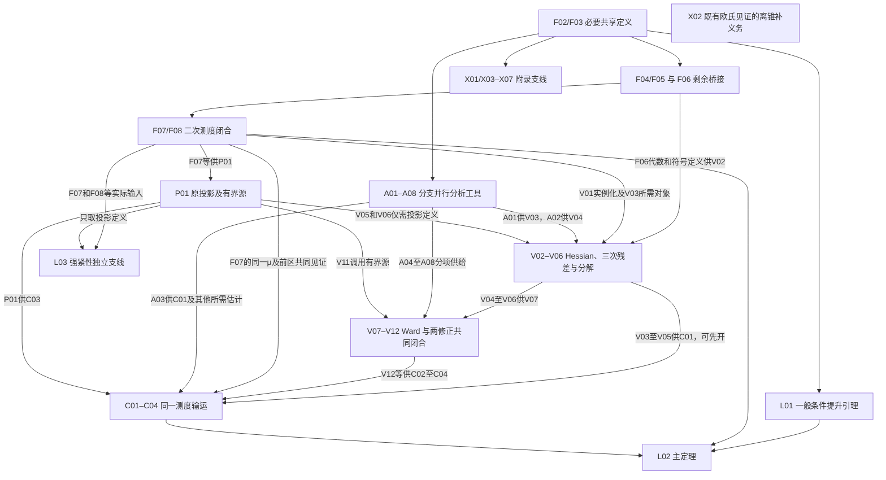

# Burnett 论文形式化：后续整体工作安排

2026-11-17用户更新了[目标续接规则](GOAL.zh-CN.md)：PR就绪后自动推进不依赖其合入main的后续分支和PR。待人工合并本身不再导致整个目标暂停；实际依赖阻塞且无独立任务、需用户裁决或确认阻断时才停止。各历史阶段的无条件“PR就绪后暂停”保留历史含义，当前按新规则执行；main合并仍由人类操作。

更新日期：2026-11-16（经对抗性复核修订）。本文安排后续工作的顺序、并行方式、接口和交付；实际数学状态仍以 [scope.json](scope.json) 及其适用证据为准，登记的切片联系以 [slices.json](slices.json) 为准。

第4节保留早期三线任务约定，第10–15节保留前批交付记录；当前数学续接以第18节为准，并按上述最新GOAL规则自动推进独立后续PR。数学状态仍以scope及其适用证据为准，不重新从初始调查开始。

## 1. 目标、起点和使用方法

最终目标采用 `paper-results` 1.2：本文全部正式数学结果、按标准纳入的关键未编号结果，以及它们所需的定义与证明依赖均在 Lean 中闭合。当前已明确 17 项正式结果和 3 项必做未编号结果，但这一计数不是已经独立核实的范围上限；后续仍核查原文中的独立断言和必要依赖，边界有实质歧义时交用户决定。允许文章专用代码及替代证明；不默认增加 mathlib 投稿要求，也不逐句认证无关背景和所有可选证明路线。

用户已选择信任 A：最终只接受 `propext`、`Classical.choice`、`Quot.sound` 三项基础公理，可直接复用固定库的合适证明。尚未形式化的文献结论可以在开发时作为明确的条件接口，最终必须补齐；不能把关键估计、缺陷测度存在或输运结论藏进结构字段后称为论文证明。

本计划的起点是：

| 项目 | 2026-11-16 的已核实状态 |
| --- | --- |
| 锁定文章 | `paper/burnett.tex`，3475 行；SHA256 `e5e9fc351bbd5540884dc7f2fec42cdba94d591a2d4f5ebb4a409f316823904e` |
| 代码基线 | PR #5 已由用户合并；main 为 `242eebe9d87ef62c15efab8df7741051f0aed260`；[该提交的实际 main CI](https://github.com/Oho1e/Burnett-conjecture/actions/runs/43807809558) 成功 |
| 固定环境 | Lean 4.24.0；mathlib `f897ebcf72cd16f89ab4577d0c826cd14afaafc7`；数学标准 1.2，skill/工程工作流 1.3.1 |
| 组织清单 | 46 片：32 个证明单元、6 个装配单元、5 个规格单元、3 个上下文单元；135 条联系 |
| 已有证明 | F06 点态实/复 Hermitian 代数、规范与物理商的相关结论；X02 正式命题 `prop:cubic` 及其支撑结果 |
| 仍待完成 | 其余 16 项编号结果；3 项必做未编号结果；F06 的几何接入及二次测度共同闭合等必要依赖 |
| 机器证据与语义 | 102 个登记目标、33 份 Lean 源码；174 条 inventory 用于防漏。已审 F06/X02 局部数学解释由用户委托主代理与独立代理确认，不能记为用户亲自阅读 Lean，也不自动覆盖未来新增结论 |
| 全文状态 | `development`，整篇 `verified=false`；原文范围、必要定义与依赖的最终独立覆盖核查仍未完成 |

状态来源分领域使用：scope 继续管理数学范围与证明状态；旧冻结交接记录中 PR5 待合并/执行者待选措辞属于合并前快照。本轮候选已同步 AGENTS、README、scope 工程字段和 X02 下一步指令，保留旧交接作为历史；本表已核实的 PR5 合并提交及其 main CI 更新当时的远端事实。每轮续接仍核实实际 main、适用回执和最新用户指令；这一事实更新不增加后续远端合并或发布权限，也不回写旧冻结证据。

阅读顺序：先看第 3 节整体安排，再看第 4 节近期任务；执行某片时查第 6 节完整依赖表和原切片工作包。第 5 节说明并行支线和共同闭合责任，第 7–9 节规定每轮如何交付、复核和续接。

这是可调整的工作顺序，不是工期或成功保证。阶段之间可以交错：一个消费者需要的直接输入就绪后即可推进，不必等待整个前阶段结束。现有 60–110 个后续 PR 的估算只是低置信度工程预算，不分配固定 PR 编号，也不能用 PR 数、目标数或切片数计算全文完成率。

## 2. 怎样判断“可以开始”和“已经完成”

| 联系类型 | 对执行顺序的含义 |
| --- | --- |
| `proof-input`（证明输入） | 按原文假设闭合该消费者时，需要对应的实际证明。输入未齐时可做明确标记的条件推导，保留所缺前提；开发时额外引入的未闭合前提须最终消除，不能提升为原文结果已证 |
| `definition`（定义） | 先取得所需对象、记号及其准确含义；不要求提供该定义的整片全部证明先完成 |
| `specification`（规格） | 先统一目标、测试类、量词或约定；规格本身不提供结论的证明 |
| `application`（应用来源） | 一般条件引理可以先独立证明；到具体应用时才由来源片提供其前提。例如 L01 不必等待 C04 输运证明完成 |
| `explanation`（说明联系） | 用于理解与定位，不自动成为证明先决条件。例如 X04 不必等待 X03 先证明 |

“完成本轮接口调查”“完成一个条件引理”“完成一个论文结果”“完成共同闭合组”和“完成整篇”分别判断。实际状态只在既有 scope/复核记录中维护，本文件不另建状态数据库。

每个被下游消费的结果，至少要能查到实际 Lean 声明及重要定义、准确假设、来源、适用的机器检查和语义核对。某片已有部分证明时只复用适用部分；新上下文不能把父片整体视作已完成。

切片类型不是完成判据。例如 V05 虽归为 `specification`，其中实际使用的分解及收敛性质仍需要证明；稳定它的定义只允许下游开始工作，不提供这些性质。

当前登记图经结构核对无环；这只说明片间联系的结构，不代替外部基础证明闭合，也不代替共同闭合组对同一见证和参数的核对。

## 3. 整体顺序与可交错的工作线

下表是推荐推进顺序。行号表示工作层次，不构成要求所有任务同步等待的全局屏障。

| 层次 | 任务与推荐顺序 | 可交付成果及后续用途 |
| --- | --- | --- |
| 0：冻结起点、统一必要规格 | F01；F02 → F03；核对 F05 对象规格、A01 分析约定、V01 目标规格；从锁定原文滚动核查结果范围及必要依赖；X10 按实际引用查阅 | 本轮真正需要的对象、符号、量词、固定环境和消费者接口。V01 可先抽出规格；在正物理测度上实例化仍依赖 F07，不将规格当证明。范围核查按已有适用证据增量推进，不把重读全文变成每轮前置条件 |
| 1：近期纵向交付与瓶颈诊断 | X02 离零锥义务；F02/F03 几何定义接入；八类外部接口按消费者优先核查 | 完成一个明确未证结果，同时尽早识别影响主线的大型基础库缺口；三项并行，见第 4 节 |
| 2Q：二次构造 | F04 → F05；F06 剩余几何桥可与二者并行；三者会合 → F07 → F08 | 从原始真空序列构造同一缺陷与正物理测度，闭合 `thm:quadratic`、`cor:base-marginal`。F06 点态成功不代替 F05/F07 的测度证明 |
| 2A：分析工具 | 在 A01 必要定义统一后，并行推进 A01 的交换子证明、A02、A04、A06；随后 A02 → A03，A04 → A05，A06 → A07，最后 A01/A06/A07 → A08 | 实际 Fourier/乘子、冻结、近角求和、修正与伴随估计；可与 2Q 并行。A02 的登记输入是 A01 定义，不机械等待 A01 整片完成；实际调用额外证明时补查对应依赖 |
| 3：投影、Hessian 与完整三次残差 | F07 后推进 P01、V01；所需规格及 F06 输入可用时推进 V02；V02/F05/A01 → V03；V03/V02/A02/F05 → V04；按 P01/V04 定义实现 V05；V02/F05/F06/P01 定义 → V06 | 原投影的真实有界源、Hessian 压缩、完整三次能量、物理/规范分解与 screen 接口。P01 证明、V04 和 V06 的可独立部分并行 |
| 4：Ward、near/far 与两种修正 | V04/V05/V06/A04/A05 → V07；之后 V08 与 V09 可并行；V08 加 A08 等输入 → V10；P01/V08/V10/A07/A08 → V11；全部相关项 → V12 | 在同一冻结能量中闭合规范腿分类、近角项、物理远角修正、低规范 transport 修正；保留 CUBIC-CLOSE 共同整合任务 |
| 5：变背景与同一测度输运 | C01 在 A03/V03/V04/V05 就绪后即可推进，不必等待 V12；V12 等输入齐后 → C02 → C03；共同装配 → C04 | 逐补丁局部化、非局部尾部、两类修正的实际源估计、正确极限顺序，闭合 `thm:variational-transport` |
| 6：提升、主定理与强紧性 | L01 的一般条件引理可在 F02 对象落实后独立推进；F07/C04/L01 → L02。L03 在 F05/F06/F07/F08 与 P01 投影定义可用后独立推进 | 闭合 `lem:lift`、`thm:main`、`cor:strong`。L03 不等待输运；L01 不循环借用主定理或主线输运的存在结论 |
| X：附录独立结果 | X01、X03、X04、X05、X07 按共享定义及各自工具就绪程度并行；X05 → X06；X02 沿近期任务收尾 | 附录正式结果和已批准例子分别闭合，不因主定理成功而自动完成；X05 的显式动理表示不借主定理循环证明 |
| 7：全文范围与最终证据收口 | 汇总从起点滚动开展的独立范围核查，包括 X08；核对 X09 等必要恒等式的实际消费者，再审查当前映射、依赖闭包、确认和机器证据 | 本层是最终收口，不是范围核查或必要恒等式的首次启动点。各条主线和附录均齐全后，才能准备与固定文章/代码版本绑定的整篇完成说明；不因 main 绿色直接发布标签 |

上表只展示主要启动关系；所有直接输入，包括 V10、V12、C02–C04 等多输入任务的完整关系，见第 6 节。



该图只画工作线的主要联系，不是全部 135 条边。聚合节点不能整体用作开工门槛：例如 M 向 P01 供给的是 F07 等实际输入，并不要求先完成 F08；A 向 V03/V04 只供给各自需要的结果，不要求先完成 A08；P 向 V05/V06/L03 只供给投影定义，完整有界源在 V11 等处才使用。C01 可在 V12 前启动。V02 的规格及代数准备也不等待整个测度组闭合。X02 的既有欧氏建模可独立推进，不等待全局几何定义。

## 4. 下一轮可以直接分派的任务

### N1：X02 固定 Fourier 离零锥义务

目标为 `unnum:cubic-off-null-gradient-localization`，锁定原文第 3193 行；精确范围见 [cubic-off-null-localization.md](../statements/cubic-off-null-localization.md)。沿用 `prop:cubic` 的同一 `fSequence`、`wSequence`，保留每个固定光滑紧支撑 χ、固定 δ 和固定 Fourier 截断，再令 n 趋于无穷的量词顺序。

建议先试显式调制频率、Plancherel 与 L² 尾积分路线：从真实函数导出全部正负调制频率及梯度系数，在固定离锥区域控制平移后的 Fourier 尾，最后证明真实乘子的全空间 L² 范数趋零。覆盖锐锥正交投影与光滑有界角截断，零频 a.e. 约定和 Fourier 归一化实际落实。

起始操作：导出 X02 工作包，读现有反例模块及上述陈述，在固定 mathlib 源码中核对 L² Fourier、Plancherel、调制平移和尾积分接口，再做最小类型/证明探针。本轮 Fourier 探针由 N1 负责产生并提供给 N3 复用；需要跨任务的 Fourier 桥时由协调者安排一处实现。本轮已在切片清单补入 EXT-HARMONIC→X02 消费者定位，并重生工作包；该定位不把路线提示变成已证接口。库名相似或缺少缓存都不能作为“已有定理”或“没有定理”的判断。

交付时还需证明 `A(χ∇hₙ)` 与 `A(∇(χhₙ))` 的差由 `A((∇χ)hₙ)` 控制并趋零；不能交换 χ 与非局部投影，不能漏掉投影产生的全空间尾部。若改用现有 H¹ 图闭包对偶的源小量，须补上到实际 Fourier 加权负范数的桥，不能只改符号。

完成判断：对应实际 Lean 定理、同一见证及两种局部化表述的桥接通过机器检查，独立反向核对确认其确实覆盖约定的固定投影结论，再更新原 scope 项；在此前仍为未证。用户已选固定 Fourier 范围，不再询问是否扩大为一般依赖位置的 Ψ⁰ 算子。

### N2：F02/F03 → F04/F06 的共同几何定义

近期只稳定实际消费者需要的最小对象：四维坐标指标、度规与逆度规、容许序列、连接/Ricci、体积密度、余切变量和测试约定。将现有 F06 的 `Fin 4` 实/复张量定义接入这些对象，明确实际 Lorentz 几何数据如何提供代数所需的可逆标架，不把已经带标架的点态模型直接称为任意流形上的结论。

起始操作：导出 F02、F03、F04、F06 工作包，比较 [main-interface.md](../statements/main-interface.md) 与现有代数实际类型；先写图内接口和立即需要的桥，再列出坐标变化、辅助度规变化、局部到全局拼接的义务及消费者。

交付判断：共享定义有可编译的真实实例和到现有代数模块的实际桥接，能够供 F04 或 F06 的下一条证明调用。定义包本身不宣称主定理或 F06 整片完成；点态存在的标架不自动成为全局光滑标架。关键几何对象不能用任意满足目标结论的字段占位。

### N3：按消费者审计外部 Lean 依赖

复用 [library-audit.md](library-audit.md) 的证据分类，按当前 pin 检查实际源码、导入和类型，而不是按数学名称推定库已支持。N3 复用 N1 产生的 Fourier/L² 调查与探针证据，本轮优先独立核查 F05 的微局部提取与定位、A01/P01 的精确交换子界；随后按就绪消费者展开其余类别，不与 N1 重复承担同一初始调查。某项证据需要独立复核时明确其复核范围。

| 外部接口 | 优先核查的实际需求 | 主要消费者 |
| --- | --- | --- |
| EXT-HARMONIC | 先核实际 L² Fourier/Plancherel/调制；再核乘子、Littlewood–Paley、双线性符号及所需有限半范数 | X02、A01–A08、P01、V/C 分支 |
| EXT-DEFECT | 同一子序列的正 Hermitian 丛值微局部提取、全部经典角测试及系统定位 | F05、V03、C02 |
| EXT-COMM | 一阶能量交换子、P01 全空间梯度型 Calderón 界、双线性高槽伴随与精确指数 | A01、P01、A06–A08、V11 |
| EXT-MEASURE | Hermitian 密度、Radon–Nikodym、解体、加权推前、支集及矩测试分离 | F05/F07/F08、L01、附录 |
| EXT-GEOMETRY | 连接/曲率差、真实变分、Lie 导数、坐标自然性、Cauchy 面及流 | F02/F04/F06、V02–V04、L01、X01/X04/X06/X07 |
| EXT-COMPACTNESS | Rellich 对偶、弱星子列、极限识别、插值、全序列子列反证 | F04/F05、C02、L03、X05/X06 |
| EXT-ODE | 光滑局部 ODE、比较、Gronwall、参数极限、零测地线流 | L01、X04–X06 |
| EXT-LIFT | 非仿射完备背景上的 Cauchy 不变尺度、s⁻² 加权全动量提升及局部二阶矩 | L01、L02 |

“主要消费者”是调度提示；正式接口归属及实际新增消费者在原清单中维护。特别核对 P01 需要的 `Π∂b` 梯度型 L² 范数界：A01 交换子能量配对已证也不自动提供此界，不能补进完整场的全局有界假设来绕过它。

已核清的接口交付“直接可用／需要桥接／需要新证明”的具体结论、实际 import/声明/类型、适用条件及探针证据；未定位或准确签名尚未核清者保留“待核”，记录检索范围与所缺证据，不能为了归类而升级为库内不存在或必须另写证明。若需引用特定文献定理，查读准确版本和全文签名后再匹配；引用存在不等于已有 Lean 证明。

大型接口缺失时，按最小消费者拆出基础证明任务，其他就绪支线继续推进。若只是缺库证明，这是实现障碍；只有实际数学差异要求加强原文假设或改变范围时，才把该处选项交用户决定。核查结果会影响后续任务粒度和 PR 预算。

## 5. 并行支线与共同闭合责任

### 可以提前推进的支线

| 支线 | 启动条件与顺序 | 需要保留的边界 |
| --- | --- | --- |
| 强紧性 L03 | F05/F06/F07/F08 及 P01 投影定义落实后推进 | 不依赖 C04 输运，也不必等待 P01 有界源证明；仍需核实其实际 Parseval/尾部工具。保留每个开放区域、每图每 χ 和整个原序列量词 |
| 提升 L01 | F02 对象及本引理用到的几何/测度工具就绪即可证明一般条件引理 | F07/C04 是应用来源，不是证明 L01 必须等待的前件；L02 应用时才实际提供同一测度的矩与输运。不得新增仿射完备假设 |
| X01 | F02 与 P01 所需定义及显式坐标/曲率工具就绪 | 证明原文规定的同一固定紧集上的 L² 源发散，不只展示坐标振荡 |
| X03 与 X04 | F02 相关对象就绪后可以分别启动；X03 的矩例子与 X04 的真实度规构造分别闭合 | X03→X04 是说明边，不能据此串行等待或把旋转张量反例代替几何反例；不擅加真空逼近结论 |
| X05 → X06 | X05 的两极化显式构造先闭合，再用于 X06；相关 ODE/弱星极限工具并行准备 | X05 独立构造全动量表示，不借用主定理；X06 另证明多尺度真空、导数尺度下界和精确零源坐标 |
| X07 | 局部收敛、弱导数及 PR #19 的内禀全曲率桥接 | 冻结证明及独立复跑已验证极限的完整 Riemann 曲率为零。对登记的模块运行工程检查，并在内禀桥接合入后与实际 main 复验。[陈述和证据](../statements/flat-rigidity.zh-CN.md) |
| X08、X09、X10 | X08 从起点滚动做范围与消费者核查；X09 按实际消费者处理必要恒等式；X10 在需要时核文献 | X08 的范围判断不等待 F07 的数学证明；其数学实现仍保留实际输入。X08 不是已批准新增认证集合；发现其含必要依赖或独立结果时按标准核查并在有实质歧义处交用户决定。上下文不机械建 Lean theorem |

### 五个共同闭合点

| 组 | 最终整合位置 | 合并局部成果时重点检查 |
| --- | --- | --- |
| Q-CLOSE：F04/F05/F06/F07 | F07 | 同一全局子序列、完整角协方差、Hermitian 正密度与 Ricci 核、实际正物理测度；有限二阶矩不能代替完整角向对象的自然性 |
| CUBIC-CLOSE：V04–V12 | V12 | V07 的所有规范腿和频率位置分类覆盖；V08/V10 两种修正准确、Hermitian 且可调用粗交换子估计；同一完整能量中数值系数、cutoff、伴随和余项全部归账 |
| TRANSPORT-CLOSE：F05/F07/A03/A05/A08/P01/V03/V04/V12/C01–C04 | C04 | 同一 σ、μ、子序列和测试；投影方程、非局部尾、局部体积因子、参数一致性及极限顺序真实匹配，不把多个独立存在见证拼成同一对象 |
| MAIN-CLOSE：F07/C04/L01/L02 | L02 | 从原文真空假设开始，使用同一全局 μ；对每个全局双曲开放 U 构造 ν，核对局部二阶矩、全动量测试及全部量词 |
| STRONG-CLOSE：F05/F06/F08/P01/L03 | L03 | P01 在此仅需定义；统一紧单位零锥束上的正定常数、投影尾部和任意子列再提取，得到整个原序列的双向结论 |

共同闭合组保留原 [slices.json](slices.json) 的责任。不能为了并行而让一条未证接口依赖它自己的消费者结论。

### 跨片必须共同保留的对象和参数

- F05 提取的子序列与缺陷对象贯穿 F07、V/C 分支和 L02；不能每换测试、补丁或下游片重新任取一个见证却仍称“同一 μ”。
- P01 的原物理投影和实际标量散度方程贯穿 V11、C03；不能用方便的新投影或不同源方程替换后不证明等价。
- 分析约定、Fourier 归一化、实/复 Hermitian 配对、三线性对称化、指数和符号类有限半范数跨 A/V/C 分支一致。
- 已证 X02 反例用于检查分析接口的适用范围：二次特征局部化本身不能充当任意三次能量消失的充分理由；实际 Einstein 三次闭合仍需要完整顶点、Ward 分类和修正估计。
- 固定有限 p*>3、κ，再固定 δ、η 与补丁尺度 ℓ；固定 n 时先恢复上频与角截断；之后固定 δ、ℓ 令 n→∞，再 ℓ→0，最后 δ→0。具体截断恢复顺序及常数依赖沿用 [dependencies.md](dependencies.md)，不要求原文未给出的二阶导数尺度或额外端点估计。
- 每个补丁保留本地体积因子，再以有界重叠求和；不得给每片重复计入整图范数，也不得把对固定 ℓ 的小量写成对 ℓ 一致。

## 6. 全部 46 片的执行定位与直接依赖

下表按锁定论文源码顺序列出，**不是要求按行串行实施**。它展开当前 135 条边：证明列为 `proof-input`；定义/规格列保留原类型；最后一列只列应用或说明边。未列入这张片间图的外部基础证明仍按第 4 节实际核查，不能据“片间输入为空”宣称无需任何数学依赖。

| 切片/原文行 | 工作线 | 本片任务 | 证明输入 | 定义/规格输入 | 应用/说明联系 |
| --- | --- | --- | --- | --- | --- |
| **F01** · 1–89 | 0：对象/约定 | 原文身份与范围 | — | — | — |
| **F02** · 90–168 | 0：对象/约定 | 容许几何与主目标规格 | — | — | — |
| **F03** · 169–351 | 0：对象/约定 | 全篇符号与收缩约定 | — | F02（定义） | — |
| **F04** · 352–389 | 2Q：二次构造 | 连接/Ricci差与H⁻¹紧性 | — | F02（定义）；F03（定义） | — |
| **F05** · 390–429 | 2Q：二次构造 | 共同缺陷与Ricci核 | F04 | F02（定义） | — |
| **F06** · 430–466 | 2Q：二次构造 | Ricci/B代数、物理商及几何桥 | — | F05（定义）；F03（定义） | — |
| **F07** · 467–486 | 2Q：二次构造 | 正测度与二次定理 | F04, F05, F06 | F02（定义） | — |
| **F08** · 487–518 | 2Q：二次构造 | 基底边缘与解体 | F07 | — | — |
| **A01** · 519–600 | 2A：分析工具 | 分析约定与一阶交换子 | — | F03（定义） | — |
| **A02** · 601–735 | 2A：分析工具 | 三次连续性与系数差 | — | A01（定义） | — |
| **A03** · 736–892 | 2A：分析工具 | 系数/测试冻结 | A02 | A01（定义） | — |
| **A04** · 893–1025 | 2A：分析工具 | 角帽、分割与相位隙 | — | A01（定义） | — |
| **A05** · 1026–1245 | 2A：分析工具 | 全尺度与近角求和 | A04 | A01（定义） | — |
| **A06** · 1246–1379 | 2A：分析工具 | 低角延拓与球谐 | — | A01（定义） | — |
| **A07** · 1380–1475 | 2A：分析工具 | 修正算子与高槽伴随 | A06 | — | — |
| **A08** · 1476–1591 | 2A：分析工具 | 正规形配对及截断恢复 | A07, A06, A01 | — | — |
| **P01** · 1592–1719 | 3：投影/变分 | 原物理投影与全空间源 | F05, F06, F07 | F02（定义） | — |
| **V01** · 1720–1744 | 3：投影/变分 | 输运规格及测度实例化 | F07 | F02（定义） | — |
| **V02** · 1745–1809 | 3：投影/变分 | Hessian及核压缩 | F06 | V01（规格）；F05（定义） | — |
| **V03** · 1810–1905 | 3：投影/变分 | 交换子与完整三次残差 | V02, F05, A01 | F07（定义） | — |
| **V04** · 1906–2010 | 3：投影/变分 | 三次作用与循环顶点 | V03, V02, A02, F05 | — | — |
| **V05** · 2011–2052 | 3：投影/变分 | IR相容物理/规范分解 | — | P01（定义）；V04（定义） | — |
| **V06** · 2053–2108 | 3：投影/变分 | screen与自身物理相位 | V02, F05, F06 | P01（定义） | — |
| **V07** · 2109–2262 | 4：Ward/修正 | 完整Ward分类 | V04, V05, V06, A04, A05 | — | — |
| **V08** · 2263–2342 | 4：Ward/修正 | 低规范transport修正 | V07, V05, V06, A06 | — | — |
| **V09** · 2343–2503 | 4：Ward/修正 | near项角增益 | V04, V06, V07, A04, A05 | F03（定义） | — |
| **V10** · 2504–2556 | 4：Ward/修正 | 物理far修正 | V04, V07, V08, V06, A04, A08 | — | — |
| **V11** · 2557–2591 | 4：Ward/修正 | 两修正的共同能量估计 | P01, V08, V10, A07, A08 | — | — |
| **V12** · 2592–2642 | 4：Ward/修正 | 冻结能量完整归账 | V04, V05, V07, V08, V09, V10, V11, A04 | — | — |
| **C01** · 2643–2730 | 3后段可并行 | 局部化、冻结与补丁体积 | A03, V03, V05, V04 | F02（定义）；F03（定义） | — |
| **C02** · 2731–2842 | 5：输运闭合 | 同一缺陷与投影尾部 | C01, F05, V06, A02, V12, F06, V07 | — | — |
| **C03** · 2843–2942 | 5：输运闭合 | 真实标量方程与补丁求和 | C01, C02, P01, V09, V11, V12 | — | — |
| **C04** · 2943–2986 | 5：输运闭合 | 同一μ的全局输运 | C01, C02, C03, V03, V12, F05, F07, V04 | V01（规格） | — |
| **L01** · 2987–3045 | 独立提升支线 | 全动量条件提升引理 | — | F02（定义） | C04（应用）；F07（应用） |
| **L02** · 3046–3062 | 6：主定理装配 | 主定理全部量词装配 | F07, C04, L01 | F02（规格） | — |
| **L03** · 3063–3115 | 独立强紧性支线 | 全序列强紧性 | F07, F08, F06, F05 | P01（定义） | — |
| **X01** · 3116–3172 | X：附录支线 | 调和坐标平直源发散 | — | F02（定义）；P01（定义） | — |
| **X02** · 3173–3212 | 1：近期优先 | 三线性反例及固定离锥补义务 | — | — | — |
| **X03** · 3213–3240 | X：附录支线 | 旋转零矩张量反例 | — | F02（定义） | — |
| **X04** · 3241–3304 | X：附录支线 | 真实度规无输运表示反例 | — | F02（定义） | X03（说明） |
| **X05** · 3305–3359 | X：附录支线 | Rosen显式两极化表示 | — | F02（定义） | — |
| **X06** · 3360–3387 | X：附录支线 | 多尺度Rosen与零源坐标 | X05 | F03（定义）；P01（定义） | — |
| **X07** · 3388–3424 | X：附录支线 | 全曲率平直刚性 | — | F02（定义） | — |
| **X08** · 3425–3446 | 起点审范围，7收口 | 三个例子的范围核查 | F07 | F02（定义） | — |
| **X09** · 3447–3463 | 依消费者落实 | 必要辅助恒等式 | F07 | F02（定义） | — |
| **X10** · 3464–3475 | 0及按需核引用 | 参考文献与结束上下文 | — | — | — |

## 7. 每轮多代理工作的具体安排

协调者先读取当前 main、scope、切片和适用证据，选择能够解除真实阻塞的少数就绪任务。近期优先 N1/N2/N3；后续按已交付接口滚动调度。并行度取决于工具容量、依赖和整合成本，不固定代理数量或工作线配额。

对一个任务，已有切片工作包加几段补充即可交接：本轮准确子目标、原文位置、可用的实际声明、缺少的输入、独占写入文件、预期交付和证据位置。不要求重新填写多份任务表。正向实现者可交换构造思路；独立反向复核由未参与该项构造的代理承担，先从实际类型及重要定义读出数学含义，再比较原文。

共享几何定义、库入口、scope、切片清单和依赖锁由协调者整合。不同分支使用独立 worktree；共用检出目录时不允许各代理自行切换分支。公共 `.lake` 或依赖变更安排独占写入，读取冻结依赖、写入自有输出目录的检查可以并行；不复制其他工作树的缓存或修改共享依赖源码。

一个成果可检查时立即交独立复核，同时其他就绪任务继续。复核返回异议后先核对实际源码和假设，必要时实现者与复核者交叉反驳；未解决的正确性问题不凭多数同意消除。角色改名不把自审变成独立审核。

接续分工时核实执行者是否仍在运行。已经结束的任务须通过显式续派重新启动；单发通知不算已开始工作。协调者观察到实际任务状态或新产物后再记录推进，避免等待尚未启动的任务。本轮出现过此类延误，已用显式续派及独立文件分工纠正；没有据此补写未发生的复核。

## 8. 从切片到 PR：交付和检查

一个 PR 围绕一组可独立消费和复核的数学成果组织；同片可有多个 PR，多个紧密相关的小片也可合并交付。新增证明、实际库入口、论文目标登记、相关 scope 状态和必要数学说明随同一候选整合，不能先合代码后让检查器长期看不到它。辅助引理不必逐条成为论文审计目标，但须接入受审结果的真实证明依赖，独立定义或计算另做适用核查。

基本顺序为：功能分支/隔离实现 → 实际 Lean 检查 → 冻结本轮源码 → 独立反向复核 → 协调者整合 → 最新 main 的实际合并候选 CI → 交接就绪 PR。最终合并执行者沿用当轮明确选择；本文件不授予代理远端合并、自动合并、删分支或发布标签权限。用户报告合并后核对真实 squash/main 提交和该提交的 push CI，成功后才记录本轮整合完成。

可直接使用的现有入口：

```powershell
# 以下命令在论文工程根目录运行；把 X02 换成当前任务的切片 ID。
python scripts/prepare_slice.py X02 --repo .
python scripts/check_slices.py --repo .

# 数学代码或相关工程输入有变更、需要本地完整候选检查时使用。
$env:PATH = 'D:\Chatpgt\Lean形式化\.tools\lean-4.24.0-windows\bin;' + $env:PATH
python scripts/check_project.py --repo . --lake 'D:\Chatpgt\Lean形式化\.tools\lean-4.24.0-windows\bin\lake.exe'
```

局部实现先做适用的增量检查，再在候选交付时做完整检查；纯计划排版变更不触发重建整套数学证据。检查器、CI 或依赖边界工具有变更时，才按影响补维护负例与独立工具审查。

机器检查、公理审计、语义复核、确认、PR 就绪、实际合并和 main CI 分别记录。旧证据可在核实当前适用范围后复用，不把旧 PR 绿色当成新 main 的证据。main CI 失败时先修复受影响整合，其他独立实现可以继续；不删困难目标或放宽保护恢复绿色。详细执行沿用 [github-workflow.md](github-workflow.md) 与 [parallel-workflow.md](parallel-workflow.md)。

## 9. 需要用户决定的事项及计划更新

下列情况才将具体原文、选项和影响交用户抉择：原文模糊条件必须精确化且存在实质差异；证明必须补加假设或改变结论；未编号结果是否纳入存在实质边界问题；拟改变固定环境、信任或最终认证范围且超出现有授权。一般开发默认其余独立工作继续；2026-11-16用户进一步明确本目标遇到需人决定或确认阻断时停止等待，该轮指令优先执行，保存当前证据并停在具体交接点。已明确的 A 信任政策、X03/X06 目标和 X02 固定 Fourier 范围不重复提问。

新增数学解释在独立代理复核后，按本项目约定和实际委托交用户/作者确认。已有 F06/X02 的委托确认只在其实际范围及版本适用时继承；不能用它替代未来结果或整篇的确认。最终标签仍需全部范围与依赖闭合、独立语义及覆盖复核、所需确认和实际版本证据齐全。

每轮只更新本文件中受影响的“下一步、依赖判断、路线选择和证据入口”；数学状态更新原 scope，详细推导留原证明记录。触发重排的实际原因包括：共享定义改变、基础接口调查有新结果、发现反例/原文缺口、用户改变范围、某条实现路线成本显著变化。局部变化只重查相关消费者，保留无关已核实成果。

原计划撰写及对抗复核阶段没有新增Lean证明；本轮正式执行的数学进展另见下节。锁定论文、数学标准及依赖锁保持不变。没有需要再次询问的既有范围或信任选择。

## 10. 从第一批基础候选直接续接

本节保留第一批候选交付时的准确续接点；其中稠密性、L² Fourier及连接差任务的本轮新进展见第11节。

本轮新增35个支撑目标；实际范围见[第一批基础证明](../statements/initial-foundations.md)、[独立回读](../statements/initial-foundations-review.md)及[依赖调查](dependency-audit-round1.md)。候选的137个目标、47份Lean源已通过本地组合检查，所有声明仍只是其实际范围；尚未合并时不称本轮主线整合完成。

- **N1**：同一f/w、任意原有实C∞c截断及固定δ的四分量全空间离锥Fourier能量已证，真实L² cutoff位置桥也已实现。下一任务是依赖调查中准确列明的Schwartz→实际L²稠密桥、等距扩张及锐/光滑投影构造，随后实例化已证结论，闭合原3193父目标。
- **N2**：真实非退化双线性形式与给定正交基已接入旧F06证书，含非空模型；它没有提供光滑/全局选择。继续核对实际几何Lorentz数据的表示，提供消费者所需的基/坐标桥，并推进F04实际连接/Ricci差；只在相关消费者需要时处理局部光滑或一致性，不额外要求全局光滑标架。
- **N3**：可数测试共同子列已证；F05/A01/P01仍有准确的待核分析接口。继续按消费者补真实PDO测试有界性、密集测试延拓、正性与系统核等最小必要步骤，不把本轮可数抽取或RMK组件等同于完整缺陷测度提取。

本轮候选在独立回读和当前合并候选CI齐全后交接功能PR；最终合并仍沿用当轮选择。后续从实际新main和上述准确缺口续接，不重复已冻结且仍适用的初始探针或局部证明，也不把支撑数当作论文完成比例。

## 11. 第二批构造及下一个交接点

本节保留PR6合并前第二批本地候选的记录；PR6已由用户合并，当前事实与新增DenseTests见第12节。

本轮从PR6已复核头 `d143c3709466bd2900e098c573c1691d987226da` 建立后继分支 `formalization/l2-fourier-extension`，主线未变。2026-11-16T11:19:13Z实际只读观察：PR6仍未合并，main仍为 `242eebe9d87ef62c15efab8df7741051f0aed260`，PR6原候选CI通过。后继分支的本轮代码不因此继承该旧CI。

具体实现和未闭合界线见[第二批数学解释](../statements/second-foundations.md)、[独立回读](../statements/second-foundations-review.md)及[冻结绑定](../statements/second-foundations-source-bindings.json)。新构造共9模块，登记36项支撑目标和原3193父目标；这是依赖登记，不是全文完成率。

- **X02**：已实际构造Schwartz→真实L²稠密、Fourier等距同构、真实固定有界乘子及锐锥正交投影；同一f/w的全部四分量、任意固定原χ、固定δ/符号及两种cutoff位置均接到物理全空间L²。零频和非紧输出尾已处理。后续消费从真实父声明及其绑定出发，不再把已有Fourier能量或真实投影记为开放数学接口；作者确认、组合机器检查和主线整合各按实际回执判断。
- **F04**：精确局部度规连接差、零挠坐标连接场的真实Ricci差及与旧F06符号的桥已有实现。下一步先从局部度规正则性统一实例化真实连接场，补逆度规一致界和Eₙ估计；再实现紧支撑测试的积分分部、弱Ricci识别及嵌套cutoff下H⁻¹紧性。**精确Ricci二次修正=−旧B** 已有Lean定理，后续弱矩装配须保留负号。不能因代数恒等式已证把这一整片关闭。
- **F05/A01/P01**：已有可数共同抽取及正半定密度的实际range≤ker工具。接着构造真实算子测试的一致界和正泛函/密集延拓，再接局部测度及同一全局见证；系统a.e.压缩为零与协方差/Gram变换须另证。可复用本轮真实固定Fourier乘子，但它不提供变系数PDO、Calderón交换子或Rellich紧性。

本轮局部构造遇到的缓存损坏已按固定源码修复，没有新增数学假设或更改锁。所有新增成果冻结后滚动交未参与该项构造的代理实际回读，协调者统一库入口、登记、说明和候选检查。

**当时的主线整合交接（现由第12节更新）**：PR6的最终合并执行尚无代理授权。待本轮本地候选可复核后，将PR6的具体就绪版本与本轮后继产物一并交接，请用户选择本次由本人合并或明确授权代理合并；不从此前用户手动合并3/4/5推定授权。按本轮用户的停止条件，在这个需人决定的交接点保存产物、停止目标并等待指令。获得决定后先核实际新main/CI、重算后继差异，再准备新PR及其实际main组合CI；不把本轮本地通过写成新PR或main已绿。

## 12. PR6合并后的当前续接

本节为PR7合并前的第二批交接记录；PR7已由用户合并，当前事实及下一步见第13节。

用户已手动合并PR6。实际main为`b4b27302556c62617798a46a22e744035fcd4602`，[该提交push CI](https://github.com/Oho1e/Burnett-conjecture/actions/runs/43861529888)成功；其文件树与受审d143完全一致，下载的真实137目标/47源输入与旧PR6候选回执逐项相同。第11节当时的PR6执行者问题已解决，不重复询问。

原本地第二批67fa已保存引用后仅将自身增量变基到实际新main，原9源及整个候选树不变。继续并行取得F05的`DenseTests`：从显式统一opNorm界与Dense D上的收敛构造实际唯一CLM极限、全点收敛及同C范数界，另有趋零误差下的非负极限。E不须完整；不是算子范数收敛，也不提供原PDO的sup界/Gårding输入。新源已单独实际编译、六项类型/公理查询与独立回读通过。

当前第二批候选共10新模块、38支撑目标加原3193父目标，合计176目标、247条inventory、57份Lean源。实际源绑定和独立回读仍用原second-foundations记录，旧67fa/174目标及报告保留历史身份。新增DenseTests并未关闭F05；下一最小工作见[两次延拓与接口](dependency-audit-round2.md)：先核实际光滑PDO测试及有限符号半范数界，再证明趋零误差正性和固定支撑order-unit C⁰界，才保共同支撑扩到整个真实C_c并接RMK。不能跳过其中任一步。

本轮先将已核第二批登记、入口、治理状态与准确解释一并准备新PR，取得基于实际main的组合CI及对应输入证据。最终合并仍保持代理prepare-only，交人类执行，不由用户手动合并6扩张未来代理合并权限。就绪后按用户的停止条件保存并等待合并指令；不再次要求选择已解决的PR6执行者。新解释确认及整篇最终条件分别保留，主线整合不产生验证标签。

后续数学继续第11节的F04局部正则/逆界/Eₙ→弱极限/H⁻¹，以及上述F05真实分析输入；已证Fourier与一般延拓工具直接按哈希复用。

## 13. PR7合并后的局部控制及下一输入

本节保留PR8合并前的局部控制交接，当前main及下一步见第14节。

PR7已由用户手动合并为main`d5c3d06e55c39776716f1fc2e4baddebd032ab00`。该[main push CI](https://github.com/Oho1e/Burnett-conjecture/actions/runs/43870473532)成功，真实artifact14227532345的176目标/57源及项目/目标全部输入与原受审2ac候选相同，指纹e2da0f479ce345fc7f118a554669b125851958d0154d64f9584568486b557da2。本地main已快进，不重复询问PR7执行者；该人类操作不扩未来代理merge权限。

本批在新功能分支`formalization/f04-inverse-local-analysis`取得9新模块、24支持目标，合计200目标、271条inventory、66份Lean源。准确数学与冻结版本见[局部控制](../statements/local-metric-control.md)、[独立回读](../statements/local-metric-control-review.md)及[绑定](../statements/local-metric-control-source-bindings.json)。九源78公开声明已经实际独立核签，仅三公理；机器组合及远端CI按当前版本另取，不继承旧176绿色。

F04已可消费：真实矩阵/FiberMetric逆扰动及吸收、连续逆与紧集B、原度规分量uniform到实际逆控制；局部背景C¹到真实Γ连续/紧集G；Christoffel/协变jet范数6/8与误差192；最终`metricConnectionError_uniform_of_coordinate_bounds`实际组合这些输入，去掉B/G/J、小扰动及Γ连续的中间前提。一般可测集上的真实Lp∞桥另有独立证明，MemLp仍须在实际消费者中取得。

**下一最关键的原条件桥**：原文91–105的D是∇ʳ，范数是物理r范数。必须从真实辅助连接、r与坐标张量范数在固定紧集的比较及图拉回，取得当前raw坐标hyp，不把两者改名视作相同。将a.e.一阶界变为K上点态界时，应在包含K的较大固定紧邻域中使用原假设和连续性，不能从任意可能零测的K自身L∞界直接推出其每点界。局部C⁰一致性、实际dV及E的可测/MemLp和物理范数对应也须闭合。此为未完成证明接口，不是新增可接受原文假设；未发现需用户改变条件的歧义。

此后再进行原真空序列的固定测试积分分部、弱Ricci识别、嵌套cutoff下H⁻¹紧性。F04整片及二次闭合组仍OPEN，局部坐标E一致收敛不代替它们。

F05已多取得真实正C_c泛函及子空间在固定支撑的C⁰/order-unit界和实际Urysohn常数。后续继续实际光滑PDO测试一致界、趋零误差正性、光滑子空间cutoff及保共同支撑逼近、兼容正线性延拓到全C_c，才实例化RMK及共同全局测度；不能以四条局部界当PDO正性或测度存在。

本轮先将上述已冻支持代码、入口、登记与说明一并交付功能PR，补当前完整检查及实际main组合CI。就绪后保持人类合并交接，按用户停止条件保存并等待；不自动合并、删分支或发布标签。获得合并通知后先核实际main及push CI，再从本节的原条件桥续接，不反复重做已证局部代数。

## 14. PR8合并后的真实辅助范数与当前续接

本节保留PR9交付前状态；用户已合并PR9，当前事实与下一步见第15节。

PR8由用户手动合并为main`0fa26471900c596e4b6767609be43cb6e94befc1`。该[push CI](https://github.com/Oho1e/Burnett-conjecture/actions/runs/43889680267)成功，真实artifact14235474654的200目标/66源、完整目标及项目输入与受审8d09候选相同；main整树相同，输入指纹634a389d3e8cc6dac1f7b4d7a3a325235d7e8185bed27e2b57d325527588e544。旧PR8交接保持历史含义，不重复申请执行者或扩大代理merge权限。

本批在功能分支`formalization/f04-auxiliary-r-norm`增加8模块、27支持目标，合计227目标、298条inventory、74份Lean源。准确数学与源码身份见[辅助r控制](../statements/auxiliary-r-control.md)、[独立回读](../statements/auxiliary-r-control-review.md)及[绑定](../statements/auxiliary-r-control-source-bindings.json)。85条显式声明已实际独立全源/类型/公理核签，仅三基础公理；新组合及远端CI仍按当前候选另取。

当前可消费的真实输入：

- 正定协变r矩阵的二/三张量范数为实际逆r全有序收缩；Gram正定与逆、sqrt能量及真实Hilbert范数对应、由r对角连续和紧性导出的统一Pi sup控制均已有证明。控制因子来自r对角，不能用r逆对角；不重做generic Gram。
- 实际Γr由r分量/逆/Fréchet一阶jet构造；真实auxiliaryPerturbationJet给Dʳh的坐标表达，compact给Γr界，反解raw jet。不是把Dʳ改名为偏导。
- 在较大紧S上物理L∞界经真实范数比较和内点连续性提升为K逐点界。S由K⊂U实际构造，不能从restrict K的ae界直接推出K每点界。保同一固定S、同一D对所有n。
- 正密度保restrict的零集/ae/∞半范数；实际rho=sqrt(detR)构造坐标metricMeasure r，给局部正开集性质并消去任意μ/hpos输入。局部可测、正性均实际证明，无额外全域正性或正下界。
- 最高层RiemannianVolume.metricConnectionError_uniform_and_LInfinity从该实际measure下的物理Dʳh局部L∞界及原局部正则/度规分量一致收敛，得真实E的uniform趋0，并内部构造其MemLp∞及实际toLp元素的范数趋0。E的输出范数仍为组件sup；并未完成混合(1,2)E物理r范数的识别。

**下一关键任务**：从原流形M的真实r、D=∇r与体积实例化上述局部对象，证明图拉回、张量范数和局部C⁰的自然性，特别是实际流形体积在图下的推前与坐标rho测度的关系；不能用同名或假设字段略过。混合型E范数另按其上下指标构造。固定图/紧集所需比较即可，不额外要求全局光滑标架。已有局部代数、正密度和L∞工具按冻结哈希复用。

几何桥明确后，继续原真空序列的固定紧支撑测试积分分部、弱Ricci识别及嵌套cutoff下H⁻¹紧性；精确二次修正=−旧B的负号保持。F04整片及二次共同闭合组仍OPEN。本批没有增加统一D²gₙ估计，也未关闭F05；F05继续真实PDO一致界、趋零误差正性、保共同支撑逼近/正延拓及同一全局测度。

本轮候选需完整机器检查、实际最新main合并候选CI及独立工程/工件核对后交人类合并；代理不merge、不开auto-merge、不删分支或发验证标签。就绪后按用户停止条件保存并暂停；合并通知后核实际新main及push CI，再从本节续接。新增语义确认仍待记录，合并不提升全文认证。

## 15. PR9合并后的真实图、物理误差和当前工作

本节保留PR10交付前记录；用户已合并PR10，当前事实及续接见第16节。

PR9由用户手动合并为main`2ff3d3616db3a99e1c600cc4bf77977a32f31117`。该[push CI](https://github.com/Oho1e/Burnett-conjecture/actions/runs/43996358073)成功，artifact14289189402的227目标/74源及全部target/project输入等于受审31a2候选；main整树相同，输入指纹6e230e9c1d2bf50d569a96bfafd7103bed1603a0d7832be4139f4e61bbe46266。代理没有远端merge，本地main已快进；旧交接不扩大未来执行权限。

本轮功能分支`formalization/f04-manifold-chart`新增10模块、27支持目标，合计254目标、325条inventory、84源。实际数学与冻结输入见[解释](../statements/chart-geometry.md)、[独立回读](../statements/chart-geometry-review.md)及[绑定](../statements/chart-geometry-source-bindings.json)。105条显式声明（17定义、2重要abbrev、86定理）的独立全源/类型/公理核签通过，仅三基础公理；实际完整候选检查与远端CI另取新回执。

已可直接消费：

- 实际四维smooth manifold的真实切丛r及逆图平凡化，给chart.target上矩阵PosDef、对称、非退化与分量C∞/C1。frame被识别为逆图的真实mfderiv，不用TangentSpace的defeq冒充恒等映射。不会为r重选已有Norm/toCore实例。
- 实际chartTransition的导数和切丛cocycle，给同一真实fiber bilinear B的两图矩阵law。B可以非正定；r.inner只是实例。真实协变二/三张量拉回的物理范数严格不变，未把raw偏导当张量。
- 上/下/下三槽的真实mixedGram=R⊗Rinv⊗Rinv、能量/sqrt范数与双向compact控制，接到实际E的物理norm标量Lp∞。仍使用真实标量Lp∞，没有假设bundle-valued normed Lp存在。
- 原文34/337明确dV_g=sqrt(abs(det g))dx。LorentzVolume已单独实现该真实密度及Jacobian/∞转移，不把g套进positive-only sqrt(detR)。背景g₀非退化在U上实际推出密度正，固定同一g₀测度控制所有n的Dh和E结论。
- same-B矩阵law实际接到两类measure的局部overlap推前：正定r与绝对det几何密度都无额外hR/ρ/measure-equality假设。它们是局部相容数据，未构造global M measure。

下一阶段的必要桥：

1. 按原文构造真实global Lorentz g₀/gₙ的bundle字段及所需原有属性，用当前同frame/同B工具实例化其图内正则、非退化和C⁰loc一致收敛。r的光滑图数据已证，不重复；Hom的opNorm不等于物理Hilbert tensor norm。若改用等价见证来表达时间定向或其他原属性，须证明等价而非静默加强原假设。
2. 构造或复用真正intrinsic Levi-Civita D，证明其图内表达等于computedΓ/auxiliaryPerturbationJet，核raw jet中的非线性坐标项。不能因为两者同名就关闭原Dh接口。固定图的高阶导数可参与变换律，但不增加uniform D²gₙ界，也不要求global smooth frame。
3. 从已证的same-B绝对det局部measure相容性构造M上的实际几何volume及chart推前定理；使用原Hausdorff/second-countable条件建立需要的覆盖与measurability。局部compatibility不能代替这一步。与第2项可在共同对象稳定后并行。

三桥明晰后推进原真空序列的紧支撑测试积分分部、弱Ricci识别与嵌套cutoff H⁻¹紧性，精确二次修正=−旧B符号保留。F04及二次共同闭合组仍OPEN；F05继续真实PDO一致界、误差正性、保支撑延拓/逼近及同一全局测度，不能用已有局部工具代替它们。

交付顺序仍为实际独立回读→完整当前候选检查→最新main组合CI及工件核对→人类merge交接。就绪后依用户停止条件保存并暂停，不merge/auto-merge/删分支/发标签。收到合并通知后核实际新main及其push CI，再从本节必要桥续接。新数学确认与全文认证分别判断。


## 16. PR10合并后的全局体积、物理收敛与连接续接

本节保留PR11交付前状态；用户已合并PR11，当前事实及续接见第17节。

用户手动合并PR10为main14cfa2fd2ac727c7e0e678682f163a8af7e8af24，整树等于受审c769候选。[push CI](https://github.com/Oho1e/Burnett-conjecture/actions/runs/44010759796)成功，artifact14296309421的254目标/84源及全部target/project输入与受审PR10相同，指纹98743c22462debe4f42e86b503269b7abbca216809549cb3aef87961f16e3b11；ZIP SHA63e7e28f429c6293ad5382dd25fb113882e372b58282ab57b4ab7d1113dccce9。代理未远端merge，本地main已快进；旧交接保持历史身份，不扩大合并权限。

本批formalization/global-geometry-inputs新增9模块、31支持目标，累计285目标/356inventory/93源。123公开声明已分别完整原源/类型/传递公理独审通过；三公理、原文、依赖锁及旧254目标/325库存/83数学叶源保持。准确实际对象、输入与边界见[说明](../statements/global-geometry.md)、[独审](../statements/global-geometry-review.md)和[绑定](../statements/global-geometry-source-bindings.json)。当前完整候选机器检查和远端组合CI另取新回执。

已经可直接消费：

- MeasureGluing的真实disjointed可数测度和、任意额外相容局部域的限制定理及唯一性。ManifoldVolume已由真实same-B局部transport相容与原SecondCountable推出global geometricMeasure及所有preferred chartAt(c:M)的推前公式，包含empty M和子覆盖选择无关。最终caller没有hcompat/cover/mu/chartlaw字段。这是底流形dV_g，不关闭相空间缺陷mu任务；任意maximal-atlas/Radon/局部有限性质未宣称。
- 真正Hom丛smooth B的图内C∞/C1、fiber对称/非退化；physicalNorm2为实际Hilbert张量长度，actualchart矩阵可逆性及preferred图不变已证。M紧集上的明确物理C0loc可直接推出固定chart compact上分量一致收敛，比较常数来自同一r且不依赖n。完整Lorentz signature/timeorientation仍未实例化，不把一般字段支持等同于全部原数据。
- 真实coordinate向量场affine derivative及诱导cov2、实际varying-vector pairing消项、computed metriccompat/torsion、同一g1-g0/r的auxiliary jet对应已证。root的LC系数唯一性及包含非线性H项的affine二阶jet变换代数已证；实际Jacobian/Hessian识别与全局LC未闭合。显式Matrix逆及非对角压力已核，不使用Tensor2逐项倒数。

下一阶段按依赖推进：

1. 对真实smooth chartTransition证明所需二阶链式法则和Hessian下槽对称，将实际r分量的一阶jet识别为已证三项transformedJet。消费现成二阶变换代数，证明两图局部affine operator对同一向量场相容，构造真正global LC并证明smooth-section闭包；再用唯一性识别原D=LCr。不能把这些等式作为structure字段后称闭合。
2. 接同一全局cov2扰动的诱导导数到已有auxiliaryPerturbationJet。按消费者需要补实际global cov3/混合tensor物理norm图识别，将原intrinsic Dh局部L∞界经真实geometricMeasure图公式送到坐标条件。保原固定紧集及较大紧邻域方法，不能从可能零测K自身的ae界推出逐点界。固定图二阶项属于固定系数，不增加uniform D²g_n界或global smooth frame。
3. 从真实smooth非退化背景字段补所需体积局部有限/正性及更广图族扩展；与第1项可按共同对象稳定程度并行。完整Lorentz signature/timeorientation的实际模型及已有F06给定正交基证书之间的实例化，在相应消费者需要时补齐，不复用给定基当存在性。
4. 原条件桥齐后继续固定紧支撑测试积分分部、弱Ricci识别和嵌套cutoff H⁻¹紧性，精确二次修正=−旧B负号保持。F05继续真实PDO测试有界性/误差正性/保支撑延拓与同一相空间缺陷测度，不将上述base volume当该缺陷measure。

本批来源绑定之后依次做完整285/93候选检查、实际最新main合并候选CI及工件独审，再交人类merge。代理不merge/auto-merge/删branch/tag；就绪后按用户条件停止，保存并暂停，收到人工合并通知后核真实新main/push CI再续接。旧确认不扩大，新作者确认待记录，整篇verified=false。下一轮新增源冻结前仍核LF单EOF/Git过滤字节，声明计数须包括同行属性。


## 17. PR11合并后的实际图与全局连接续接

用户手动合并PR11为main cc13fd23a7d72e9cc05612b389d7f4a5944d761b，整树等于受审e0345b2。[push CI](https://github.com/Oho1e/Burnett-conjecture/actions/runs/44020822875)成功，artifact14301023073的285目标/93源及全部target/project输入与受审PR11相同，指纹b951de598470c3bc48d6f09266fefe1bc3d1ead3776ad52a1ddea287c95e5c77；ZIP SHA a770db04a40ed0ba0e56ccdabf27c32b7a9c60f94f6d61bd1f72d2548d81c59f。恢复后再次只读核实main、该CI及保护匹配，未发生main变化。代理未远端merge。

本批formalization/actual-chart-connection新增12模块、39支持目标，累计324目标/395inventory/105源，102公开声明均完成逐源独立回读、实际全类型/公理核签；准确对象与未闭合项见[说明](../statements/actual-chart-connection.md)、[复核](../statements/actual-chart-connection-review.md)及[绑定](../statements/actual-chart-connection-source-bindings.json)。原文/锁/标准/三公理、旧285目标/356库存/92数学叶源保持，当前完整机器/组合CI/工件证据另取。

可消费的新证明：真实C∞ chartTransition及其实际二次Fréchet导数H、same-B三项metric jet、保留H的computed连接变换；真实切丛向量场坐标/光滑双向桥及求导law；图内affine operator相容和真正global derivative、由实际inverse/jet正则消去Γ光滑前提的截面光滑封闭。GlobalConnectionLaws给出实际连接运算律；真实scalar mfderiv及mathlib mlieBracket坐标桥取得全局metric compatibility/zero torsion，辅助r由其原光滑、对称、正定性质实例化。这里没有声称关于一切抽象全局连接算子的唯一性。

同一真实geometricMeasure还由B光滑取得图内与全局紧集有限、局部有限，由另加原非退化条件取得非空开集正性。它是底流形dV_g，不是F05缺陷μ；Radon与任意maximal-atlas扩展未宣称。

继续按实际依赖推进：

1. 接同一全局cov2扰动的真实诱导导数到既有auxiliaryPerturbationJet，构造真实cov3及物理r范数的图识别；经已证几何体积图公式将原intrinsic Dh条件变成所需坐标一阶界。保持同一r、固定紧集/较大紧邻域及较大邻域ae到逐点论证，不增加uniform D²g_n或全局光滑frame。完整Lorentz/timeorientation模型按消费者所需补齐，不能由一般B支持冒认原admissible全部完成。
2. 上述原条件桥齐后做固定测试积分分部、弱Ricci与嵌套cutoff H⁻¹紧性，保持精确Ricci二次修正=−旧B。F05继续实际PDO界、误差正性、保支撑延拓和同一相空间缺陷测度，不能用base volume替代。
3. 按[GOAL](GOAL.zh-CN.md)，本PR就绪并保存证据后，自动转向不依赖它先进入main的数学支线。X03旋转零矩反例可按实际main已有Minkowski/Fourier/积分分部工具调查；其F02入边是定义，X03→X04是说明联系，不机械等待本批LC。完整无输运反例仍需真实正测度支撑迫定和原量词，局部代数/测试函数成功不关闭X03。无可执行独立任务、需用户裁决或确认阻断时才停止。

先做当前完整候选机器检查、实际最新main组合CI及工件独审，再交人类合并；就绪本身不暂停整个目标。main变化则刷新受影响候选及检查，不能拿旧绿色冒充新组合。代理不merge/auto-merge/强推/删branch/tag。新作者确认仍待记录，整篇/F04/F05不升级。


## 18. PR12进入main后的并行续接

本节保留PR13交付前记录；PR13已实际合入main，当前续接见第19节。

远端API确认PR12于2026-11-17 11:42:12 UTC合入main42508e05fbc45326e15797d978eb531e3484b837，整树等于受审0c96620e。[main push CI](https://github.com/Oho1e/Burnett-conjecture/actions/runs/44076390546)成功；原始artifact14325064567的324目标/105源及全部target/project输入与受审PR12相同，指纹9dd0759daf4e665e08d8a80c944dbd704eee0afe9b5a5a1d8d1996cf053052b8，ZIP SHA29b985a276da8386f729afade37390721216c7130bd29c9d184dd1034d84dc58。代理未远端merge；旧PR12待人类合并报告是11:39:35观察的历史封存，不回写为合并后证据。

已从实际main自动建立formalization/rotating-null-moments，基线CI成功，无需因等待合并停止。本批数学尚在推进；下面列的是当前真实工作与准确缺口，不表示X03或整篇已经完成。

- X03：已有旋转T的全部点态性质、真实角延拓与canonical Hamilton识别、实际截断/统一导数界/缩放、四维保测分离、真实积分分部及测度积分误差界。单位余球真实测度模型、完整moment→00/12及最后大R矛盾已实现；完整bundle含全部T性质与¬∃μ。10源194声明已独立回读/全类型公理及推广delta核签，登记354目标/424库存/115源（29支持加原父目标）。当前完整候选检查与组合CI另取，不沿用main324/105绿色覆盖新增源。
- 允许替代证明的既定标准在此适用：选a_R=χ(t)η(x/R)Fodd(ξ)，时间项由12矩和IBP给非零R³，空间误差由00矩界为R²，取大R反证。此法保留两个时间方向和原全部测试，不额外要求支撑分类或分支权重；没有声称已形式核验原文fold/branch那条可选证明路线。X03最终结果及全部T性质仍全部必做，不缩成一个局部代数例子。频率的物理单位条件是euclideanSquare ξ=1，不能拿Covector的Lean sup范数单位球替代。
- 原几何Dh主线同时继续：私有31声明候选已证明真实dualDerivative/cov3、完整任意fiber图无关及所有preferred图下同r/g1−g0的auxiliaryJet对应，逐源独审在进行。物理cov3 Hilbert范数、tensor bundle光滑及原Dh条件装配仍OPEN；该候选尚未进入本X03分支的生产代码，也不混算main已交付内容。
- 三子代理分别负责X03剩余模型、物理cov3范数和独立反向复核；协调者负责实际μ反证、公共源码/范围登记/合并候选。各写独占文件或私有目录，公共构建和Git只由协调者操作。一个成果冻结后滚动独审，其余就绪任务继续，避免全局等待屏障。

接续以scope的数学状态及本轮实际源/回执为准。证据入口为工作区proof-scratch/pr12-ready-and-x03-rotating-moments-2026-11-17与各.project-verification独占目录；这些目录只是证据/工作包，不是工程import来源。后继PR最终仍需配套源、入口、登记、准确说明、完整机器检查、最新main组合CI和工件独审；整篇verified=false，新解释作者确认不自动继承。


### 本批X03收口与下一分支

父unnum:rotating-null-moment-example现指向NoTransport.rotating_null_moment_counterexample，用户原范围决定和source_ref3215–3239保留。最终4证明实际从原μ条件推出大R矛盾，消除ht/hb等中间输入，真覆盖给定T全部性质。准确模型与替代路线边界见[数学说明](../statements/rotating-null-moment.md)；新解释作者确认仍pending，不能据code合并签发整篇tag。完成当前完整候选/最新组合CI/工件独审后，按GOAL自动转下一可执行交付，不等人类合并暂停。并行intrinsic Dh候选已有31+20+10私有证明，须按其独审/当前main输入核对后在单独分支整合，不能混算为本X03的生产或CI结果。


## 19. 原 intrinsic Dh 与局部弱 Ricci 消费者

本节保留PR14交付记录；PR14已实际合入main，当前分析续接见第20节。

PR13已于2026-11-17 14:19:12UTC由外部操作合入main e563bad1，整树等于受审01e54的dba4b943。push CI44101803956及原始工件另核后才作就绪交接。PR14首候选1a980的350/421/111本地证据保持历史；当前按新main全部354目标/424库存/115源为基线，追加原26支持目标，形成380/450/121组合。普通本地merge保留原已发head祖先关系，后续normal push，不force或代理合并main。

本批6模块91完整声明，选择26实际支持端点登记；计数见scope和源码绑定。原文、依赖锁、标准1.2/skill1.3.1及三公理保持。新作者确认待记录，整篇及F04/F05不升级。

可直接消费：

- 真实全局诱导cov2导数、任意fiber/任意preferred图自然性、同r及gₙ−g₀的auxiliaryJet识别；物理cov3逆r全收缩Hilbert范数、图不变性及组件统一控制。
- normScalar连续/可测，同g₀实际几何体积下原局部Dh∞经共同较大紧邻域提升，给真实辅助jet界。原物理C⁰loc再给rawJet最终统一界和真实E局部均匀/实际坐标L∞收敛。无需重证这些已闭桥；通用chart Lp运输及整个tensor-bundle smoothness不是其前置条件。
- 局部zero-germ积分分部只需f/a图内光滑；固定测试的一二次导数弱消失已从真实物理C⁰loc实例化。同g₀的ρ₀、Γ₀均实际光滑，最终积分明确是带ρ₀系数的Lebesgue积分；没有新增withDensity识别。
- E分量光滑及C=L(D^{g₀}H)+E精确分解；ρ₀∂E、ρ₀Γ₀E及真实ρ₀∇g₀E单分量测试趋零，所有项可积和有限和换积分实际证明。固定a/ψ先于n，不能直接代n依赖逆系数。

后续按依赖滚动并行：

1. 正向主线从真实原条件和vacuum数据装配Ricci散度收缩及L(D^{g₀}H)的固定系数测试消失；真实证明Q(C)与Q(L)之差测试趋零，不能把目标极限当结构字段。保持精确二次修正=−旧B，并先核rank-one符号等式的适用性。
2. 独立H⁻¹支线先从真实L²余项构造GraphDual分布及导数的opnorm趋零；一般紧支撑统一L²部分仍需实际低频Fourier/DCT、高频尾及weighted Fourier到dual的桥。没有现成Rellich时可直接证明消费者，不额外建庞大抽象API。
3. 滚动独审未参与该项构造的冻结源，并监督原量词、同一见证/参数/极限顺序。root整合生产源、入口、目标及scope，一份相关数学交付对应一份PR；不按代理人数机械分PR。
4. 完整Lorentz/时间定向及真空包装按真实消费者实例化；全局mixed E定量模型、F05 PDO界/误差正性/保支撑延拓及同一相空间缺陷测度仍OPEN。底流形体积不是缺陷μ。所有原文歧义、补假设或改变结论仍交用户决定。

当前完整候选机器检查、实际最新main组合CI及原始工件独审另取新回执。交人类合并后，按GOAL自动推进不依赖该PR先合main的独立工作；若后继确需依赖先查其他可执行任务。代理不merge/auto-merge/强推/删branch/tag，PR就绪本身不暂停目标。旧各节的暂停语句保持历史含义，已由本规则覆盖。


## 20. 同一局部化下的 H⁻¹ 分析与几何消费者

PR14由外部操作于2026-11-17 15:27:41UTC合入main167dffe9，整树等于受审44e342；native push CI44114590261成功，artifact14343767577全部380目标/121源及target/project输入与受审组合相同。代理未远端合并。独立分析分支先于PR14合并启动，发现main前进后安全快进，保留六份新分析源并重新锁真实基线。

本批6模块75声明、14支持端点，累计394目标/464库存/127源。实际定义、假设与归一化见analysis-hminus说明及绑定。原文、锁、标准/技能版本和三公理保持，新增解释作者确认待记录。

已可消费：强零真实L²余项及其方向导数的真实GraphDual泛函；同一smooth compact cutoff和真实L²界导出的L¹/逐频Fourier/固定球DCT；W=1+4π²|ξ|²的H¹能量与weighted对偶norm桥；C/R高频尾；内部产生同Fn并对所有真实测试同时表示的compact-smooth强Hminus消费者。没有∂f属于L²、uniform D²或结论functional字段。

后继按实际依赖并行：

1. 将原真实几何数据、同χ、同g₀和同n送入主算子精确分解及bounded-L²源/强零L²导数余项，完整保留固定cutoff修正、early有限指标与图内等式作用域。私有候选已构造者核其冻结证据后晋升，不从旧scope未登记状态推定需要重证。
2. 原弱Ricci的实际测度测试接口及Hminus几何装配按可消费模块分批登记；它们与本批一般分析核心分别复核。完整原Lorentz/vacuum自动实例化及全局张量接口仍须实际消除额外前提，不能用同名或结论字段关闭。
3. F05矩/共同微局部测度及真正输运C04的关键Ward、符号延拓、实际投影源和变分局部化继续独立推进。数学预审无已确认阻断不等于Lean完成；引用标准定理的形式化欠库也不是数学反例。确定原文需补条件或改变结论时交用户裁决。

完成本批真实当前机器、最新main组合CI及工件独审后交人类合并；就绪后自动推进不依赖其先合main的下一交付。main前进时确认真实pushCI/源码并刷新适用组合，不使用旧绿色冒充新输入，不代理merge/auto-merge/强推/删branch/tag。


## 21. 已合分析核心后的原条件弱 Ricci 识别

PR15于2026-11-17 17:33:24UTC由外部操作合入main14b492c2，整树等于受审74d1ce3的791653。原生push CI44138288710及其原始工件须独立按实际结果核对，不从旧PR绿色推定。旧A32候选8616的387/457/125及其全部原始机器字节已在独立执行目录保存，不能当成当前401组合证据。

当前在新main全部394目标/464库存/127源基础上保留原七支持目标，形成401/471/131。四份A数学源码、namespace、32声明及其适用独审不变；只刷新真正受新main影响的中央记录、完整机器和组合检查。A的实际import图不依赖分析75，但当前基线已包含已合分析75，不能继续称其未合。

原物理Dʳ局部控制与L中Dᵍ⁰准确区分；一般Q二次替换、显式coordinateVacuum下−Q(Lₙ)弱Ricci极限、同coordinateMeasure(g₀,c)下可积性与积分识别见weak-ricci-identification及绑定。旧394目标/464库存/126数学叶源与旧确认全保留；新作者确认待记录，父结果/F05/全文不升级。

后继B38需要A的前三模块和分析75；分析部分已合，A实际合入后确认新main及原生CI才正式装配B。私有主算子强H⁻¹证明已构造独审，依证据晋升而不重复证明。完整内禀Ricci/真空到坐标前提、Lorentz/时间定向包装、全局测试及F05微局部对象继续各自闭合；私有曲率与真实Ward工作不混入本批CI。

刷新仅普通本地merge、之后正常push；最终远端main合并仍由人类执行。当前完整机器、实际新main原生CI和最新组合CI/工件独审后才交就绪，不强推/auto-merge/删branch/tag；就绪后仍继续独立任务。

## 22. 原几何算子的局部强 H⁻¹ 实现

PR #16 已合入，实际主分支 CI 及原始工件已核验。当前 B38 候选集成五个模块和 F04 的七项支持目标。精确前提、局部测试身份及复核见[命题说明](../statements/geometric-Hminus-closure.md)和[复核记录](../statements/geometric-Hminus-closure-review.md)。

PR #17 已合入 `8744c43`，其树与已审双语候选相同。B38 在该版本上同步更新中英文入口、工作计划和 F04 切片说明，保留已独审的五个证明模块及原始证据身份。

继续并行推进内禀 Ricci 与 Ward。用同一图内数据把实际内禀真空接入两个局部 Ricci 结论。全局张量测试、共同缺陷测度和输运仍各有证明义务。

PR #18 已进入 `63bbe2b`。合并文件树与已审候选一致，main 的原生 CI 通过并检查了 408 个登记目标。

## 23. 内禀曲率与图内 Ricci 的并行交付

以 #17 合入后的 `main` 为基线，本批登记六个模块和八个 F02、F04 支持目标。内禀曲率在不同优先图中的一致性和真实 Ricci 迹，给出同一序列的图内真空条件，供局部 Ricci 证明使用。[命题说明](../statements/intrinsic-curvature-Ricci.md) · [复核记录](../statements/intrinsic-curvature-Ricci-review.md)

需在局部强 H⁻¹ 模块进入共同基线后，登记同一内禀真空序列到两个局部 Ricci 结论的消费者。完整 Lorentz 符号与时间定向及全局张量测试继续推进。此次 CI 的缓存预取仅补这批实际导入的两个已锁定 mathlib 模块，原有检查与信任范围沿用。

PR #19 已按受审文件树合入 `aaa7053`。其 main 原生 CI 核验 416 个登记目标。

## 24. 有限维 Ward 公式与输运调用

本批八个 Lean 模块的 229 项声明中登记八个支持目标。V02/V04 使用实际循环顶点与带 Fourier 负号的 Hessian。V07 从复双线性单规范恒等式、双屏幕四项公式及三纯规范精确消去继续。双规范与一般度规各有待完成的证明。用于输运前，仍须证明实际频率位置下的估计与曲率作用量的散度等价。[命题说明](../statements/transport-ward.md) · [复核](../statements/transport-ward-review.md)

## 25. 多尺度 Rosen 例子（X06）

X06 独立于主算子和 Ward 的证明工作。第 3360–3386 行的总定理在两套坐标中使用同一组序列，给出真空方程、度规和导数界、尺度反例及零源坐标。每套坐标均使用同一个正图测度处理全部内蕴 Einstein 矩与 Hamilton 输运测试。[命题说明](../statements/rosen-multiscale.md)给出精确表述，[数学复核](../statements/rosen-multiscale-review.md)记录其范围。

交付 PR 前核实当前机器检查及与实际 `main` 的精确组合。作者确认单独登记。一般 Rosen 命题（X05）独立于本显式模型，仍需完成一般双极化几何、动理学密度的弱下半连续性，以及一般矩和输运的装配。
