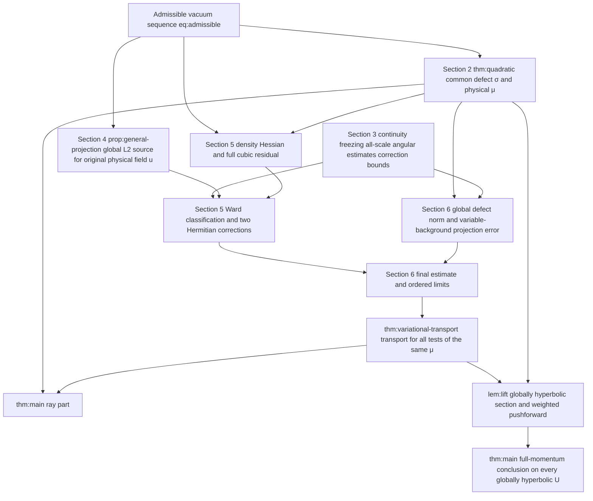

# Dependency interfaces for the main theorem and transport argument

[Chinese original](dependencies.md)

Source: `paper/burnett.tex`, SHA256 `e5e9fc351bbd5540884dc7f2fec42cdba94d591a2d4f5ebb4a409f316823904e`. Date: 2026-11-15. This document covers near-term modeling dependencies for the main theorem, quadratic measure, transport, and full-momentum lift. It is not a second status inventory: project status, all formal-result scope, and progress remain in `scope.json`. Unnumbered/definition entries in `../statements/source-index.json` remain candidates; citing a candidate ID here does not approve an expansion of scope.

**Evidence conventions.** “Stated in the paper” means the locked text explicitly gives the interface. “Checked this round” means its statement and actual consumers were read and their objects, parameters, and conclusions compared. Neither means the analytic theorem was independently proved. “External verification pending” means the relevant external full text and exact original theorem were not read. “Formalization pending” means no Lean declaration/proof exists yet. The table's `needed_statement` is not an approved extra axiom. This round made no network access and produced no evidence of external full-text access.

For the whole-paper decomposition, statement/closure slices of all formal results, and appendix branches, see the [slice graph](slices.en.md) and [machine inventory](slices.json). This document retains detailed mathematical explanations of mainline interfaces. A reference location is not automatically a proof dependency: mentioning the lift at the end of the transport proof does not make the lift a premise of transport.

## 1. Main line

`Q→R` must retain the same defect and physical measure. `P` alone does not prove transport; `Q` alone does not satisfy the lift's inputs. Section 3's intermediate lemmas and the other 17 formal results are not excluded from all-result coverage simply because this diagram shows only the main line.

## 2. Priority interfaces and actual consumers

Every source_ref below refers to `paper/burnett.tex`. This is a bounded group of near-term proof obligations, not a sentence-by-sentence review or a new ledger for the whole paper.

| Interface | source_ref | consumer | needed_statement and this round's findings |
|---|---|---|---|
| Common quadratic defect and physical measure | 392–428, `eq:sigma`; 469–485, `eq:mu-invariant` / `eq:norm-change` | Hessian defect limit at 1811–1835; global norm at 2731–2758; main theorem at 3046–3055 | A single diagonal subsequence produces a global positive Hermitian defect, with all classical degree-zero homogeneous principal-symbol tests sharing its quadratic limit. Physical contraction is evaluated only on the null cone, retaining coordinate covariance/auxiliary-section weights. The paper explicitly does not claim simultaneous convergence for arbitrary nonhomogeneous `S⁰₁,₀` symbols. Consumers checked; compactness/globalization proofs await verification/formalization. Corresponds to `unnum:microlocal-extraction`, `unnum:physical-measure-construction`. |
| First-order commutator and full cubic continuity | 566–612, `lem:commutator`; 613–734, `lem:cubic-continuity` | Nonlinear remainder at 1886–1898; full polarization at 1990–2009; localization at 2672–2712; physical replacement at 2837–2841 | Matrix principal coefficients must satisfy `(R^{ab})*=R^{ba}` and tests must be scalar at every order. The remainder is small only in the imaginary-part energy pairing. Full symmetric cubic energy has three `W¹,³` continuity terms; this cannot be transferred to an isolated unsymmetrized pairing. Constants use only finitely many symbol seminorms and are independent of highest frequency. A01 implements both Lebesgue energy estimates of the first-order commutator lemma. Full cubic continuity retains its separate manuscript claim. |
| Quantitative freezing | 736–892, `lem:freezing` | 2698–2712, `eq:var-freezing-error`; final patch sum | `Aℓ‖∂z‖₃³+B_ℓ‖z‖₃‖∂z‖₃²`. A is uniform in patch center, count, frequency, and ℓ; B_ℓ need only be finite for each fixed ℓ. Tests have real odd principal symbols, are self-adjoint and scalar, with `−iB` preserving real fields. The paper first reduces to odd tests at 1906–1915, consistent with the interface order. The compact-chart Weyl endpoint passed the locked native replay. Independent mathematical readback is pending. |
| All-scale trilinear transfer and near-angle gain | 893–1243, `lem:analytic-near`, especially 1026–1057 | Physical phase term at 2244–2261; physical near-angle terms at 2343–2502; 2632–2640 and 2843–2850 | Removing gradient weights leaves a degree-zero homogeneous core. The low/high ratio `ρ→0` admits a `C¹⁰⁰` extension. The normalized annular-box extension on comparable blocks must retain exclusion of zero in the third frequency. The full near-angle symbol is δ² times a uniformly normalized symbol, giving a `δ^{β*}` bound with three L³ norms. Cutoff independence concerns finite smooth dyadic cutoffs on the factors, not arbitrary two-index weights (1218–1224). Section 5's `C¹⁰³` test-symbol bounds and degrees were checked (2459–2482); the unified A05 entry supplies the uniform estimate. |
| Independent-variable symbols for corrections and rough commutators | 1248–1526, `eq:analytic-extension`, `lem:analytic-correction-bounds`, `eq:analytic-quartic-bound` / `eq:analytic-far-pairing` | Gauge correction at 2307–2341; physical far-angle correction at 2504–2555; 2557–2589 and 2852–2941 | Smoothness in ρ is insufficient: `t=∣q∣M(ω,z,θ)` must extend in independent variables at z=0. The low absolute-frequency cutoff acts on the low field. A summable spherical-harmonic expansion removes the low angular multiplier from the Cartesian `BS¹₁,₀` symbol. Needed bounds are `L⁴×L⁴→L²`, high adjoint `L⁴×L²→L^{4/3}`, and the Lipschitz high-slot commutator. The two corrections provide the requisite forms in Section 5; external commutator theorems and uniform finite-seminorm control remain to be checked. |
| Bounded scalar source after projection | 1600–1718, `prop:general-projection`, `eq:general-explicit-source` | Both correction energies at 2557–2589; rescaled patch source bound at 2852–2903 | Zero-extend `z=χhₙ`, with fixed IR-regularized projection `u=Πz`. On all ℝ⁴, `−∂_a(aₙ^{ab}∂_b u)` has an L² bound, including noncompact tails. ∂u needs every fixed finite Lp bound, not an added L∞ bound. The full physical angular measure is unchanged where χ=1. Section 6 constructs `aₙ=m+dₙ` with the original inverse metric's local matching; corrections act on original u. Do not insert screen/cone operators into the wave equation being solved. Identity/use checked; projection-source proof awaits formalization. |
| Hessian to full cubic residual for the same measure | 1747–1903, `eq:var-hessian-form` / `eq:var-commutator` / `eq:var-cubic-residual`; 1906–2009 | Transport closure at 2647–2968 | Density-form variational formal self-adjointness applies even to a nonvacuum smooth background. Compression of the full raw defect supplies factor 4, conversion `σ_dx=w⁻¹σ`, and off-cone gauge vanishing. The third-order remainder from `E(g+hₙ)=0` disappears through energy estimates with matrix symmetry and scalar tests; a small norm of the remainder itself is unnecessary. Retain the full third variation and cyclic factor `α_a=a(p)+a(q)+a(r)`. The paper was checked not to substitute a reduced equation; identities and commutator principal-symbol calculations await independent reconstruction. |
| All gauge positions and assembly of both corrections | 2013–2261, `eq:var-ward` / `eq:var-low-gauge-identity`; 2265–2641, `eq:var-full-assembly` | Section 6 sum of phase, near-angle, and correction bounds | `h^{hi}=u+G`, and G can have off-null defect. The low one-gauge slot separates exact phase difference from the physical self-phase. High gauge, double gauge, and comparable cases must all be covered; the triple-gauge vertex is zero. The phase factor in T_G cancels algebraically, including Δ=0; T_F extends the denominator only where the far-angle phase difference has a lower bound. Full assembly has coefficient 3 on each of two terms. Handle high projections by transpose/adjoint; a thin-cone profile occurs once in each slot. Classification and assembly were located explicitly; Ward vertex algebra, symbol normalization, and all finite-slot expansions remain independently unverified. |
| Variable-background defect compression and patch volume | 2647–2841, `eq:var-local-volume` / `eq:var-global-defect-norm` / `eq:var-projection-error` | Replacement/phase/near-angle at 2837–2850; sum over all patches at 2914–2963 | Original σ gives **global** L² norm limits after nonlocal multipliers act on zero-extended fields. Frozen screen error and normalized phase are O(ℓ) on the actual defect range, giving L² error `O(ℓ)∣K_j^+∣^{1/2}`. Interpolation with fixed finite `L^{p*}` gives L³ error `O(ℓ^{α*})∣K_j^+∣^{1/3}`. Every cubic term finally carries `∣K_j^+∣`; a patch cannot copy the norm of the whole chart. The paper explicitly includes projection tails and uses the same subsequence. Norm limits and error upgrading await formalization. |
| Final estimate and limits | 2843–2985, `eq:var-final-bound` | `thm:variational-transport`; `thm:main` at 3046–3060 | For fixed `p*>3` and κ, first obtain for the same nonnegative number `∣4∫H_Pa dμ∣ ≤ C_{κ,p*}δ^{β*}+C_{δ,p*}ℓ^{α*}+C_δℓ`, then take limits in the next section's order. limsup may handle nonconvergent cubic pieces. Excluded constant dependencies and volume factors were checked. Final numerical vanishing is elementary conditional on all preceding estimates, not a proof of transport. |
| Globally hyperbolic lift and main-theorem assembly | 2989–3060, `lem:lift` | Full-momentum part of `thm:main` on every globally hyperbolic U | First prove transport for the same μ. Then use a smooth Cauchy section to construct a positive degree-one homogeneous flow-invariant ℰ, set s=ℰ⁻¹ and `ν=L_*(s⁻²μ)`. Required are the Radon property, exact local second moments, moments for all S, and full transport for every total-space compactly supported b. The s⁻² weight agrees with the paper's homogeneity calculation. Global existence of a Cauchy section and smooth crossing map await checking against geometric interfaces; an unread citation does not establish missing hypotheses. |

## 3. Uniform constants and order of limits

In Section 3's setup (521–537), frozen Lorentz forms belong to a compact nondegenerate family; constants depend on finitely many normalized symbol seminorms. Each later estimate must retain this uniformity from its actual inputs rather than recording only a separate constant for every parameter.

| Estimate | Allowed dependence | Excluded dependence |
|---|---|---|
| Leading freezing term `Aℓ‖∂z‖₃³` (757–762) | Finite smooth seminorms of background/tests, fixed support ratios, finite-dimensional field space | n, ℓ, center, patch count, and field frequency; remainder B_ℓ may depend on ℓ⁻¹. |
| All-scale transfer (1033–1055) | κ, finite p*, 𝔄₁₀₀, near-angle profile norms | Highest frequency, number of scales, finite factor-truncation length; the leading near-angle constant is uniform in δ, cap center, and the compact frozen-background family. |
| Corrections and rough commutators (1258–1266, 1382–1393) | Finite extension seminorms for fixed δ, fixed finite Lp multiplier bounds, ‖d‖∞ / ‖∂d‖∞ | Counts of high/low scales or angular-expansion terms, D²d, D²u; no uniform boundedness of C_δ as δ→0 is required. |
| Patch sources and coefficients (2865–2885) | Fixed background, original first-derivative bound, rescaled profiles, explicit ℓ⁻¹ and ℓ⁻² | Hidden j,n,ℓ dependence; ℓ dependence may appear only in the displayed terms. |
| Final estimate (2947–2963) | Fixed compact set, test, smooth limit, original derivative bound, fixed κ,p*; the latter two constants may depend on δ | n, patch count, angular truncation, radial-scale count. C_{κ,p*} may not hide δ or ℓ dependence; the other two constants cannot depend on ℓ. |

The paper's actual order is:

1. Fix atlas localization, finite p*>3, and 0<κ<1/16. Fix δ>0, set η=cκδ², then choose sufficiently small fixed ℓ so the actual null cone lies within the frozen thin cone.
2. For each fixed n and angular-expansion truncation L, first take the upper-frequency cutoff λ_max→∞, then L→∞ to restore the full Hermitian correction. These precede the sequence limit (1528–1590, 2572–2574). This uses Schwartz/`P₀u∈L²` for fixed n, without a norm bound uniform in n. An n-dependent maximum frequency cannot replace the limit.
3. With δ,ℓ fixed, take n→∞ along the same subsequence extracted once in Section 2. For each ℓ the patch count is finite. Small-amplitude terms containing ℓ⁻¹ then vanish; B_ℓ need not be uniform in ℓ. Cubic pieces may use limsup, while all quadratic limits come from the fixed defect (2731–2758, 2937–2960).
4. In the resulting inequality for the same number, take ℓ→0 and then δ→0 with κ,p* fixed. There is no exchange of limits, additional p*→∞ limit, or endpoint claim.

The directly checkable exponent arithmetic is

$$
\alpha_* =\frac{2(p_*-3)}{3(p_*-2)}>0,\qquad
\frac13=\frac{\alpha_*}{2}+\frac{1-\alpha_*}{p_*},\qquad
\beta_* =2-\frac{2}{p_*-2}=\frac{2(p_*-3)}{p_*-2}>0.
$$

Thus, if the preceding estimates hold, this limit order suffices to eliminate the right-hand side numerically. The arithmetic does not prove preceding angular estimates, transport of the same measure, or the main theorem. The paper also does not regard these exponents as convergence rates in n (2971–2976).

## 4. Actual uses of external references and pending verification

Only external theorems actually used on the main line are listed. This round did not access external full texts, so it records no invented access dates, verified page numbers, or citation passes. Bibliographic information appears at 3468–3473; verify exact versions and signatures before adopting them.

| Reference | Actual source location and use | Precise content to check next | Current evidence |
|---|---|---|---|
| Huneau–Luk, `HLelliptic`, Theorem 5.5 | 392–410: positive microlocal defect compactness for common quadratic limits of tensor Dhₙ | Original field space, positivity, local weak convergence, classical homogeneous-symbol test class, and density conventions; how far this paper supplies fixed-atlas covariance/single-subsequence passage from the Euclidean local version to tensor bundles | External verification pending; actual consumers in this paper checked. Do not consequently require a defect measure as a main-theorem premise. |
| Same paper, Theorem 5.6 | 412–428: microlocal localization; curl and first-order Ricci constraints place the defect range in the symbol kernel | Whether strong-zero H⁻¹_loc system constraints are the applicable signature; whether this paper's direct elliptic-inverse/compact-remainder argument can close independently | External verification pending; the paper also supplies a direct argument, not yet formalized. |
| Same paper, Lemma 2.5 | 2993–3040: globally hyperbolic full-momentum lift | Original phase space, homogeneous weights, Cauchy section, and total/local finiteness; this paper's concrete local-second-moment supplement. An independent proof from this construction can avoid retaining the original lemma as a final unproved premise. | External verification pending. An unread lemma cannot justify asserting that this paper must assume affine completeness. |
| Bényí–Oh, `BenyiOh`, Theorem A | 587–591: first-order commutator of a linear S¹₁,₀ operator and Lipschitz multiplier; Section 4 at 1674–1684 uses a similar Calderón bound | Applicable x-dependent symbol class, scalar/componentwise matrix version, whether W¹,∞ alone suffices, required finite seminorms, and lower-order terms after density conjugation | A01 has an internal Lean proof of the linear commutator estimates. The scope of the citation and the Section 4 consumers remain to be checked. |
| Same paper, Theorem 1 | 1308–1377, 1425–1464, 2567–2571: bilinear BS¹₁,₀ high-slot commutator and dual exponents for the high adjoint | Coverage of (4,4,2) and (4,2,4/3); translation to this paper's translation-invariant subclass, Lipschitz quotient space, and finite-seminorm control; separate checking of the paper's quantitative closed-graph/uniform-boundedness argument | External verification pending. Original symbols smooth only on a graph cannot be called directly admissible; first complete the independent-variable extension and removal of the spherical-harmonic factor. |

The paper also uses Rellich dual compactness, classical PDO principal symbols/compact remainders, Coifman–Meyer, Mikhlin/Riesz transforms, Littlewood–Paley square functions, maximal functions, Khintchine and Riesz–Thorin, Radon–Nikodym/disintegration of measures, smooth Cauchy surfaces in globally hyperbolic spacetimes, and smooth dependence of flows. These belong to the actual dependency closure. Their exact signatures in the pinned formal library have not yet been checked. An absent separate bibliography entry does not imply an available Lean implementation.

`Burnett1989`, `GW2011`, `GTC`, and `HLwave` serve background/result comparisons in the current main line; their gauge-restricted transport conclusions are not used as direct proof of 1729–1735. The derivative-scale assumption of HLwave cannot become a new premise of this main theorem. Bibliographic accuracy of those comparisons lies outside this bounded interface review.

## 5. Bounded next steps and feasibility limits

Near-term parallel work can include:

1. Extract finite-dimensional algebraic interfaces for Section 2's 𝓡_ξ kernel, B contraction, gauge cross-term vanishing, and null-cone positivity. This does not require the whole PDO theory first; state clearly that the result is only the algebraic part of the quadratic construction.
2. Specify checkable mathematical interfaces for the common defect witness and physical measure: objects, test classes, same subsequence, density/covariance conventions, and consumers. Keep unproved existence explicit; do not put transport of μ into the input structure.
3. Check both exact BenyiOh signatures and required finite-seminorm control, then handle the independent-variable extensions of both corrections. This exposes executable analytic-interface differences earlier than wrapping the entire transport theorem in one premise.
4. Separate the final-limit and lift consumers. The final limit uses the listed uniform constants; the lift uses already-proved transport and a Cauchy section. Pure exponent/weight arithmetic may be checked first, followed by the preceding analytic and geometric proofs.

The main implementation costs are global defect measures, rough-coefficient PDO/bilinear estimates, full cubic variation and Ward algebra, nonlocal localization, and globally hyperbolic lifting, rather than merely writing the main theorem as a Lean theorem. Reuse of the pinned formal library requires a separate actual symbol search; general subject names are not existing library theorems.

The bounded conclusion now available is that required objects and quantifiers for the main theorem/transport consumers can be explicitly separated, and the paper states the uniformity needed for ordered limits. There is no evidence yet that these interfaces close in Lean. No new assumption requiring unilateral insertion into the main theorem was found. If exact later checking reveals substantive ambiguity, list the source location, interpretations, and impact for the user to decide. “The external theorem has not yet been read” is not a discovered counterexample or mathematical error.
