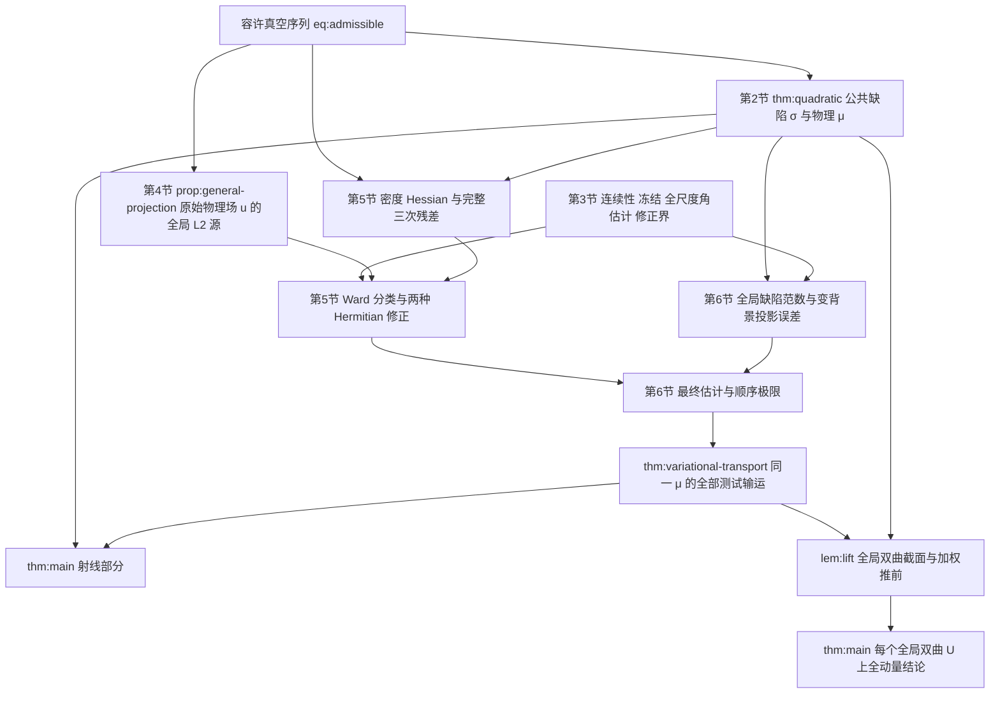

# 主定理和输运主线的依赖接口

原文：`paper/burnett.tex`，SHA256 `e5e9fc351bbd5540884dc7f2fec42cdba94d591a2d4f5ebb4a409f316823904e`。日期：2026-11-15。本文只承接主定理、二次测度、输运和全动量提升的近期建模依赖，不是第二份状态清单；项目状态、全部正式结果范围和进度仍见 `scope.json`。`../statements/source-index.json` 的未编号项和定义项仍是候选，本文引用候选 ID 不表示已批准扩大范围。

**证据口径。** “原文陈述”表示锁定正文确实写出该接口；“本轮核对”表示已读取其陈述和实际消费者并比较对象、参数和结论；二者均不表示分析定理已独立证明。“待核外部”表示未读取相应外部全文和精确原定理。“待形式化”表示尚无 Lean 声明与证明；不能把本表的 `needed_statement` 当成已获准的额外公理。本文未联网，未产生外部全文访问证据。

全文工作分解、全部正式结果的陈述/闭合片及附录支线见[切片图](slices.md)与[机器清单](slices.json)。本文保留主线接口的详细数学解释；引用定位不自动成为证明依赖，例如输运证明末尾提到提升，不意味着以提升作为输运前提。

## 1. 主线

`Q→R` 必须保留同一缺陷与同一物理测度；`P` 单独不证明输运；`Q` 单独不满足提升输入。第3节中间引理和其他17项正式结果并不会因为这里只画主线就被排出全部结果范围。

## 2. 高优先接口及实际消费者

每行的 source_ref 均为 `paper/burnett.tex`。以下是一组有限的近期证明义务，不是逐句审稿或全论文新账本。

| 接口 | source_ref | consumer | needed_statement 与本轮核对结果 |
|---|---|---|---|
| 公共二次缺陷与物理测度 | 392–428，`eq:sigma`；469–485，`eq:mu-invariant` / `eq:norm-change` | 1811–1835 的 Hessian 缺陷极限；2731–2758 的全局范数；3046–3055 主定理 | 一次对角子序列产生全局正 Hermitian 缺陷，全部经典零阶齐次主符号测试共享其二次极限；物理收缩只在零锥取值，并保留坐标协方差/辅助截面权重。原文明确不主张任意非齐次 `S⁰₁,₀` 符号同时收敛。已核对消费者；紧性和全局化证明待核/待形式化。对应 `unnum:microlocal-extraction`、`unnum:physical-measure-construction`。 |
| 一级交换子和完整三次连续性 | 566–612，`lem:commutator`；613–734，`lem:cubic-continuity` | 1886–1898 非线性余项；1990–2009 完整极化；2672–2712 局部化；2837–2841 物理替换 | 矩阵主系数须满足 `(R^{ab})*=R^{ba}` 且测试每阶均标量；余项只在虚部能量配对中小。完整对称三次能量有三份 `W¹,³` 连续性；不能移用到孤立未对称配对。常数只需有限符号半范数且不依赖最高频。原文消费者的标量性/对称性可定位，估计本身尚未独立证明。 |
| 定量冻结 | 736–892，`lem:freezing` | 2698–2712，`eq:var-freezing-error`；最终补丁求和 | `Aℓ‖∂z‖₃³+B_ℓ‖z‖₃‖∂z‖₃²`；`A` 对补丁中心、数量、频率和 `ℓ` 一致，`B_ℓ` 只在固定 `ℓ` 有限。测试为实奇主符号、自伴标量测试且 `−iB` 保持实场。原文先在1906–1915作奇测试约化，接口顺序相符；冻结证明未作独立逐行审稿。 |
| 全尺度三线性传递与近角增益 | 893–1243，`lem:analytic-near`，尤其1026–1057 | 2244–2261 物理相位项；2343–2502 物理近角项；2632–2640 与2843–2850 | 梯度权重移除后为零齐次核心；低高频比 `ρ→0` 有 `C¹⁰⁰` 延拓；可比块的归一化环盒延拓必须保留第三频率排除零点。近角完整符号为 `δ²` 乘一致归一化符号；输出 `δ^{β*}` 的三份 `L³` 范数界。截断独立性限于因子上的有限平滑 dyadic 截断，不包括任意二指标权重（1218–1224）。已核对第五节的 `C¹⁰³` 测试符号界与齐次次数（2459–2482）；统一估计已由 A05 入口实现。 |
| 修正的独立变量符号与粗交换子 | 1248–1526，`eq:analytic-extension`，`lem:analytic-correction-bounds`，`eq:analytic-quartic-bound` / `eq:analytic-far-pairing` | 2307–2341 规范修正；2504–2555 物理远角修正；2557–2589 与2852–2941 | 不只是 `ρ` 光滑，还需 `t=∣q∣M(ω,z,θ)` 在独立变量 `z=0` 延拓。低绝对频率截断置于低场，低角乘子经可和球谐展开移出笛卡尔 `BS¹₁,₀` 符号。需 `L⁴×L⁴→L²`、高伴随 `L⁴×L²→L^{4/3}` 及 Lipschitz 高槽交换子界。已核对两修正在第五节分别给出所需形式；外部交换子定理和有限半范数一致性仍待核。 |
| 投影后的有界标量源 | 1600–1718，`prop:general-projection`，`eq:general-explicit-source` | 2557–2589 两修正能量；2852–2903 缩放补丁源界 | 对 `z=χhₙ` 零延拓，固定红外正则化投影 `u=Πz`；在全 `ℝ⁴` 上 `−∂_a(aₙ^{ab}∂_b u)` 有 `L²` 界，含非紧尾。`∂u` 只需所有固定有限 `Lp` 界，不能补写 `L∞`。`χ=1` 区域完整物理角测度不变。第6节构造 `aₙ=m+dₙ` 满足原逆度量的局部匹配，修正作用原 `u`；screen/cone 不得移进待解波方程。已核对身份及实际用法，投影源证明待形式化。 |
| Hessian→同一测度的完整三次残差 | 1747–1903，`eq:var-hessian-form` / `eq:var-commutator` / `eq:var-cubic-residual`；1906–2009 | 2647–2968 输运收尾 | 在非真空光滑背景上也可用密度型变分的形式自伴；完整原始缺陷压缩给出因子4、`σ_dx=w⁻¹σ` 换算及离锥规范消失。`E(g+hₙ)=0` 的三阶余项通过矩阵对称、标量测试的能量估计消失；无需余项本身有小范数。保留完整第三变分及循环因子 `α_a=a(p)+a(q)+a(r)`。已核对原文没有以约化方程替代本接口；恒等式与交换子主符号计算待独立重建。 |
| 全部规范位置及两修正的装配 | 2013–2261，`eq:var-ward` / `eq:var-low-gauge-identity`；2265–2641，`eq:var-full-assembly` | 第6节相位、近角和修正界的总和 | `h^{hi}=u+G`，`G` 可有非零锥缺陷；一规范低槽分出精确相位差与物理自身相位；高规范、双规范和可比情形均须覆盖，三规范顶点为零。`T_G` 的相位因子代数消去，含 `Δ=0`；`T_F` 仅在远角相位差有下界处分母延拓。全装配系数为两项各3；高投影按转置/伴随处理，薄锥 profile 各槽只出现一次。已核对分类与装配处均有明确正文；未独立验证 Ward 顶点代数、符号归一化和所有有限槽展开。 |
| 变背景缺陷压缩与补丁体积 | 2647–2841，`eq:var-local-volume` / `eq:var-global-defect-norm` / `eq:var-projection-error` | 2837–2850 替换/相位/近角；2914–2963 全部补丁求和 | 原 `σ` 给出零延拓场经非局部乘子后的**全局** `L²` 范数极限；冻结 screen 误差与归一化相位在实际缺陷范围为 `O(ℓ)`，故 `L²` 误差为 `O(ℓ)∣K_j^+∣^{1/2}`。和固定有限 `L^{p*}` 插值得 `L³` 误差 `O(ℓ^{α*})∣K_j^+∣^{1/3}`。每个三次项最后携带 `∣K_j^+∣`，不能每补丁复制整张图的范数。已核对原文明确计入投影尾并沿用同一子序列；范数极限与误差提升待形式化。 |
| 最终估计和极限 | 2843–2985，`eq:var-final-bound` | `thm:variational-transport`；3046–3060 的 `thm:main` | 对任意固定 `p*>3`、固定 `κ`，先得同一非负数 `∣4∫H_Pa dμ∣ ≤ C_{κ,p*}δ^{β*}+C_{δ,p*}ℓ^{α*}+C_δℓ`，再按下节顺序取极限。可用 limsup 处理未收敛的三次分项。已核对常数禁依赖和各体积因子；最终数值消失是条件于全部前置估计的初等推论，未视为输运已证。 |
| 全局双曲提升和主定理合成 | 2989–3060，`lem:lift` | `thm:main` 的每个全局双曲 `U` 全动量部分 | 先已证明同一 `μ` 输运，再以光滑 Cauchy 截面构造正一齐次且沿流不变的 `ℰ`，令 `s=ℰ⁻¹`、`ν=L_*(s⁻²μ)`。需 Radon 性、精确局部二阶矩、所有 `S` 的矩和所有总空间紧支撑 `b` 的完整输运。已核对 `s⁻²` 权重与原文的齐次计算一致；Cauchy 截面的全局存在和光滑穿越映射待几何接口核对，不能从未读引用推断它们缺假设。 |

## 3. 统一常数和极限顺序

在第3节总设定（521–537）中，冻结 Lorentz 形式属于一个紧的非退化族；常数依赖有限个归一化符号半范数。后续每个估计要从实际输入保留这些一致性，而不能只登记逐个参数存在常数。

| 估计 | 允许的依赖 | 必须排除的依赖 |
|---|---|---|
| 冻结前导项 `Aℓ‖∂z‖₃³`（757–762） | 背景/测试有限光滑半范数、固定支撑比例、有限维场空间 | `n`、`ℓ`、中心、补丁数和场的频率；余项 `B_ℓ` 允许依赖 `ℓ⁻¹` |
| 全尺度传递（1033–1055） | `κ`、有限 `p*`、`𝔄₁₀₀`；近角 profile 规范 | 最高频率、尺度数量、因子有限截断长度；近角前导常数对 `δ`、cap 中心和冻结背景紧族一致 |
| 修正与粗交换子（1258–1266、1382–1393） | 固定 `δ` 的有限延拓半范数、固定有限 `Lp` 乘子界、`‖d‖∞` / `‖∂d‖∞` | 高低频尺度数、角展开截断数、`D²d`、`D²u`；不要求 `C_δ` 在 `δ→0` 时有界 |
| 补丁源和系数（2865–2885） | 固定背景、原一阶导数界、缩放 profile；显式 `ℓ⁻¹,ℓ⁻²` | 隐含的 `j,n,ℓ` 依赖；`ℓ` 依赖只可按显示项出现 |
| 最终估计（2947–2963） | 固定紧集、测试、光滑极限、原导数界、固定 `κ,p*`；后两常数可依赖 `δ` | `n`、补丁数、角截断、径向尺度数；`C_{κ,p*}` 不可隐含依赖 `δ` 或 `ℓ`，另两常数不可依赖 `ℓ` |

原文的实际顺序为：

1. 固定图册局部化、有限 `p*>3` 和 `0<κ<1/16`；固定 `δ>0`，令 `η=cκδ²`；再选足够小的固定 `ℓ`，使实际零锥落在冻结薄锥内。
2. 对每个固定 `n`、角展开截断 `L`，先令上频截断 `λ_max→∞`；再令 `L→∞`，恢复完整 Hermitian 修正。这些极限先于序列极限（1528–1590、2572–2574）。此处用固定 `n` 的 Schwartz/`P₀u∈L²`，不要求其范数对 `n` 一致，也不允许选依赖 `n` 的最大频率替代。
3. 固定 `δ,ℓ`，沿第2节一次提取的同一子序列令 `n→∞`。每个 `ℓ` 的补丁数有限；含 `ℓ⁻¹` 的小幅度项此时消失，`B_ℓ` 无需对 `ℓ` 一致。三次分项可只用 limsup，二次极限均来自既定缺陷（2731–2758、2937–2960）。
4. 在得到的同一数值不等式中令 `ℓ→0`，再令 `δ→0`，保持 `κ,p*` 固定。没有交换极限，没有额外 `p*→∞` 或端点声明。

可直接核实的指数算术为

$$
\alpha_* =\frac{2(p_*-3)}{3(p_*-2)}>0,\qquad
\frac13=\frac{\alpha_*}{2}+\frac{1-\alpha_*}{p_*},\qquad
\beta_* =2-\frac{2}{p_*-2}=\frac{2(p_*-3)}{p_*-2}>0.
$$

因此前置估计若成立，此极限顺序在数值层面足以消掉右端。该算术核对不证明前置角估计、同一测度输运或论文主定理。原文也不把这些指数当作 `n` 的收敛率（2971–2976）。

## 4. 外部引用的实际用途与待核项目

仅列主线实际使用的外部定理。此轮没有访问外部全文，因此不记录虚构的访问日期、页码核验或“引用已通过”。原文书目信息见3468–3473；准确版本和签名须在采用前核实。

| 引用 | 实际源位置与用途 | 近期应核对的精确内容 | 当前证据 |
|---|---|---|---|
| Huneau–Luk，`HLelliptic`，Theorem 5.5 | 392–410：正微局部缺陷紧性，用于张量 `Dhₙ` 的公共二次极限 | 原定理的场空间、正性、局部弱收敛、经典齐次符号测试类与密度约定；从欧氏局部版本到张量丛的固定图册协方差/单子序列论证由本稿补足到何处 | 待核外部；已核对本稿实际消费者。不能因此要求主定理预设缺陷测度。 |
| 同文，Theorem 5.6 | 412–428：微局部定位，curl 与 Ricci 一阶系统约束给出缺陷范围落在符号核 | `H⁻¹_loc` 强零的系统约束是否为适用签名；本稿给出的椭圆逆与紧余项直接论证可否独立闭合 | 待核外部；本稿亦提供直接论证，尚未形式化。 |
| 同文，Lemma 2.5 | 2993–3040：全局双曲的全动量提升路线 | 原定理使用的相空间、齐次权重、Cauchy 截面与全/局部有限性；本稿以局部二阶矩作出的具体补充。若可按本稿构造独立证明，可不把原引理当作最终未证前提 | 待核外部；不得据未读引理宣称本稿必须假设仿射完备。 |
| Bényí–Oh，`BenyiOh`，Theorem A | 587–591：线性 `S¹₁,₀` 算子和 Lipschitz 乘子的一阶交换子；第4节1674–1684亦调用同类 Calderón 界 | `x` 依赖符号的适用类、标量/矩阵逐项版本、是否只需要 `W¹,∞`、所需有限半范数及密度共轭后的低阶项 | 待核外部。 |
| 同文，Theorem 1 | 1308–1377、1425–1464、2567–2571：双线性 `BS¹₁,₀` 高槽交换子，及高伴随用的对偶指数 | `(4,4,2)` 与 `(4,2,4/3)` 是否涵盖；翻译为本稿的平移不变子类、Lipschitz 商空间、有限半范数控制；本稿由闭图/一致有界给出的定量化论证仍需单独核对 | 待核外部。不得把只在图上光滑的原始符号直接称为满足该定理，需先完成独立变量延拓和球谐移出。 |

本稿还调用 Rellich 对偶紧性、经典伪微分算子主符号/紧余项、Coifman–Meyer、Mikhlin/Riesz 变换、Littlewood–Paley 平方函数、最大函数、Khintchine 和 Riesz–Thorin，以及测度的 Radon–Nikodym/分解、全局双曲的光滑 Cauchy 面与流的光滑依赖。这些是实际依赖闭包，尚未核对固定形式库的具体签名；不能因未列单独参考文献就视为已具备 Lean 实现。

`Burnett1989`、`GW2011`、`GTC`、`HLwave` 在当前主线中用于背景/结果比较；本稿没有把它们的受规范限制输运结论作为1729–1735的直接证明。`HLwave` 的导数尺度假设不能继承为当前主定理的新前提。其比较文字的文献准确性不属于本轮有限接口核对。

## 5. 有限的下一步与可行性边界

近期可以并行推进的工作是：

1. 将第2节 `𝓡_ξ` 符号核、`B` 收缩、规范交叉消失与零锥正性抽成有限维代数接口。这不需要先实现全套伪微分分析；其结论应明确只是二次构造的代数部分。
2. 给公共缺陷见证和物理测度写可核验的数学接口：对象、测试类、同一子序列、密度/协方差约定及消费者。暂未证明的存在性要保持显式待证；不把 `μ` 的输运放进输入结构。
3. 核对 `BenyiOh` 两个精确外部签名及需要的有限半范数控制；再处理两修正的独立变量延拓。这比先把整个输运定理包装成一个前提，更早暴露可执行的分析接口差异。
4. 将最终极限和提升拆成独立接口消费者：最终极限使用列明的一致常数；提升使用已证输运和 Cauchy 截面。先可验证纯指数/权重算术，再逐步补上前置分析和几何证明。

主线的主要实现成本在全局缺陷测度、粗系数伪微分/双线性估计、完整三次变分和 Ward 代数、非局部局部化及全局双曲提升；不是将主定理陈述直接写成一个 Lean theorem。能否复用固定版本形式库，要由另行实际符号检索确定，本文没有把通用学科名称等同于已有库定理。

当前可下的有限结论是：主定理和输运消费者要求的对象与量词可以明确拆分；原文为顺序极限写出了需要的一致性；尚无这些接口在 Lean 中闭合的证据。未发现需要本轮擅自补入主定理的新假设。若后续精确核对出现实质歧义，应逐项列出原文定位、可选解释和影响，请用户决定；不能把“尚未读到外部定理”写成已发现反例或数学错误。
