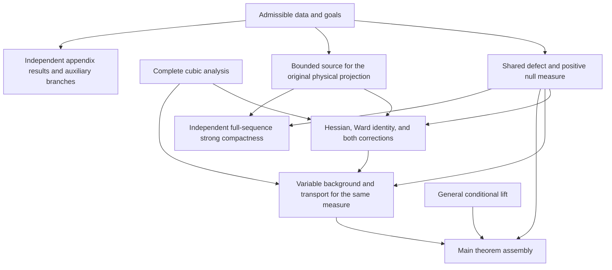

# Manuscript slices and mathematical dependencies

[简体中文](slices.md) · [Project goal](GOAL.en.md)

This English view describes the same decomposition as the Chinese generated view. The slices cover every line of the locked source. Use the shared manifests for the dependency graph and current proof status. [Slices](slices.json) · [Scope](scope.json)

Manuscript: `paper/burnett.tex`, 3475 lines. SHA256 `e5e9fc351bbd5540884dc7f2fec42cdba94d591a2d4f5ebb4a409f316823904e`.

Translated slice manifest SHA256: `d7c6fb1fdd5415dc626a43cda21d075f7e64823b3155a8ab41fa7343ff8035e0`. Update the affected English prose when the underlying interfaces change. Run `python scripts/check_slices.py --repo . --write-view` to refresh the Chinese view.

## How to use the slice plan

Select a slice, verify its direct inputs and the actual proof status in scope, and take its next step. On completion, check its consumers. Keep witnesses, parameters, and limit order shared within a joint closure group.

Edge kinds distinguish proof inputs, definitions and specifications, applications of conditional lemmas, and explanatory links. Definitions can be implemented ahead of the supplying slice's proofs. General conditional lemmas can be proved independently of their applications. The approved scope governs coverage of examples and background.

## Main dependency overview

The diagram shows the main dependencies. The table and manifest list all direct dependencies, including the independent appendix work.

## Full manuscript coverage

| Slice | Source lines | Kind | Deliverable | Direct inputs |
| --- | --- | --- | --- | --- |
| [F01](#f01) Manuscript identity, opening material, and scope | 1–89 | context | Identify the manuscript as a proposed proof of forward Burnett in the smooth four-dimensional limit class, and relate the abstract to the formal goals in the body. | — |
| [F02](#f02) Admissible geometric data, ray dynamics, and the main theorem specification | 90–168 | specification | Fix the objects, quantifiers, and ray and full-momentum conclusions of the main theorem for all consumers. | — |
| [F03](#f03) Scope, literature context, proof outline, and common conventions | 169–351 | specification | Extract the actual contraction, inner-product, and constant conventions used by the proof. The literature comparison and proof outline give context. | F02 (definition) |
| [F04](#f04) Exact connection difference, weak Ricci identity, and H^{-1} compactness | 352–389 | proof-unit | Construct the weak quadratic curvature limit from original vacuum assumptions and prove strong local H^{-1} vanishing of the linearized Ricci operator. | F02 (definition), F03 (definition) |
| [F05](#f05) Shared microlocal covariance, subsequence, and Ricci kernel | 390–429 | proof-unit | Provide a shared global defect measure and natural coordinate changes for all subsequent angular tests. | F04 (proof-input), F02 (definition) |
| [F06](#f06) Full quadratic Ricci algebra, polarization, and positivity of the null physical quotient | 430–466 | proof-unit | Close the noncharacteristic cancellation, mixed Hermitian terms, and null positivity in one algebraic parent result. | F05 (definition), F03 (definition) |
| [F07](#f07) Positive physical measure, second moments, and quadratic theorem | 467–486 | assembly | Assemble compactness, full algebra, and global covariance into thm:quadratic and include the auxiliary section transformation. | F04 (proof-input), F05 (proof-input), F06 (proof-input), F02 (definition) |
| [F08](#f08) Base marginal, angular disintegration, and vanishing on vacuum regions | 487–518 | assembly | Derive all conclusions of cor:base-marginal from the quadratic construction. | F07 (proof-input) |
| [A01](#a01) Analytic/Fourier specifications and Lipschitz first-order commutator energy | 519–600 | proof-unit | Fix the analytic objects for the whole section and close lem:commutator, including its matrix-coefficient version under scalar tests. | F03 (definition) |
| [A02](#a02) Finite-exponent commutators, full cubic continuity, and coefficient differences | 601–735 | proof-unit | Close L³-gradient continuity of the fully polarized cubic energy and supply the coefficient-difference subinterface for freezing. | A01 (definition) |
| [A03](#a03) Quantitative coefficient and test freezing for the full cubic action | 736–892 | proof-unit | Jointly close lem:freezing, making frequency- and patch-independent constants explicit in the interface. | A02 (proof-input), A01 (definition) |
| [A04](#a04) Triple partition, angular-cap operator bounds, and the exact phase gap | 893–1025 | proof-unit | Supply geometric/multiplier inputs shared by near-angle summation and far-angle phase division. | A01 (definition) |
| [A05](#a05) Joint closure of all-scale symbol transfer, the low-frequency endpoint, and near-angle summation | 1026–1245 | proof-unit | Jointly close lem:analytic-near's bound without loss in scale count and its δ^{β_*} near-angle bound. | A04 (proof-input), A01 (definition) |
| [A06](#a06) Independent low-angle extension, spherical-harmonic decomposition, and a uniform finite derivative threshold | 1246–1379 | proof-unit | Move the correction symbol's low-angle singularity onto the low field, giving A07 and truncation recovery a summable BS¹ interface. | A01 (definition) |
| [A07](#a07) Correction operators, derivative/rough-coefficient commutators, and high-slot adjoint bounds | 1380–1475 | proof-unit | Jointly close lem:analytic-correction-bounds, including the complete adjoint version. | A06 (proof-input) |
| [A08](#a08) Quartic commutators, exact normal-form pairing, and cutoff recovery at fixed n | 1476–1591 | assembly | Assemble correction-operator bounds into an exact energy interface requiring only first-order coefficients, and legitimately remove angular-sum/upper-frequency cutoffs. | A07 (proof-input), A06 (proof-input), A01 (proof-input) |
| [P01](#p01) Fixed gauge-complement projection and whole-space bounded source in arbitrary coordinates | 1592–1719 | proof-unit | Deliver all of Proposition 4.1: construct a fixed real even order-zero multiplier Pi from the original vacuum/first-order hypotheses, obtain finite-Lp gradient bounds and Lp/uniform convergence to zero for the projected field, prove a whole-space L2 divergence source, and preserve the full physical angular measure. | F02 (definition), F05 (proof-input), F06 (proof-input), F07 (proof-input) |
| [V01](#v01) Formal transport target and local variational conventions | 1720–1744 | specification | Fix the objects, test class, and local pairing conventions of Theorem5.1. Deliver only the target statement, without assuming transport is true. | F02 (definition), F07 (proof-input) |
| [V02](#v02) Hermitian density Hessian and compression on the full Ricci kernel | 1745–1809 | proof-unit | Derive the density Euler expression and self-adjoint Hessian from the first-order Einstein–Hilbert representative; compute the exact principal symbol and Poisson-bracket compression on null/off-null kernels. | V01 (specification), F05 (definition), F06 (proof-input) |
| [V03](#v03) Hessian commutators, nonlinear remainders, and the unnormalized transport residual | 1810–1905 | proof-unit | Derive eq:var-cubic-residual from the original vacuum equation, fully handling outer cutoffs of nonlocal tests, lower-order symbols, and Taylor remainders that vanish only in the imaginary energy pairing. | V02 (proof-input), F05 (proof-input), A01 (proof-input), F07 (definition) |
| [V04](#v04) Complete cubic variation, cyclic Fourier vertices, and polarized continuity | 1906–2010 | proof-unit | Convert the full residual into symmetric trilinear energy; prove vanishing of background-derivative terms, every test position in the frozen vertex, and matrix W1,3 continuity. | V03 (proof-input), V02 (proof-input), A02 (proof-input), F05 (proof-input) |
| [V05](#v05) Physical/gauge decomposition and gauge potentials with compatible infrared cutoffs | 2011–2052 | specification | Deliver an exact high-frequency decomposition and convergence properties usable by actual correction operators, with common nested IR conventions for original projection, tests, and corrections. | P01 (definition), V04 (definition) |
| [V06](#v06) Metric-uniform screen projections and extraction of each physical factor's own phase | 2053–2108 | proof-unit | Explicitly construct screen projections on a fixed wide null-cone neighborhood; prove uniformity in metric parameters, preservation of the actual defect, and the exact phase formula for off-cone screen tensors. | V02 (proof-input), F05 (proof-input), F06 (proof-input), P01 (definition) |
| [V07](#v07) Off-shell Ward identity and complete gauge-leg/frequency-position classification | 2109–2262 | proof-unit | Retain one joint classification responsibility: derive the exact Ward identity from diffeomorphism invariance of the action and exhaust one/two/three gauge legs at low/high/comparable frequencies, assigning every remainder to its own physical phase or the unique low-gauge transport-difference phase. | V04 (proof-input), V05 (proof-input), V06 (proof-input), A04 (proof-input), A05 (proof-input) |
| [V08](#v08) Exact low-gauge transport correction, Hermitian adjunction, and BS1 extension | 2263–2342 | proof-unit | Construct T_G for one symmetric low-gauge/two-physical energy, verifying no resonant division, Hermitian symmetry, and independent-variable symbols suitable for rough commutator estimates. | V07 (proof-input), V05 (proof-input), V06 (proof-input), A06 (proof-input) |
| [V09](#v09) Quadratic angular gain and the full normalized three-physical near kernel | 2343–2503 | proof-unit | Use cancellation of a shared linear jet of odd homogeneous tests, not a special vertex, to prove delta² gain of the complete screen/cap/cone kernel and all-scale near-energy bounds. | V04 (proof-input), V06 (proof-input), V07 (proof-input), A04 (proof-input), A05 (proof-input), F03 (definition) |
| [V10](#v10) Exact physical far-correction denominator and independent-variable extension | 2504–2556 | proof-unit | Divide the complete Hermitian numerator by the exact signed phase only on physical far support; prove independent omega,z,theta extension and high-slot adjunction for rough commutator estimates. | V04 (proof-input), V07 (proof-input), V08 (proof-input), V06 (proof-input), A04 (proof-input), A08 (proof-input) |
| [V11](#v11) Joint energy estimates for both Hermitian corrections on the same original projected equation | 2557–2591 | proof-unit | Jointly bound rough-coefficient energies for T_G/T_F by inserting both into the same original physical field u's whole-space scalar divergence equation, controlling all three divergence commutators and removing operator truncations. | P01 (proof-input), V08 (proof-input), V10 (proof-input), A07 (proof-input), A08 (proof-input) |
| [V12](#v12) Joint assembly of complete frozen energy and accounting of phases/corrections | 2592–2642 | assembly | Jointly own the final frozen coverage of Ward classification and both corrections: assemble all cubic terms of v+G into near energy, physical-far correction, low-gauge transport correction, and each physical factor's own phase, retaining every cutoff and coefficient consistently. | V04 (proof-input), V05 (proof-input), V07 (proof-input), V08 (proof-input), V09 (proof-input), V10 (proof-input), V11 (proof-input), A04 (proof-input) |
| [C01](#c01) Localization and freezing of the full variable-background cubic energy | 2643–2730 | proof-unit | Turn the single variable-background residual into finitely many complete frozen energies with patch-local volume factors. | F02 (definition), F03 (definition), A03 (proof-input), V03 (proof-input), V05 (proof-input), V04 (proof-input) |
| [C02](#c02) Global projection tails, frozen screens, and phase interpolation from the same defect measure | 2731–2842 | proof-unit | Derive the whole-space L2 formula from one tensor defect measure and interpolate to patchwise L3 errors. | C01 (proof-input), F05 (proof-input), V06 (proof-input), A02 (proof-input), V12 (proof-input), F06 (proof-input), V07 (proof-input) |
| [C03](#c03) Actual scalar equation, patch volumes, and both complete corrections | 2843–2942 | proof-unit | Bound the physical far-angle and gauge corrections using the whole-space scalar divergence equation for the localized u itself. Keep ell fixed until the negative powers in the source vanish. | C01 (proof-input), C02 (proof-input), P01 (proof-input), V09 (proof-input), V11 (proof-input), V12 (proof-input) |
| [C04](#c04) Closure of the total residual and global transport for the same measure | 2943–2986 | assembly | Combine freezing, near angles, substitutions, phases, and both corrections. Preserve the identified measure and exact order of limits. | C01 (proof-input), C02 (proof-input), C03 (proof-input), V03 (proof-input), V12 (proof-input), F05 (proof-input), F07 (proof-input), V04 (proof-input), V01 (specification) |
| [L01](#l01) Invariant Cauchy-section momentum scale and the weighted full-momentum lift | 2987–3045 | proof-unit | For a positive ray measure already satisfying moments and transport, build a full null cotangent measure with finite second moments over compact base sets. | F02 (definition), C04 (application), F07 (application) |
| [L02](#l02) Main theorem with the same global ray measure and full momentum on each globally hyperbolic open subspacetime | 3046–3062 | assembly | Combine the quadratic construction, transport for its measure, and the lift with every quantifier of thm:main. | F07 (proof-input), C04 (proof-input), L01 (proof-input), F02 (specification) |
| [L03](#l03) Strong compactness equivalence on vacuum regions for the full physical projection sequence | 3063–3115 | proof-unit | Prove cor:strong without transport, for each open U, each chart and cutoff, and the original entire sequence. | F07 (proof-input), F08 (proof-input), F06 (proof-input), P01 (definition), F05 (proof-input) |
| [X01](#x01) Formal Appendix A Result: Divergence of the Background L2 Source for an Exactly Harmonic-Coordinate Flat Sequence | 3116–3172 | proof-unit | Include prop:shear in full, constructing divergence on the same fixed compact set rather than recording only illustrative coordinate oscillation. | F02 (definition), P01 (definition) |
| [X02](#x02) Formal Appendix B Result: Quadratic Characteristic Localization Does Not Eliminate General Cubic Interactions | 3173–3212 | proof-unit | Include the scalar trilinear counterexample prop:cubic in full, preserving its scope distinct from Einstein sequences. | — |
| [X03](#x03) Confirmed Target: Incompatibility of Conservation and Transport for a Rotating Positive Null-Moment Tensor | 3213–3240 | proof-unit | Prove that the rotating positive null-moment tensor, although conserved and pointwise possessing positive null moments, has no positive transported ray representation. Close it separately from the formal geometric counterexample prop:bianchi. | F02 (definition) |
| [X04](#x04) Formal Geometric Counterexample: A Positive Null-Square Einstein Tensor Still Has No Positive Kinetic Transport Representation | 3241–3304 | proof-unit | Prove existence of the smooth metric in prop:bianchi and exclusion of every positive representation, without assuming vacuum approximation. | F02 (definition), X03 (explanation) |
| [X05](#x05) Formal Rosen Two-Polarization Closure: An Independent Explicit Full-Momentum Massless Representation | 3305–3359 | proof-unit | Independently complete the full-momentum massless representation in prop:rosen, without circular use of the main theorem. | F02 (definition) |
| [X06](#x06) Confirmed Target: A Multiscale Rosen Vacuum Sequence and Exact Zero-Source Coordinates | 3360–3387 | proof-unit | Prove the included multiscale nontrivial Rosen vacuum construction, including ODE comparison, limits, scale lower bounds, and exact zero-source coordinates. prop:rosen alone does not close it. | X05 (proof-input), F03 (definition), P01 (definition) |
| [X07](#x07) Formal Rigidity: An Admissible Sequence with Zero Full Curvature Has a Flat Smooth Limit | 3388–3424 | proof-unit | Prove the full Riemann-curvature-zero conclusion of prop:flat-rigidity; Ricci=0 alone is not completion. | F02 (definition) |
| [X08](#x08) Scope Pending: A Flat Multiscale Coordinate Example, Spacelike Raw Defect, and a Weak-Energy Counterexample | 3425–3446 | context | Retain candidate locations and scope boundaries for the three Appendix E examples, without automatically elevating them to formal certification targets. | F02 (definition), F07 (proof-input) |
| [X09](#x09) Auxiliary Identities: Second-Derivative Products Against Fixed Tests and Degree-Two Unit-Section Weights | 3447–3463 | specification | Establish precise contracts for two potentially used unnumbered identities, distinguishing fixed distributional tests from degree-two pushforward weights. | F07 (proof-input), F02 (definition) |
| [X10](#x10) References and End-of-Document Context | 3464–3475 | context | Preserve contiguous coverage of the locked source’s end, registering bibliographic identities only, without assuming that external interfaces are verified. | — |

## Formal statements and proof closure

The statement and closure slices can differ. Use scope for actual status of all 17 formal results.

| Result | Statement slice | Proof slices | Closure slice |
| --- | --- | --- | --- |
| `thm:main` | F02 | L02 | L02 |
| `thm:quadratic` | F04 | F04, F05, F06, F07 | F07 |
| `cor:base-marginal` | F08 | F08 | F08 |
| `lem:commutator` | A01 | A01 | A01 |
| `lem:cubic-continuity` | A02 | A02 | A02 |
| `lem:freezing` | A03 | A03 | A03 |
| `lem:analytic-near` | A05 | A05 | A05 |
| `lem:analytic-correction-bounds` | A07 | A07 | A07 |
| `prop:general-projection` | P01 | P01 | P01 |
| `thm:variational-transport` | V01 | C01, C02, C03, C04 | C04 |
| `lem:lift` | L01 | L01 | L01 |
| `cor:strong` | L03 | L03 | L03 |
| `prop:shear` | X01 | X01 | X01 |
| `prop:cubic` | X02 | X02 | X02 |
| `prop:bianchi` | X04 | X04 | X04 |
| `prop:rosen` | X05 | X05 | X05 |
| `prop:flat-rigidity` | X07 | X07 | X07 |

The user separately designated the following unnumbered results as required:

- `unnum:rotating-null-moment-example` (closure slice X03). See scope for current status.
- `unnum:rosen-multiscale-example` (closure slice X06). See scope for current status.
- `unnum:cubic-off-null-gradient-localization` (closure slice X02). See scope for current status.

## Joint closure groups

### Q-CLOSE — Shared defect and positive physical measure

Members: F04, F05, F06, F07. Closes in F07.

- Proofs cover the real and Hermitian Ricci/B algebra, pointwise Lorentzian positivity, and the two-parameter gauge classification. Geometry and covariance instantiation and the joint F04/F05/F07 measure construction remain open.
- Preserve the same global subsequence and covariance for all classical angular tests. Naturality of the full angular object exceeds what follows from stress-moment identities.

### CUBIC-CLOSE — Complete Ward classification and both corrections

Members: V04, V05, V06, V07, V08, V09, V10, V11, V12. Closes in V12.

- Account jointly for one, two, and three gauge legs and comparable-frequency positions. Keep thin-cone/screen degrees by slot, both factors 3, and the high-slot transpose.
- Establish existence, exactness, Hermitian structure, independent low-angle extension, and cutoff removal at fixed n for both corrections. The residual's vanishing is part of the conclusion.

### TRANSPORT-CLOSE — Variable-background transport for the same μ

Members: F05, F07, A03, A05, A08, P01, V03, V04, V12, C01, C02, C03, C04. Closes in C04.

- Use the same sigma, mu, original subsequence, and fixed test. Parameter-dependent fixed tests use that object. The total residual has a limit and summands can use limsup estimates.
- Keep the local patch volume factor for each cubic term and sum over finitely many patches of bounded overlap.
- Fix finite p_*>3 and κ. Remove high frequency and angle cutoffs at fixed n. Then take n→∞ at fixed δ, ℓ, followed by ℓ→0 and δ→0. Verify each constant's allowed dependencies.
- Extend real odd tests to all positively one-homogeneous tests with compact base support and glue local charts using one global measure.

### MAIN-CLOSE — Ray and full-momentum conclusions on every globally hyperbolic U

Members: F07, C04, L01, L02. Closes in L02.

- L01 is an independent conditional lemma for any measure with the moment and transport properties. F07/C04 supply those premises in the main theorem application.
- Restrict the same mu to each U and use a Cauchy-invariant scale to construct nu=L_*(s^(-2)mu). Check local second moments and all compactly supported total-space tests. Affine completeness is outside the assumptions.

### STRONG-CLOSE — Whole-sequence strong compactness independent of transport

Members: F05, F06, F08, P01, L03. Closes in L03.

- P01 supplies the definition of the projection. Use the manuscript's direct Parseval argument for the nonlocal tail.
- Use uniform positivity on the compact unit null bundle and subsequence re-extraction to prove the full equivalence for each chart and χ and the whole sequence.

## Detailed slice interfaces and next steps

### F01 Manuscript identity, opening material, and scope

Lines 1–89; context. Identify the manuscript as a proposed proof of forward Burnett in the smooth four-dimensional limit class, and relate the abstract to the formal goals in the body.

Inputs:

- Locked manuscript hash, LaTeX environments, and title.

Outputs:

- Bibliographic identity and proposed-proof status. The abstract centers on transport and puts reverse approximation and nonsmooth limits outside scope.

Boundaries:

- The abstract is not a separate proved main theorem. TeX environment declarations do not constitute the inventory of completed mathematics.

Consumers: None.

Next: Bind the manuscript identity to later target mappings. Scope the Lean certification targets by mathematical results.

### F02 Admissible geometric data, ray dynamics, and the main theorem specification

Lines 90–168; specification. Fix the objects, quantifiers, and ray and full-momentum conclusions of the main theorem for all consumers.

Inputs:

- M is a smooth Hausdorff second-countable four-manifold. g_n are smooth Lorentzian metrics. g is smooth, time-oriented, and of signature (-,+,+,+). Set h_n=g_n-g.
- Ric(g_n)=0, h_n→0 in C^0_loc, and sup_n ||D h_n||_L∞(K;r)<∞ for every compact K⊂M, where r is a fixed smooth Riemannian metric and D=∇^r. There is no D²g_n hypothesis.
- S_r^*M={|ξ|_r=1} represents positive scaling rays with both time directions. P=1/2 g^{ab}ξ_aξ_b and H_P is the Hamilton vector field at lines 111–117.

Outputs:

- One common subsequence and one global nonnegative Radon measure μ. For each compact K⊂M, μ(π^{-1}K)<∞, supp μ⊂{P=0}, and for each S∈C_c∞(M;Sym²TM), ∫G_ab S^{ab}dV_g=∫S^{ab}ξ_aξ_b dμ. Also Scal(g)=0.
- The same μ satisfies ∫H_Pa dμ=0 for all smooth real positively one-homogeneous tests a with compact base support. Take the Hamilton derivative on the punctured cotangent bundle before restricting to the unit section. H_Pa is two-homogeneous. “Positively homogeneous” refers to positive scaling and allows signed a.
- For each globally hyperbolic open subspacetime U, obtain a nonnegative Radon ν on T*U∖{0} supported on the null cone, with ∫_{π^{-1}K}|ξ|_r²dν<∞ for each compact K⊂U. All compactly supported smooth S and b satisfy the full-momentum moment equation and ∫H_Pb dν=0, respectively. No uniqueness of μ or ν is asserted.
- Fixed smooth coordinate changes or changes of auxiliary metric preserve admissibility. This compatibility is a needed interface beyond the specification.

Boundaries:

- Retain the common subsequence across tests.
- Global hyperbolicity is used for the full-momentum lift only. The global μ and transport claims use the original assumptions.
- Forward references in the specification graph identify consumers.

Consumers: F03 (definition), F04 (definition), F05 (definition), F07 (definition), P01 (definition), V01 (definition), C01 (definition), L01 (definition), X01 (definition), X03 (definition), X04 (definition), X05 (definition), X07 (definition), X08 (definition), X09 (definition), L02 (specification).

Supplementary obligation:

- Equivalence of local derivative bounds under changes of fixed r and coordinates (lines 105–108).

Next: The original local auxiliary-metric derivative bound gives genuine coordinate bounds. The intrinsic curvature and Ricci trace now send a vacuum sequence to coordinate vacuum on each preferred chart. Complete the Lorentzian signature and time orientation data and connect the bridge to the local Ricci conclusions and global objects.

### F03 Scope, literature context, proof outline, and common conventions

Lines 169–351; specification. Extract the actual contraction, inner-product, and constant conventions used by the proof. The literature comparison and proof outline give context.

Inputs:

- Main theorem specification F02.

Outputs:

- rmk:status, rmk:scope, and the literature comparison describe status and scope. The manuscript excludes the reverse problem, nonsmooth limits, additional concentration, Λ≠0, and other dimensions.
- Tensor indices 0…3, full summation over ordered pairs, Lorentzian trace, positive r-length, dV_g=√|det g|dx, coordinate pairing ∫u·conj(v)dx linear in the first slot, and zero extension of local fields.
- Constants may depend on fixed compact sets, smooth backgrounds, test symbols, and given first derivative bounds. Higher derivatives of g_n are outside the hypotheses.
- Limit order summarized in the outline: n→∞ with δ,ℓ fixed, then ℓ→0, then δ→0. With p_*>3 fixed and finite, β_*=2(p_*-3)/(p_*-2) and α_*=2(p_*-3)/(3(p_*-2)). The common closure is established in later sections.

Boundaries:

- Comparisons and illustrations have their stated contextual status.
- Im, i, and linear-slot conventions determine the signs in the energy identities.
- The examples p_*=4,12 illustrate the exponents.

Consumers: F04 (definition), F06 (definition), A01 (definition), V09 (definition), C01 (definition), X06 (definition).

Next: Reuse the reviewed identification of the same cov3 induced derivative in any preferred chart, the physical Hilbert norm, and original local Dh control. Complete the global mixed E quantitative model for the actual F04 consumers. The full result and author confirmation have separate evidence.

### F04 Exact connection difference, weak Ricci identity, and H^{-1} compactness

Lines 352–389; proof-unit. Construct the weak quadratic curvature limit from original vacuum assumptions and prove strong local H^{-1} vanishing of the linearized Ricci operator.

Inputs:

- F02 admissible sequence and F03 density and constants. Use ∇=∇^g.

Outputs:

- C_n=1/2 g_n^{-1}(∇h_n+∇h_n-∇h_n)=L(∇h_n)+E_n. On each fixed K the inverse metrics are eventually uniformly bounded and ||E_n||_L∞(K)≤C||h_n||_L∞||∇h_n||_L∞→0.
- The exact equation eq:ricci-exact retains all derivatives. ∇h_n tends weak-* to 0 in L∞_loc, and C_n tends weakly to 0 in L²_loc. After integration by parts on each fixed smooth compactly supported tensor test, Ric(g) is the weak limit of the quadratic expression in L(∇h_n) in eq:weak-ricci.
- ℒh=∇_aL(∇h)^a_bc-∇_cL(∇h)^a_ba. On each bounded chart with nested cutoffs, ℒh_n is the sum of a uniformly L²-bounded term and derivatives of terms tending strongly to zero in L². Conclude ℒh_n→0 strongly in H^{-1}_loc. The quadratic terms can survive.

Boundaries:

- Use fixed tests first for exact curvature and weak limits. Sequence-dependent tests require retaining D²h_n terms.
- Local H^{-1} compactness requires nested cutoffs, lower-order terms, and uniqueness of the cluster point.

Consumers: F05 (proof-input), F07 (proof-input).

Supplementary obligation:

- Exact connection difference and weak curvature are separate from H^{-1} compactness (lines 360–382).

Next: The actual linearized Ricci operator now has a strong local H⁻¹ realization in each chart and for each component, with the same r, g₀, gₙ, χ and n. It builds on the local weak Ricci identification and the general H⁻¹ analysis. Continue the full intrinsic Lorentzian vacuum model, global tensor testing across charts, and the common microlocal object in F05. F04 remains open overall.

### F05 Shared microlocal covariance, subsequence, and Ricci kernel

Lines 390–429; proof-unit. Provide a shared global defect measure and natural coordinate changes for all subsequent angular tests.

Inputs:

- F02 global Dh_n, positive r-fiber inner product, and dV_g. F04 local L² bound, weak convergence to zero, and strong H^{-1} vanishing of ℒh_n.
- Classical order-zero defect tests with smooth principal symbol, homogeneous of degree zero away from zero, fixed infrared regularization, and an order −1 remainder.

Outputs:

- Diagonal extraction of one subsequence using a countable relatively compact atlas, compact exhaustion, and dense test family yields a positive Hermitian bundle-valued Radon measure M_E for E=T*M⊗Sym²T*M. Continuity extends it to all the stated compactly base-supported principal symbols. Local order −1 remainders have zero quadratic limit.
- For a smooth first-order system A with Au_n→0 strongly in H^{-1}_loc, the range of the M_E density lies in ker a_1 almost everywhere. Apply the curl and ℒ constraints in sequence to obtain u_{α,ab}=ξ_α k_ab and ℛ_ξ(k)=1/2(sk_ab+ξ_aξ_b t-ξ_aq_b-ξ_bq_a)=0, with s=g^{-1}(ξ,ξ), t=tr_g k, and q_b=ξ^a k_ab.
- j_ξ:k↦ξ⊗k is r-isometric at |ξ|_r=1. A positive Hermitian σ satisfies M_E=j_ξσj_ξ*, with density range in kerℛ_ξ. The coordinate covariance matrix is σ_op G_F^{-1}.
- For each real scalar principal symbol a_0 of such an A, eq:sigma gives lim_n〈∂_αh_ab,A∂_βh_cd〉_{dV_g}=∫a_0 ξ_αξ_β dσ_ab,cd. Extend to complex tests with conjugate linearity in the second slot. Preserve ordered symmetric-index multiplicities. Fixed coordinate changes, replacement of D by ∂, and lower-order conjugation remainders are compatible.

Boundaries:

- The common test class is classical and homogeneous. General inhomogeneous S^0_{1,0} symbols exceed this conclusion.
- Distinguish positive Hermitian operator-valued measure matrices from covariance components, especially under changes of r.
- Second stress moments alone do not determine the angular measure or its section and coordinate transformations.

Consumers: F06 (definition), F07 (proof-input), P01 (proof-input), V02 (definition), V03 (proof-input), V04 (proof-input), V06 (proof-input), C02 (proof-input), C04 (proof-input), L03 (proof-input).

Supplementary obligations:

- Common subsequence and extension to all tests (lines 392–410).
- Localization under a general first-order constraint, using an external theorem or the direct argument (lines 412–418).
- Gram conversion, isometric factorization, and natural coordinate changes (lines 421–428).

Next: Lock the exact test class, bundle values, and quantifiers of the external microlocal interface. Treat the common subsequence and Gram conversion as separately checkable obligations.

### F06 Full quadratic Ricci algebra, polarization, and positivity of the null physical quotient

Lines 430–466; proof-unit. Close the noncharacteristic cancellation, mixed Hermitian terms, and null positivity in one algebraic parent result.

Inputs:

- A fixed real four-dimensional Lorentz fiber g, ξ≠0, symmetric k, and the definition of ℛ_ξ from F05. The microlocal measure construction is independent at this stage.
- c(k)^a_bc=1/2(ξ_bk_c^a+ξ_ck_b^a-ξ^a k_bc), B_bc=c^a_ce c^e_ba-c^a_ae c^e_bc, t=tr_gk, q_b=ξ^ak_ab, s=g^{-1}(ξ,ξ).

Outputs:

- The full expansion 4B_bc=ξ_bξ_c K_2+2q_bq_c-2s(k²)_bc-t(ξ_bq_c+ξ_cq_b-sk_bc), K_2=k_abk^{ab}. Derive mixed and Hermitian polarizations from real identities.
- With s≠0 and ℛ_ξk=0, k=ξ⊗v+v⊗ξ and v=(q-tξ/2)/s. Thus c(k)^a_bc=ξ_bξ_c v^a and B=0, including mixed terms.
- With s=0 the equation ℛ_ξk=0 is equivalent to q=tξ/2. B_bc=1/4 ξ_bξ_c F(k,k), with F=k_abk^{ab}-1/2(tr_gk)². For every k in the kernel and every gauge ℓ=ξ⊗v+v⊗ξ, F(k,ℓ)=0.
- Choose a null frame with g(L,L_under)=-2 and a two-dimensional orthonormal screen. Kernel constraints and gauge removal leave a symmetric trace-free screen tensor. F(k,k)=Σ_{A,B}|k_AB|²≥0, and the physical quotient has dimension two with representative-independent norm. Extend the real proof to positive Hermitian covariance.

Boundaries:

- Existing proofs cover real and complex noncharacteristic cancellation, full B and Hermitian cross terms, gauge representative invariance, positivity in every nonzero null direction, pointwise Lorentz certificate covariance, and the full two-complex-parameter classification. The geometric input bridge, F05/F07 covariance and measures, and new interpretation confirmation require separate evidence. The parent quadratic theorem still needs this assembly.
- Distinguish the kernel, gauge quotient, and positive screen norm. F off the null cone has no such positivity claim.
- The mixed terms used by covariance are required in addition to diagonal vanishing.

Consumers: F07 (proof-input), P01 (proof-input), L03 (proof-input), V02 (proof-input), V06 (proof-input), C02 (proof-input).

Supplementary obligations:

- Complete symmetric tensor algebra (lines 432–449).
- Real and complex mixed Hermitian algebra has the original-definition bridge, both slot laws, and both kernel results. See actual declarations and review (lines 450–452).
- Physical/gauge cross cancellation on the null cone (lines 454–463).
- Pointwise frame certificates, two-reflection normalization, gauge invariance, positivity and null gauge kernel, and two-way two-parameter classification have proofs. Check geometry and measures and smooth global choices separately (line 465).

Next: Bring the Lorentz certificates, Hermitian form, and full two-coordinate classification into the actual F02/F05 geometry and covariance. Use F07 for positivity of the measure pairing and closure of the quadratic theorem. V06 requires smoothness and uniform parameter estimates beyond the pointwise reflection choice.

### F07 Positive physical measure, second moments, and quadratic theorem

Lines 467–486; assembly. Assemble compactness, full algebra, and global covariance into thm:quadratic and include the auxiliary section transformation.

Inputs:

- The F04 weak Ricci equation, F05 common global σ and kernel, F06 full Hermitian algebra and null positivity, and F02 specifications.

Outputs:

- On Z={P=0}∩S_r^*M define dμ=1/4 1_Z(g^{ac}g^{bd}-1/2g^{ab}g^{cd})dσ_ab,cd, using Borel measure restriction to Z.
- Use the positive r-trace measure to control σ. The spectral decomposition of positive Hermitian fiber densities and F06 give μ≥0. Coefficient bounds over a compact base in the unit cosphere give local finiteness. Weak Ricci and full B give Ricci moments for all compactly supported S. Taking S=φg^{-1} gives Scal(g)=0, hence Einstein moments.
- Close thm:quadratic on one subsequence with a global positive Radon μ, null support, moments, Scal=0, and fixed smooth coordinate compatibility.
- For auxiliary r', use s_0=|ξ|_{r'} on S_r^*M and F_0(x,ξ)=(x,ξ/s_0). Then σ'=F_{0*}(s_0²σ) and μ'=F_{0*}(s_0²μ), from covariance of all angular symbols.

Boundaries:

- Positivity of the F contraction uses restriction to Z.
- Stress moments do not uniquely determine a general angular measure. Transport concerns the same μ.
- Spectral decomposition, local Radon properties, Hermitian positivity, and conjugation conventions are dependencies. Transport is a later result.

Consumers: F08 (proof-input), P01 (proof-input), V01 (proof-input), C04 (proof-input), L02 (proof-input), L03 (proof-input), X08 (proof-input), X09 (proof-input), V03 (definition), L01 (application).

Next: Keep the F04–F06 outputs on the same σ and subsequence, and assemble Borel contraction, moment tests, and weighted pushforward between sections.

### F08 Base marginal, angular disintegration, and vanishing on vacuum regions

Lines 487–518; assembly. Derive all conclusions of cor:base-marginal from the quadratic construction.

Inputs:

- F07 positive μ, Einstein moments, local base finiteness, unit condition r^{ab}ξ_aξ_b=1, and smooth g.

Outputs:

- e_r=r^{ab}G_ab is smooth and everywhere nonnegative, with π_*μ=e_r dV_g.
- Measurable nonnegative finite fiber measures μ_x, defined dV_g-almost everywhere, are supported on unit null covectors at x. They satisfy dμ=dμ_x dV_g, μ_x(S^*_{r,x}M)=e_r(x) and G_ab(x)=∫ξ_aξ_b dμ_x almost everywhere. Choose μ_x=0 where e_r=0.
- The disintegration of fixed μ is unique in the usual almost-everywhere sense. No angular regularity or uniqueness of μ from its moments is asserted. Its base marginal has no concentration, and μ vanishes on each vacuum open set of g. This uses the quadratic construction alone.

Boundaries:

- Tensor moments hold almost everywhere. Smoothness upgrades e_r≥0 to an everywhere statement.
- A measurable fiber measure need not be a smooth Vlasov density.

Consumers: L03 (proof-input).

Next: Check the pinned library's hypotheses for disintegration. Construct the marginal first, then disintegrate in angle and prove vanishing on vacuum regions.

### A01 Analytic/Fourier specifications and Lipschitz first-order commutator energy

Paper lines 519–600; proof-unit. Fix the analytic objects for the whole section and close lem:commutator, including its matrix-coefficient version under scalar tests.

Inputs:

- Fixed finite-dimensional real fields on R⁴, complexified for Fourier analysis; fields compactly supported in charts are extended by zero. Smooth coefficients are extended using fixed nested cutoffs. All pairings use dx and a fixed Euclidean fiber inner product. Let m range over a fixed compact family of nondegenerate constant Lorentz forms, with q_m(ξ)=m^{ab}ξ_aξ_b.
- Fourier transform exp(-ix·ξ), inverse factor (2π)^-4, and bilinear T_b integral factor (2π)^-8. The last slot in 𝒯_b(f,g,w)=∫T_b(f,g)w is bilinear, not Hermitian.
- A vector field u∈C_c∞; real smooth scalar coefficients r^{ab}=r^{ba}; a fixed properly supported matrix ΨDO B=B* of order 1 with smooth S^1_{1,0} symbol; fixed infrared regularization.

Outputs:

- |2 Im〈r^{ab}∂_abu,Bu〉|≤C_B||r||_{W^{1,∞}(R⁴)}||u||_{H¹(R⁴)}², with no dependence on second derivatives of r or u.
- The same estimate holds for matrix R^{ab} satisfying (R^{ab})*=R^{ba}, provided B is scalar at every symbol order. Conjugation by the square root reduces a fixed smooth positive density to this case, adding fixed lower-order terms.
- Constants throughout the section are independent of the number of dyadic scales and depend on finitely many normalized symbol derivatives used in the proof. Angular estimates require uniformity in cap indices and δ. Retain the exact three-term divergence-commutator decomposition for A08.

Boundaries:

- The matrix-coefficient version requires B to be scalar at every symbol order; a scalar principal symbol alone is insufficient.
- Conversion between analytic dx pairings and geometric dV_g must be explicit. Do not confuse this slice's coefficient r^{ab} with the paper's auxiliary metric r.

Consumers: A02 (definition), A03 (definition), A04 (definition), A05 (definition), A06 (definition), A08 (proof-input), V03 (proof-input)

Internal refinements (no separate completion status):

- Shared analytic objects and uniform finite-symbol-seminorm specifications for this section. (Paper lines 519–537)

Next: Check the exact linear interface of BenyiOh Theorem A, then prove both versions using the formally self-adjoint divergence form and three commutator terms.

### A02 Finite-exponent commutators, full cubic continuity, and coefficient differences

Paper lines 601–735; proof-unit. Close L³-gradient continuity of the fully polarized cubic energy and supply the coefficient-difference subinterface for freezing.

Inputs:

- A^{ab} is a constant linear map from field values to endomorphisms, with A^{ab}(H)^T=A^{ba}(H) for every real H. The form 𝒬 is a fixed constant-coefficient bilinear expression in first derivatives. B=a(D)Id, with a real, smooth, and degree-one homogeneous.
- Smooth compactly supported real fields u,v; 𝔈(u)=2Im〈A^{ab}(u)∂_abu+𝒬(∂u,∂u),Bu〉; the Fourier/pairing conventions of A01.

Outputs:

- For every smooth degree-one homogeneous b and 1<p,s,r<∞ with 1/r=1/p+1/s, ||[b(D),f]v||_Lr≤C_b||∂f||_Lp||v||_Ls, where C_b depends only on finitely many derivatives of b on the unit sphere. The paper gives a global Coifman–Meyer decomposition covering arbitrarily small product frequencies.
- |𝔈(u)-𝔈(v)|≤C||∂(u-v)||_L³ (||∂u||_L³+||∂v||_L³)²; the corresponding W^{1,3} version under fixed inhomogeneous regularization. Full real symmetric trilinear polarization satisfies the product bound in gradient norms.
- For real smooth f,H,u, |2Im〈f A^{ab}(H)∂_abu,Bu〉|≤C(||f||_∞||∂H||_3+||∂f||_∞||H||_3)||∂u||_3²; polarization gives versions with distinct factors. An O(ℓ) coefficient difference produces an O(ℓ) leading term; its derivative multiplies an undifferentiated field and vanishes in the sequence limit at fixed localization scale.

Boundaries:

- An estimate for an isolated unsymmetrized test slot is insufficient for this lemma.
- Keep c_j's product-frequency linear multiplier outside the bilinear operator; do not claim smoothness at zero product frequency.
- Retain the finite-exponent restriction r>1; do not extend to unproved endpoints.

Consumers: A03 (proof-input), V04 (proof-input), C02 (proof-input)

Internal refinements (no separate completion status):

- Necessary definition: the full energy containing both quasilinear and semilinear terms. (Paper lines 601–611)
- An independently reusable finite-exponent commutator obligation, not replaceable by A01's Lipschitz-L² version. (Paper lines 626–677)
- Full symmetric polarization and telescoping continuity. (Paper lines 679–715)

Next: Establish the global commutator decomposition and exact exponent interface, then combine symmetric polarization, continuity, and coefficient-difference conclusions.

### A03 Quantitative coefficient and test freezing for the full cubic action

Paper lines 736–892; proof-unit. Jointly close lem:freezing, making frequency- and patch-independent constants explicit in the interface.

Inputs:

- A fixed relatively compact R⁴ chart and finite-dimensional real field space. A real symmetric trilinear action 𝒯 has principal cubic polynomial P_C(z)=∫C_{IJK}^{ab}(x)z^I∂_az^J∂_bz^K dx, with C_{IJK}^{ab}=C_{IKJ}^{ba}. Remaining terms have at most 1 total field derivative. All coefficients are fixed and smooth.
- A scalar self-adjoint order-1 test B with real odd principal symbol a(x,ξ), choosing Q=-iB to preserve real fields; one fixed infrared regularization. The action 𝒯_0 retains only principal coefficients frozen at x_0, and Q_0=-ia(x_0,D).
- A center x_0 in a fixed compact set, real z∈C_c∞(B(x_0,Rℓ)), and 0<ℓ≤ℓ_0≤1.

Outputs:

- |𝒯(z,z,Qz)-𝒯_0(z,z,Q_0z)|≤Aℓ||∂z||_3³+B_ℓ||z||_3||∂z||_3².
- A depends only on R, field dimension, and finitely many fixed smooth coefficient/normalized test-symbol seminorms. It is uniform in ℓ, x_0, patch count, and z frequency. For each fixed ℓ, finite B_ℓ is uniform in x_0, z frequency, and patch count, while dependence on ℓ^-1 and additional fixed seminorms is permitted. No second derivatives of z occur.
- Internal obligations: full three-slot variation cancels apparent second derivatives; the commutator formula for Q_{f,b}=(fQ_b+Q_bf)/2; Poincaré; ℓ-small weighted summable seminorms in the rescaled spatial Fourier expansion; order-zero/infrared/quantization and lower-action terms all contain an undifferentiated z.

Boundaries:

- A must be uniform in patch count and ℓ, while B_ℓ may deteriorate with ℓ. Confusing them breaks the patch sum.
- Freeze both the test and action coefficients, with full three-slot symmetry established before estimating.
- Do not call the paper's fixed finite-symbol-derivative threshold N optimal.

Consumers: C01 (proof-input)

Internal refinements (no separate completion status):

- Three-slot variation and separated-test estimates. (Paper lines 767–819)
- ℓ-small spatial expansion and order-zero remainders. (Paper lines 825–865)

Next: Establish the three-slot cancellation with finite-seminorm control, verify test freezing and coefficient freezing separately, then unify the quantifiers for A/B_ℓ.

### A04 Triple partition, angular-cap operator bounds, and the exact phase gap

Paper lines 893–1025; proof-unit. Supply geometric/multiplier inputs shared by near-angle summation and far-angle phase division.

Inputs:

- A01's fixed compact Lorentz family; fixed 0<κ<1/16 and ϑ∈C∞([0,∞);[0,1]), equal to 1 on [0,1/4] and 0 on [1,∞); nonzero triples with p+q+r=0.
- 0<δ<δ_0; η=cκδ² with fixed sufficiently small c>0; thin cone |q_m(ζ)|≤Cη|ζ|². Positive projective null directions identify antipodes, while Fourier frequencies retain signs.

Outputs:

- L_p=ϑ(λ_p²/[κ²(λ_q²+λ_r²)]) and cyclic L_q,L_r, with L_comp=1-ΣL. At most one low term is nonzero; the four terms are nonnegative and sum to 1. In the low-p piece, λ_p/λ_q≤2κ and 1-2κ≤λ_r/λ_q≤1+2κ. In the comparable piece, minλ/maxλ≥κ/2. Preserve high-slot interchange and high-adjoint symmetry.
- N_p=ϑ(d(p,q)/δ²)ϑ(d(p,r)/δ²), where d=|p∧q|²/(λ_p²λ_q²). The low near/far split is L_pN_p and L_p(1-N_p); both projective separations on the far piece are at least a fixed multiple of δ².
- A two-dimensional cap cover of the projective null set has N_δ≤Cδ^-2 and uniformly bounded overlap, using two signed lifts. P_γ and fixed enlarged P_γ^+ include thin-cone profiles with the required uniform normalized derivatives. In a near-angle trilinear form, insert one cap partition in only one specified slot; the other two slots lie in the same fixed enlarged cap.
- For 1<p<∞, ||P_γf||_p≤C_p||f||_p uniformly in δ,γ. For every fixed finite p_*>3, (Σγ||P_γf||_3³)^{1/3}≤C_{p_*}N_δ^{1/[3(p_*-2)]}||f||_3, likewise for P_γ^+. These follow from parabolic linear rescaling, L² overlap, and interpolation with L^{p_*} counting measure.
- If all three frequencies satisfy the thin-cone condition and p is smallest, the three projective directions in the comparable piece lie in boundedly neighboring δ-caps. Only on the low-p angular-far piece L_p(1−N_p)≠0 (and cyclic analogues) does the exact signed phase Δ=q_m(ξ+p)−q_m(ξ)=2m(p,ξ)+q_m(p) satisfy |Δ|≥c₁δ²λ_pλ_q. Low/high frequency separation alone is insufficient. The normalized cap variables and ρ=λ_p/λ_q=0 endpoint interface are separately defined at 1019–1024.

Boundaries:

- Individual cap Lp bounds do not imply a uniform Lp bound for the entire thin-cone projection.
- Retain separately the directions of incomparable frequencies, low-frequency endpoint, two signed cone pieces, and antipodal identification.
- Do not replace the finite-exponent argument by an L∞ multiplier endpoint or an L³ angular ℓ² bound.
- Retain angular-far support in the phase lower bound. Collinear null triples can have low/high separation but Δ=0; phase division is invalid on the near piece on that basis.

Consumers: A05 (proof-input), V07 (proof-input), V09 (proof-input), V10 (proof-input), V12 (proof-input)

Internal refinements (no separate completion status):

- Single-cap-index and enlarged-cap geometry; independent counting of three caps is prohibited. (Paper lines 928–951)
- Make Lp(1−Np)≠0 an explicit hypothesis of the exact phase gap; low/high separation does not replace angular-far support. (Paper lines 921–1014)

Next: Treat triple geometry, individual-cap construction/finite-exponent operator bounds, and the Δ lower bound as parallelizable subobligations, then unify κ,c,δ_0 and constants over the compact Lorentz family.

### A05 Joint closure of all-scale symbol transfer, the low-frequency endpoint, and near-angle summation

Paper lines 1026–1245; proof-unit. Jointly close lem:analytic-near's bound without loss in scale count and its δ^{β_*} near-angle bound.

Inputs:

- A translation-invariant trilinear Fourier multiplier on p+q+r=0. After removing three first-derivative weights, m is degree-zero homogeneous under simultaneous positive scaling. On the fixed smooth homogeneous low/high partition, m=M(ω,θ,ρ), with ω=p/λ_p, θ=q/λ_q, ρ=λ_p/λ_q.
- 𝔄_100 controls the C^100 extension to ρ=0 in a finite angular atlas and the C^100 extension of the comparable piece to a fixed normalized annular box. Fixed per-factor infrared cutoffs may be placed separately. The symbols f,g,w denote already differentiated factors.
- The near-angle case also requires neighboring null-cap support and m=δ² times a symbol with uniform 𝔄_100≤A in normalized cap variables, including the ρ=0 endpoint.

Outputs:

- The general bound |𝒯_m(f,g,w)|≤C_κ𝔄_100||f||_3||g||_3||w||_3, uniform over finite smooth per-factor dyadic truncations and independent of highest frequency and number of scales.
- For each fixed finite p_*>3, |𝒯_near|≤C_{κ,p_*}A δ^{2(p_*-3)/(p_*-2)}||f||_3||g||_3||w||_3. Thin-cone multipliers are already part of individual cap symbols; no norm of the full thin-cone projection is required on the right.
- Technical subinterfaces: determinant cancellation between the integral and three L³ norms under a common parabolic linear transformation; ρ=ρ' b_δ(ω')/b_δ(θ'), with uniform symbol bounds for b_δ and its reciprocal only on fixed cones; the exact low/high decomposition M=χ_0M_0+ρR, where M_0 need not vanish.
- After angular separation, M_0 retains the low-pass/high/high paraproduct, controlled by a maximal function and two square functions. For ρR, fixed separation s supplies 2^-s and summable coefficients; the comparable piece has finitely many relative annular shifts. Insert a thick third-slot product-frequency annular cutoff before all separated Fourier terms.
- Single-cap δ² bounds, Hölder in the unique cap index, and A04 cap bounds give δ²N_δ^{1/(p_*-2)}≤Cδ^{β_*}. Finite per-factor cutoffs are allowed, not arbitrary independent weights for each pair of dyadic indices.

Boundaries:

- Smoothness at finite frequency gaps is insufficient; control the ρ→0 endpoint.
- Support of two input caps does not keep the third frequency of separated Fourier terms away from zero; retain the output annular cutoff.
- The transformation matrix is not uniformly invertible over the whole frequency space; the proof needs only ratio-symbol bounds on fixed enlarged cones.
- Account jointly for C^100 control, Fourier-coefficient decay, and polynomial square-function losses. Finite length alone does not give uniformity.

Consumers: V07 (proof-input), V09 (proof-input)

Internal refinements (no separate completion status):

- Parabolic rescaling. (Paper lines 1060–1099)
- Nonvanishing low-frequency endpoint and low-pass switching. (Paper lines 1101–1146)
- Radial remainder, comparable piece, third-slot support protection, and truncation uniformity. (Paper lines 1148–1224)
- Cap summation and β_* output. (Paper lines 1226–1243)

Next: Establish the two core obligations—the ρ=0 paraproduct and radial transfer with third-slot annular protection—then combine cap rescaling/summation and verify per-factor truncation uniformity.

### A06 Independent low-angle extension, spherical-harmonic decomposition, and a uniform finite derivative threshold

Paper lines 1246–1379; proof-unit. Move the correction symbol's low-angle singularity onto the low field, giving A07 and truncation recovery a summable BS¹ interface.

Inputs:

- Translation-invariant bilinear T_Hu=T_t(H,u), with smoothly cut off low/high support |p|<Cκ|ξ| and Cκ<1/2. Set t(p,ξ)=|ξ| M(ω,z,θ), where ω=p/|p|, z=p/|ξ|, θ=ξ/|ξ|.
- M extends smoothly in independent variables (ω,z,θ)∈S³×𝒦, with fixed compact 𝒦 containing {0}×S³. The low/high cutoff depends smoothly on |z|²; high frequencies have fixed infrared regularization, and any low absolute-frequency cutoff is placed on H. Dependence on fixed δ is allowed, with C_δ depending on finitely many seminorms.

Outputs:

- Expand only independent ω: M=ΣY_ν(ω)c_{ν,δ}(z,θ). After R_νH=Y_ν(D)H, the symbol b_{ν,δ}=|ξ|c_{ν,δ}(p/|ξ|,ξ/|ξ|) belongs to BS¹_{1,0}. For each fixed derivative order, |∂_p^α∂_ξ^βb_ν|≤C_{N,α,β,δ}(1+ν)^-N(1+|p|+|ξ|)^{1-|α|-|β|}.
- There exists a finite K such that 𝔭_K(b)=max_{|α|+|β|≤K}sup(1+|p|+|ξ|)^{|α|+|β|-1}|∂_p^α∂_ξ^βb| controls both the order-zero CM norm and the (4,4,2), (4,2,4/3) commutator norms of BenyiOh Thm1, multiplied by ||∂d||∞. K comes from the closed graph theorem, uniform boundedness on Fréchet spaces, and taking the larger threshold for the two exponent triples. The paper gives no intrinsic minimal K.
- For real orthonormal S³ harmonics indexed by l and 1≤k≤(l+1)², ||c_lk||_{C^K}≤C(1+l)^-12||M||_{C^{K+12}}, while ||Y_lk(D)||_{L^s→L^s}≤C_s(1+l)^7 for 1<s<∞. The total series Σ(l+1)²(l+1)^7(l+1)^-12 is summable.
- The full operator and angular partial sums share control by the same finite ||M||_{C^{K+12}}. The angular L-tail norm is ≤C(1+L)^-2||M||. Symbol seminorms for symmetric upper-frequency cutoffs on the high input/output are uniform above fixed infrared regularization; A08 is responsible for actual strong convergence.

Boundaries:

- Smoothness in ρ alone does not imply an independent (ω,z,θ) extension.
- A low absolute-frequency cutoff cannot remain inside a Cartesian symbol claimed to be BS¹.
- The unexpanded low-angle symbol is not Cartesian-smooth at p=0; spherical-harmonic separation cannot be skipped.
- Finite K+12 derivative control must supply the same interface for both later corrections; do not arbitrarily fix a minimal K.

Consumers: A07 (proof-input), A08 (proof-input), V08 (proof-input)

Internal refinements (no separate completion status):

- Closed-graph/uniform-boundedness passage from qualitative external theorems to uniform finite-seminorm control. (Paper lines 1300–1345)
- Concrete harmonic-multiplier loss, multiplicity, and O(L^-2) tail. (Paper lines 1347–1377)

Next: Define the independent extension and BS¹ seminorms, check the external commutator interfaces for both exponent triples and extract finite K, then establish the summable spherical-harmonic tail.

### A07 Correction operators, derivative/rough-coefficient commutators, and high-slot adjoint bounds

Paper lines 1380–1475; proof-unit. Jointly close lem:analytic-correction-bounds, including the complete adjoint version.

Inputs:

- T_H from A06's independent-variable extension; fixed δ; smooth/Schwartz fields with finite applicable norms and a real scalar Lipschitz d; fixed infrared regularization.

Outputs:

- ||T_Hu||_2≤C_δ||H||_4||∂u||_4; ||[∂_a,T_H]u||_2≤C_δ||∂_aH||_4||∂u||_4; ||[d,T_H]v||_2≤C_δ||∂d||_∞||H||_4||v||_4.
- The high-slot formal adjoint has b†(p,ξ)=conj(b(-p,ξ+p))^T and low field conj(F). High input/output frequencies remain comparable; the adjoint has the same leading bound. The identity [∂_a,T_H]=T_{∂_aH} holds, with the same control for the adjoint derivative commutator.
- For real scalar d, [d,T_H*]=-[d,T_H]*. The external (4,2,4/3) bound and duality give the same L⁴-low-field × L⁴-high-field → L² rough-commutator bound for the adjoint. The inhomogeneous version adds only a lower-order norm of u.
- Constants are controlled by A06's finite extension seminorms and uniform over finite angular sums. Recover the full Hermitian correction through Hermitian parts in operator norm.

Boundaries:

- The adjoint rough commutator needs the second exponent triple (4,2,4/3) and duality; the first (4,4,2) bound alone is insufficient.
- d acts only on the high slot. Moving it to the low slot introduces an uncontrolled low-angular commutator.
- Make the support/high-frequency comparability and low-angle conjugation of T_H* explicit.

Consumers: A08 (proof-input), V11 (proof-input)

Internal refinements (no separate completion status):

- High-adjoint symbol and duality for the second exponent triple. (Paper lines 1441–1465)

Next: Using A06's separation, prove the leading bound and derivative identity term by term, then use both external exponent bounds to close rough commutators for the original operator and high adjoint, with one C_δ.

### A08 Quartic commutators, exact normal-form pairing, and cutoff recovery at fixed n

Paper lines 1476–1591; assembly. Assemble correction-operator bounds into an exact energy interface requiring only first-order coefficients, and legitimately remove angular-sum/upper-frequency cutoffs.

Inputs:

- A06/A07's correction T_H and its adjoint; real scalar Lipschitz d^{ab}=d^{ba}, L_d=-∂_a(d^{ab}∂_b), P_0=-m^{ab}∂_ab, T_H=T_H*, and P_n=P_0+L_d.
- A Hermitian numerator σ may be divided by iΔ where Δ=q_m(ξ+p)-q_m(ξ)≠0; the resulting t must separately satisfy A06's independent-variable extension.
- In applications, at each fixed n and local scale, z=χh_n is smooth and compactly supported. The paper's projection, screen, cone, and low-angular multipliers have fixed infrared regularization; the resulting H,u are Schwartz, d is smooth and compactly supported, and T_Hu is Schwartz. No uniform Schwartz seminorms in n are required.

Outputs:

- The exact three-term decomposition of [L_d,T_H] gives |〈i[L_d,T_H]u,u〉|≤C_δ[||d||∞||∂u||_2||∂H||_4||∂u||_4+||∂d||∞||∂u||_2||H||_4||∂u||_4], without second derivatives of d or u.
- S_H=i[P_0,T_H] has Fourier-shift symbol iΔt, and 〈S_Hu,u〉=2Im〈P_nu,T_Hu〉-〈i[L_d,T_H]u,u〉. Thus an L²-bounded source P_nu, small L⁴ low field, and the preceding bound control the correction. This slice does not supply the actual sequence's bounded source.
- Let A_L be the finite spherical-harmonic sum through L and T_L=(A_L+A_L*)/2. Then || (T_L-T_H)u||_2≤C_δ(1+L)^-2||H||_4||∂u||_4, with the same tail factor for derivative/rough commutators. At fixed n, P_0u∈L² ensures convergence of the exact commutator pairing.
- J_Λ=χ(D/Λ), with χ real, even, compactly supported, and 1 near 0; T_{L,Λ}=J_ΛT_LJ_Λ. For fixed n,L, first take Λ→∞: corrections converge strongly in L², and all three rough-commutator pairings and the P_0 pairing converge. Then L→∞ yields the full correction. Both limits precede n→∞. No uniform operator norm for the Λ-tail, uniform P_0u_n bound, or sequence-dependent cutoff is needed.

Boundaries:

- A_L is generally not Hermitian; take its Hermitian part before recovery.
- P_0u∈L² is used only at fixed n; do not upgrade it to a sequence-uniform background-source estimate.
- The rough commutator requires only Lipschitz d. Smooth d and the Schwartz domain in applications need separate verification; domain approximation must not conceal a limit.
- Do not replace the exact phase by an approximate one. The Hermitian numerator, division symbol, and extension must match.

Consumers: V10 (proof-input), V11 (proof-input)

Internal refinements (no separate completion status):

- Application domain of formal identities; downstream projection symbols must verify this prerequisite. (Paper lines 1528–1540)

Next: Assemble the three-term rough commutator and exact pairing first. Then prove the fixed-n domain and Λ→∞, L→∞ recovery theorem, giving later correction-energy slices an interface with explicit limit order.

### P01 Fixed gauge-complement projection and whole-space bounded source in arbitrary coordinates

Paper lines 1592–1719; proof-unit. Deliver all of Proposition 4.1: construct a fixed real even order-zero multiplier Pi from the original vacuum/first-order hypotheses, obtain finite-Lp gradient bounds and Lp/uniform convergence to zero for the projected field, prove a whole-space L2 divergence source, and preserve the full physical angular measure.

Inputs:

- The original admissible sequence; a relatively compact coordinate chart U and smooth compactly supported chi; z_n=chi*h_n extended by zero.
- a_n is a smooth uniformly Lipschitz extension of the inverse components of g_n near supp chi. Final constants may depend on the family's first-order bounds. The extension is not a supplied bounded source.
- The original derivative defect lies in the Ricci-symbol kernel, is pure gauge off the cone, and satisfies null-cone Lorenz constraints and Hermitian gauge cross-term cancellation; the multiplier action law for the full angular measure.
- The Calderón interface for fixed whole-space IR-regularized Fourier multiplier Π remains open. For scalar Lipschitz f and w∈L², require ||[Π∂_b,f]w||₂≤C_Π||∂f||∞||w||₂, then use [Π,f]∂_bw=[Π∂_b,f]w−Π((∂_bf)w) to obtain the norm bound at paper lines 1674–1684. A01's imaginary-part energy bound cannot replace it, nor may proper support or second-order f bounds be borrowed. Finite-Lp and noninteger-C^α multiplier interfaces also await verification/implementation under EXT-COMM and EXT-HARMONIC.

Outputs:

- Pi_E(xi)H=P_xi H P_xi, P_xi=I-xi*xi^T/|xi|_E^2, with an explicit gauge-difference tensor. Radially IR-regularized Pi still exactly annihilates symmetric gradients of compactly supported distributional covectors. Conditions and uniformity: homogeneous symbol at nonzero xi; fixed real even IR cutoff, vanishing near zero and 1 at high frequency. Regularized Pi is generally no longer idempotent.
- Coordinate Ricci decomposition, with gauge-source index lowered before moving it into a symmetric gradient, proves ||Pi Q_n z_n||_2≤C_chi. Combining [Pi,f]∂_b w=[Pi∂_b,f]w-Pi((∂_b f)w) gives eq:general-explicit-source and ||-∂_a(a_n^{ab}∂_b u_n)||_2≤C_chi. Conditions and uniformity: u_n=Pi z_n; the whole-space estimate includes the Pi tail, depends only on first-order coefficient bounds, and requires no ∂²a_n or ∂²h_n bound. It does not claim Q_n z_n itself is L2-bounded.
- For each fixed 1<p<infinity, uniform Lp bounds for ∂u_n and u_n→0 in Lp and L-infinity; defect vanishing, Lorenz polarization, and invariance of the complete angular measure in eq:mu-invariant where chi=1. Conditions and uniformity: no L-infinity bound for ∂u_n; no strong-convergence claim for the derivative of the removed gauge field. Equality of physical contractions cannot be replaced by equality of second moments alone.

Boundaries:

- Annihilation of symmetric gradients does not put the original field in a coordinate condition.
- A local source bound cannot replace control of the noncompact projection tail.
- Pi's IR cutoff must be compatible with V05's chi_hi.
- The smooth background g is generally nonvacuum; Ricci expansions must retain its background term.

Consumers: V05 (definition), V11 (proof-input), C03 (proof-input), L03 (definition), X01 (definition), X06 (definition), V06 (definition)

Internal refinements (no separate completion status):

- The original inventory included only the projection definition and whole proposition, not separate entries for coordinate Ricci expansion after lowering the gauge-source index, the Calderon bound, and the exact whole-space source formula including noncompact tails. (Paper lines 1644–1695)
- Prove invariance of the full angular measure; stress second moments alone or the existing 5 real-algebra supports are insufficient. (Paper lines 1703–1709)

Next: State Pi_E's finite-dimensional pure-gauge decomposition and regularized gradient-annihilation result, then model coordinate Ricci identities separately from the Calderon interface. Use the exact whole-space source formula, not merely its norm, as the downstream interface.

### V01 Formal transport target and local variational conventions

Lines 1720–1744; specification. Fix the objects, test class, and local pairing conventions of Theorem5.1. Deliver only the target statement, without assuming transport is true.

Inputs:

- Original eq:admissible data and the same invariant nonnegative physical measure mu produced by thm:quadratic.
- Smooth positively one-homogeneous tests a with compact base support; local lower-metric tensor components are the affine variables.

Outputs:

- Theorem5.1 target: ∫H_P a dmu=0 for all such a, with no coordinate condition or second-derivative scale. Conditions and consistency: this is an unproved proposition, not a mathematical input to V02–V12. Proof ownership lies in the C-region assembly at2647–2969.
- Declared conventions for fixed Lebesgue density, lower-metric affine variables, ordered symmetric-index summation, and local partitions. Conditions and consistency: off-diagonal multiplicity2, or an equivalent orthonormal10-component basis; the dV_g defect normalization needs an explicit bridge.

Boundaries:

- Appearance of the theorem in this region does not register its proof as complete here.
- The source-index proof range2647–2969 crosses regions; through2642 this region supplies only preliminary identities and frozen estimates.

Consumers: V02 (specification), C04 (specification)

Next: draft the original transport-target type, leaving every construction/analytic dependency open; assign proof ownership to the C region in the overview.

### V02 Hermitian density Hessian and compression on the full Ricci kernel

Lines 1745–1809; proof-unit. Derive the density Euler expression and self-adjoint Hessian from the first-order Einstein–Hilbert representative; compute the exact principal symbol and Poisson-bracket compression on null/off-null kernels.

Inputs:

- Any smooth Lorentz background g, not necessarily vacuum; smooth compactly supported lower-metric variations and V01 pairing conventions.
- Ricci symbol, full Hermitian polarization, and null/off-null kernel structure.

Outputs:

- S(k)=-∫R(k)sqrt(|det k|)dx, S'(k)=E(k)=sqrt(|det k|)G(k) with both indices raised; E'_g is formally self-adjoint. Define G_xi(k), C_g(k,l), and A. Conditions and consistency: lower-metric variables; valid even for nonvacuum backgrounds; boundary terms disappear solely through compact variations.
- eq:var-hessian-form: k·Ak=w[4P C_g(k,k)-g^{ab}G_xi(k)_a overline(G_xi(k)_b)]. Conditions and consistency: partial→i*xi convention; the second term is a Lorentz contraction with no positivity; curvature terms from density/raising variation affect only order zero and must still be recorded.
- On the null Ricci kernel, k·{A,a}k=4w H_Pa C_g(k,k), polarized over the full Hermitian kernel, including physical/gauge mixing; off the cone the Ricci-kernel compression of {A,a} is0. Conditions and consistency: phase-space differentiation fixes coordinate components of k; the off-null proof uses A K_xi(v)=0 and self-adjoint A, without assuming the raw defect vanishes.

Boundaries:

- A real diagonal calculation alone is not a Hermitian mixed result.
- For nonvacuum g, Hessian self-adjointness and principal symbol must still follow from the action functional.
- Hamiltonian P=1/2*g^{-1}(xi,xi), q_m=2P_m; constants must not be conflated.

Consumers: V03 (proof-input), V04 (proof-input), V06 (proof-input)

Next: The finite-dimensional variation of the actual ΓΓ density and the Fourier Hessian–Einstein pairing at η are implemented. Continue the full action and divergence identity, general backgrounds, and Hermitian kernel compression.

### V03 Hessian commutators, nonlinear remainders, and the unnormalized transport residual

Lines 1810–1905; proof-unit. Derive eq:var-cubic-residual from the original vacuum equation, fully handling outer cutoffs of nonlocal tests, lower-order symbols, and Taylor remainders that vanish only in the imaginary energy pairing.

Inputs:

- An admissible sequence and its same original defect sigma; nested theta,rho and B_a=theta Op^w(a) theta, fixed IR regularization, scalar at every symbol order and self-adjoint.
- V02 kernel compression; conversion from defect Lebesgue density=w^{-1}sigma; the matrix-coefficient/scalar-test version of lem:commutator.
- Smooth coefficients C_{IJ}^{ab}(k)=C_{JI}^{ba}(k) in the first-order action representative, integral Taylor remainders, and fixed-background derivatives.

Outputs:

- eq:var-commutator: lim 2 Im<E'_g h_n,B_a h_n>=4∫H_Pa dmu; lower-order commutator pairings strongly vanish, including subprincipal terms. Conditions and consistency: B_a is scalar at every order; replacements of the outer cutoff in B_a and local differential/cubic-action pairings are rigorously valid; the original defect is the same.
- E(g+h_n)=E(g)+E'_g h_n+1/2 E''_g[h_n,h_n]+R_n, R_n=A_n^{ab}∂_{ab}h_n+r_n; A_n=O(||h_n||_infinity^2), ∂A_n,r_n=O(||h_n||_infinity), with matrix adjoint symmetry. Conditions and consistency: vanishing is only in 2 Im<R_n,B_a h_n>; neither strong smallness of R_n nor bounded ∂²h_n is output.
- eq:var-cubic-residual: 4∫H_Pa dmu=-lim Im<E''_g[h_n,h_n],B_a h_n>. Conditions and consistency: derived from E(g_n)=0 and the small remainder; the limit concerns only the total complete cubic residual, not separate limits of all cubic terms.

Boundaries:

- Second derivatives of A_n must not enter estimate constants.
- A scalar principal symbol alone is insufficient: B_a must be scalar at all symbol orders.
- A limit of the total residual does not license limits for every frozen cubic component.

Consumers: V04 (proof-input), C01 (proof-input), C04 (proof-input)

Refinement obligations within the slice (no separate completion status):

- Nested outer cutoffs, all-orders scalar structure, fixed IR, and subprincipal vanishing are necessary for later remainder estimates but were not separately listed as definition candidates. (Source lines1811–1828.)
- Matrix-symmetric Taylor remainders vanish only in imaginary energy; generic Taylor expansion or a strongly small remainder cannot substitute. (Source lines1837–1898.)

Next: first specify integral matrix Taylor remainders of the fixed-background first-order Lagrangian, then prove imaginary-part vanishing using the actual matrix signature of lem:commutator; separately verify outer-cutoff identities.

### V04 Complete cubic variation, cyclic Fourier vertices, and polarized continuity

Lines 1906–2010; proof-unit. Convert the full residual into symmetric trilinear energy; prove vanishing of background-derivative terms, every test position in the frozen vertex, and matrix W1,3 continuity.

Inputs:

- Real original fields, xi→-xi conjugation symmetry of the real measure, and symmetric Weyl tests with real odd full symbol; Q=-i B_a.
- The V03 full residual, symmetric complex-multilinear extension S'''_g, and the first three field derivatives of C.
- The fully polarized lem:cubic-continuity and finite-exponent commutators (3,3,3/2), checked for the current matrix-equation implementation.

Outputs:

- Real odd tests suffice for transport; Qh is real; -Im<E''[h,h],B_a h>=T_g(h,h,Qh). Conditions and consistency: exact real/complex pairing and odd-symbol conventions; evenness of mu follows from real fields, not an unsupported assumption for arbitrary measures.
- The third-order expansion of T_g contains C^(1),C^(2),C^(3). Integrating by parts in the unique background term containing ∂Qh leaves error≤C_g,a ||h||_infinity ||h||_H1^2, hence vanishing. Conditions and consistency: a fixed smooth background need not be vacuum; no ∂Qh estimate or second-derivative h bound.
- T_m and Gamma_m are complete symmetric degree-two frequency vertices. eq:var-cyclic has alpha_a=a(p)+a(q)+a(r) and coefficient-i/[3(2pi)^8]. V_Q averages three test positions and V_Q(h,h,h)=T_g(h,h,Qh). Conditions and consistency: signed p+q+r=0;1/3 comes from averaging positions, not another Taylor factorial; different fields retain full polarization.
- Fully polarized energy for the current matrix principal part has three-factor W1,3 continuity. Fixed inhomogeneous regularizations may add lower-order norms; constants do not depend on maximum frequency. Conditions and consistency: the high-slot coefficient is an adjoint-symmetric matrix divergence operator and the test scalar; this bound is not delivered for isolated test positions.

Boundaries:

- Extracting only a reduced/semilinear vertex loses cyclic cancellation.
- Removing background terms and freezing coefficients are different tasks; this slice does not give a variable-coefficient freezing-error rate.
- Matrix extension is a substantive dependency, not discharged merely by citing the scalar lem:cubic-continuity name.

Consumers: V05 (definition), V07 (proof-input), V09 (proof-input), V10 (proof-input), V12 (proof-input), C01 (proof-input), C04 (proof-input)

Refinement obligations within the slice (no separate completion status):

- Angular-measure evenness from real fields, reduction to odd tests, and reality of Qh connect the variational residual to all final tests; that bridge was not listed separately originally. (Source lines1906–1915.)
- Full polarized continuity for the current10-component equation is a substantive bridge from the stated lemma, not discharged by an identical citation name. (Source lines1990–2009.)

Next: The actual cyclic vertex, three real amplitude linearity laws, and joint frequency degree two are implemented. Continue integral Fourier normalization, the full energy coefficients, and matrix continuity.

### V05 Physical/gauge decomposition and gauge potentials with compatible infrared cutoffs

Lines 2011–2052; specification. Deliver an exact high-frequency decomposition and convergence properties usable by actual correction operators, with common nested IR conventions for original projection, tests, and corrections.

Inputs:

- The fixed projection allowed by P01 and localized z; chi_hi real/even and supported outside the frozen-test IR transition; chi_reg=1 outside a smaller ball, with chi_reg chi_hi=chi_hi.
- Finite-Lp multiplier bounds, original-field Lp vanishing, and gradient-Lp bounds.

Outputs:

- z_hi=chi_hi(D)z, u=Pi_E(D)z_hi, G=(I-Pi_E(D))z_hi. At every nonzero p, G is exactly K_p(v), with v=Ghat*p/|p|²-p(p^T Ghat p)/(2|p|⁴). Conditions and consistency: u is the appropriate fixed regularized P01 projection; |p|v is angularly smooth and linear in Ghat; G may have nonzero defects, including off-null ones.
- z-z_hi→0 in each fixed W1,p; u,G→0 in Lp with uniformly bounded Lp gradients. The correction's high input q and output p+q use chi_reg(q)chi_reg(p+q). Conditions and consistency:1<p<infinity; regularized i[P0,T_reg]=S_reg holds exactly, with no extra chi_hi factor in the energy acting on u; the low gauge slot is nested too.

Boundaries:

- chi_reg is not another multiplication by chi_hi; repeating cutoffs changes exact cubic energy.
- Pure-gauge G is a symbol-algebra fact, not strong smallness of its derivatives.
- This specification slice still contains unproved multiplier/convergence obligations; defining u/G alone does not close it.
- Strong first-order vanishing of the fixed low-frequency smoothing remainder is an output to prove here, not an advance input.

Consumers: V07 (proof-input), V08 (proof-input), V12 (proof-input), C01 (proof-input)

Refinement obligations within the slice (no separate completion status):

- Three-level IR relations and regularization of both high correction slots are required for exact energy, not explicitly tracked by the broad definition block. (Source lines2019–2035.)
- Low-frequency strong W1,p vanishing, u/G gradient-Lp bounds, and the exact gauge-potential formula are unproved inputs to establish, not just definitions. (Source lines2036–2051.)

Next: encode all three IR cutoff relations and u/G decomposition first; give an independent low-frequency strong-W1,p lemma while preserving the identity of original u for later consumers.

### V06 Metric-uniform screen projections and extraction of each physical factor's own phase

Lines 2053–2108; proof-unit. Explicitly construct screen projections on a fixed wide null-cone neighborhood; prove uniformity in metric parameters, preservation of the actual defect, and the exact phase formula for off-cone screen tensors.

Inputs:

- A frozen Lorentz metric m and compact nondegenerate Lorentz-metric family; nonzero xi, B=m^{-1}, e=xi/|xi|_E.
- Ricci-kernel Lorenz constraints and Pi_E physical range; V02 A_m/C_m; finite-Lp multiplier bounds.

Outputs:

- Define w,Q,mathsf A,mathsf R,Pi_T by eq:var-screen-matrix. Prove uniform positive lower bounds for denominators and the least eigenvalue of B|ranQ on the wide cone, evenness/degree-zero/smoothness of Pi_T, and uniform fixed-order symbol/metric derivative bounds. Conditions and consistency: width is uniform for the compact family; the global cutoff extension is1 on a smaller wide cone. The globally cut-off multiplier is generally nonidempotent; Pi_T²=Pi_T cannot remove the thin-cone profile.
- Local screen range consists of J xi=0, J m^{-1}xi=0, tr_m J=0 and is fixed by the projection; on the null cone range=Pi_E ker R_m,xi. Conditions and consistency: only the actual-metric screen automatically fixes the actual physical defect. Frozen-m errors belong to the C region.
- Even slightly off cone, screen tensors satisfy A_m(q)J_q=(1/2)w_m q_m(q)J_q with both indices raised=2w_m q_m(q) C_m J_q. Conditions and consistency: actual Fourier tensors must be in the screen range, not only satisfy a limiting-defect constraint. The scalar equation always acts on original u; screen/cone factors stay inside correction multipliers.

Boundaries:

- A screen need not be Euclidean self-adjoint; the high output slot must be transposed.
- A frozen screen does not exactly preserve the actual defect; its error estimate must not be hidden here.
- Distinguish a local range projection from an order-zero multiplier after global cutoff.

Consumers: V07 (proof-input), V08 (proof-input), V09 (proof-input), V10 (proof-input), C02 (proof-input)

Refinement obligations within the slice (no separate completion status):

- A common wide cone, positive denominator lower bounds, and metric derivatives over an entire compact Lorentz family directly serve C-region freezing errors. Existence for fixed m does not substitute. (Source lines2061–2095.)

Next: first formalize finite-dimensional Q/R identities and range equivalence; then establish a uniform cone neighborhood and symbol-derivative bounds for compact Lorentz families.

### V07 Off-shell Ward identity and complete gauge-leg/frequency-position classification

Lines 2109–2262; proof-unit. Retain one joint classification responsibility: derive the exact Ward identity from diffeomorphism invariance of the action and exhaust one/two/three gauge legs at low/high/comparable frequencies, assigning every remainder to its own physical phase or the unique low-gauge transport-difference phase.

Inputs:

- Diffeomorphism invariance of S, a fixed compactly supported vector X, fixed metric directions J/L; L_X g is linear in g.
- V04 complete Gamma_m; V05 lower-index gauge potential v with V=m^{-1}v; V06 actual screen tensors and exact Hessian-phase extraction.
- Real odd smooth homogeneous a, signed p+q+r=0, kappa partition/minimum-frequency relabeling; the first assertion of lem:analytic-near giving all-scale L3 trilinear bounds.

Outputs:

- Exact off-shell eq:var-ward and frozen Fourier-generator formula2129–2132, without E(g)=0 or an extra S'_g term. Conditions and consistency: complex-bilinear rather than Hermitian, strictly signed p+q+r=0; the Lie generator uses raised V.
- eq:var-low-gauge-identity has all four terms for one low gauge/two screen-physical legs: leading-w_m Delta V·(q-r) C_m(J,L), and three further terms each retaining its own q_m(q) or q_m(r). Conditions and consistency: physical-phase terms need not vanish when Delta=0. V08 owns the leading-term correction; classification does not assume its energy bound.
- Independent smooth integral extension of alpha_a/lambda_p in (omega,z,theta) to z=0. One high gauge leg gives rho² times the low physical factor's own phase and rho times the high physical factor's own phase. Two gauge legs give exact2217–2218, with rho² gain for physical-low and rho gain for gauge-low; three gauge legs have exactly zero vertex. Conditions and consistency: all low directions allowed, gauge legs need not be null, comparable blocks have minimum-frequency lower bounds including a minimum gauge slot; no negative rho powers after normalization.
- In the symmetric expansion h=u+G, coefficients are1,3,3,1. Every physical-phase term is bounded by three gradient-L3 factors with one replaced by ||(q_m(D)/|D|²)∂v_phys||_3. Conditions and consistency: move the phase onto its own physical factor before low/high paraproduct/gap summation; no maximum-frequency dependence or small full-cone-multiplier norm. Actual phase smallness/freezing errors belong to the C region.

Boundaries:

- Splitting mutually dependent low-/high-gauge completion items must not omit two-gauge or comparable minimum-gauge cases.
- A Delta factor in the leading low-gauge term does not allow division of the other three terms by Delta.
- q_m(p)/lambda_p² must act on its own physical field; another field's null defect cannot eliminate it.
- The bilinear Ward identity and a correction operator's Hermitian adjoint require distinct later checks.

Consumers: V08 (proof-input), V09 (proof-input), V10 (proof-input), V12 (proof-input), C02 (proof-input)

Next: At η, the complex-bilinear one-gauge identity, the four-term low-gauge formula with two screens, and three-pure-gauge elimination are implemented. Continue the two-gauge cases, general metric covariance, and phase and symbol estimates for all frequency positions.

### V08 Exact low-gauge transport correction, Hermitian adjunction, and BS1 extension

Lines 2263–2342; proof-unit. Construct T_G for one symmetric low-gauge/two-physical energy, verifying no resonant division, Hermitian symmetry, and independent-variable symbols suitable for rough commutator estimates.

Inputs:

- V07 low-gauge transport term and smooth alpha/lambda_p extension; V05 actual gauge potential/nested IR; V06 screen projections in both high slots.
- Rapid coefficient decay of low-angular spherical harmonics, polynomial finite-Lp angular-multiplier growth, and the actual symbol interface of lem:analytic-correction-bounds.

Outputs:

- t_G=(w_m/3) alpha_a V·(q-r) C_m, sigma_G=i Delta t_G; high-slot matrix Pi_T(-r)^T C_m Pi_T(q). Exact S_G=i[P0,T_G], including Delta=0. Conditions and consistency: one symmetric trilinear energy; the full one-gauge expansion has an extra factor3 counted by V12. Never divide by Delta.
- Under high adjunction(p,q)→(-p,p+q), odd a and V(-p)=-conj(V(p)) provide cancelling minus signs, giving full T_G=T_G*. Conditions and consistency: transpose output screens even when not Euclidean self-adjoint; radial low/high and IR cutoffs must be high-slot symmetric. Self-adjoint total energy does not prove self-adjoint isolated terms.
- t_G=lambda_q M_a(omega,z,theta), independently extended smoothly to z=0 for all low directions. Expand only omega and move angular multipliers to G; the remaining Cartesian symbol belongs to BS1_1,0 with rapidly summable relevant seminorms. Conditions and consistency: a fixed low absolute-frequency cutoff acts on G before the kernel, not inside the BS1 Cartesian symbol; high IR remains fixed; no |p|^-1 angular derivative remains in the Cartesian symbol.

Boundaries:

- No cone condition may be added to the low gauge direction to manufacture regularity.
- High-slot self-adjointness must be checked for t_G itself.
- Inserting the fixed low cutoff into the Cartesian kernel invalidates the high-frequency derivative-order estimates.

Consumers: V10 (proof-input), V11 (proof-input), V12 (proof-input)

Next: separately deliver sigma_G=iDelta t_G and factorwise high-adjunction signatures, then prove BS1 seminorm certificates through independent omega expansion.

### V09 Quadratic angular gain and the full normalized three-physical near kernel

Lines 2343–2503; proof-unit. Use cancellation of a shared linear jet of odd homogeneous tests, not a special vertex, to prove delta² gain of the complete screen/cap/cone kernel and all-scale near-energy bounds.

Inputs:

- Fixed kappa, cap width delta, eta=c*kappa*delta², finite p_*>3; signed near-null three-physical triads and original low/high/near/far partitions.
- V04 complete vertex, V07 cyclic-test integral extension, V06 compact-metric-family screens; common parabolic map and fixed profiles of the analytic-transfer lemma.
- lem:analytic-near, cap L2/finite-p_* interpolation summation, and beta_* from optimized-exponents.

Outputs:

- eq:var-near-test-gain: alpha_a=delta² lambda_p M, with uniform normalized cap derivatives and extension to zero low/high ratio. Subtract the common linear first jet, use integral Taylor expansion and oddness/homogeneity to obtain consistency on both signed rays. Conditions and consistency: parabolic interpolation stays away from the origin, extension remains smooth as delta→0; pointwise smallness alone is insufficient.
- eq:var-near-normalized-kernel explicitly includes all three actual screen tensors, three derivative weights, and product frequency. All near cutoffs, thin-cone profiles, and screens have the required normalized derivatives simultaneously at delta=0 and rho'=0. Conditions and consistency: comparable/transition pieces retain the third cap and product annulus before extension, keeping product frequency/longitudinal components away from zero. Two input caps alone do not control the third frequency.
- The complete three-derivative normalized kernel has degree zero and A_100(delta^-2*m_near)≤C_K,kappa ||a||_C103(S³). Near energy≤C_kappa,p_* delta² N_delta^{1/(p_*-2)} ||∂u||_3³≤C_kappa,p_* delta^beta_* ||∂u||_3³. Conditions and consistency: uniform in cap centers/compact metric family, finite p_*>3, beta_*=2-2/(p_*-2)>0. Right-side u may carry a fixed wide screen; no full thin-cone-multiplier norm appears. Derivative order103 is sufficient and nonoptimal, not an intrinsic minimum.

Boundaries:

- Pointwise delta² gain does not meet the C100 transfer interface.
- A bilinear kernel lacking product-frequency support control cannot simply be extended and fed to the lemma.
- Do not differentiate the delta-dependent cap covering; a uniform symbol bound does not give delta differentiability of a discrete cover.
- Neither beta_*=2 nor p_*=infinity is claimed.

Consumers: V12 (proof-input), C03 (proof-input)

Next: establish simultaneous C100 extension of the Taylor kernel and actual screens/cutoffs under the common parabolic map before transfer. Make the comparable-case third-frequency lower bound an explicit local certificate.

### V10 Exact physical far-correction denominator and independent-variable extension

Lines 2504–2556; proof-unit. Divide the complete Hermitian numerator by the exact signed phase only on physical far support; prove independent omega,z,theta extension and high-slot adjunction for rough commutator estimates.

Inputs:

- The complete physical low/high far-energy numerator, V04/V07 cyclic factors, every V06 screen, V05 nested IR, and original u.
- Actual far support/rho=0 limit from eq:analytic-phase-gap, the exact correction interface, and V08's summable low-angular/Cartesian mechanism.

Outputs:

- sigma_F/(iDelta) is exact on actual physical far support; Delta/(lambda_p lambda_q)=d_m(omega,z,theta)=2m(omega,theta)+(omega·z)q_m(omega). Conditions and consistency: all screens/cones for the low physical field and signed high/product frequencies appear once; actual support geometry gives |Delta|≥c_delta lambda_p lambda_q.
- Extend the low cutoff and both angular distances to independent variables; psi_delta(d_m)/d_m removes zeros in the nonphysical extension domain. The resulting t_F=lambda_q M_delta is independently smooth, has the same BS1 angular expansion mechanism, and agrees with the actual exact-quotient operator. Conditions and consistency: C_delta may deteriorate as delta varies; only fixed-delta finite seminorms are needed. A denominator lower bound only along z=rho omega does not license Cartesian division.
- T_F is high-slot Hermitian. The other two physical-low positions contribute equally by permutation, with factor3 counted by V12. Conditions and consistency: finite angular sums retain only symmetric low/high support and may lose original far support. Original exact numerators are identified only after restoring the full operator; never divide finite angular sums by Delta again.

Boundaries:

- Do not replace Delta by its linear approximation2m(p,q).
- Far phase gaps hold only on the physical manifold; independent-variable extension needs extra cutoffs.
- T_F already has one S in the low slot; do not additionally use S u as the external low amplitude.

Consumers: V11 (proof-input), V12 (proof-input)

Next: first record actual physical far support and the complete numerator; define the independent quotient using psi_delta/d_m, checking high adjunction and low-angular expansion requirements factor by factor.

### V11 Joint energy estimates for both Hermitian corrections on the same original projected equation

Lines 2557–2591; proof-unit. Jointly bound rough-coefficient energies for T_G/T_F by inserting both into the same original physical field u's whole-space scalar divergence equation, controlling all three divergence commutators and removing operator truncations.

Inputs:

- P01 actual u=Pi_E(D)chi_hi(D)(chi h_n), P_n=-∂(a_n∂)=P0+L_d with whole-space L2 source; H is a fixed angular projection of G or u.
- Complete V08/V10 corrections with proved Hermitian symmetry, compatible IR, and independent-variable BS1 expansions; not structures assuming their final energy bounds.
- lem:analytic-correction-bounds and eq:analytic-quartic-bound. The exact external Benyi–Oh Theorem1 interface for high slots/adjoints (4,4→2 and4,2→4/3) remains to be checked.

Outputs:

- Both corrections satisfy ||T_H u||_2≤C_delta ||H||_4 ||∂u||_4. Translation invariance gives [∂,T_H]=T_∂H, and rapidly decaying angular series can be summed in all three divergence commutators. Conditions and consistency: check matrix entries/adjoints; use only first derivatives of d/H/u; no new wave equation for a screened field.
- eq:var-correction-energy: |<S_Hu,u>|≤2||P_nu||_2||T_Hu||_2+C_delta||d||_infinity||∂u||_2||∂H||_4||∂u||_4+C_delta||∂d||_infinity||∂u||_2||H||_4||∂u||_4. Conditions and consistency: S_H=i[P0,T_H], full T_H Hermitian. Remove angular sums in operator norm and high-frequency truncations by strong convergence at fixed n before any sequence limit.
- A common interface lets the C region prove both sequence limsups using actual a_{n,j}^{ab}=m_j^{ab}+chi_j^+(g_n^{ab}-m_j^{ab}), with m_j^{ab} the frozen inverse metric, and volume factors. Conditions and consistency: no limsup=0 or C_delta ell conclusion yet. Small d and ell-dependence of local sources are constructed in C. No equation is applied to gauge G, and the Einstein matrix Hessian is not a nonlinear wave operator.

Boundaries:

- Separating T_G/T_F and forgetting their common original-u/source interface fabricates closure.
- Never redivide finite angular sums by Delta or take n-limits before restoring operators.
- This region provides fixed-field estimates, not advance claims of strong vanishing of both corrections.

Consumers: V12 (proof-input), C03 (proof-input)

Next: a common Correction structure should store only constructed symbols, adjoints, and operator identities, with open proofs listed separately. Prove one generic exact pairing identity for original u and instantiate F/G separately.

### V12 Joint assembly of complete frozen energy and accounting of phases/corrections

Lines 2592–2642; assembly. Jointly own the final frozen coverage of Ward classification and both corrections: assemble all cubic terms of v+G into near energy, physical-far correction, low-gauge transport correction, and each physical factor's own phase, retaining every cutoff and coefficient consistently.

Inputs:

- V04 complete symmetric F_chi, V05 original u/G; v=S(D)u with screen/thin-cone S, and full triad partitions L/N.
- V07 proved complete gauge-leg/frequency classification; V08/V10 exact corrections, not assumed energy identities; V09 near bounds and V11 joint rough-coefficient estimates.

Outputs:

- N_a=F_{L_comp+L_p N_p+L_q N_q+L_r N_r}(v,v,v); P_a=3[F^ph_{L_p}(G,v,v)+F_{L_q+L_r+L_comp}(G,v,v)+F_1(v,G,G)]. Conditions and consistency: F^ph retains-i alpha/3 and cutoffs, replacing only the vertex by the last three low-gauge Ward terms. All two-gauge terms enter P_a; three-gauge terms vanish.
- eq:var-full-assembly: F_1(v+G,v+G,v+G)=N_a+3<i[P0,T_F(u)]u,u>+3<i[P0,T_G(G)]u,u>+P_a. Conditions and consistency: T_F uses original uhat as low amplitude, with one S per symbol slot; T_G has S only in both high slots. The two factors3 come respectively from physical-low positions and the one-gauge expansion; nested IR is retained.
- |P_a|≤C_delta,kappa,a,m ||(q_m(D)/|D|²)∂v||_3 (||∂v||_3+||∂G||_3)². V09 controls near energy, V11 both complete corrections. Conditions and consistency: comparable one-gauge cases include a minimum gauge slot and extract a physical phase directly from original Ward, without low/high correction. These are fixed-field/fixed-parameter identities/bounds, not assumed separate n-limits.
- Joint frozen-coverage certificate: every full action-vertex term belongs exactly once to near energy, one of the two corrections, or its own physical phase. Deliver fixed-parameter tools with constant dependencies to C. Conditions and consistency: no final transport of the original physical measure is output here. Variable-coefficient replacement, freezing errors, phase smallness, whole-space source scaling, and ordered n/ell/delta limits close in C.

Boundaries:

- Thin-cone multipliers are generally nonidempotent; repeating low-slot S changes exact assembly.
- Complete frozen-energy accounting does not close the original variable-coefficient energy.
- Assuming eq:var-full-assembly or phase smallness as a parameter is not joint closure.
- Only the total residual needs a limit; components need limsup bounds only. Do not strengthen conclusions or assumptions unnecessarily.

Consumers: C02 (proof-input), C03 (proof-input), C04 (proof-input)

Next: build a finite expansion ledger labeled by leg type and partition, proving assembly termwise from1,3,3,1. Then deliver near/phase/F/G outputs to C with the same parameters and original-u identity.

### C01 Localization and freezing of the full variable-background cubic energy

Lines 2643–2730; proof-unit. Turn the single variable-background residual into finitely many complete frozen energies with patch-local volume factors.

Inputs:

- eq:admissible on fixed compact K⊂K+, smooth g, a uniform local first derivative bound, and uniform h_n→0 on K+. Localize coordinate fields before zero extension to R4. Use dx and Euclidean component norms.
- Fix finite p_*>3, alpha_*=2(p_*-3)/(3(p_*-2)), beta_*=2(p_*-3)/(p_*-2). Fix kappa first, then delta and eta=c*kappa*delta². Choose ell small relative to the fixed cone width.
- Nonnegative cutoffs with bounded overlap and sum chi_j³=1 near K. Each supp chi_j is inside B(x_j,C ell), with |∂^a chi_j|≤C_a ell^(-|a|). A nested chi_j+ equals 1 in a c ell neighborhood of supp chi_j. K_j+=supp chi_j+ is compactly contained in K+ and lies in B(x_j,C+ ell). Cutoff constants are uniform in j and ell.
- Full third-variation residual eq:var-cubic-residual, real odd one-homogeneous a, and Q=-i B_a. Freeze the full symmetric action energy.

Outputs:

- z_nj=chi_j h_n and m_j=g(x_j). At fixed ell the three-factor localization, nonlocal test remainder tau=1-sum chi_j³, cutoff derivatives, and separated-support smoothing tails give o_n(1) in total. Sum finitely many patches first.
- eq:var-freezing-error bounds each patch error by C_delta ell ||∂z_nj||_3³+o_n(1). The term B_ell ||z_nj||_3||∂z_nj||_3² vanishes at fixed ell. The first constant is uniform over patches and independent of field frequency.
- Localize first and set z_hi=chi_hi(D)z_nj, u_nj=Pi_E(D)z_hi, G_nj=(Id-Pi_E(D))z_hi. For each fixed 1<p<infty, limsup_n(||∂u_nj||_p+||∂G_nj||_p)≤C_p |K_j+|^(1/p). The undifferentiated fields tend to zero in those Lp norms.
- Whole-space multiplier estimates include all noncompact projection tails and use the local patch volume on each patch.

Boundaries:

- The partition uses sum chi_j³.
- Keep the full divergence structure for nonlocal Q/cutoff remainders and terms that appear to contain second derivatives.
- C_ell may grow as ell shrinks. Eliminate o_n(1) first at fixed ell.
- A new cutoff after projection introduces new nonlocal errors that must be accounted for.

Consumers: C02 (proof-input), C03 (proof-input), C04 (proof-input).

Next: Write the exact identity and error bounds from the variable-background residual to the finite frozen sum. Register tau, cutoff derivatives, smoothing tails, and B_ell terms, then prove the volume-normalized whole-space multiplier estimate.

### C02 Global projection tails, frozen screens, and phase interpolation from the same defect measure

Lines 2731–2842; proof-unit. Derive the whole-space L2 formula from one tensor defect measure and interpolate to patchwise L3 errors.

Inputs:

- The Section 2 common subsequence and positive Hermitian covariance sigma with density range in ker R_(g(x),xi), and sigma_dx=w^(-1)sigma for w=sqrt(|det g|). Use a fixed Euclidean orthonormal symmetric-tensor basis.
- Fixed real chi∈Cc∞ and fixed classical order-zero matrix Fourier multiplier T(D), smooth at zero with homogeneous degree-zero principal symbol t0. Use the C01 fields and volume-normalized finite-p gradient bounds.
- Fixed wide-cone extension of Pi_T,m with uniform symbol and metric derivative bounds for the compact Lorentzian family. On the actual null cone Pi_T,g(x) fixes Pi_E ker R_(g(x),xi). Choose ell small relative to fixed delta.

Outputs:

- eq:var-global-defect-norm: lim_n ||∂T(D)(chi h_n)||_L2(R4,dx)^2 = integral chi² |xi|_E² tr(t0 d sigma_dx t0*). This includes the nonlocal tails. At fixed ell and delta all objects are admissible fixed tests of the same measure. No new subsequence or uniform bounds as parameters vanish are needed here.
- E1=(Id-Pi_T,mj(D))∂u_nj, E2=(q_mj(D)/|D|²)Pi_T,mj(D)∂u_nj. Symbol error on the actual defect range is O(ell), and compressed quadratic error is O(ell²). Thus limsup ||Er||_2≤C ell |K_j+|^(1/2) and limsup ||Er||_p*≤C_p* |K_j+|^(1/p*) for r=1,2.
- Interpolate using 1/3=alpha_*/2+(1-alpha_*)/p_* to get eq:var-projection-error: limsup ||Er||_3≤C_p* ell^alpha_* |K_j+|^(1/3).
- The complement of the fixed thin cone vanishes on the actual null cone. Its gradient tends strongly to zero in L3 by L2 convergence and finite-p interpolation. For v_nj=S_j(D)u_nj, both limsup ||∂(u-v)||_3 and limsup ||(q_mj(D)/|D|²)∂v||_3 are at most C_delta,p* ell^alpha_* |K_j+|^(1/3).
- Full W1,3 continuity and normalized phase estimates bound each physical replacement and Ward phase term by C_delta,p* ell^alpha_* |K_j+|. Fixed bounded-frequency regularization adds o_n(1).

Boundaries:

- Sigma is a covariance tensor with the specified dx/dV conversion and ordered-index multiplicity.
- Verify the classical homogeneous principal symbol and zero-frequency treatment. The extraction only applies to its specified symbol class.
- The frozen screen need not fix the actual defect. The L3 error uses O(ell) metric variation and interpolation.
- Separate the wide screen and total thin-cone multiplier norms. The latter can depend on delta.

Consumers: C03 (proof-input), C04 (proof-input).

Next: Establish the independent global L2 formula with sigma_dx and the Euclidean basis. Use the actual defect range for both L2 estimates and the thin-cone complement. Then interpolate with the fixed p_*.

### C03 Actual scalar equation, patch volumes, and both complete corrections

Lines 2843–2942; proof-unit. Bound the physical far-angle and gauge corrections using the whole-space scalar divergence equation for the localized u itself. Keep ell fixed until the negative powers in the source vanish.

Inputs:

- C01/C02 fields z_nj,u_nj,G_nj,v_nj and K_j+. eq:var-near-bound for wide-screen fields with C_kappa,p* delta^beta_* |K_j+| uniform in ell and the compact frozen metric family.
- a_nj^ab=m_j^ab+d_nj^ab and d_nj=chi_j+(g_n^ab-m_j^ab), with P_nj=-∂a(a_nj^ab ∂b). The coefficient equals the true inverse metric near supp z_nj. Keep physical and cone projections inside the corrections, while the equation acts on u_nj.
- The two actual complete Hermitian corrections T_F,nj,T_G,nj from eq:var-full-assembly. Each low tensor H_nj comes from the angular expansion of u or G. Remove angular and upper-frequency cutoffs at fixed n before taking n limits.
- e_n=||h_n||_L∞(K+)≤1, tending to zero at fixed ell and delta.

Outputs:

- With the projection tails included, ||P_nj u_nj||_2≤C |K_j+|^(1/2)(1+ell^(-1)+ell^(-2)e_n), with C independent of j,n,ell. Use the original inverse-metric Lipschitz bound.
- ||d_nj||∞≤C(ell+e_n), ||∂d_nj||∞≤C(1+e_n/ell), ||H_nj||_4≤C_delta e_n |K_j+|^(1/4), and for each fixed 1<p<infty, ||∂u_nj||_p+||∂H_nj||_p≤C_delta,p(1+e_n/ell)|K_j+|^(1/p).
- Each correction is C_nj^sigma=<i[P0j,T_sigma,nj]u_nj,u_nj>, sigma=F,G. All three lines in eq:var-correction-energy carry |K_j+|^(1/2+1/4+1/4)=|K_j+|.
- sum_j,sum_sigma |C_nj^sigma|≤C_delta |K+| [e_n(1+ell^(-1)+ell^(-2)e_n)(1+e_n/ell)+(ell+2e_n)(1+e_n/ell)³]. Bounded overlap sum |K_j+|≤C|K+| gives limsup_n≤C_delta ell |K+| at fixed ell,delta.
- Constants are independent of the patch count, angular cutoffs, and radial scale count. The near-angle term separately contributes C_kappa,p* delta^beta_* |K_j+| without a potentially large factor from the whole thin-cone projection.

Boundaries:

- Use the same u_nj in the equation. Additional screen projection and gauge fields are separate.
- Keep the low-field L4 smallness with the negative ell powers in the L2 source until n tends to infinity.
- Charge each patch its local norm rather than the full global norm.
- Close the complete Hermitian corrections, factors 3, three divergence commutators, and removal of angular and frequency cutoffs together.

Consumers: C04 (proof-input).

Next: For both corrections track the same parameters, substitute each of the three energy estimates, check the 1/2+1/4+1/4 volume power, and take limsup_n at fixed ell,delta after summing.

### C04 Closure of the total residual and global transport for the same measure

Lines 2943–2986; assembly. Combine freezing, near angles, substitutions, phases, and both corrections. Preserve the identified measure and exact order of limits.

Inputs:

- All C01–C03 errors, bounded overlap sum |K_j+|≤C|K+|, complete frozen assembly, and the total limit of the original variational residual.
- An arbitrary fixed smooth real odd one-homogeneous a with compact base support. Fix kappa, finite p_*>3, test, g, compact sets, and the original first derivative bound.
- The Section 2 global subsequence for all admissible classical homogeneous principal symbols, with the same sigma and physical mu. Real fields make mu even under xi→-xi. Coordinate and unit-section changes are compatible.

Outputs:

- eq:var-final-bound: |4 integral H_P a dmu| ≤ C_{κ,p*}δ^β* + C_{δ,p*}ℓ^α* + C_δℓ. Constants can depend on the fixed compact sets, g, a, and first derivative bound. The first term's constant is independent of δ and ℓ. The others can depend on fixed δ and are independent of ℓ. All are independent of n, patch count, angular truncation, and radial scale count. Negative source powers and B_ℓ terms vanish in the fixed-parameter n limit.
- Take n to infinity at fixed ell,delta, then ell→0 in the same inequality, then delta→0, keeping kappa fixed. The left side is the same number for the same mu. The total residual has a limit. Individual summands only need their relevant limsup bounds.
- Derive transport for odd real tests, then for all one-homogeneous tests by antipodal symmetry, parity, and complex linearity. A base partition of the test and global invariant measure give eq:transport with the same subsequence for all tests, charts, and parameters.
- Finite p_* gives alpha_* approaching 2/3 and any 0<beta_*<2, with neither endpoint. These are auxiliary scale and angle errors. Full-momentum conclusions are handled by L01.

Boundaries:

- Close C01–C03 and earlier assemblies jointly without presupposing the total cubic cancellation.
- Preserve the n,ell,delta limit order and fixed thin-cone widths when taking sequence limits.
- Use the same mu for all tests.
- Globalize by splitting the test itself and summing the Hamilton derivatives, including cutoff derivatives.

Consumers: L01 (application), L02 (proof-input).

Next: Track each assembly term and its constants in the final error estimate. Prove the numerical nested-limit argument, then combine the same sigma and mu with parity and the base partition.

### L01 Invariant Cauchy-section momentum scale and the weighted full-momentum lift

Lines 2987–3045; proof-unit. For a positive ray measure already satisfying moments and transport, build a full null cotangent measure with finite second moments over compact base sets.

Inputs:

- Smooth globally hyperbolic spacetime with positive definite auxiliary r. A given nonnegative locally base-finite ray measure μ is supported on P=0 and satisfies the moment identity and transport for all positively one-homogeneous tests with compact base support. These are explicit premises of the lemma at line 2990.
- A smooth Cauchy hypersurface, unique transverse crossing by nonzero null geodesics, and smooth dependence. The construction uses neither completeness of affine parameters nor compactness of the section.
- Weighted pushforward, homogeneous angular extension, and local moment facts. The particular μ from F07/C04 is an application in L02.

Outputs:

- Smooth invariant E(x,xi)=|xi_Sigma|_r>0, E(x,t xi)=t E(x,xi), and H_P E=0. With s(x,omega)=E(x,omega)^(-1), the image of L(x,omega)=(x,s omega) is the invariant section {E=1}.
- nu=L_*(s^(-2) mu) is nonnegative Radon with punctured null-cone support. s and its inverse are bounded on compact-base unit null bundles. The second moments match mu, and integral_pi^-1(K) |xi|_r² dnu = mu(pi^-1(K)∩S_r*M)<infty.
- For every b∈Cc∞(T*M∖{0}), set a(x,rho omega)=(rho/s)b(x,s omega) on the cone, then extend smoothly in angle with compact base support using a partition. On the invariant section a=b. Hence integral H_P b dnu=integral s^(-2)(H_P a)∘L dmu=integral H_P a dmu=0.
- For H_P=rho X+rho² k∂rho, one has Xs=ks. With B=b∘L and f=B/s, (H_P a)|rho=1=s^(-1)XB and (H_P b)∘L=s XB. This gives the s^(-2) weight.
- Obtain eq:full-moment-bound and eq:full-equations. Formal radial lifting rho^(-3)drho dmu would have divergent second moment integral drho/rho.

Boundaries:

- Construct nu and prove transport from the listed premises.
- Distinguish orbit parameters, positive momentum scale, and Cauchy crossing for incomplete orbits.
- Verify the weight and radial drift together.
- Prove smooth definition on the null cone, off-cone extension, compact base support, and the Radon property.

Consumers: L02 (proof-input).

Next: Specify the globally hyperbolic Cauchy crossing and smooth energy interfaces. Check the exact HLelliptic Lemma 2.5, then implement the weighted pushforward, moment identity, test extension, and radial formulas.

### L02 Main theorem with the same global ray measure and full momentum on each globally hyperbolic open subspacetime

Lines 3046–3062; assembly. Combine the quadratic construction, transport for its measure, and the lift with every quantifier of thm:main.

Inputs:

- eq:admissible. thm:quadratic gives a global nonnegative null mu, Einstein moments, and Scal(g)=0. C04 gives transport for this mu on all one-homogeneous tests. L01 applies to each globally hyperbolic open U.

Outputs:

- All of thm:main: one subsequence and one global mu, nonnegative Radon, locally finite over the base, supported on P=0, with Einstein moments, Scal=0, and transport for all compact-base one-homogeneous tests. On each globally hyperbolic open U, lift the restriction of mu to nu with the local second moment bound and all compactly supported cotangent transport tests.
- Split cross-chart tests by a partition on the base. sum a_i=a gives sum H_P a_i=H_P a with the same measure and subsequence.

Boundaries:

- Keep the one extracted subsequence and one global mu for all tests and atlas choices.
- Retain the quantifier over every globally hyperbolic open U. nu can vary with U.
- lem:lift consumes ray transport established by C04.

Consumers: None.

Next: State the full actual type of thm:main, assemble the proved outputs of thm:quadratic, C04, and L01, and check the identity of mu and the quantifier over U.

### L03 Strong compactness equivalence on vacuum regions for the full physical projection sequence

Lines 3063–3115; proof-unit. Prove cor:strong without transport, for each open U, each chart and cutoff, and the original entire sequence.

Inputs:

- Arbitrary open U and every chart in U and chi∈Cc∞ within the chart. Test ||∂Pi_E(D)(chi h_n)||_L2(R4) on the full sequence after zero extension. Pi_E is homogeneous and its value at frequency zero is immaterial.
- For each subsequence, cor:base-marginal gives vanishing of the physical measure on vacuum regions. The noncharacteristic Ricci kernel is gauge. On the null cone F is gauge invariant and strictly positive on the physical quotient. Use a uniform finite-dimensional coercivity constant over compact unit null bundles.

Outputs:

- Ric(g)=0 on any open U iff, for each chart and cutoff, the physical projected gradient norm tends to zero along the full original sequence. Use F(k,k)=F(Pi_E k,Pi_E k)≥c|Pi_E k|_E² with c>0 uniform on compact unit null bundles. Every subsequence has a further subsequence with zero limit, giving the full sequence conclusion.
- Whole-space Parseval uses Pi_E*=Pi_E=Pi_E² and commutation with derivatives. The squared norm is sum_a <Pi_E∂a(chi h_n),∂a(chi h_n)>. The second factor has fixed compact support, and ∂chi times h_n tends strongly to zero. This accounts for the nonlocal tail. The converse uses vanishing physical defect, gauge invariance of F, and quadratic moments to obtain Ric=0.
- Strong Dh_n→0 in L2_loc(U) is sufficient for mu|S_r*U=0 and Ric=0. The converse statement concerns the physical projection. cor:strong depends on the quadratic construction alone.

Boundaries:

- The original five real noncharacteristic supporting theorems do not prove null physical coercivity, mixed/Hermitian compression, or the uniform compact-family constant.
- Use the subsequence argument to pass from a selected sequence to the full sequence.
- U may be any open set. The equivalence gives no strong convergence claim for the raw gradient in the converse.
- Use the direct Parseval route at lines 3094–3105. C02's full frozen-phase machinery is independent of this corollary.

Consumers: None.

Next: Prove uniform coercivity on the compact null quotient and the global Parseval defect formula. Then obtain full-sequence convergence by re-extraction and prove the converse and strong-Dh special case.

### X01 Formal Appendix A Result: Divergence of the Background L2 Source for an Exactly Harmonic-Coordinate Flat Sequence

Source lines 3116–3172; proof-unit. Include prop:shear in full, constructing divergence on the same fixed compact set rather than recording only illustrative coordinate oscillation.

Inputs:

- m=diag(-1,1,1,1), Box_m=m^ab∂ab; eps=n^(-1), delta=n^(-3), f(p)=eps^2 sin(p/eps), j(q)=delta^2 sin(q/delta).
- Global triangular coordinate transformation x0=y0, x3=y3, x1=y1+f(y0-y3), x2=y2+j(y0-y1); the explicit inverse uses p=t-z, s=t-x1+f(p). In eq:admissible take g=m.
- Use the coordinate source explicitly defined at line 1644, H^rho(k)=k^ab Gamma^rho_ab(k), with the same convention as the literature comparison at line 245.

Outputs:

- Globally smooth flat pullback metrics g_n=(y(x))*m, transformation determinant 1, and a global inverse, with H(g_n)=H(m)=0 exactly; g_n→m uniformly and first derivatives locally uniformly bounded.
- h_n,21=j'(s), m^(-1)(ds,ds)=-2 f'(p), Box_m s=0; hence Box_m h_n,21=(2 eps/delta) cos(p/eps)cos(s/delta).
- Fix K as the image of [0,1]^2×[0,2pi]^2 under the linear coordinates (t,x2,p,q=t-x1), with absolute Jacobian 1. Integer frequencies give ||Box_m h_n,21||_L2(K)^2=4 pi^2 n^4, so the tensor-source L2 norm diverges to infinity.
- The interpretation mu=0 and applicability boundaries of HLwave (3.16)/Lemma 5.2 are literature-comparison context, not a refutation of the Burnett main theorem.

Boundaries:

- n must be a positive integer, and the compact divergence set must be fixed; an n-dependent interval is not allowed.
- Flatness and zero coordinate source are distinct statements, to be verified separately through pullback naturality and coordinate harmonicity.

Consumers: This slice supplies no mathematical input or application to other slices.

Next: Fix the coordinate-source convention using the line-1644 definition of H. Prove the global inverse, pullback components, harmonicity, derivative bounds, and exact integral on fixed K as internal construction steps, then combine them into the existence proposition.

### X02 Formal Appendix B Result: Quadratic Characteristic Localization Does Not Eliminate General Cubic Interactions

Source lines 3173–3212; proof-unit. Include the scalar trilinear counterexample prop:cubic in full, preserving its scope distinct from Einstein sequences.

Inputs:

- R4 coordinates (t,x,y,z), u=t-x, v=t+x, lambda1=n^2, lambda2=n; f_n=lambda1^(-1) cos(lambda2 v)sin(lambda1 u), w_n=(2lambda2)^(-1)sin(2lambda2 v).
- Q0(df,dw)=m^ab∂a f∂b w, with Box_m=-4∂u∂v on these functions. All local H^(-1) and distributional tests use arbitrary fixed smooth compactly supported cutoffs.

Outputs:

- Smooth scalars f_n,w_n tend locally uniformly to zero with uniformly bounded first derivatives; Box_m f_n=4lambda2 sin(lambda2 v)cos(lambda1 u), Box_m w_n=0, and both tend strongly to zero in H^(-1)_loc.
- The user approved the additional mandatory unnum:cubic-off-null-gradient-localization: for the same f/w, a fixed compact localization, and a fixed off-null-cone Fourier projection, the gradient projection tends strongly to zero in whole-space L². This additional property is not yet formalized and does not follow automatically from the alternative proof of prop:cubic. The original Fourier/Rellich route has not been certified in its entirety.
- Q0(df_n,dw_n)∂t f_n = -2 cos^2(lambda2 v)cos(2lambda2 v)cos^2(lambda1 u)+o(1), whose mean gives distributional limit -1/4; all remaining modes tend to zero when integrated against each fixed smooth compactly supported test.
- Do not claim f_n,w_n are exact Einstein solutions or present this conclusion as a counterexample to the complete Einstein physical contraction.

Boundaries:

- The distributional limit concerns each fixed smooth compactly supported test, not arbitrary n-dependent high-frequency tests.
- Both scales and the cross frequencies must diverge. Multiplying the separate weak limits of individual factors is invalid.
- Strong off-cone L2 projection is not an explicit conclusion of the formal proposition, but any future claim of verification must include its actual dependencies.
- On 2026-11-16, the user selected 2A and fixed Fourier cone projections. This obligation is in scope and the mandatory-unnumbered mapping but remains unproved. Localization order needs an actual L² bridge. Fix χ/δ/symbol first; do not replace them with n-dependent cutoffs or general x-dependent Ψ⁰.

Consumers: This slice supplies no mathematical input or application to other slices.

Next: Continue the fixed-Fourier off-null-cone gradient obligation from merged PR5 and the original same f/w. Actually construct and check normalized modulation, whole-space Fourier energy, and the bridge between both cutoff formulations. Explicitly retain unclosed actual L² Fourier extension/projection models; passing foundational lemmas does not elevate the parent. Prepare a subsequent feature PR containing new proofs, entry points, registration, independent review, and combined CI; do not merge main.

### X03 Confirmed Target: Incompatibility of Conservation and Transport for a Rotating Positive Null-Moment Tensor

Source lines 3213–3240; proof-unit. Prove that the rotating positive null-moment tensor, although conserved and pointwise possessing positive null moments, has no positive transported ray representation. Close it separately from the formal geometric counterexample prop:bianchi.

Inputs:

- c>0, v(t)=(cos t,sin t,0), with T₀₀=2c, T₀ᵢ=0, Tᵢⱼ=2c vᵢvⱼ on Minkowski space. The moment identity in this example is ∀ smooth compactly supported symmetric S, ∫T_ab S^{ab}dV_m=∫S^{ab}ξ_aξ_b dμ: replace G(m) on the left side of eq:moment by the given T, with T≠G(m). Frequency tests for moments are degree two homogeneous; transport still uses P_m and degree-one positively homogeneous tests a, retaining both time directions.

Outputs:

- For fixed c>0, T is ordinarily positive semidefinite, Lorentz trace-free, and divergence-free, with T=c(k+^2+k-^2), where k±=(-1,±v(t)) are null. On a time interval near t=0 there is no positive transported null-ray representation.
- Intermediate assertion of another proof route in the source (not claimed formally verified in this batch; the final result is covered by the large-R alternative proof): Euclidean unit normalization on the future sheet gives xi0=-1/sqrt(2) and only omega±=(-1,±v)/sqrt(2); the 00 and 0i moments give mass 2c dt dx on each branch, proved as a measure identity.
- Intermediate assertion of another proof route in the source (not claimed formally verified in this batch; the final result is covered by the large-R alternative proof): take a=chi(t)eta(x)F(xi), with F=xi1 xi2/(-xi0) extended angularly as a degree-one homogeneous function. The transport integral is -2c(integral eta dx)(integral chi cos(2t)dt), nonzero for nonzero nonnegative cutoffs near 0. Folding preserves moments and preserves zero transport.
- T is not G(m); no vacuum approximation is constructed. This candidate does not replace formal prop:bianchi.

Boundaries:

- T is not G(m), so this is not a vacuum-limit counterexample.
- Positive-measure support determination, folding of both time directions, and branch weights need precise checking.
- The user explicitly included this in the final formalization target on 2026-11-15; that scope decision is neither a proof nor semantic confirmation.
- This example uses the second-moment identity for the given T, not an Einstein-only interface whose left side is fixed to G(m).
- On 2026-11-17, the large-R cutoff route was chosen under the established standard permitting alternative proofs. Original future-fold/branch-weight items in Outputs are intermediate assertions from the source proof. Success of a different route does not verify those intermediate steps.

Consumers: X04 (explanation)

Next: The complete theorem for all rotating-tensor properties and absence of a transport representation is implemented and independently reviewed. This round completes the associated registration, current candidate machine/CI checks, and new-interpretation confirmation records. Use the large-R cutoff alternative proof without recording formal verification of the original fold/branch-weight route, closing X04, or claiming a vacuum-limit counterexample.

### X04 Formal Geometric Counterexample: A Positive Null-Square Einstein Tensor Still Has No Positive Kinetic Transport Representation

Source lines 3241–3304; proof-unit. Prove existence of the smooth metric in prop:bianchi and exclusion of every positive representation, without assuming vacuum approximation.

Inputs:

- Formal proposition: for any fixed H>0, p(t)=(cos t,sin t,0)^T; gamma is symmetric positive definite, A is symmetric, K=gamma^(-1)A, theta=tr K, d=p^T gamma^(-1)p, W=gamma^(-1)pp^T/d.
- Finite-dimensional ODE: gamma'=2A, A'=2A gamma^(-1)A-theta A+rho pp^T/d, rho'=-rho(theta+tr(KW)); gamma(0)=I, A(0)=HI, rho(0)=3H^2.

Outputs:

- The formal result has smooth gamma>0 and rho>0 on some |t|<tau<pi/4. The constraint theta^2-tr(K^2)-2rho initially vanishes and has derivative -2theta times itself, hence remains zero.
- For g=-dt^2+gamma_ij(t)dxi dxj, Ric00=rho, Ric0i=0, Ricij=rho p_i p_j/d, Scal=0; G=rho/(2d)(k+⊗k++k-⊗k-), where k±=(-sqrt d,±p) are null. Thus G is trace-free, positive semidefinite as an ordinary quadratic form, and pointwise a sum of two positive null squares.
- Any positive null-ray measure satisfying the Einstein moments and transport may be folded to the future sheet. Transverse nullspace moments force xi_sp parallel to p, and cos t>0 gives xi1≠0. Choose nonzero nonnegative chi∈Cc∞(-tau,tau), eta∈Cc∞(R3); a degree-one homogeneous test equals chi eta (xi1 xi2-tan(t)xi1^2)/(-xi0) near the relevant future null shell.
- On support, H_Pa=-chi eta sec^2(t)xi1^2; the 11 moment gives integral=-integral chi eta rho/d dV_g<0, a contradiction. Hence no positive representation on both sheets satisfies both moments and transport. The usual Bianchi divergence-zero identity does not supply transport.

Boundaries:

- Check ordinary positive semidefiniteness, Lorentz trace-freeness, and a positive null-square representation separately; the weak energy condition is insufficient.
- Antipodal folding preserves moments but reverses the Hamilton field. Transform tests precisely rather than claim unconditional field preservation under pushforward.
- The angular-extension denominator is available only near the future null shell; an actual smooth homogeneous cutoff is required.
- Do not confuse rho/d dV_g with ordinary dx. The formal result excludes every positive representation, not only a natural candidate.

Consumers: This slice supplies no mathematical input or application to other slices.

Next: First give precise independent interfaces for ODE existence and constraint preservation, then compute the Einstein tensor. The nonrepresentation branch must cover every candidate measure through positive-moment support determination, future-sheet folding, and the specified test.

### X05 Formal Rosen Two-Polarization Closure: An Independent Explicit Full-Momentum Massless Representation

Source lines 3305–3359; proof-unit. Independently complete the full-momentum massless representation in prop:rosen, without circular use of the main theorem.

Inputs:

- Any interval I, M=I×R3, g_n=-2du dv+gamma_n,AB(u)dyA dyB, A,B=1,2; gamma_n is smooth positive definite, with eq:admissible and a smooth positive definite limit gamma.
- L_n=gamma_n^(-1)gamma_n'/2, tau_n=tr L_n; S_n=(1/2)gamma_n^(-1/2)gamma_n'gamma_n^(-1/2), and its limit S.

Outputs:

- The only possibly nonzero Ricci component is Ric(g_n)_uu=-tau_n'-tr(L_n^2). S_n converges weak-star to S in L∞_loc(I), and vacuum gives -tau_n'=|S_n|_F^2. Take the quadratic weak-star limit Q=-tau'. L2 lower semicontinuity for nonnegative tests phi gives smooth rho=-tau'-|S|_F^2>=0.
- Ric(g)=rho(u)du^2, Scal=0. At xi=du, P=0 and H_P=-∂v has no vertical component. nu=rho(u)dV_g delta_du is a nonnegative full-momentum Radon measure giving the Einstein moments for every compactly supported S. For each b∈Cc∞(T*M\0), integration in v gives integral H_P b dnu=0; second moments are finite over every compact base set.
- The formal conclusion needs neither a second-derivative scale assumption nor the globally hyperbolic lift interface.

Boundaries:

- The weak-star limit Q=-tau' is determined by the vacuum identity; the weak limit of |S_n|^2 is not |S|^2.
- Actually prove the relation between positive definite matrix square roots and the Frobenius expression for nonsymmetric L_n.
- nu is a full-momentum Dirac measure on a single covector section. It is not a unit-ray measure with an omitted r-length weight.

Consumers: X06 (proof-input)

Next: Establish Rosen curvature and the symmetric S_n identities, obtain rho>=0 from weighted lower semicontinuity, then explicitly construct nu and check moments, transport, and second moments over every compact base set.

### X06 Confirmed Target: A Multiscale Rosen Vacuum Sequence and Exact Zero-Source Coordinates

Source lines 3360–3387; proof-unit. Prove the included multiscale nontrivial Rosen vacuum construction, including ODE comparison, limits, scale lower bounds, and exact zero-source coordinates. prop:rosen alone does not close it.

Inputs:

- The accompanying example additionally sets lambda_n=e^n, psi_n=sin(nu)/n+sin(lambda_n u)/lambda_n, B_n''+(psi_n')^2B_n=0, B_n(0)=1, B_n'(0)=0, I=(-1/4,1/4).

Outputs:

- B_n≥cos(2u)>0 on I=(-1/4,1/4), B_n′ and B_n″ are uniformly bounded, and B_n→cos u in C¹(closed I). Prove this through exact ODE comparison, weak-star limits, compactness, and uniqueness of the limiting ODE.
- g_n=-2du dv+B_n²(e^(2ψ_n)dx²+e^(-2ψ_n)dz²) is an exact admissible vacuum sequence, with limit g=-2du dv+cos²u(dx²+dz²), Ric(g)=2du²; ν=2dV_g δ_du gives full-momentum transport.
- Fix a closed interval I₀ compactly contained in I with 0 in its interior, and the box I₀×[-1,1]³. There exist c>0, C, and N such that all n≥N have amplitude lower bound c/n and second-derivative lower bound c e^n-C, excluding a common scale as in eq:literature-scale. The two bounds are attained respectively at u=π/(2n) and u=π/(2e^n).
- Pull back by v=B_n(u)V on the fixed (u,V,x,z) domain to obtain g̃_n=-2B_n du dV-2B_n′V du²+B_n²(e^(2ψ_n)dx²+e^(-2ψ_n)dz²). The volume density is B_n³, g̃_n^(uV)=-B_n^(-1), g̃_n^(VV)=2B_n′V/B_n², g̃_n^(uu)=0. Verify that every contracted coordinate-source component is exactly zero, not only the displayed component.
- The pullback sequence converges uniformly and has uniformly bounded first derivatives on every fixed compact subset, with no common scale on the fixed box above containing u=0 in its interior. For B=cos u, the limit is g̃=−2B du dV−2B′V du²+B²(dx²+dz²), with Ric(g̃)=2du² and zero contracted coordinate source. At du, H_{P_g̃}=−B^(-1)∂_V, and ν̃=2dV_g̃ δ_du satisfies complete transport. Closing prop:rosen does not automatically complete this independent construction.

Boundaries:

- Positivity of B_n, the C1 limit, and lower bounds at two different points do not follow directly from prop:rosen.
- Verify uniform convergence and first-derivative bounds for n-dependent coordinate transformations on a fixed target domain.
- Check the definition of H and every source component, not only the displayed one.
- The user explicitly included this in the final formalization target on 2026-11-15; that scope decision is neither proof nor semantic confirmation.

Consumers: This slice supplies no mathematical input or application to other slices.

Next: Verify the actual merge candidate for the example and record the author’s confirmation. The direct coordinate proof and the general Rosen proposition have separate proof obligations.

### X07 Formal Rigidity: An Admissible Sequence with Zero Full Curvature Has a Flat Smooth Limit

Source lines 3388–3424; proof-unit. Prove the full Riemann-curvature-zero conclusion of prop:flat-rigidity; Ricci=0 alone is not completion.

Inputs:

- Add to eq:admissible the assumption that every g_n has full Riemann curvature 0. The target is full curvature 0 for smooth g, not merely Ric(g)=0.
- Any simply connected coordinate ball B compactly contained in R4; uniform inverse-metric convergence and weak-star first-derivative convergence give locally uniform L∞ bounds on Gamma_n and weak-star convergence to Gamma.

Outputs:

- Each flat connection admits a parallel frame E_n with a fixed invertible value at its center. Radial Gronwall gives uniform L∞ bounds for E_n and its inverse. Path independence gives ∂a E_n=-Gamma_n,a E_n and uniform Lipschitz bounds.
- Extract a uniform invertible limit E; strong E_n times weak-star Gamma_n passes to the distributional equation ∂a E=-Gamma_a E. Smooth Gamma makes E smooth. Commuting derivatives gives Rm(g)E=0, hence Rm(g)=0 on B; covering M gives the formal conclusion. Original coordinate transformations need not be near identity.

Boundaries:

- Rm=0 cannot be replaced by Ric=0; the main theorem does not directly close rigidity.
- Local-ball boundaries and compactness: obtain uniform convergence on suitably smaller compact balls rather than invoke Ascoli on an open ball without explanation.
- A uniform inverse-frame bound ensures invertibility of the limit. Invertibility of each E_n alone is insufficient.

Consumers: This slice supplies no mathematical input or application to other slices.

Next: Specify the coordinate balls and smaller compact balls, construct parallel frames with fixed center values and uniform forward/inverse bounds, then complete the strong/weak limit, smooth upgrade, curvature commutation, and covering of M.

### X08 Scope Pending: A Flat Multiscale Coordinate Example, Spacelike Raw Defect, and a Weak-Energy Counterexample

Source lines 3425–3446; context. Retain candidate locations and scope boundaries for the three Appendix E examples, without automatically elevating them to formal certification targets.

Inputs:

- The explanatory example separately defines F_n(s)=s+n^(-2)sin(ns)+e^(-2n)sin(e^n s) for n>=3.
- Minkowski background and the eq:mu-invariant physical-measure convention; the weak-energy example separately uses the constant covariant tensor diag(3,-1,2,2).

Outputs:

- Appendix E context: F_n' >=1-1/3-e^(-3)>0 with bounded displacement, so it is a global diffeomorphism. The pure pullback has only g11=(F_n')^2, amplitude O(1/n), bounded first derivatives, and amplitude/second-derivative lower bounds at zero that exclude a shared literature scale.
- The same sequence’s raw |∂1 h11|^2 converges weakly to 4, with directional defect at spacelike ±dx1, while physical mu=0 by eq:mu-invariant. Weak energy/trace-free/conservation properties of the constant tensor diag(3,-1,2,2) do not imply positive second moments of real covectors. The latter three items are explanatory-example candidates only, not substitutes for completing this slice’s formal results.

Boundaries:

- Appendix E has no section label; do not change the locked source to locate it.
- Preserve the closed-null-cone restriction when distinguishing spacelike raw-defect directions from physical mu=0.
- Weak energy, Lorentz trace-freeness, and divergence zero are not ordinary positive-semidefinite second moments.

Consumers: This slice supplies no mathematical input or application to other slices.

Next: Decide whether the three examples are explanatory only. If included, separately verify the global inverse and scale lower bounds, the oscillatory quadratic weak limit and directions, and the constant tensor’s timelike inequalities and negative spatial component.

### X09 Auxiliary Identities: Second-Derivative Products Against Fixed Tests and Degree-Two Unit-Section Weights

Source lines 3447–3463; specification. Establish precise contracts for two potentially used unnumbered identities, distinguishing fixed distributional tests from degree-two pushforward weights.

Inputs:

- Product identity: f_n→0 uniformly and ∂f_n is locally L∞ bounded. This paragraph does not restate smoothness of f_n or the distributional-product convention for second derivatives. Determine the regularity interpretation from actual consumers; do not silently strengthen it and claim equivalence. Fix a,b and chi∈Cc∞(R4), with K=supp chi.
- Unit section: s0=|xi|_r' from eq:norm-change on S_r*M, F0(x,xi)=(x,xi/s0); any degree-two homogeneous test b, including stress tests S^ab xi_a xi_b and H_Pa for degree-one homogeneous a.

Outputs:

- f_n∂ab f_n = ∂a(f_n∂b f_n)-∂a f_n∂b f_n. Since f_n∂b f_n→0 in L2 on every compact set, the divergence term tends strongly to zero in H^(-1)_loc. For fixed chi, its divergence pairing has absolute value <=||∂a chi||_1 ||f_n||_L∞(K)||∂b f_n||_L∞(K)→0. This gives no conclusion for arbitrary n-dependent high-frequency tests.
- b∘F0=s0^(-2)b, so mu'=F0_*(s0^2 mu) preserves stress moments and H_Pa tests; an unweighted pushforward generally does not. This is only a transformation of degree-two tests. Stress moments alone cannot recover the transformation of the complete angular measure.

Boundaries:

- The source’s description “elementary” does not waive actual proof dependencies, but examples without consumers are not automatically elevated.
- The distributional product f_n∂ab f_n needs a regularity/definition contract; arbitrary distributions cannot simply be multiplied.
- s0^2 and L01’s s^(-2) arise from opposite mapping directions; do not interchange them because their weights look reversed.

Consumers: This slice supplies no mathematical input or application to other slices.

Next: Ask preceding consumers to locate use of the product identity and set its distributional interface from their regularity. Independently check the degree-two pushforward computation and the directions of both scale maps, then arrange precisely located external-theorem verification.

### X10 References and End-of-Document Context

Source lines 3464–3475; context. Preserve contiguous coverage of the locked source’s end, registering bibliographic identities only, without assuming that external interfaces are verified.

Inputs:

- Locked bibliography: BenyiOh, Burnett1989, GW2011, GTC, HLelliptic, HLwave.

Outputs:

- Six bibliographic entries and the end-of-document location. No formal mathematical result; external theorems are registered by exact citation and actual consumer.

Boundaries:

- A bibliography is not evidence of full-text acquisition or verification of an exact theorem.

Consumers: This slice supplies no mathematical input or application to other slices.

Next: Verify original external statements against the specific citations in external_interfaces_pending. Historical background references do not automatically become proof tasks.

## External interfaces pending verification

- **EXT-DEFECT**: Huneau–Luk Theorems 5.5/5.6 on positive bundle-valued microlocal extraction, classical homogeneous tests, the common subsequence, and first-order system localization. Lines 392–428. Consumers: F05, V03, C02. Status: `exact-version-and-Lean-interface-pending`.
- **EXT-COMM**: Bényí–Oh Theorem A/1 for linear and bilinear Lipschitz commutators, (4,4,2)/(4,2,4/3) high-slot adjoints, and finitely many symbol seminorms. Lines 587–591, 1308–1345, 1425–1465, 2567–2571. P01 independently needs the global L² gradient-type commutator bound for fixed Π∂b at lines 1674–1684. The A01 energy bound is a different assertion. Preserve the original assumptions on f. Consumers: A01, A06, A07, P01, V11. Status: `exact-version-and-Lean-interface-pending`.
- **EXT-LIFT**: Local-second-moment version of Huneau–Luk Lemma 2.5 and the paper's s^(-2) construction, lines 2993–3040. Consumer: L01. Status: `exact-version-and-Lean-interface-pending`.
- **EXT-HARMONIC**: Coifman–Meyer, Mikhlin/Riesz, Littlewood–Paley, maximal-function, Khintchine, Riesz–Thorin, spherical harmonic spectrum, and uniform bounds from finite seminorms and the closed graph theorem. Check exact pinned interfaces. The approved fixed Fourier off-null target from line 3193 of X02 needs Fourier/L², modulation shifts, and tail integrals. The inventory pass recorded the consumer while its proof remained open at that time. Consumers: A02, A04, A05, A06, A07, P01, V08, V09, X02. Status: `Lean-interface-pending`.
- **EXT-MEASURE**: Positive Hermitian densities, Radon–Nikodym, disintegration, weighted bundle pushforward, and separation of supports from moment tests. Consumers: F05, F07, F08, L01, L03, X03, X04, X05. Status: `Lean-interface-pending`.
- **EXT-GEOMETRY**: Connection and curvature differences, Einstein–Hilbert variation, Lie derivative, smooth Cauchy surfaces, null geodesic flow, and naturality. X06 needs curvature naturality under coordinate pullback or an equivalent component computation. Consumers: F04, F06, V02, V07, L01, X01, X04, X05, X07, X06. Status: `Lean-interface-pending`.
- **EXT-COMPACTNESS**: Rellich dual compactness, weak-* subsequences, identification of distributional limits, compact-support interpolation, and the full-sequence subsequence argument. Appendix consumers include X02 local Rellich/H⁻¹ compactness (3193), X05 weak-* and weighted lower semicontinuity (3332–3338), and X06 C¹ compactness and weak-* ODE coefficient identification (3365–3367). Consumers: F04, P01, C01, L03, X07, X02, X05, X06. Status: `Lean-interface-pending`.
- **EXT-ODE**: Local smooth ODE existence and uniqueness, comparison, Gronwall, parameter compactness, and construction of parallel frames. Consumers: X04, X05, X06, X07. Status: `Lean-interface-pending`.

## Findings and historical decisions

- Three agents read lines 1–1591, 1592–2642, and 2643–3475, respectively. The coordinator integrated the partition and checked formal environments and candidate mappings.
- The user added the rotating null-moment example and multiscale Rosen construction to final coverage. All 17 numbered results remain required. Decide other candidates through scope, regardless of numbering.
- Expanded proof obligations include the common subsequence and Gram naturality, finite-exponent commutators, all-scale low-frequency endpoints, finite seminorms via the closed graph theorem, full angular measure after projection, the imaginary matrix Taylor remainder, real odd tests, and all Ward slot types. These entries describe obligations.
- Cross-area review added A06→V08, A08→V11, V04→C01 and other detailed edges. Declarations and ordinary cross-references have their own relation types.
- L01 is a general conditional lemma and F07/C04 supply its application. The lift mentioned after C04 does not establish ray transport. L03 uses direct Parseval independently of the full transport machinery.
- In the historical review, F06 had supporting results for real noncharacteristic cancellation, full real B expansion, the real null kernel and formula, and real gauge cross terms. General polarization, complex Hermitian algebra, and quotient positivity were then open. Later pointwise complex work is recorded on November 16, 2026.
- Check regularity and the weak-derivative interpretation of the auxiliary f_n product by its actual consumers. If an additional hypothesis is needed, present it to the user for a decision.
- Exact external theorem versions and pinned mathlib interfaces were pending at this point. The inventory review did not consult external full texts or approve new axioms.
- The second-round independent readers checked the locked manuscript and challenged each other's findings. They corrected A04 far-angle assumptions, definitions/proof edges, P01's whole-space Calderón interface, inventory synchronization, and appendix consumers. [Slice review](slicing-review.en.md)
- The parallel trial added four real algebra targets, including the coordinator's null B formula. The source, pins, and overall scope were preserved. Author confirmation was pending. [Real algebra review](../statements/quadratic-real-algebra-review.en.md) · [Parallel workflow](parallel-workflow.en.md)
- On November 16, 2026 F06 gained pointwise complex Hermitian algebra, Lorentz positivity, actual reflection normalization, and two-way two-coordinate classification. Its 57 new supporting targets share the same parent and do not add numbered results. The paper, standard, and 135 dependency edges were unchanged. Geometry, covariance, measures, and confirmation of the new meaning remained separate. The user chose trust policy A.
- On November 16, 2026 X02 modeled the five-component L² jet of a genuine C∞c test function, its H¹ closure, and the strong continuous dual. The complete prop:cubic candidate used explicit divergence and time integration by parts instead of the manuscript's Fourier/Rellich route, with the same f and w and a nonzero test. Production evidence and semantic confirmation were tracked separately. The extra off-null property at line 3193 was pending at that time.
- On November 16, 2026 the user merged PR #3 and #4, preserving F06 and X02. Choice 1A delegated technical confirmation of prop:cubic. Choice 2A with the fixed Fourier selection added line 3193 as the third required unnumbered result. It was then `not_formalized`. The 102 targets, 174 inventory entries, 33 Lean sources, and three required unnumbered results were structural counts.
