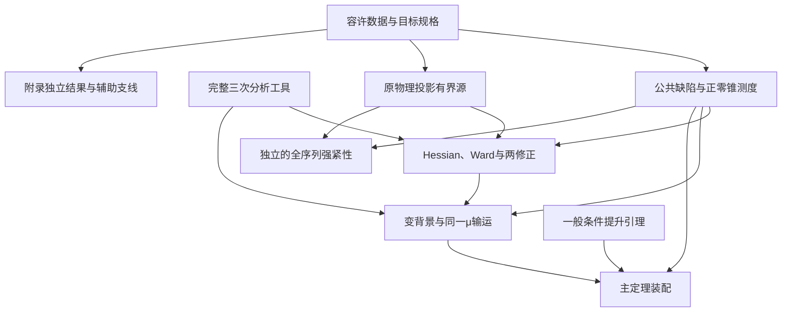

# 全文切片与数学依赖

这是当前锁定文章的工作分解图。切片覆盖每一行源码；数学完成状态仍以 [scope.json](scope.json) 为准。
正文范围、接口和依赖来自本次逐区阅读；结构检查不证明数学结论，也不认证全文语义无遗漏。

原文：`paper/burnett.tex`，3475行，SHA256 `e5e9fc351bbd5540884dc7f2fec42cdba94d591a2d4f5ebb4a409f316823904e`。

机器清单：[slices.json](slices.json)。本页由 `python scripts/check_slices.py --repo . --write-view` 生成。

## 使用方式

先选一个切片，检查其直接输入及 scope 中的实际证明状态，再执行其下一步。完成后沿出边检查消费者；闭合组保留同一见证、参数和极限的共同责任。
边类型：proof-input 是证明输入，definition/specification 是定义或规格，application 是条件引理的应用来源，explanation 是说明联系。定义可先实现，无须先闭合提供片的全部证明；application 不要求先证明其来源定理才能证明一般条件引理。
例子及背景也有源码归属，其认证范围仍按既有标准和待决项处理。

## 主线概览

该图是主线概览；全部直接依赖见下表及机器清单。附录正式结果保留独立工作支线。

## 全文范围

| 切片 | 原文行 | 类型 | 可交付结果 | 直接输入片 |
| --- | --- | --- | --- | --- |
| [F01](#f01) 原文身份、前置材料与论证范围摘要 | 1–89 | context | 固定本文是光滑四维极限类的正向Burnett拟证明，辨明摘要与正文正式目标的关系。 | — |
| [F02](#f02) 容许几何数据、射线动力学及主定理精确规格 | 90–168 | specification | 固定主定理所有对象、量词及射线/全动量两层结论，供各区实现共同使用。 | — |
| [F03](#f03) 范围说明、历史比较、证明导航及全篇记号契约 | 169–351 | specification | 将历史与导航留为上下文，同时抽出证明真正使用的收缩、内积及常数约定。 | F02（definition） |
| [F04](#f04) 精确连接差、弱Ricci恒等式及H^{-1}紧性 | 352–389 | proof-unit | 从原始真空假设构造弱曲率二次极限并得到线性化Ricci的局部H^{-1}强消失。 | F02（definition）, F03（definition） |
| [F05](#f05) 共同微局部协方差、子序列与Ricci核约束 | 390–429 | proof-unit | 为所有后续角向测试提供同一全局缺陷测度及自然坐标变换，而非仅有限矩数据。 | F04（proof-input）, F02（definition） |
| [F06](#f06) 完整Ricci二次代数、极化与零锥物理商正性 | 430–466 | proof-unit | 在一个共同代数父项中闭合非特征消去、Hermitian混合项和零锥正性。 | F05（definition）, F03（definition） |
| [F07](#f07) 正物理测度、二阶矩与二次定理共同闭合 | 467–486 | assembly | 将紧性、完整代数及全局协方差装配成thm:quadratic，并保留辅助截面变换。 | F04（proof-input）, F05（proof-input）, F06（proof-input）, F02（definition） |
| [F08](#f08) 基底边缘、角向解体及真空区消失 | 487–518 | assembly | 从二次构造独立获得cor:base-marginal全部结论。 | F07（proof-input） |
| [A01](#a01) 分析/Fourier规格与Lipschitz一阶交换子能量 | 519–600 | proof-unit | 固定整节分析对象，闭合lem:commutator含标量测试下矩阵系数版本。 | F03（definition） |
| [A02](#a02) 有限指数交换子、完整三次连续性与系数差 | 601–735 | proof-unit | 闭合完整极化三次能量的L³梯度连续性，并提供冻结用系数差子接口。 | A01（definition） |
| [A03](#a03) 完整三次作用的定量系数及测试冻结 | 736–892 | proof-unit | 共同闭合lem:freezing，并将频率独立、补丁独立常数写进接口。 | A02（proof-input）, A01（definition） |
| [A04](#a04) 三元组分割、角帽算子界及精确相位隙 | 893–1025 | proof-unit | 提供后续近角求和与远角除相位共同使用的几何/乘子输入。 | A01（definition） |
| [A05](#a05) 全尺度符号传递、低频端点与近角求和共同闭合 | 1026–1245 | proof-unit | 共同闭合lem:analytic-near的无尺度数损失界及δ^{β_*}近角界。 | A04（proof-input）, A01（definition） |
| [A06](#a06) 独立低角延拓、球谐分解与统一有限导数阈值 | 1246–1379 | proof-unit | 把修正符号的低角奇性移到低场，给A07与截断恢复可求和的BS¹接口。 | A01（definition） |
| [A07](#a07) 修正算子、导数/粗系数交换子与高槽伴随界 | 1380–1475 | proof-unit | 共同闭合lem:analytic-correction-bounds含完整伴随版本。 | A06（proof-input） |
| [A08](#a08) 四次交换子、精确正规形配对与固定n截断恢复 | 1476–1591 | assembly | 把修正算子界装配成只需一阶系数的精确能量接口，并合法移除角和/上频率截断。 | A07（proof-input）, A06（proof-input）, A01（proof-input） |
| [P01](#p01) 任意坐标中的固定规范补投影与全空间有界源 | 1592–1719 | proof-unit | 完整交付命题4.1：由原始真空一阶假设构造固定实偶order-zero乘子Pi，获得投影场的有限Lp梯度界、Lp及一致趋零、全空间L2散度源，并保持完整物理角测度。 | F02（definition）, F05（proof-input）, F06（proof-input）, F07（proof-input） |
| [V01](#v01) 输运正式目标与局部变分约定 | 1720–1744 | specification | 锁定定理5.1的对象、测试类及局部配对约定；只交付目标声明，不预设输运真值。 | F02（definition）, F07（proof-input） |
| [V02](#v02) 密度Hessian的Hermitian型与全Ricci核上的压缩 | 1745–1809 | proof-unit | 从Einstein–Hilbert一阶代表建立密度Euler式和自伴Hessian，精确计算其主符号及Poisson括号在零锥/离锥核上的压缩。 | V01（specification）, F05（definition）, F06（proof-input） |
| [V03](#v03) Hessian交换子、非线性余项与未规范化输运残差 | 1810–1905 | proof-unit | 从原始真空方程得到eq:var-cubic-residual，完整处理非局部测试的外截断、低阶符号和只在虚部能量中消失的Taylor余项。 | V02（proof-input）, F05（proof-input）, A01（proof-input）, F07（definition） |
| [V04](#v04) 完整三次变分、循环Fourier顶点与极化连续性 | 1906–2010 | proof-unit | 将完整残差转为对称三线性能量，证明背景导数项消失、冻结顶点的所有测试位置及其矩阵W1,3连续性。 | V03（proof-input）, V02（proof-input）, A02（proof-input）, F05（proof-input） |
| [V05](#v05) 相容红外截断下的物理/规范分解与规范势 | 2011–2052 | specification | 交付可供实际修正算子使用的精确高频分解及其收敛性质，统一原投影、测试与修正的嵌套IR约定。 | P01（definition）, V04（definition） |
| [V06](#v06) 度量一致的屏幕投影与自身物理相位抽取 | 2053–2108 | proof-unit | 显式构造固定宽零锥邻域上的screen投影，证明其度量参数一致性、真实缺陷保持和离锥screen张量的精确相位公式。 | V02（proof-input）, F05（proof-input）, F06（proof-input）, P01（definition） |
| [V07](#v07) off-shell Ward恒等式与全部规范腿/频率位置分类 | 2109–2262 | proof-unit | 保留单一共同分类责任：从作用的微分同胚不变性推导精确Ward式，穷尽一/二/三规范腿、低/高/可比频率位置；把每个剩余项归到自身物理相位或唯一低规范transport差相位。 | V04（proof-input）, V05（proof-input）, V06（proof-input）, A04（proof-input）, A05（proof-input） |
| [V08](#v08) 低规范transport修正的精确性、Hermitian伴随及BS1延拓 | 2263–2342 | proof-unit | 为单个低规范/两物理对称能量构造T_G，严格验证无共振除法、Hermitian性和可供粗交换子定理使用的独立变量符号类。 | V07（proof-input）, V05（proof-input）, V06（proof-input）, A06（proof-input） |
| [V09](#v09) 三物理near项的二次角增益与完整归一化核 | 2343–2503 | proof-unit | 由奇齐次测试的共同线性jet相消而非顶点特例，证明完整screen/cap/cone核的delta²增益及全尺度near能量估计。 | V04（proof-input）, V06（proof-input）, V07（proof-input）, A04（proof-input）, A05（proof-input）, F03（definition） |
| [V10](#v10) 物理far修正的精确分母与独立变量延拓 | 2504–2556 | proof-unit | 只在物理far支持上以精确signed相位除完整Hermitian分子，建立可用于粗交换子估计的独立omega,z,theta延拓和高槽自伴。 | V04（proof-input）, V07（proof-input）, V08（proof-input）, V06（proof-input）, A04（proof-input）, A08（proof-input） |
| [V11](#v11) 两类Hermitian修正对同一原投影方程的共同能量估计 | 2557–2591 | proof-unit | 共同交付T_G和T_F的粗系数能量控制：把两个修正均代入同一个原始投影物理场u的全空间标量散度方程，完整控制三个散度交换子并移除算子截断。 | P01（proof-input）, V08（proof-input）, V10（proof-input）, A07（proof-input）, A08（proof-input） |
| [V12](#v12) 完整冻结能量的共同装配与相位/修正归账 | 2592–2642 | assembly | 共同承担Ward分类与两类修正的最终冻结覆盖：精确装配v+G的所有三次项为near、physical far修正、低规范transport修正及自身物理相位项，保持每个cutoff和数值系数一致。 | V04（proof-input）, V05（proof-input）, V07（proof-input）, V08（proof-input）, V09（proof-input）, V10（proof-input）, V11（proof-input）, A04（proof-input） |
| [C01](#c01) 变背景完整三次能量的局部化、冻结及逐补丁体积归一 | 2643–2730 | proof-unit | 将同一个变背景三次残差变成有限个完整冻结能量；同时保留补丁局部体积，而非为每片重复收费全局场范数。 | F02（definition）, F03（definition）, A03（proof-input）, V03（proof-input）, V05（proof-input）, V04（proof-input） |
| [C02](#c02) 同一缺陷测度控制全空间投影尾部、冻结屏幕与相位插值 | 2731–2842 | proof-unit | 从一个已提取的张量缺陷测度得到全空间L2公式，再升级为逐补丁L3小误差；不以二次局部化直接冒充三次估计。 | C01（proof-input）, F05（proof-input）, V06（proof-input）, A02（proof-input）, V12（proof-input）, F06（proof-input）, V07（proof-input） |
| [C03](#c03) 两种完整修正的真实标量方程、体积因子与补丁求和 | 2843–2942 | proof-unit | 在已局部化u本身的全局标量散度方程上控制物理远角和规范修正；消去源项ell负幂前不得改空间尺度。 | C01（proof-input）, C02（proof-input）, P01（proof-input）, V09（proof-input）, V11（proof-input）, V12（proof-input） |
| [C04](#c04) 完整残差的共同闭合、固定同一mu及有序极限到全局输运 | 2943–2986 | assembly | 汇合冻结、近角、替换、相位及两修正，证明针对同一已提取测度的全部测试输运，明确三重极限和全局化。 | C01（proof-input）, C02（proof-input）, C03（proof-input）, V03（proof-input）, V12（proof-input）, F05（proof-input）, F07（proof-input）, V04（proof-input）, V01（specification） |
| [L01](#l01) 全局双曲Cauchy截面上的不变尺度与s^(-2)加权全动量提升 | 2987–3045 | proof-unit | 在已具有矩与输运的正射线测度上构造全零余切测度，保留每个紧基集的二阶矩有限性；不假设仿射完备。 | F02（definition）, C04（application）, F07（application） |
| [L02](#l02) 主定理：同一全局射线测度与任意全局双曲开放子时空上的全动量表示 | 3046–3062 | assembly | 组合二次构造、同一测度输运与全局双曲提升，逐项实现thm:main全部量词。 | F07（proof-input）, C04（proof-input）, L01（proof-input）, F02（specification） |
| [L03](#l03) 正式强紧性推论：真空区与全序列物理投影梯度强L2等价 | 3063–3115 | proof-unit | 在不使用输运的支路上证明cor:strong，保留每个开放U、每图每chi及整个原序列量词。 | F07（proof-input）, F08（proof-input）, F06（proof-input）, P01（definition）, F05（proof-input） |
| [X01](#x01) 正式附录A结果：精确调和坐标平直序列的背景L2源发散 | 3116–3172 | proof-unit | 完整纳入prop:shear，构造同一固定紧集上的发散，而非只记说明性坐标振荡。 | F02（definition）, P01（definition） |
| [X02](#x02) 正式附录B结果：二次特征局部化不足以消去一般三次相互作用 | 3173–3212 | proof-unit | 完整纳入标量三线性反例prop:cubic，并保留其与Einstein序列不同的适用范围。 | — |
| [X03](#x03) 已确认目标：旋转正零矩张量的守恒与输运不相容例 | 3213–3240 | proof-unit | 证明旋转正零矩张量虽守恒且有点态正零矩，却不存在输运的正射线表示；与正式几何反例prop:bianchi分别闭合。 | F02（definition） |
| [X04](#x04) 正式几何反例：正null-square Einstein张量仍无正动理输运表示 | 3241–3304 | proof-unit | 证明prop:bianchi的光滑度规存在与任意正表示排除，未假设真空逼近。 | F02（definition）, X03（explanation） |
| [X05](#x05) 正式Rosen两极化闭合：独立显式全动量无质量表示 | 3305–3359 | proof-unit | 独立完成prop:rosen的全动量无质量表示，不借主定理形成循环证明。 | F02（definition） |
| [X06](#x06) 已确认目标：多尺度Rosen真空序列与精确零源坐标例 | 3360–3387 | proof-unit | 证明已纳入的多尺度Rosen非零真空构造，包括ODE比较、极限、尺度下界及精确零源坐标；单独使用prop:rosen不足以闭合。 | X05（proof-input）, F03（definition）, P01（definition） |
| [X07](#x07) 正式刚性：全曲率为零的容许序列具有平直光滑极限 | 3388–3424 | proof-unit | 完整证明prop:flat-rigidity的全Riemann曲率为零结论，不把只得Ricci=0当作完成。 | F02（definition） |
| [X08](#x08) 范围待定：平直多尺度坐标例、类空raw defect与弱能量反例 | 3425–3446 | context | 保留附录E三例的候选定位和范围边界，不自动升级为正式认证目标。 | F02（definition）, F07（proof-input） |
| [X09](#x09) 辅助恒等式：固定测试的二阶导乘积与二齐次单位截面权重 | 3447–3463 | specification | 为可能实际使用的两个未编号恒等式建立精确合同；区分固定分布测试和二齐次推前权重。 | F07（proof-input）, F02（definition） |
| [X10](#x10) 参考文献与文档结束上下文 | 3464–3475 | context | 保持锁定原文末尾连续覆盖，只登记文献身份，不推定外部接口已核实。 | — |

## 正式结果的陈述与证明闭合

陈述片与闭合片可以不同；表中归属是实施计划，不是完成标记。全部17项仍通过 scope 追踪。

| 原文结果 | 陈述片 | 证明范围片 | 共同闭合片 |
| --- | --- | --- | --- |
| `thm:main` | F02 | L02 | L02 |
| `thm:quadratic` | F04 | F04, F05, F06, F07 | F07 |
| `cor:base-marginal` | F08 | F08 | F08 |
| `lem:commutator` | A01 | A01 | A01 |
| `lem:cubic-continuity` | A02 | A02 | A02 |
| `lem:freezing` | A03 | A03 | A03 |
| `lem:analytic-near` | A05 | A05 | A05 |
| `lem:analytic-correction-bounds` | A07 | A07 | A07 |
| `prop:general-projection` | P01 | P01 | P01 |
| `thm:variational-transport` | V01 | C01, C02, C03, C04 | C04 |
| `lem:lift` | L01 | L01 | L01 |
| `cor:strong` | L03 | L03 | L03 |
| `prop:shear` | X01 | X01 | X01 |
| `prop:cubic` | X02 | X02 | X02 |
| `prop:bianchi` | X04 | X04 | X04 |
| `prop:rosen` | X05 | X05 | X05 |
| `prop:flat-rigidity` | X07 | X07 | X07 |

用户另行确认必须形式化的未编号结果：

- `unnum:rotating-null-moment-example`：闭合片 X03；当前证明状态见 scope。
- `unnum:rosen-multiscale-example`：闭合片 X06；当前证明状态见 scope。
- `unnum:cubic-off-null-gradient-localization`：闭合片 X02；当前证明状态见 scope。

## 共同闭合组

### Q-CLOSE：公共缺陷与正物理测度

成员：F04, F05, F06, F07；闭合于 F07。

- 完整Ricci/B实及Hermitian代数、点态Lorentz正性与两参数规范类分类已有证明；几何/协方差对象实例化及F04/F05/F07共同测度构造仍待闭合。
- 同一全局子列和全部经典角测试的协方差；不得仅用应力矩唯一性代替全角对象自然性。

### CUBIC-CLOSE：完整Ward分类与两类修正

成员：V04, V05, V06, V07, V08, V09, V10, V11, V12；闭合于 V12。

- 全部一/二/三规范腿与可比位置统一归账；thin-cone/screen各槽次数、两个系数3及高槽转置保持一致。
- 修正存在、精确性、Hermitian、独立低角延拓与固定n截断恢复一并满足；不把残差消失作为任一工具的前提。

### TRANSPORT-CLOSE：同一μ的变背景输运共同闭合

成员：F05, F07, A03, A05, A08, P01, V03, V04, V12, C01, C02, C03, C04；闭合于 C04。

- 同一sigma、mu、原始子列和固定测试；所有参数测试使用这一对象，总残差极限固定，分项允许limsup。
- 每三次项最终携带局部补丁体积，有限补丁有界重叠后求和；不重复使用整图范数。
- 固定有限p_*>3和κ；先在固定n恢复高频和角截断，再固定δ、ℓ令n→∞，之后ℓ→0，再δ→0；常数禁依赖逐项核对。
- 奇实测试恢复到全部正一齐次紧底支撑测试，局部图册与全局同一测度拼接。

### MAIN-CLOSE：射线与每个全局双曲U的全动量结论

成员：F07, C04, L01, L02；闭合于 L02。

- L01是对任意给定矩+输运测度的条件引理，可独立证明；F07/C04只在主定理应用中提供其前提。
- 同一mu限制到每个U后，以Cauchy不变尺度构造nu=L_*(s^(-2)mu)，核对局部二阶矩和全部总空间紧支撑测试；不增加仿射完备性。

### STRONG-CLOSE：不依赖输运的全序列强紧性

成员：F05, F06, F08, P01, L03；闭合于 L03。

- 仅需P01投影定义；选择原文直接Parseval路线处理非局部尾。
- 紧单位零锥束的一致正定常数与任意子列再提取论证，闭合每图每χ和整个序列的双向结论。

## 逐片接口与下一步

### F01 原文身份、前置材料与论证范围摘要

原文1–89行；context。固定本文是光滑四维极限类的正向Burnett拟证明，辨明摘要与正文正式目标的关系。

输入：

- 锁定原文哈希、LaTeX环境与标题。

输出：

- 文献身份及拟证明状态；摘要中输运为中心主张、逆逼近和非光滑极限在范围外。

需保留的边界：

- 摘要不能作为另一条已证主定理；TeX环境声明不是数学完成清单。

消费者：此片未向其他片提供数学输入或应用。

下一步：将原文身份绑定到后续目标映射；不为排版与摘要另建Lean认证目标。

### F02 容许几何数据、射线动力学及主定理精确规格

原文90–168行；specification。固定主定理所有对象、量词及射线/全动量两层结论，供各区实现共同使用。

输入：

- M为光滑Hausdorff第二可数四流形；g_n光滑Lorentz度规；g光滑、时间定向、signature(-,+,+,+)；h_n=g_n-g。
- Ric(g_n)=0；h_n→0于C^0_loc；每个K紧包含M均有sup_n ||D h_n||_L∞(K;r)<∞；r为固定光滑Riemann度规，D=∇^r。无D²g_n假设。
- S_r^*M={|ξ|_r=1}表示正缩放射线且保留两时间方向；P=1/2 g^{ab}ξ_aξ_b；H_P为原文111–117的Hamilton向量场。

输出：

- 主定理规格：存在同一个子序列和同一个全局非负Radon μ；对每个K紧包含M，μ(π^{-1}K)<∞；supp μ⊂{P=0}；每个S∈C_c∞(M;Sym²TM)满足∫G_ab S^{ab}dV_g=∫S^{ab}ξ_aξ_b dμ；Scal(g)=0。
- 该同一μ对所有光滑、紧基支撑、正一齐次实测试a满足∫H_Pa dμ=0；先在非零余切丛求Hamilton导数，再限制单位截面；H_Pa二齐次。正齐次不要求a≥0。
- 对每个全局双曲开子时空U，另存在非负Radon ν于非零余切丛T*U∖{0}，支撑在零锥；每个K紧包含U有∫_{π^{-1}K}|ξ|_r²dν<∞；所有紧支撑光滑S和b分别满足全动量矩等式和∫H_Pb dν=0。未断言μ或ν唯一。
- 固定光滑坐标改变或辅助度规改变保持容许类；此为必要对象相容性接口，尚不由规格本身证明。

需保留的边界：

- 不得把每个测试各取子序列替代共同子序列。
- 全局双曲性仅用于全动量提升，不可加到全局μ存在或输运前提。
- 规格依赖图中的前向引用并不表示本片已经证明主定理。

消费者：F03（definition）、F04（definition）、F05（definition）、F07（definition）、P01（definition）、V01（definition）、C01（definition）、L01（definition）、X01（definition）、X03（definition）、X04（definition）、X05（definition）、X07（definition）、X08（definition）、X09（definition）、L02（specification）

片内细化义务（不另建完成状态）：

- 必要定义相容性子义务：固定r和坐标改变下局部导数界的等价性。（原文105–108行）

下一步：已证明原真空序列的局部一致收敛与紧集一阶导数界在任意两个光滑辅助黎曼度量之间等价。已有由原局部辅度量导数界导出的真实图内导数界。已构造内禀曲率与 Ricci 迹，并将内禀真空换为同一序列在各优先图中的坐标真空。继续完成 Lorentz 符号与时间定向，将该桥接入局部 Ricci 结论和全局对象。

### F03 范围说明、历史比较、证明导航及全篇记号契约

原文169–351行；specification。将历史与导航留为上下文，同时抽出证明真正使用的收缩、内积及常数约定。

输入：

- F02的主定理规格。

输出：

- rmk:status、rmk:scope与文献比较属于状态/范围说明；不自动新建认证目标。原文没有声称逆问题、非光滑极限、额外集中、Λ≠0或其他维数。
- 记号契约：tensor指标0…3、有序指标对全求和；Lorentz trace；r正长度；dV_g=√|det g|dx；坐标内积∫u·conj(v)dx线性于第一槽；局部字段延零。
- 常数可依赖固定紧集、光滑背景、测试符号和给定一阶界，不能依赖未假设的g_n高阶导数。
- 导航所列终结顺序：先n→∞固定δ,ℓ，再ℓ→0，后δ→0；p_*>3固定有限，β_*=2(p_*-3)/(p_*-2), α_*=2(p_*-3)/(3(p_*-2))。此处为后文结果摘要，认证归后文共同闭合。

需保留的边界：

- 文献比较与举例不得自行升格为本工程新增定理目标。
- 方程中的Im、i和线性槽约定会影响所有能量恒等式符号。
- 本片所含数字例p_*=4,12是说明，不各自建形式化项目。

消费者：F04（definition）、F06（definition）、A01（definition）、V09（definition）、C01（definition）、X06（definition）

下一步：同一真实cov3诱导导数的任意preferred图识别、物理Hilbert范数及原Dh局部控制已实现独审；无需重做这些桥。按F04实际消费者补全局mixed E定量模型，完整主结果和作者确认仍另取。

### F04 精确连接差、弱Ricci恒等式及H^{-1}紧性

原文352–389行；proof-unit。从原始真空假设构造弱曲率二次极限并得到线性化Ricci的局部H^{-1}强消失。

输入：

- F02的容许序列；F03的几何密度/常数约定；∇=∇^g。

输出：

- C_n=1/2 g_n^{-1}(∇h_n+∇h_n-∇h_n)=L(∇h_n)+E_n；每个固定K上最终逆度规一致有界且||E_n||_L∞(K)≤C||h_n||_L∞||∇h_n||_L∞→0。
- 精确式eq:ricci-exact保留所有导数；∇h_n弱*→0于L∞_loc，C_n弱→0于L²_loc；对固定紧支撑光滑张量测试积分分部后，Ric(g)是L(∇h_n)L(∇h_n)的eq:weak-ricci弱极限。
- ℒh=∇_aL(∇h)^a_bc-∇_cL(∇h)^a_ba；对每个有界图和嵌套截断，ℒh_n由L²一致有界项及强零L²项的导数组成，因而ℒh_n→0强于H^{-1}_loc。不推出二次项消失。

需保留的边界：

- 曲率精确式与弱极限必须对固定测试先操作；不能在序列依赖测试中丢弃D²h_n项。
- H^{-1}局部化需嵌套截断、低阶项及簇点唯一性，不能只写分布收敛。

消费者：F05（proof-input）、F07（proof-input）

片内细化义务（不另建完成状态）：

- 与H^{-1}紧性分开的精确连接差及弱曲率子义务。（原文360–382行）

下一步：已在同一r、g₀、gₙ、χ及n下实现逐图逐分量的真实线性化Ricci强H⁻¹局部化，沿用已实现的局部弱Ricci及一般H⁻¹核心。继续完整内禀Lorentz真空实例化、跨图全局张量测试和F05共同微局部对象。F04整体仍开放。

### F05 共同微局部协方差、子序列与Ricci核约束

原文390–429行；proof-unit。为所有后续角向测试提供同一全局缺陷测度及自然坐标变换，而非仅有限矩数据。

输入：

- F02的全局Dh_n与r正纤维内积、dV_g；F04的局部L²界、弱零及ℒh_n强H^{-1}零。
- 缺陷测试严格取经典零阶算子：主符号光滑、离零零齐次，固定红外正则化，余项阶-1。

输出：

- 由可数相对紧图册、紧穷竭、稠密测试族对角抽取一个子序列，产生E=T*M⊗Sym²T*M上正Hermitian束值Radon测度M_E；连续性扩展到所有上述紧基支撑主符号；局部阶-1余项二次极限零。
- 一般定位子义务：若光滑一阶系统A满足Au_n→0强H^{-1}_loc，则M_E密度range⊂ker a_1 a.e.；依次应用curl约束和ℒ约束，得到u_{α,ab}=ξ_α k_ab且ℛ_ξ(k)=1/2(sk_ab+ξ_aξ_b t-ξ_aq_b-ξ_bq_a)=0，其中s=g^{-1}(ξ,ξ),t=tr_g k,q_b=ξ^a k_ab。
- j_ξ:k↦ξ⊗k在|ξ|_r=1时为r等距；存在正Hermitian σ使M_E=j_ξσj_ξ*，密度range⊂kerℛ_ξ；坐标协方差矩阵为σ_op G_F^{-1}。
- 每个上述A的实标量主符号a_0满足eq:sigma：lim_n〈∂_αh_ab,A∂_βh_cd〉_{dV_g}=∫a_0 ξ_αξ_β dσ_ab,cd；复测试按第二槽共轭线性延伸。所有有序对称指标重数保留；固定坐标改变、D与∂替换及算子共轭低阶余项均相容。

需保留的边界：

- 没有任意非齐次S^0_{1,0}全符号同步收敛的结论。
- 正Hermitian算子测度矩阵与协方差分量不能混同，尤其改变r时。
- 只证明应力二阶矩不足以识别角测度或其坐标/截面变换。

消费者：F06（definition）、F07（proof-input）、P01（proof-input）、V02（definition）、V03（proof-input）、V04（proof-input）、V06（proof-input）、C02（proof-input）、C04（proof-input）、L03（proof-input）

片内细化义务（不另建完成状态）：

- 共同子序列及全测试扩展子义务。（原文392–410行）
- 一般一阶约束定位子义务；可复用外部定理或原文直接论证。（原文412–418行）
- Gram转换、等距因子化与自然坐标变换子义务。（原文421–428行）

下一步：实际一阶行已有 Bessel 主部定位，原度规列已有坐标旋度约束。继续接入 Ricci 行、同一抽取的有序测度和密度约束。

### F06 完整Ricci二次代数、极化与零锥物理商正性

原文430–466行；proof-unit。在一个共同代数父项中闭合非特征消去、Hermitian混合项和零锥正性。

输入：

- 固定四维实Lorentz纤维g、ξ≠0、对称k；F05的ℛ_ξ定义，但不要求先形式化微局部测度。
- c(k)^a_bc=1/2(ξ_bk_c^a+ξ_ck_b^a-ξ^a k_bc)；B_bc=c^a_ce c^e_ba-c^a_ae c^e_bc；t=tr_gk,q_b=ξ^ak_ab,s=g^{-1}(ξ,ξ)。

输出：

- 全展开4B_bc=ξ_bξ_c K_2+2q_bq_c-2s(k²)_bc-t(ξ_bq_c+ξ_cq_b-sk_bc)，K_2=k_abk^{ab}；从实恒等式获得所需混合/Hermitian极化。
- s≠0且ℛ_ξk=0时k=ξ⊗v+v⊗ξ，v=(q-tξ/2)/s；c(k)^a_bc=ξ_bξ_c v^a且B=0，包括极化混合项。
- s=0时ℛ_ξk=0等价q=tξ/2；B_bc=1/4 ξ_bξ_c F(k,k)，F=k_abk^{ab}-1/2(tr_gk)²；每个核中k和每个规范ℓ=ξ⊗v+v⊗ξ满足F(k,ℓ)=0。
- 选择g(L,L_under)=-2及二维正交屏幕的零标架，核约束与规范消去留下无迹对称屏幕张量；F(k,k)=Σ_{A,B}|k_AB|²≥0，物理商二维且与代表无关；需把实证明准确延伸到正Hermitian协方差。

需保留的边界：

- 已实现实/复非特征消去、完整B及Hermitian混合公式、规范代表不变、任意非零零方向正性、一般Lorentz点态证书协变及完整两复参数分类；几何Lorentz数据到证书、F05/F07协方差与测度实例化及本轮新数学解释确认仍须分别核实，不据此关闭父二次定理。
- 核、规范商与屏幕正范数需严格区分；非零锥上不应宣称F非负。
- 不能仅证明B(k,k)=0而漏掉协方差所需混合项。

消费者：F07（proof-input）、P01（proof-input）、L03（proof-input）、V02（proof-input）、V06（proof-input）、C02（proof-input）

片内细化义务（不另建完成状态）：

- 完整对称张量代数子义务。（原文432–449行）
- 实及复Hermitian混合代数已有原定义桥接、完整两槽规律和两类核结论；见新实际声明与复核。（原文450–452行）
- 零锥物理/规范交叉消去子义务。（原文454–463行）
- 点态frame证书、实际双反射归一化、规范代表不变、非负/规范零核及两参数双向分类已有证明；几何/测度实例化与全局光滑选择另核。（原文465–465行）

下一步：把已证点态Lorentz证书、Hermitian型及完整两坐标分类接入F02/F05真实几何与协方差对象，再由F07闭合测度配对正性和二次定理；点态反射选择不自动提供V06需要的光滑性/参数一致界。

### F07 正物理测度、二阶矩与二次定理共同闭合

原文467–486行；assembly。将紧性、完整代数及全局协方差装配成thm:quadratic，并保留辅助截面变换。

输入：

- F04的弱Ricci式；F05的共同全局σ与核约束；F06的完整Hermitian代数/零锥正性；F02对象规格。

输出：

- Z={P=0}∩S_r^*M上定义dμ=1/4 1_Z(g^{ac}g^{bd}-1/2g^{ab}g^{cd})dσ_ab,cd；Z限制为Borel测度限制。
- 以正r-trace测度控制σ，纤维正Hermitian密度谱分解及F06给μ≥0；固定紧基单位余球上系数有界给局部有限。由弱Ricci与完整B式得到所有紧支撑S的Ricci矩；取S=φg^{-1}给Scal(g)=0，从而Einstein矩。
- 共同闭合thm:quadratic：一个子序列上的全局正Radon μ、零锥支撑、矩、Scal=0与固定光滑坐标相容；没有输运结论。
- 辅助r'：s_0=|ξ|_{r'}于S_r^*M，F_0(x,ξ)=(x,ξ/s_0)；σ'=F_{0*}(s_0²σ)，μ'=F_{0*}(s_0²μ)。依据全部角向符号协变性，不能只由矩等式推得。

需保留的边界：

- 不能把未限制于Z的F收缩当作正测度。
- 一般角测度不由应力矩唯一决定；输运不得替换成某个同矩测度的输运。
- 谱分解、Radon局部性、正Hermitian与复共轭约定均是实际依赖。

消费者：F08（proof-input）、P01（proof-input）、V01（proof-input）、C04（proof-input）、L02（proof-input）、L03（proof-input）、X08（proof-input）、X09（proof-input）、V03（definition）、L01（application）

下一步：统一F04–F06输出的同一σ及子序列，建立正测度Borel收缩、矩测试和截面加权推前的共同装配。

### F08 基底边缘、角向解体及真空区消失

原文487–518行；assembly。从二次构造独立获得cor:base-marginal全部结论。

输入：

- F07的正μ、Einstein矩、局部基底有限性；单位截面r^{ab}ξ_aξ_b=1；g光滑。

输出：

- e_r=r^{ab}G_ab为处处光滑非负函数，π_*μ=e_r dV_g。
- 存在dV_g-a.e.定义的可测非负有限纤维测度μ_x，支撑于x的单位零余向量；dμ=dμ_x dV_g，μ_x(S^*_{r,x}M)=e_r(x)，G_ab(x)=∫ξ_aξ_b dμ_x a.e.；e_r=0处可取μ_x=0。
- 固定μ的解体具通常a.e.唯一性；无角向正则性、无由矩唯一确定μ的结论；基底无集中，g的每个真空开区上μ消失；不使用输运。

需保留的边界：

- 张量矩恒等式为a.e.；e_r≥0由光滑性提升至处处，二者量词不能混同。
- 可测纤维测度不等于光滑Vlasov密度。

消费者：L03（proof-input）

下一步：已有光滑测试的正性和测度确定、给定联合测度与边缘密度的局部加权分解，以及在局部界成立的可数覆盖上拼接角核和几乎处处唯一。给定角核的可测换坐标、非负加权和逐事件重构也已证明。下一步从同一 F07 物理测度构造实际基底边缘与角核并给出局部界和单位零壳集中，核对 Einstein 二阶矩与真空区消失。

### A01 分析/Fourier规格与Lipschitz一阶交换子能量

原文519–600行；proof-unit。固定整节分析对象，闭合lem:commutator含标量测试下矩阵系数版本。

输入：

- R⁴上固定有限维实场，Fourier时复化，紧图字段延零；光滑系数以固定嵌套截断延拓；所有配对用dx与固定Euclidean纤维内积。m取非退化常Lorentz形式的固定紧族，q_m(ξ)=m^{ab}ξ_aξ_b。
- Fourier变换exp(-ix·ξ)；逆变换(2π)^-4；T_b双线性积分因子(2π)^-8；𝒯_b(f,g,w)=∫T_b(f,g)w以双线性末槽而非Hermitian配对。
- u∈C_c∞向量场；r^{ab}=r^{ba}实光滑标量系数；B=B*固定properly supported矩阵ΨDO阶1、光滑S^1_{1,0}符号；固定红外正则化。

输出：

- |2 Im〈r^{ab}∂_abu,Bu〉|≤C_B||r||_{W^{1,∞}(R⁴)}||u||_{H¹(R⁴)}²；常数不依赖r或u的二阶导数。
- 若矩阵R^{ab}满足(R^{ab})*=R^{ba}且B在每一符号阶都标量，相同估计成立；固定光滑正密度由平方根共轭还原，新增固定低阶项。
- 全节常数独立dyadic尺度数；依赖证明用到的有限个归一化符号导数，在角估计中须对帽指标及δ一致。精确散度交换子三项分解保留以供A08。

需保留的边界：

- 矩阵系数版本要求B每一符号阶都标量，只有主符号标量不够。
- 分析配对dx与几何dV_g转换必须显式；r^{ab}本片系数不能混同全篇辅助度规r。

消费者：A02（definition）、A03（definition）、A04（definition）、A05（definition）、A06（definition）、A08（proof-input）、V03（proof-input）

片内细化义务（不另建完成状态）：

- 本节共同分析对象及有限符号半范数一致性规格。（原文519–537行）

下一步：在登记的符号及支撑假设下，完整左量子化的标量、矩阵主能量配对和两条固定图密度估计已有 Lean 证明。后续须将原文算子类和下游 Weyl 作用与这些 Lean 输入对接。

### A02 有限指数交换子、完整三次连续性与系数差

原文601–735行；proof-unit。闭合完整极化三次能量的L³梯度连续性，并提供冻结用系数差子接口。

输入：

- A^{ab}为场值到endomorphisms的常线性映射，所有实H有A^{ab}(H)^T=A^{ba}(H)；𝒬为固定常系数一阶导数双线性式；B=a(D)Id，a实光滑一齐次。
- u,v为光滑紧支撑实场；𝔈(u)=2Im〈A^{ab}(u)∂_abu+𝒬(∂u,∂u),Bu〉；A01的Fourier/配对约定。

输出：

- 每个光滑一齐次b、1<p,s,r<∞且1/r=1/p+1/s，有||[b(D),f]v||_Lr≤C_b||∂f||_Lp||v||_Ls；C_b仅依赖单位球上有限个b导数。原文给覆盖任意小乘积频率的全局Coifman–Meyer分解。
- |𝔈(u)-𝔈(v)|≤C||∂(u-v)||_L³ (||∂u||_L³+||∂v||_L³)²；固定非齐次正则化时对应W^{1,3}版；完整实对称三线性极化满足梯度范数乘积界。
- 实光滑f、H,u有|2Im〈f A^{ab}(H)∂_abu,Bu〉|≤C(||f||_∞||∂H||_3+||∂f||_∞||H||_3)||∂u||_3²；极化给不同因子版。O(ℓ)系数差产生O(ℓ)主项；其导数乘未微分场，于固定局部化尺度序列极限中消失。

需保留的边界：

- 只估孤立未对称测试槽不足以推出本引理。
- c_j的乘积频率线性乘子留在双线性算子外；不能假称在乘积频率0光滑。
- 有限指数条件r>1必须保留，不能外推到未证端点。

消费者：A03（proof-input）、V04（proof-input）、C02（proof-input）

片内细化义务（不另建完成状态）：

- 必要定义：含quasilinear和semilinear完整能量。（原文601–611行）
- 独立可复用的有限指数交换子子义务，不能以A01的Lipschitz-L²版替代。（原文626–677行）
- 完整对称极化及望远镜连续性子义务。（原文679–715行）

下一步：完整齐次及固定正则化能量、有穷指数交换子和混合系数界均有 Lean 证明。原文命题确认及空间变系数应用另有后续工作。

### A03 完整三次作用的定量系数及测试冻结

原文736–892行；proof-unit。共同闭合lem:freezing，并将频率独立、补丁独立常数写进接口。

输入：

- 固定相对紧R⁴图与有限维实场；实对称三线性作用𝒯的主三次多项式P_C(z)=∫C_{IJK}^{ab}(x)z^I∂_az^J∂_bz^K dx，C_{IJK}^{ab}=C_{IKJ}^{ba}；其余项总场导数至多1；全部系数固定光滑。
- B为标量自伴阶1测试，实奇主符号a(x,ξ)，选择Q=-iB保实场；一个固定红外正则化。𝒯_0仅保留x_0冻结的主系数，Q_0=-ia(x_0,D)。
- x_0在固定紧集，z∈C_c∞(B(x_0,Rℓ))实场，0<ℓ≤ℓ_0≤1。

输出：

- |𝒯(z,z,Qz)-𝒯_0(z,z,Q_0z)|≤Aℓ||∂z||_3³+B_ℓ||z||_3||∂z||_3²。
- A仅依赖R、场维数与有限个固定光滑系数/归一化测试符号半范数；对ℓ、x_0、补丁数及z频率均一致；每个固定ℓ有有限B_ℓ且对x_0、z频率及补丁数一致，允许依赖ℓ^-1与更多固定半范数。无z二阶导数。
- 片内子义务：完整三槽变分消掉表观二阶导数；Q_{f,b}=(fQ_b+Q_bf)/2的交换子式；Poincaré；重标度后空间Fourier展开的ℓ小加权可和半范数；阶0/红外/量子化与低作用项均含未微分z。

需保留的边界：

- A必须对补丁数与ℓ一致，B_ℓ允许随ℓ退化；混写会破坏补丁求和。
- 必须同时冻结测试与作用系数，且完整三槽对称性先于估计。
- 原文固定N的有限符号导数阈值不应误称最优阈值。

消费者：C01（proof-input）

片内细化义务（不另建完成状态）：

- 三槽变分及分离测试估计子义务。（原文767–819行）
- ℓ小空间展开及阶0余项子义务。（原文825–865行）

下一步：先建有限半范数控制的三槽取消式，再分别验证测试冻结与系数冻结，统一输出A/B_ℓ量词。

### A04 三元组分割、角帽算子界及精确相位隙

原文893–1025行；proof-unit。提供后续近角求和与远角除相位共同使用的几何/乘子输入。

输入：

- A01的固定紧Lorentz族；固定0<κ<1/16及ϑ∈C∞([0,∞);[0,1])，在[0,1/4]为1、[1,∞)为0；p+q+r=0的非零三元组。
- 0<δ<δ_0；η=cκδ²，c>0固定足够小；薄锥|q_m(ζ)|≤Cη|ζ|²；正射影零方向识别反点，但Fourier频率保留符号。

输出：

- L_p=ϑ(λ_p²/[κ²(λ_q²+λ_r²)])及循环L_q,L_r，L_comp=1-ΣL；至多一个低项非零，四项非负且和1。低p片λ_p/λ_q≤2κ且1-2κ≤λ_r/λ_q≤1+2κ；可比片minλ/maxλ≥κ/2；高槽互换及高伴随对称性。
- N_p=ϑ(d(p,q)/δ²)ϑ(d(p,r)/δ²)，d=|p∧q|²/(λ_p²λ_q²)；低近/远分割L_pN_p与L_p(1-N_p)；远片两个项目分离均≥固定倍δ²。
- 射影零集二维帽覆盖N_δ≤Cδ^-2，均有界重叠，使用两个有符号提升；P_γ与固定放大的P_γ^+含薄锥剖面及所需归一化导数一致；近三线性形仅在指定一槽插入一个帽分割，其余两槽落同一固定放大帽。
- 1<p<∞时||P_γf||_p≤C_p||f||_p，对δ,γ一致；每个固定有限p_*>3，(Σγ||P_γf||_3³)^{1/3}≤C_{p_*}N_δ^{1/[3(p_*-2)]}||f||_3；P_γ^+相同。来自抛物线线性重标度、L²重叠及L^{p_*}计数测度插值。
- 全部三频满足薄锥条件且p为最小频时，可比片三射影方向位于有界相邻δ帽。仅在低p角远片L_p(1−N_p)≠0上（循环位置同理），signed精确相位Δ=q_m(ξ+p)−q_m(ξ)=2m(p,ξ)+q_m(p)满足|Δ|≥c₁δ²λ_pλ_q；低高频率分离本身不够。归一化帽变量与ρ=λ_p/λ_q=0端点接口在1019–1024另作定义。

需保留的边界：

- 个别帽Lp界不推出整个薄锥投影一致Lp界。
- 不可比频率方向、小频端点、两个有符号锥片与反点识别须分别保留。
- 不允许使用L∞乘子端点或L³角向ℓ²界替代原文有限指数论证。
- 相位下界必须保留角远支撑；共线null三元组可低高分离但Δ=0，不能在near片据此除相位。

消费者：A05（proof-input）、V07（proof-input）、V09（proof-input）、V10（proof-input）、V12（proof-input）

片内细化义务（不另建完成状态）：

- 单一帽指标与放大帽几何子义务，禁止独立三帽计数。（原文928–951行）
- 将Lp(1−Np)≠0作为精确相位隙的明示前提；频率低高分离不能替代角远支持。（原文921–1014行）

下一步：本批证明了角帽几何、统一的单帽与角向场估计，以及薄锥低槽远角区的有符号相位下界。后续用同一放大帽实现 A05 的单帽指标三线性局部化。

### A05 全尺度符号传递、低频端点与近角求和共同闭合

原文1026–1245行；proof-unit。共同闭合lem:analytic-near的无尺度数损失界及δ^{β_*}近角界。

输入：

- 平移不变三线性Fourier乘子在p+q+r=0；移出三个一阶导数权重后m同时正缩放零齐次。固定光滑齐次低高分割上m=M(ω,θ,ρ)，ω=p/λ_p, θ=q/λ_q, ρ=λ_p/λ_q。
- 𝔄_100控制有限角图册中到ρ=0的C^100延拓，以及可比片到固定归一化环箱的C^100延拓；固定逐因子红外截断可单独放置。f,g,w指已微分因子。
- 近角另要求相邻零帽支撑，m=δ²乘以归一化帽变量中含ρ=0端点均匀𝔄_100≤A的符号。

输出：

- 一般界|𝒯_m(f,g,w)|≤C_κ𝔄_100||f||_3||g||_3||w||_3；常数对有限光滑逐因子dyadic截断一致，与最高频率及尺度数无关。
- 每个固定有限p_*>3，|𝒯_near|≤C_{κ,p_*}A δ^{2(p_*-3)/(p_*-2)}||f||_3||g||_3||w||_3；薄锥乘子已含个帽符号，右侧不需要完整薄锥投影范数。
- 技术子接口：共同抛物线线性变换三因子L³范数与积分行列式抵消；ρ=ρ' b_δ(ω')/b_δ(θ')且仅固定锥上b_δ及倒数符号界一致；低高符号精确拆M=χ_0M_0+ρR，M_0无需消失。
- M_0按角变量分离后保留低通/高/高抛物积，以最大函数和两平方函数控制；ρR固定间隔s给2^-s与可和系数；可比片有限相对环移。所有分离Fourier项前须插入第三槽厚乘积频率环截断。
- 单帽δ²界经唯一帽指标Hölder和A04帽界给δ²N_δ^{1/(p_*-2)}≤Cδ^{β_*}。允许逐因子有限截断，未允许每对dyadic指标任意独立权重。

需保留的边界：

- 仅有限频隙光滑不足，必须控制ρ→0端点。
- 两输入帽支撑不保证分离Fourier项第三频率离零，必须保留输出环截断。
- 变换矩阵在全频空间不一致可逆；证明只需固定放大锥上的比值符号界。
- C^100、Fourier系数衰减与平方函数多项式损失须共同核算，不能凭长度有限宣称一致。

消费者：V07（proof-input）、V09（proof-input）

片内细化义务（不另建完成状态）：

- 抛物线重标度子义务。（原文1060–1099行）
- 非消失低频端点及低通切换子义务。（原文1101–1146行）
- 径向余项、可比片、第三槽支撑保护与截断一致性子义务。（原文1148–1224行）
- 帽求和与β_*输出子义务。（原文1226–1243行）

下一步：先落实ρ=0抛物积与含第三槽环保护的径向传递两个核心子义务，再拼接帽重标度/求和并核实逐因子截断一致性。

### A06 独立低角延拓、球谐分解与统一有限导数阈值

原文1246–1379行；proof-unit。把修正符号的低角奇性移到低场，给A07与截断恢复可求和的BS¹接口。

输入：

- T_Hu=T_t(H,u)平移不变双线性，低高支撑|p|<Cκ|ξ|、Cκ<1/2且光滑截断。t(p,ξ)=|ξ| M(ω,z,θ)，ω=p/|p|, z=p/|ξ|, θ=ξ/|ξ|。
- M在独立变量(ω,z,θ)∈S³×𝒦上光滑延拓，𝒦固定紧且含{0}×S³；低高截断光滑依赖|z|²；高频固定红外正则化；任何低绝对频率截断置于H。可依赖固定δ，常数C_δ依赖有限半范数。

输出：

- 只展开独立ω：M=ΣY_ν(ω)c_{ν,δ}(z,θ)；R_νH=Y_ν(D)H后，b_{ν,δ}=|ξ|c_{ν,δ}(p/|ξ|,ξ/|ξ|)属于BS¹_{1,0}；每个固定导数阶有|∂_p^α∂_ξ^βb_ν|≤C_{N,α,β,δ}(1+ν)^-N(1+|p|+|ξ|)^{1-|α|-|β|}。
- 存在一个有限K，𝔭_K(b)=max_{|α|+|β|≤K}sup(1+|p|+|ξ|)^{|α|+|β|-1}|∂_p^α∂_ξ^βb|同时控制阶0CM及BenyiOh Thm1的(4,4,2)、(4,2,4/3)交换子范数，乘||∂d||∞。K来源为闭图、Fréchet空间一致有界与两个指数取较大阈值，原文没有给内在最小K。
- 实正交S³谐波按l及1≤k≤(l+1)²：||c_lk||_{C^K}≤C(1+l)^-12||M||_{C^{K+12}}，||Y_lk(D)||_{L^s→L^s}≤C_s(1+l)^7，1<s<∞；总级数Σ(l+1)²(l+1)^7(l+1)^-12可和。
- 全算子及角部分和受同一有限||M||_{C^{K+12}}控制；角度L尾范数≤C(1+L)^-2||M||；对称高输入/输出上频截断的符号半范数在固定红外以上一致，其实际强收敛由A08承担。

需保留的边界：

- 仅ρ光滑不蕴含独立(ω,z,θ)延拓。
- 低绝对频率截断不可留在声称BS¹的Cartesian符号中。
- 未展开低角符号并非p=0处Cartesian光滑；不能跳过球谐分离。
- K+12的有限导数控制须为后续两修正提供同一接口，不能任意写定最小K。

消费者：A07（proof-input）、A08（proof-input）、V08（proof-input）

片内细化义务（不另建完成状态）：

- 由定性外部定理到统一有限半范数的闭图/一致有界子义务。（原文1300–1345行）
- 具体谐波乘子损失、重数与O(L^-2)尾估计子义务。（原文1347–1377行）

下一步：先定义独立延拓与BS¹半范数，再核外部交换子两个指数的定理接口及有限K提取，最后建立球谐可和尾。

### A07 修正算子、导数/粗系数交换子与高槽伴随界

原文1380–1475行；proof-unit。共同闭合lem:analytic-correction-bounds含完整伴随版本。

输入：

- A06独立变量延拓的T_H；固定δ；适用范数有限的光滑/Schwartz字段及实标量Lipschitz d；固定红外正则化。

输出：

- ||T_Hu||_2≤C_δ||H||_4||∂u||_4；||[∂_a,T_H]u||_2≤C_δ||∂_aH||_4||∂u||_4；||[d,T_H]v||_2≤C_δ||∂d||_∞||H||_4||v||_4。
- 高槽形式伴随b†(p,ξ)=conj(b(-p,ξ+p))^T、低场变conj(F)；高输入/输出频率仍可比，伴随有同样首项界；[∂_a,T_H]=T_{∂_aH}，伴随导数交换子相同控制。
- 实标量d满足[d,T_H*]=-[d,T_H]*；用(4,2,4/3)外部界及对偶性得同样L⁴低场×L⁴高场→L²的伴随粗交换子界。非齐次版只增加u低阶范数。
- 常数由A06有限延拓半范数控制，对角有限和一致；完整Hermitian修正由Hermitian部分在算子范数中恢复。

需保留的边界：

- 伴随粗交换子不能只用首个(4,4,2)界，需要第二指数(4,2,4/3)及对偶。
- d只在高槽；若误置低槽会产生未控制的低角交换子。
- T_H*的支撑/高频可比性及低角共轭必须明确。

消费者：A08（proof-input）、V11（proof-input）

片内细化义务（不另建完成状态）：

- 高伴随符号与第二指数三元组对偶子义务。（原文1441–1465行）

下一步：基于A06分离逐项证明首界与导数式，再用两个外部指数界闭合原算子及高伴随粗交换子；统一C_δ。

### A08 四次交换子、精确正规形配对与固定n截断恢复

原文1476–1591行；assembly。把修正算子界装配成只需一阶系数的精确能量接口，并合法移除角和/上频率截断。

输入：

- A06/A07的修正T_H及其伴随；d^{ab}=d^{ba}实标量Lipschitz，L_d=-∂_a(d^{ab}∂_b)；P_0=-m^{ab}∂_ab；T_H=T_H*；P_n=P_0+L_d。
- Hermitian分子σ可在Δ=q_m(ξ+p)-q_m(ξ)≠0区域除以iΔ，所得t必须另验证A06独立变量延拓。
- 应用中每个固定n、固定局部尺度，z=χh_n光滑紧支撑；原文所述投影、屏幕、锥及低角乘子有固定红外，所得H,u为Schwartz，d光滑紧支撑，T_Hu亦Schwartz；不要求Schwartz半范数对n一致。

输出：

- 精确[L_d,T_H]三项分解给|〈i[L_d,T_H]u,u〉|≤C_δ[||d||∞||∂u||_2||∂H||_4||∂u||_4+||∂d||∞||∂u||_2||H||_4||∂u||_4]；无d,u二阶导数。
- S_H=i[P_0,T_H]的Fourier-shift符号为iΔt；〈S_Hu,u〉=2Im〈P_nu,T_Hu〉-〈i[L_d,T_H]u,u〉。故L²有界源P_nu、小L⁴低场及前式足以控制修正；本片不提供实际序列的有界源。
- A_L为球谐至L的有限和，取T_L=(A_L+A_L*)/2；|| (T_L-T_H)u||_2≤C_δ(1+L)^-2||H||_4||∂u||_4，导数与粗交换子同尾因子。固定n下P_0u∈L²使精确交换子配对收敛。
- J_Λ=χ(D/Λ)，χ实偶紧支撑且近0为1；T_{L,Λ}=J_ΛT_LJ_Λ。固定n,L先Λ→∞，修正L²强收敛、三种粗交换子配对及P_0配对收敛；再L→∞得到完整修正；两限均先于n→∞。不需要Λ尾的统一算子范数、P_0u_n一致界或随序列选择的截止。

需保留的边界：

- A_L一般不Hermitian，必须先取Hermitian部分再恢复。
- 只在固定n使用P_0u∈L²，不可误升级为序列一致背景源估计。
- 粗交换子界d仅Lipschitz，应用中的光滑d与Schwartz域需另验证；不能以域近似隐匿极限。
- 精确相位不能用近似相位替代；Hermitian分子/除法符号及延拓必须匹配。

消费者：V10（proof-input）、V11（proof-input）

片内细化义务（不另建完成状态）：

- 形式恒等式的应用域子义务；下游投影符号需验证此前提。（原文1528–1540行）

下一步：先装配三项粗交换子与精确配对；再证明固定n域与Λ→∞、L→∞恢复定理，向后续修正能量片交付带明确限序的接口。

### P01 任意坐标中的固定规范补投影与全空间有界源

原文1592–1719行；proof-unit。完整交付命题4.1：由原始真空一阶假设构造固定实偶order-zero乘子Pi，获得投影场的有限Lp梯度界、Lp及一致趋零、全空间L2散度源，并保持完整物理角测度。

输入：

- 原始admissible序列；U相对紧坐标图、chi光滑紧支集；z_n=chi*h_n零延拓。
- a_n是g_n逆分量在supp chi邻域的光滑一致Lipschitz延拓；最终常数允许依赖该族的一阶界。延拓不是预给定有界源。
- 原导数缺陷在Ricci符号核中、离锥为纯规范、零锥Lorenz约束和Hermitian规范交叉消去；完整角测度的乘子作用规律。
- 固定全空间 IR 正则乘子 Π 的梯度交换子已有全局 Lipschitz 系数的 L² 有界延拓。任意相容光滑图的内禀输入已转移到实际坐标真空、一致收敛和一阶图内界，与同一 Π 的全空间散度公式相接。

输出：

- Pi_E(xi)H=P_xi H P_xi，P_xi=I-xi*xi^T/|xi|_E^2；给出显式规范差张量。径向IR正则化后的Pi仍严格杀死紧支集分布协向量的对称梯度。 条件与一致性：xi非零的齐次符号；IR cutoff固定实偶，零附近消失，高频为1；正则化后的Pi一般不再幂等。
- 坐标Ricci分解及降低规范源指标后移入对称梯度，证明||Pi Q_n z_n||_2≤C_chi。结合[Pi,f]∂_b w=[Pi∂_b,f]w-Pi((∂_b f)w)，得到eq:general-explicit-source和||-∂_a(a_n^{ab}∂_b u_n)||_2≤C_chi。 条件与一致性：u_n=Pi z_n；全空间估计包括Pi尾部；只依赖一阶系数界，无∂²a_n或∂²h_n界，不声称Q_n z_n本身L2有界。
- 每个固定1<p<infinity，∂u_n的Lp一致界及u_n→0于Lp、L-infinity；chi=1处缺陷零性、Lorenz极化和eq:mu-invariant的完整角测度不变。 条件与一致性：无∂u_n的L-infinity界；不声称去掉的规范场导数强收敛。物理收缩相等不能仅由二阶矩相等替代。

需保留的边界：

- 不能把消去对称梯度提升成原场已满足坐标条件。
- 非紧投影尾部不能用局部源界替代。
- Pi的IR cutoff必须与V05的chi_hi选取相容。
- 光滑g背景一般不真空；Ricci展开须保留背景项。

消费者：V05（definition）、V11（proof-input）、C03（proof-input）、L03（definition）、X01（definition）、X06（definition）、V06（definition）

片内细化义务（不另建完成状态）：

- 原清单只有投影定义与整命题，未单列降低规范源指标后的坐标Ricci展开、Calderon界和含非紧尾部的精确全空间源公式。（原文1644–1695行）
- 须证明完整角测度不变；仅应力二阶矩或现有5条实代数支持均不足。（原文1703–1709行）

下一步：任意相容光滑图中，同一个零延拓场的投影满足全部范数结论及全空间散度界。固定 Lipschitz 上界后，一个常数统一控制所有合格逆度量延拓族和序列指标。接续同一原序列的投影协方差和完整物理角向测度识别。

### V01 输运正式目标与局部变分约定

原文1720–1744行；specification。锁定定理5.1的对象、测试类及局部配对约定；只交付目标声明，不预设输运真值。

输入：

- eq:admissible原始数据及thm:quadratic产生的同一个不变非负物理测度mu。
- 光滑正向一齐次测试a，紧base支集；局部张量分量用lower metric作为仿射变量。

输出：

- 定理5.1目标：所有该类a满足∫H_P a dmu=0；无坐标条件、无二阶导数尺度。 条件与一致性：此项是待证命题，不能作为V02–V12的数学输入；证明归属2647–2969的C区装配。
- 固定Lebesgue密度、lower metric仿射变量、ordered symmetric-index summation及局部分割的声明约定。 条件与一致性：非对角分量重数2，或等价的正交10分量基；与dV_g缺陷归一化须显式桥接。

需保留的边界：

- 不能因定理在本区出现就把它登记为本区证明完成。
- 正式结果在source-index的证明定位2647–2969跨区；本区至2642只有预备恒等式和冻结估计。

消费者：V02（specification）、C04（specification）

下一步：起草与原文一致的输运目标类型，保持所有构造及分析依赖开放；在总表把证明所有权指向C区。

### V02 密度Hessian的Hermitian型与全Ricci核上的压缩

原文1745–1809行；proof-unit。从Einstein–Hilbert一阶代表建立密度Euler式和自伴Hessian，精确计算其主符号及Poisson括号在零锥/离锥核上的压缩。

输入：

- 任意光滑Lorentz背景g，不要求真空；紧支集光滑lower metric变分和V01配对约定。
- Ricci符号、完整Hermitian极化及零锥/离锥核结构。

输出：

- S(k)=-∫R(k)sqrt(|det k|)dx，S'(k)=E(k)=sqrt(|det k|)G(k)升双指标；E'_g形式自伴。定义G_xi(k)、C_g(k,l)及A。 条件与一致性：相对于lower metric变量；背景不真空时仍成立；边界仅因紧变分消除。
- eq:var-hessian-form: k·Ak=w[4P C_g(k,k)-g^{ab}G_xi(k)_a overline(G_xi(k)_b)]。 条件与一致性：partial→i*xi约定；第二项Lorentz收缩无正性；密度与raising变分的曲率项只影响零阶，不能漏记。
- 零锥Ricci核上k·{A,a}k=4w H_Pa C_g(k,k)，并在完整Hermitian核上极化，包括物理/规范混合；离锥Ricci核上{A,a}压缩为0。 条件与一致性：相空间求导固定k坐标分量；离锥通过A K_xi(v)=0及A自伴证明，不要求原始缺陷零性。

需保留的边界：

- 实对角计算不能直接充当Hermitian混合结论。
- g非真空时，Hessian自伴性和主符号仍要从作用泛函证明。
- Hamiltonian P=1/2*g^{-1}(xi,xi)，q_m=2P_m，不能混淆常数。

消费者：V03（proof-input）、V04（proof-input）、V06（proof-input）

下一步：已实现实际 ΓΓ 密度的有限维度规变分及标准 η 的 Fourier Hessian–Einstein 配对。继续完整作用量与散度恒等式、一般背景及 Hermitian 核压缩。

### V03 Hessian交换子、非线性余项与未规范化输运残差

原文1810–1905行；proof-unit。从原始真空方程得到eq:var-cubic-residual，完整处理非局部测试的外截断、低阶符号和只在虚部能量中消失的Taylor余项。

输入：

- admissible序列及其同一原始缺陷sigma；嵌套theta,rho与B_a=theta Op^w(a) theta，固定IR正则化，标量到每一符号阶且自伴。
- V02核压缩；缺陷Lebesgue密度=w^{-1}sigma的转换；矩阵系数/标量测试版本lem:commutator。
- 一阶作用代表的光滑系数C_{IJ}^{ab}(k)=C_{JI}^{ba}(k)，Taylor积分余项及固定背景导数。

输出：

- eq:var-commutator: lim 2 Im<E'_g h_n,B_a h_n>=4∫H_Pa dmu；低阶交换子配对强零，不遗漏subprincipal项。 条件与一致性：B_a在每一阶为标量；外截断在B_a和局部微分/三次作用配对中的替换均严格有效；同一原始缺陷。
- E(g+h_n)=E(g)+E'_g h_n+1/2 E''_g[h_n,h_n]+R_n，R_n=A_n^{ab}∂_{ab}h_n+r_n；A_n=O(||h_n||_infinity^2)，∂A_n、r_n=O(||h_n||_infinity)，矩阵伴随对称。 条件与一致性：余项消失只在2 Im<R_n,B_a h_n>意义，不输出R_n强小或∂²h_n有界。
- eq:var-cubic-residual: 4∫H_Pa dmu=-lim Im<E''_g[h_n,h_n],B_a h_n>。 条件与一致性：从E(g_n)=0与小余项推出；极限只声明完整三次残差的总和，不拆分每个三次项极限。

需保留的边界：

- A_n的二阶导数不能出现在估计常数中。
- 对B_a仅principal scalar不够，必须all symbol orders scalar。
- 不存在从总残差极限自动推出各个冻结三次项极限的许可。

消费者：V04（proof-input）、C01（proof-input）、C04（proof-input）

片内细化义务（不另建完成状态）：

- 嵌套外截断、all-orders scalar、固定IR和subprincipal消失是后续余项估计的必要结构，未在定义候选中单列。（原文1811–1828行）
- 矩阵对称Taylor余项只在虚能量趋零，不能被通用Taylor或强小余项替代。（原文1837–1898行）

下一步：先建固定背景的一阶Lagrangian Taylor矩阵余项规范，再以lem:commutator的真实矩阵签名证明虚部消失；单独核实外截断恒等式。

### V04 完整三次变分、循环Fourier顶点与极化连续性

原文1906–2010行；proof-unit。将完整残差转为对称三线性能量，证明背景导数项消失、冻结顶点的所有测试位置及其矩阵W1,3连续性。

输入：

- 实原场、实测度的xi→-xi共轭对称及实奇full symbol的对称Weyl测试，Q=-i B_a。
- V03完整残差、S'''_g对称复多线性扩张及C的前三阶field导数。
- lem:cubic-continuity的完整极化版本和有限指数交换子(3,3,3/2)；须核对当前矩阵方程实现。

输出：

- 奇实测试足以证明输运；Qh为实场；-Im<E''[h,h],B_a h>=T_g(h,h,Qh)。 条件与一致性：只在精确实/复配对与奇符号约定下；从实场推得偶mu，不能把任意测度偶性作无源假设。
- T_g三阶展开含C^(1)、C^(2)、C^(3)；对唯一含∂Qh的背景项分部积分，余差≤C_g,a ||h||_infinity ||h||_H1^2并消失。 条件与一致性：固定光滑背景不要求真空；无∂Qh估计、无二阶h界。
- T_m及Gamma_m为完整对称、频率二次顶点；eq:var-cyclic带alpha_a=a(p)+a(q)+a(r)、系数-i/[3(2pi)^8]。V_Q为三测试位置平均且V_Q(h,h,h)=T_g(h,h,Qh)。 条件与一致性：p+q+r=0带符号；1/3来自测试位置平均，不是新增Taylor阶乘；不同场也保留完整极化。
- 对当前矩阵主部的完整极化能量成立三因子W1,3连续性，固定非齐次正则化可加低阶范数，常数无最大频率。 条件与一致性：高槽系数为伴随对称矩阵散度算子且测试标量；不交付任何孤立测试位置的该界。

需保留的边界：

- 只提取某个reduced或semilinear顶点会丢失循环消去。
- 降背景项和冻结系数是两项不同任务；本片不输出变系数冻结误差率。
- 矩阵推广是实质依赖，不应只引用标量lem:cubic-continuity而不核对签名。

消费者：V05（definition）、V07（proof-input）、V09（proof-input）、V10（proof-input）、V12（proof-input）、C01（proof-input）、C04（proof-input）

片内细化义务（不另建完成状态）：

- 实场角测度偶性、奇测试还原及Qh实性连接变分残差与最终全部测试，原候选未单列该桥。（原文1906–1915行）
- 从已陈述lemma到当前10分量方程的完整极化连续性存在实质桥接；不是引用名相同即可完成。（原文1990–2009行）

下一步：已实现实际循环顶点、三槽实线性及共同频率二次齐次性。继续积分类型的 Fourier 归一化、全部能量系数和矩阵连续性。

### V05 相容红外截断下的物理/规范分解与规范势

原文2011–2052行；specification。交付可供实际修正算子使用的精确高频分解及其收敛性质，统一原投影、测试与修正的嵌套IR约定。

输入：

- P01允许的固定投影与局部z；chi_hi实偶并在冻结测试IR过渡外支持；chi_reg在更小球外变为1，chi_reg chi_hi=chi_hi。
- 有限Lp乘子界、原场Lp趋零和梯度Lp界。

输出：

- z_hi=chi_hi(D)z，u=Pi_E(D)z_hi，G=(I-Pi_E(D))z_hi；G在每个非零p严格为K_p(v)，v=Ghat*p/|p|²-p(p^T Ghat p)/(2|p|⁴)。 条件与一致性：u等于P01的适当固定正则投影；|p|v光滑角向且线性于Ghat；G可有非零、非零锥缺陷。
- z-z_hi→0于每个固定W1,p；u,G→0于Lp且其梯度Lp一致有界。修正的输入高槽q及输出槽p+q使用chi_reg(q)chi_reg(p+q)。 条件与一致性：1<p<infinity；正则修正i[P0,T_reg]=S_reg严格成立，作用u的能量无额外chi_hi因子；规范低槽同样嵌套。

需保留的边界：

- chi_reg不是再次乘chi_hi；重复cutoff会破坏精确三次能量。
- G纯规范是符号代数事实，不能推成G导数强小。
- 声明型片仍含待证乘子/收敛义务，不能只定义u,G就宣布本片闭合。
- 固定低频平滑余项的一阶强趋零属于本片待证输出，不能提前作为输入。

消费者：V07（proof-input）、V08（proof-input）、V12（proof-input）、C01（proof-input）

片内细化义务（不另建完成状态）：

- 三层IR关系与修正两high槽正则化是精确能量必需的一致性条件，宽泛定义块未显式追踪。（原文2019–2035行）
- 低频部分强W1,p趋零、u/G梯度Lp界及规范势的精确式属于待证输入，不能只有定义。（原文2036–2051行）

下一步：先用结构明确三层IR cutoff关系及u/G分解；给低频部分强W1,p趋零独立引理，保留后续原u标识不变。

### V06 度量一致的屏幕投影与自身物理相位抽取

原文2053–2108行；proof-unit。显式构造固定宽零锥邻域上的screen投影，证明其度量参数一致性、真实缺陷保持和离锥screen张量的精确相位公式。

输入：

- 冻结Lorentz度量m及一个紧的非退化Lorentz度量族；非零xi，B=m^{-1}，e=xi/|xi|_E。
- Ricci核的Lorenz约束和Pi_E物理像；V02的A_m、C_m；有限Lp乘子界。

输出：

- 按eq:var-screen-matrix定义w、Q、mathsf A、mathsf R、Pi_T；证明宽锥邻域分母与B|ranQ最小特征值统一正下界，Pi_T偶、degree-zero、光滑且固定阶符号/度量导数一致有界。 条件与一致性：width对紧度量族统一；全局cutoff延拓在较小宽锥等于1；全局cutoff后的乘子一般非幂等，不能据Pi_T²=Pi_T去掉thin-cone profile。
- 局部screen投影range为J xi=0、J m^{-1}xi=0、tr_m J=0，并固定该range；零锥上range=Pi_E ker R_m,xi。 条件与一致性：只有actual metric的screen自动固定actual physical defect；冻结m的误差留C区。
- 即使略离锥，screen张量仍满足A_m(q)J_q=(1/2)w_m q_m(q)J_q升双指标=2w_m q_m(q) C_m J_q。 条件与一致性：实际Fourier张量必须在screen range，不能只给极限缺陷约束；底层标量方程始终作用原u，screen/cone留在修正乘子内。

需保留的边界：

- screen不一定Euclidean自伴；高输出槽必须转置。
- 冻结screen不精确保留真实缺陷，不能在本片暗藏其误差估计。
- 局部range投影与乘全局cutoff后的order-zero乘子应区分。

消费者：V07（proof-input）、V08（proof-input）、V09（proof-input）、V10（proof-input）、C02（proof-input）

片内细化义务（不另建完成状态）：

- 全紧Lorentz族上统一宽锥、分母正下界及metric derivatives直接服务C区冻结误差；固定m存在性不能替代。（原文2061–2095行）

下一步：实际屏幕约束、统一宽锥正下界、偶性、零次齐次性及冻结代数相位已有 Lean 证明。后续接续光滑性、全局截断和变分算子接口。

### V07 off-shell Ward恒等式与全部规范腿/频率位置分类

原文2109–2262行；proof-unit。保留单一共同分类责任：从作用的微分同胚不变性推导精确Ward式，穷尽一/二/三规范腿、低/高/可比频率位置；把每个剩余项归到自身物理相位或唯一低规范transport差相位。

输入：

- S的微分同胚不变性、固定紧向量X与固定metric方向J,L；生成元L_X g对g线性。
- V04完整Gamma_m；V05规范势v低指标及V=m^{-1}v；V06实际screen张量和精确Hessian相位抽取。
- 实奇光滑齐次a、signed p+q+r=0，kappa分区与最小频率重标号；lem:analytic-near第一断言的全尺度L3三线性估计。

输出：

- eq:var-ward off-shell精确式，和冻结Fourier生成元公式2129–2132；无需E(g)=0且无额外S'_g项。 条件与一致性：复双线性而非Hermitian，signed triad严格p+q+r=0；Lie generator使用升指标V。
- eq:var-low-gauge-identity为一低规范/两screen物理腿的完整四项：首项-w_m Delta V·(q-r) C_m(J,L)；其余三项各保留自己的q_m(q)或q_m(r)。 条件与一致性：物理相位项不要求在Delta=0消失；首项的修正由V08承担，分类本身不输入修正能量界。
- alpha_a/lambda_p的独立(omega,z,theta)光滑积分延拓至z=0；一高规范腿归入rho²低物理自身相位和rho高物理自身相位；二规范腿给出2217–2218精确式，物理低时rho²、规范低时rho增益；三规范腿顶点严格为0。 条件与一致性：全部低方向都允许，规范腿无需零性；可比块最小频率有下界，包含最小槽为规范的情况；归一化无rho负幂。
- 代入h=u+G的对称能量系数为1,3,3,1；全部有物理相位项满足由三梯度L3范数控制，其中一因子替为||(q_m(D)/|D|²)∂v_phys||_3。 条件与一致性：先把相位移至自身物理因子再做低高paraproduct/间隔求和；无最大频率和cone乘子小范数；物理相位真正趋小/冻结误差归C区。

需保留的边界：

- 不得分成互相输入的低规范/高规范完成项而遗漏两规范及可比最小规范槽。
- 不能因低规范首项含Delta就把其余三项也除以Delta。
- q_m(p)/lambda_p²必须落在自己的物理场，不能用另一个场的零锥缺陷消除。
- Ward双线性式与修正算子Hermitian伴随是后续不同检验。

消费者：V08（proof-input）、V09（proof-input）、V10（proof-input）、V12（proof-input）、C02（proof-input）

下一步：标准 η 上已实现真实复双线性单规范恒等式、低规范双屏幕四项及三纯规范消去。继续双规范、一般度规协变与所有频率位置的相位和符号估计。

### V08 低规范transport修正的精确性、Hermitian伴随及BS1延拓

原文2263–2342行；proof-unit。为单个低规范/两物理对称能量构造T_G，严格验证无共振除法、Hermitian性和可供粗交换子定理使用的独立变量符号类。

输入：

- V07一低规范transport项及alpha/lambda_p光滑延拓；V05现实规范势和嵌套IR；V06两high槽screen投影。
- 低角球谐展开的快速系数衰减、角乘子有限Lp范数多项式增长，以及lem:analytic-correction-bounds的真实符号接口。

输出：

- t_G=(w_m/3) alpha_a V·(q-r) C_m，sigma_G=i Delta t_G；高槽矩阵包含Pi_T(-r)^T C_m Pi_T(q)。S_G=i[P0,T_G]严格成立，包括Delta=0。 条件与一致性：这是单个对称三线性能量；完整一规范项有额外3份，由V12计数；从不除Delta。
- high adjunction(p,q)→(-p,p+q)下a奇性和V(-p)=-conj(V(p))两负号相消，完整T_G=T_G*。 条件与一致性：screen即使非Euclidean自伴也用输出槽转置；径向low/high cutoff及IR cutoff须high-slot对称；不能由全能量自伴推出孤立项自伴。
- t_G=lambda_q M_a(omega,z,theta)，对所有低方向独立延拓至z=0；仅展开omega，把角乘子移到G，剩余Cartesian符号属于BS1_1,0且相关seminorm快速可求和。 条件与一致性：固定低绝对频率cutoff先作用G，不放入BS1 Cartesian核；high IR固定；无|p|^-1角导数留在Cartesian符号内。

需保留的边界：

- 不得给低规范方向加cone条件来制造符号正则。
- 高槽自伴性必须对t_G本身检查。
- 固定低cutoff放入Cartesian核会使高频导数阶估计失效。

消费者：V10（proof-input）、V11（proof-input）、V12（proof-input）

下一步：先分别交付sigma_G=iDelta t_G和high-adjunction的逐因子签名，再按独立omega展开建立BS1 seminorm证书。

### V09 三物理near项的二次角增益与完整归一化核

原文2343–2503行；proof-unit。由奇齐次测试的共同线性jet相消而非顶点特例，证明完整screen/cap/cone核的delta²增益及全尺度near能量估计。

输入：

- 固定kappa，cap宽delta、eta=c*kappa*delta²，有限p_*>3；signed近零锥三物理triad及原文low/high和near/far分区。
- V04完整顶点、V07循环测试积分延拓、V06紧度量族screen符号；analytic transfer lemma的共同parabolic map和固定profiles。
- lem:analytic-near与cap的L2/有限p_*插值求和界；原文optimized-exponents中的beta_*。

输出：

- eq:var-near-test-gain: alpha_a=delta² lambda_p M，M有统一归一化cap导数并延拓到零低/高比。由减去共同线性first jet、Taylor积分式及奇/齐次性获得两签名ray一致性。 条件与一致性：parabolic插值路径始终远离原点；delta→0时延拓光滑；不能仅输出pointwise alpha小界。
- eq:var-near-normalized-kernel明确含实际三个screen张量、三个导数权重及product频率；所有near cutoffs、thin-cone profiles和screen同时在delta=0与rho'=0具有所需归一化导数。 条件与一致性：comparable/transition保留第三cap及product annulus后再延拓，保证product频率和纵向分量远离0；不是从两输入caps推得第三频率。
- 完整三导数归一化核degree zero，A_100(delta^-2*m_near)≤C_K,kappa ||a||_C103(S³)；near能量≤C_kappa,p_* delta² N_delta^{1/(p_*-2)} ||∂u||_3³≤C_kappa,p_* delta^beta_* ||∂u||_3³。 条件与一致性：统一cap中心和紧度量族；有限p_*>3，beta_*=2-2/(p_*-2)>0；右侧u允许固定宽screen，不出现全thin-cone乘子范数；103是充分非最优导数阶，不声称固有最小。

需保留的边界：

- pointwise delta²增益不足以满足C100 transfer接口。
- 不能把缺少product频率支集控制的双线性核延拓后直接引用lemma。
- delta-dependent cap covering不求导；uniform symbol bound不等于能对离散cover求delta导数。
- beta_*=2端点及p_*=infinity均未声称。

消费者：V12（proof-input）、C03（proof-input）

下一步：先建立共同parabolic map下Taylor核及实际screen/cutoff的同时C100延拓，再调用transfer；把comparable第三频率下界作为显式局部证书。

### V10 物理far修正的精确分母与独立变量延拓

原文2504–2556行；proof-unit。只在物理far支持上以精确signed相位除完整Hermitian分子，建立可用于粗交换子估计的独立omega,z,theta延拓和高槽自伴。

输入：

- 完整physical low/high far能量分子，V04/V07的循环因子和V06所有screen；V05嵌套IR与原始u。
- eq:analytic-phase-gap的实际far支持及rho=0极限；精确修正通用接口；同V08的可求和低角/Cartesian符号机制。

输出：

- sigma_F/(iDelta)在实际physical far支持精确；Delta/(lambda_p lambda_q)=d_m(omega,z,theta)=2m(omega,theta)+(omega·z)q_m(omega)。 条件与一致性：low物理场及signed high/product频率的全部screen/cone各出现一次；|Delta|≥c_delta lambda_p lambda_q来自实际支持几何。
- 将low cutoff及两角距离延拓到独立变量，用psi_delta(d_m)/d_m消除非物理延拓域中的零点；所得t_F=lambda_q M_delta满足独立变量光滑及同型BS1角展开，且与实际算子精确商一致。 条件与一致性：C_delta可随delta恶化；只需固定delta有限seminorm；不能仅凭沿z=rho omega的分母下界作Cartesian除法。
- T_F高槽Hermitian；另外两个物理low位置由置换给等贡献，3倍由V12计数。 条件与一致性：有限角和只需保留对称low/high支持，可丢原far支持；恢复完整算子才识别原精确分子，禁止再对有限角和除Delta。

需保留的边界：

- 不能把Delta换成线性近似2m(p,q)。
- far phase gap仅沿物理流形，独立变量延拓需要额外cutoff构造。
- T_F低槽已有S一次，不能再把S u作为外部low amplitude。

消费者：V11（proof-input）、V12（proof-input）

下一步：先精确记录physical far支持及完整分子；以psi_delta/d_m定义独立变量商，逐项核对high adjunction和低角展开条件。

### V11 两类Hermitian修正对同一原投影方程的共同能量估计

原文2557–2591行；proof-unit。共同交付T_G和T_F的粗系数能量控制：把两个修正均代入同一个原始投影物理场u的全空间标量散度方程，完整控制三个散度交换子并移除算子截断。

输入：

- P01实际u=Pi_E(D)chi_hi(D)(chi h_n)，P_n=-∂(a_n∂)=P0+L_d及全空间L2源；H为G或u的固定角投影。
- V08/V10各自已经构造并证明Hermitian、IR相容、独立变量BS1展开的完整修正；不是把最终修正能量界作为结构字段输入。
- lem:analytic-correction-bounds与eq:analytic-quartic-bound；Benyi–Oh Theorem 1用于高槽及高伴随(4,4→2与4,2→4/3)的外部精确接口待核。

输出：

- 两类修正均有||T_H u||_2≤C_delta ||H||_4 ||∂u||_4；translation invariance给[∂,T_H]=T_∂H，快速角级数可在所有三个散度交换子中求和。 条件与一致性：矩阵逐项及伴随均核实；只要一阶d、H、u范数；没有screen后场的新波动方程。
- eq:var-correction-energy: |<S_Hu,u>|≤2||P_nu||_2||T_Hu||_2+C_delta||d||_infinity||∂u||_2||∂H||_4||∂u||_4+C_delta||∂d||_infinity||∂u||_2||H||_4||∂u||_4。 条件与一致性：S_H=i[P0,T_H]，T_H完整Hermitian；先移除角和(算子范数)和高频截断(固定n强收敛)，再取序列极限。
- 共同接口供C区用实际a_{n,j}^{ab}=m_j^{ab}+chi_j^+(g_n^{ab}-m_j^{ab})（m_j^{ab}为冻结逆度量）和体积因子证明两个修正的序列limsup。 条件与一致性：本片尚不输出limsup=0或C_delta ell；d的小量和局部源的ell依赖由C区构造。无方程施于规范G，无Einstein矩阵Hessian作为非线性波算子。

需保留的边界：

- 把T_G和T_F分开后遗忘统一原u/source接口会伪造闭合。
- 不可对finite角和重新除Delta或先取n-limit后恢复算子。
- 本区只有固定场估计，不能先声称两修正强零。

消费者：V12（proof-input）、C03（proof-input）

下一步：以共同Correction结构只存已构造符号、伴随及算子恒等式，分列所有开放证明；对原u建立一个通用精确配对证明，并让F、G分别实例化。

### V12 完整冻结能量的共同装配与相位/修正归账

原文2592–2642行；assembly。共同承担Ward分类与两类修正的最终冻结覆盖：精确装配v+G的所有三次项为near、physical far修正、低规范transport修正及自身物理相位项，保持每个cutoff和数值系数一致。

输入：

- V04完整对称F_chi；V05原u/G；v=S(D)u，其中S为screen与thin-cone组合；全triad分区L和N。
- V07全部规范腿/频率位置的已证明分类；V08/V10精确修正而非未证能量等式；V09 near界及V11共同粗系数估计。

输出：

- N_a=F_{L_comp+L_p N_p+L_q N_q+L_r N_r}(v,v,v)；P_a=3[F^ph_{L_p}(G,v,v)+F_{L_q+L_r+L_comp}(G,v,v)+F_1(v,G,G)]。 条件与一致性：F^ph保留-i alpha/3和cutoff，只把vertex换成低规范Ward最后三项；二规范全在P_a，三规范=0。
- eq:var-full-assembly: F_1(v+G,v+G,v+G)=N_a+3<i[P0,T_F(u)]u,u>+3<i[P0,T_G(G)]u,u>+P_a。 条件与一致性：T_F低amplitude为原uhat，符号三槽S各一次；T_G仅两high槽S。两个3分别来自physical low位置与一规范展开；IR嵌套保持。
- |P_a|≤C_delta,kappa,a,m ||(q_m(D)/|D|²)∂v||_3 (||∂v||_3+||∂G||_3)²；near受V09控制，两个完整修正受V11控制。 条件与一致性：可比一规范包含最小规范槽，直接由原Ward抽取物理相位；不套low/high修正。固定场、固定参数恒等式/估计，不假设各项分别有n极限。
- 共同冻结覆盖证书：每个完整action-vertex项均唯一落入near、两类修正之一或自身物理相位；向C区交付带常数依赖的固定参数工具包。 条件与一致性：本片不输出原物理测度的最终输运；变系数替换、冻结误差、phase-smallness、全空间源尺度化及n/ell/delta顺序限均由C区闭合。

需保留的边界：

- thin-cone一般非幂等，低槽S重复会改变exact assembly。
- 完整冻结能量账不等于原始变系数能量已闭合。
- 不能通过把eq:var-full-assembly或相位小量放进参数再称共同闭合完成。
- 总残差有极限即可，各分量只需limsup，不额外加强结论或假设。

消费者：C02（proof-input）、C03（proof-input）、C04（proof-input）

下一步：建立带标记腿型与分区的有限展开账，从1,3,3,1展开逐项证明assembly；随后将near、phase、F、G四类输出交C区，保持参数和原u标识一致。

### C01 变背景完整三次能量的局部化、冻结及逐补丁体积归一

原文2643–2730行；proof-unit。将同一个变背景三次残差变成有限个完整冻结能量；同时保留补丁局部体积，而非为每片重复收费全局场范数。

输入：

- eq:admissible: 固定K紧含于K+、固定光滑g及一阶导局部统一界；h_n在K+上一致趋零。坐标场先紧支撑局部化再零延拓到R4，所有本片Lp/W1p取dx和Euclidean分量范数。
- 固定有限p_*>3，alpha_*=2(p_*-3)/(3(p_*-2))，beta_*=2(p_*-3)/(p_*-2)；先固定kappa，再固定delta与eta=c*kappa*delta^2，再选ell相对该固定锥厚度充分小。
- 非负有界重叠chi_j满足sum chi_j^3=1于K附近，supp chi_j在B(x_j,C ell)，|∂^a chi_j|<=C_a ell^(-|a|)。嵌套chi_j+在supp chi_j的c ell邻域为1，K_j+=supp chi_j+紧含K+并位于B(x_j,C+ ell)；切断常数对j、ell统一。
- 完整三次变分残差eq:var-cubic-residual，实奇一齐次测试a及Q=-i B_a；冻结引理必须用于完整对称作用能量，不能只冻结一个非对称顶点。

输出：

- z_nj=chi_j h_n、m_j=g(x_j)；在固定ell下三因子局部化、非局部测试剩余tau=1-sum chi_j^3、切断导数和分离支撑平滑尾项总计o_n(1)，有限补丁先求和再改ell。
- eq:var-freezing-error: 每补丁误差<=C_delta ell ||∂z_nj||_3^3+o_n(1)。B_ell ||z_nj||_3||∂z_nj||_3^2在固定ell消失；第一常数对补丁统一且不依赖场频率。
- 先局部化再作全空间Fourier分解：z_hi=chi_hi(D)z_nj，u_nj=Pi_E(D)z_hi，G_nj=(Id-Pi_E(D))z_hi。对每个固定1<p<infty，limsup_n(||∂u_nj||_p+||∂G_nj||_p)<=C_p |K_j+|^(1/p)；无导数场在这些Lp中趋零。
- 所有非紧投影尾部已含在全空间乘子范数中；不对每补丁加入一个完整全局场范数。

需保留的边界：

- sum chi_j^3与通常平方分割不可混用。
- Q与切断的非局部余项、表面出现二阶导的项必须保留完整散度结构后估计。
- C_ell可能随ell爆炸，o_n(1)必须在ell固定时先消去。
- 不能把投影后的场重新截断而未计入新的非局部误差。

消费者：C02（proof-input）、C03（proof-input）、C04（proof-input）

下一步：先写变背景残差到有限完整冻结能量的精确恒等式及误差合同，逐类登记tau、切断导数、平滑尾部与B_ell项；随后单独证明体积归一的全空间乘子界。

### C02 同一缺陷测度控制全空间投影尾部、冻结屏幕与相位插值

原文2731–2842行；proof-unit。从一个已提取的张量缺陷测度得到全空间L2公式，再升级为逐补丁L3小误差；不以二次局部化直接冒充三次估计。

输入：

- Section 2同一子列上的正Hermitian协方差sigma，密度值域在ker R_(g(x),xi)；sigma_dx=w^(-1)sigma，w=sqrt(|det g|)，协方差在固定Euclidean正交对称张量基中表达。
- 任意固定实chi∈Cc∞及固定经典0阶矩阵Fourier乘子T(D)，在零频平滑、主符号t0齐次0阶；C01的u_nj、G_nj及每个有限p的体积归一梯度界。
- Pi_T,m的固定宽锥延拓、对紧Lorentz度规族统一的符号与度规导数界；实际零锥上Pi_T,g(x)固定Pi_E ker R_(g(x),xi)。ell相对固定delta足够小。

输出：

- eq:var-global-defect-norm: lim_n ||∂T(D)(chi h_n)||_L2(R4,dx)^2 = integral chi^2 |xi|_E^2 tr(t0 d sigma_dx t0*)。不丢弃全空间非局部尾部。固定ell、delta后每个对象均是同一提取测度的合法固定测试，无需新子列或参数趋零的一致符号界。
- E1=(Id-Pi_T,mj(D))∂u_nj，E2=(q_mj(D)/|D|^2)Pi_T,mj(D)∂u_nj；实际缺陷值域上的符号误差O(ell)，压缩二次误差O(ell^2)。故limsup ||Er||_2<=C ell |K_j+|^(1/2)，limsup ||Er||_p*<=C_p* |K_j+|^(1/p*)，r=1,2。
- 由1/3=alpha_*/2+(1-alpha_*)/p_*，eq:var-projection-error给limsup ||Er||_3<=C_p* ell^alpha_* |K_j+|^(1/3)。不宣称O(ell)的L3误差。
- 固定薄锥的补投影在实际零锥上符号为零，其梯度先L2再有限Lp插值而强L3趋零。v_nj=S_j(D)u_nj满足limsup ||∂(u-v)||_3及limsup ||(q_mj(D)/|D|^2)∂v||_3均<=C_delta,p* ell^alpha_* |K_j+|^(1/3)。
- 完整W1,3连续性及归一相位估计使每个物理因子替换、每个Ward相位项的代价<=C_delta,p* ell^alpha_* |K_j+|；固定有界频率正则化仅增o_n(1)。

需保留的边界：

- sigma为协方差张量而非随意的endomorphism矩阵，dx/dV与有序对称指标重数必须一致。
- T的经典齐次主符号和零频处理须核对，不能将任意S0_(1,0)符号纳入既有提取结论。
- 屏幕在冻结度规下通常不固定实际缺陷；只能由O(ell)度规变化加有限指数插值获得L3误差。
- Pi_T宽锥与总薄锥乘子范数的角色必须分开，后者可依赖delta。

消费者：C03（proof-input）、C04（proof-input）

下一步：将全空间L2缺陷公式先建成独立接口，明确sigma_dx与Euclidean张量基；再以原始缺陷值域压缩证明两个L2界和薄锥补误差，最后统一作有限p_*插值。

### C03 两种完整修正的真实标量方程、体积因子与补丁求和

原文2843–2942行；proof-unit。在已局部化u本身的全局标量散度方程上控制物理远角和规范修正；消去源项ell负幂前不得改空间尺度。

输入：

- C01/C02的z_nj,u_nj,G_nj,v_nj及K_j+；eq:var-near-bound对固定宽屏幕场给C_kappa,p* delta^beta_* |K_j+|且对ell及紧冻结度规族统一。
- 真实全局系数a_nj^ab=m_j^ab+d_nj^ab，d_nj=chi_j+(g_n^ab-m_j^ab)，P_nj=-∂a(a_nj^ab ∂b)。a_nj在supp z_nj邻域等于g_n逆度规；物理/锥投影仍留在修正中，方程作用u_nj本身。
- 两种实际完整Hermitian修正T_F,nj与T_G,nj来自eq:var-full-assembly；低张量H_nj分别来自u或G的角展开。所有角级数及上频切断已在固定n时移除，不能先取n极限。
- 记e_n=||h_n||_L∞(K+)<=1；固定ell、delta时e_n趋零。

输出：

- 全空间源含投影尾部：||P_nj u_nj||_2 <= C |K_j+|^(1/2)(1+ell^(-1)+ell^(-2)e_n)，C对j,n,ell独立。仅使用原逆度规的Lipschitz界，不使用二阶导界。
- ||d_nj||∞<=C(ell+e_n)，||∂d_nj||∞<=C(1+e_n/ell)；||H_nj||_4<=C_delta e_n |K_j+|^(1/4)，且每固定1<p<infty有||∂u_nj||_p+||∂H_nj||_p<=C_delta,p(1+e_n/ell)|K_j+|^(1/p)。
- 每种修正C_nj^sigma=<i[P0j,T_sigma,nj]u_nj,u_nj>，sigma=F,G；eq:var-correction-energy三类项均带|K_j+|^(1/2+1/4+1/4)=|K_j+|。
- sum_j,sum_sigma |C_nj^sigma| <= C_delta |K+| [e_n(1+ell^(-1)+ell^(-2)e_n)(1+e_n/ell)+(ell+2e_n)(1+e_n/ell)^3]。利用有界重叠sum |K_j+|<=C|K+|，固定ell、delta后limsup_n<=C_delta ell |K+|。
- 常数对补丁数量、角截断、径向尺度数量独立。近角项单独为C_kappa,p* delta^beta_* |K_j+|，不附带整个薄锥投影的可能大范数。

需保留的边界：

- 方程不能改为作用额外屏幕投影场，亦不能作用规范场。
- 低场L4小量和源L2的ell负幂必须一起保留到n先趋极限；不能只写源有界而丢常数。
- 逐补丁错误收费全局Lp范数会导致补丁数爆炸，无法推得最终界。
- 修正完整Hermitian形式、因子3、三散度交换子、角级数/频率切断移除均有共同闭合责任。

消费者：C04（proof-input）

下一步：为每种实际修正建立同一参数账本，逐项代入三行修正能量估计并核对1/2+1/4+1/4体积幂；仅在完整求和后计算固定ell、delta的limsup_n。

### C04 完整残差的共同闭合、固定同一mu及有序极限到全局输运

原文2943–2986行；assembly。汇合冻结、近角、替换、相位及两修正，证明针对同一已提取测度的全部测试输运，明确三重极限和全局化。

输入：

- C01-C03的全部误差合同及有界重叠sum |K_j+|<=C|K+|；前区完整冻结装配与原变分残差的总极限。
- 固定任意紧基支撑实奇光滑一齐次a，固定kappa与有限p_*>3；测试、g、紧集及原一阶统一界固定。
- 同一sigma及其物理mu已在Section 2用一个对所有合法经典齐次主符号测试有效的全局子列提取；实场给mu在xi→-xi下对称；mu的坐标和单位截面变换相容。

输出：

- eq:var-final-bound: |4 integral H_P a dmu| ≤ C_{κ,p*}δ^β* + C_{δ,p*}ℓ^α* + C_δℓ。可依赖固定紧集、g、a及原一阶界；第一常数与δ、ℓ均无关，后两常数可依赖固定δ但与ℓ无关。上述常数也不依赖n、补丁数、角展开截断或径向尺度数；源项负幂和B_ℓ项先在固定参数的n极限中消去。
- 先在固定ell、delta取n极限/limsup，再在同一个数值不等式中令ell→0，继而delta→0；kappa始终固定。左侧对所有固定允许参数都是同一mu、同一数。单独三次项无需有极限，总残差必须已有极限。
- 得到实奇测试输运，再以反足对称、标量奇偶及复线性扩至所有一齐次测试；用基空间光滑分割和全局不变measure构造得到全局eq:transport。没有随测试、图册或参数另选子列。
- alpha_*仅有限p_*取得并趋近2/3，beta_*任意0<beta_*<2可取得，均不含端点；这些是辅助空间/角参数误差，没有n收敛速率。全动量结论交给L01，不能在本片预置。

需保留的边界：

- C01-C03与前区装配是一个共同闭合点，不能互相把完整三次消去作为未证前提。
- n、ell、delta的极限顺序不能交换，也不能取依赖n的薄锥宽度来代替。
- 不能用逐测试存在子列替代同一mu对全部测试的结论。
- 全局分割须分割测试本身，随后对H_P线性求和；不能仅逐图声明而忽略切断导数。

消费者：L01（application）、L02（proof-input）

下一步：建立最终误差表，要求每一完整装配项有唯一消费者与常数依赖；先在纯数值层证明嵌套极限消去，再将同一sigma/mu及测试奇偶、基分割接入正式输运声明。

### L01 全局双曲Cauchy截面上的不变尺度与s^(-2)加权全动量提升

原文2987–3045行；proof-unit。在已具有矩与输运的正射线测度上构造全零余切测度，保留每个紧基集的二阶矩有限性；不假设仿射完备。

输入：

- 任意光滑全局双曲时空、辅助正定度量r，以及一个给定的非负、底空间局部有限、支撑P=0的射线测度μ；该μ满足原文矩与所有正一齐次紧底支撑测试输运。这些是引理2990行本身的明示前提。
- 光滑Cauchy超曲面、非零零测地线的唯一横截与光滑依赖等几何接口待实现；不增加仿射完备或截面紧性假设。
- 测度加权推前、正齐次角延拓及局部矩接口；具体μ由F07/C04产生属于L02中的应用，不加强一般引理的前提。

输出：

- E(x,xi)=|xi_Sigma|_r>0光滑，E(x,t xi)=t E(x,xi)且H_P E=0；s(x,omega)=E(x,omega)^(-1)，L(x,omega)=(x,s omega)的像{E=1}不变。无需Sigma紧或测地仿射完备。
- nu=L_*(s^(-2) mu)非负Radon，支撑非零零锥。s及s^(-1)在每个紧基单位零锥束上有界；所有二阶矩与mu相同，exactly integral_pi^-1(K) |xi|_r^2 dnu = mu(pi^-1(K)∩S_r*M)<infty。
- 每个b∈Cc∞(T*M\0)，在零锥上定义a(x,rho omega)=(rho/s)b(x,s omega)，再光滑角延拓并以分割保持紧基支撑。a=b在不变截面上，integral H_P b dnu=integral s^(-2)(H_P a)∘L dmu=integral H_P a dmu=0。
- 径向核对：H_P=rho X+rho^2 k∂rho，Xs=ks；B=b∘L，f=B/s时(H_P a)|rho=1=s^(-1)XB、(H_P b)∘L=s XB，精确解释s^(-2)权重。
- 满足eq:full-moment-bound与eq:full-equations。形式径向rho^(-3)drho dmu的二阶矩为divergent integral drho/rho，不能替代此构造。

需保留的边界：

- 不能把nu存在及输运藏进结构字段而当作引理已证明。
- 几何轨道参数、动量正尺度与不完备轨道的Cauchy相交性须精确区分。
- 无权推前或rho径向形式提升均不足；权重与径向漂移必须一起核对。
- a的全零锥光滑定义、离锥延拓、紧基支撑及nu的Radon性都属于实际证明义务。

消费者：L02（proof-input）

下一步：先精确化全局双曲/Cauchy交点与光滑能量接口，并核对HLelliptic Lemma 2.5原陈述；随后分别实现加权推前、二阶矩恒等式和测试延拓/径向漂移公式。

### L02 主定理：同一全局射线测度与任意全局双曲开放子时空上的全动量表示

原文3046–3062行；assembly。组合二次构造、同一测度输运与全局双曲提升，逐项实现thm:main全部量词。

输入：

- eq:admissible；thm:quadratic输出一个全局正零mu、Einstein矩及Scal(g)=0；C04针对这个mu给所有一齐次测试输运；L01用于任意全局双曲开放子时空U。

输出：

- thm:main的全部断言：一条子列、一个全局mu，非负Radon、基局部有限、P=0支撑、Einstein矩、Scal=0及全部紧基一齐次测试输运；每个全局双曲开放U上由mu限制得到nu并满足局部二阶矩与全部全余切紧测试输运。
- 跨图测试用基分割分解a，各a_i之和=a故sum H_P a_i=H_P a，不另取测度或子列。

需保留的边界：

- 仅允许一个已提取子列及同一全局mu，不为不同测试或图册另选measure。
- 任意全局双曲开放U的量词必须保留；nu可随U构造，mu不重新选择。
- lem:lift消费已闭合ray transport，不是ray transport本体前提。

消费者：此片未向其他片提供数学输入或应用。

下一步：写出thm:main完整目标类型，逐项代入真正闭合的thm:quadratic、C04与L01输出，核查同一mu身份及任意U量词。

### L03 正式强紧性推论：真空区与全序列物理投影梯度强L2等价

原文3063–3115行；proof-unit。在不使用输运的支路上证明cor:strong，保留每个开放U、每图每chi及整个原序列量词。

输入：

- cor:strong另取任意开放U（不要求全局双曲），对U内每个坐标图及每个chi∈Cc∞图，考察整个原序列的||∂Pi_E(D)(chi h_n)||_L2(R4)；Pi_E齐次，零频取值无关，chi h_n先零延拓。
- cor:base-marginal的每条子序列物理测度在真空区消失；非特征Ricci核纯规范、零锥上F的规范不变与物理商严格正性；紧单位零锥束上的统一有限维正定常数。

输出：

- cor:strong: Ric(g)=0于任意开放U，当且仅当每图每chi的物理投影梯度L2范数沿整个原序列趋零。用F(k,k)=F(Pi_E k,Pi_E k)>=c|Pi_E k|_E^2，c>0在紧单位零锥束统一，先证每条提取子列极限为零，再用每子列有更深零极限子列得到全序列。
- 全空间Parseval利用Pi_E*=Pi_E=Pi_E^2并与导数对易：范数平方=sum_a <Pi_E∂a(chi h_n), ∂a(chi h_n)>；第二因子固定紧支撑，∂chi乘h_n强零，故非局部尾部不丢失。反向由物理缺陷为零、F规范不变和二次矩得Ric=0。
- 强Dh_n→0于L2_loc(U)为充分特例，给mu|S_r*U=0及Ric=0；不声称Ric=0时原始全梯度强收敛。cor:strong仅依赖二次构造而与输运无关。

需保留的边界：

- 现有5条实非特征支持定理没有给零锥物理商正定、混合/Hermitian压缩或紧参数族统一c。
- 不能把已提取一条子列的范数极限升级为整个序列而不做子列反证。
- 任意开放U不要求全局双曲；不能给原始全梯度添加不存在的必要强收敛结论。
- 本计划采用3094–3105行直接Parseval路线；不把C02含冻结相位估计的完整工具链作为本推论的必需输入。

消费者：此片未向其他片提供数学输入或应用。

下一步：先完成紧零锥物理商统一强制性与全空间Parseval缺陷公式，再由每子列再提取零极限推出整个序列；独立证明双向与Dh_n强收敛特例。

### X01 正式附录A结果：精确调和坐标平直序列的背景L2源发散

原文3116–3172行；proof-unit。完整纳入prop:shear，构造同一固定紧集上的发散，而非只记说明性坐标振荡。

输入：

- m=diag(-1,1,1,1)，Box_m=m^ab∂ab；eps=n^(-1)、delta=n^(-3)，f(p)=eps^2 sin(p/eps)、j(q)=delta^2 sin(q/delta)。
- 全局三角坐标变换x0=y0、x3=y3、x1=y1+f(y0-y3)、x2=y2+j(y0-y1)；给定显式逆p=t-z、s=t-x1+f(p)。eq:admissible取g=m。
- 坐标源采用1644行明确定义H^rho(k)=k^ab Gamma^rho_ab(k)，与245行文献比较约定相同。

输出：

- 全局光滑平直pullback度规g_n=(y(x))*m，变换行列式1、全局逆，H(g_n)=H(m)=0精确成立；g_n→m一致且一阶导局部统一有界。
- h_n,21=j'(s)，m^(-1)(ds,ds)=-2 f'(p)，Box_m s=0；故Box_m h_n,21=(2 eps/delta) cos(p/eps)cos(s/delta)。
- 固定K为线性坐标(t,x2,p,q=t-x1)下[0,1]^2×[0,2pi]^2之像，Jacobian绝对值1；整数频率给||Box_m h_n,21||_L2(K)^2=4 pi^2 n^4，故张量源L2范数趋无穷。
- mu=0的解释及HLwave (3.16)/Lemma 5.2适用边界为文献比较上下文；不视为反驳Burnett主定理。

需保留的边界：

- n需正整数且发散紧集固定；不能用随n变动区间。
- 平直与坐标源为零是不同陈述，需分别由pullback自然性和坐标调和性验证。

消费者：此片未向其他片提供数学输入或应用。

下一步：用1644行H定义锁定坐标源；将全局逆、pullback分量、调和性、导数界和固定K的精确积分作为构造内部步骤后组合存在性命题。

### X02 正式附录B结果：二次特征局部化不足以消去一般三次相互作用

原文3173–3212行；proof-unit。完整纳入标量三线性反例prop:cubic，并保留其与Einstein序列不同的适用范围。

输入：

- R4坐标(t,x,y,z)，u=t-x、v=t+x，lambda1=n^2、lambda2=n；f_n=lambda1^(-1) cos(lambda2 v)sin(lambda1 u)，w_n=(2lambda2)^(-1)sin(2lambda2 v)。
- Q0(df,dw)=m^ab∂a f∂b w，Box_m=-4∂u∂v于这些函数；所有局部H^(-1)与分布测试采用任意固定紧支撑光滑切断。

输出：

- 光滑标量f_n,w_n局部一致趋零、一阶导统一有界；Box_m f_n=4lambda2 sin(lambda2 v)cos(lambda1 u)，Box_m w_n=0，二者强趋零于H^(-1)_loc。
- 用户已批准新增必做unnum:cubic-off-null-gradient-localization：同一f/w、固定紧局部化与固定离零锥Fourier投影，梯度投影全空间L²强趋零；该额外性质尚未形式化，不由prop:cubic的替代证明自动取得。原Fourier/Rellich具体路线未作整体认证。
- Q0(df_n,dw_n)∂t f_n = -2 cos^2(lambda2 v)cos(2lambda2 v)cos^2(lambda1 u)+o(1)，均值给分布极限-1/4；其余模式对每个固定紧光滑测试积分趋零。
- 不将f_n,w_n宣称为精确Einstein解，也不把该结论当作完整Einstein物理收缩的反例。

需保留的边界：

- 分布极限是对每个固定紧光滑测试，不允许任意依赖n的高频测试。
- 两个尺度与交叉频率都须发散；不能只计算各因子各自弱极限再相乘。
- 离锥投影强L2不是正式命题的显式结论，但若未来宣称该性质已验证，应纳入其实际依赖。
- 2026-11-16用户选2A并锁定固定Fourier锥投影；义务已纳入scope及必做未编号映射，尚未证明。局部化次序须有真实L²桥，χ/δ/符号先固定，不能偷换成n依赖截断或一般x依赖Ψ⁰。

消费者：此片未向其他片提供数学输入或应用。

下一步：以已合并PR5及原同一f/w为基线，继续固定Fourier离零锥梯度义务。实际构造并核对归一化调制、全空间Fourier能量与两种cutoff表述桥；真实L² Fourier扩张和投影模型未闭合时明确保留，不能因基础引理通过提升父项。新证明随入口、登记、独立复核和组合CI准备后续功能PR，不执行main合并。

### X03 已确认目标：旋转正零矩张量的守恒与输运不相容例

原文3213–3240行；proof-unit。证明旋转正零矩张量虽守恒且有点态正零矩，却不存在输运的正射线表示；与正式几何反例prop:bianchi分别闭合。

输入：

- c>0，v(t)=(cos t,sin t,0)，Minkowski上给定T₀₀=2c、T₀ᵢ=0、Tᵢⱼ=2c vᵢvⱼ。本例的矩身份为∀紧支撑光滑对称S，∫T_ab S^{ab}dV_m=∫S^{ab}ξ_aξ_b dμ，即以给定T替换eq:moment左侧的G(m)；T≠G(m)。矩的频率测试为二齐次；输运仍用P_m及正一齐次测试a，并保留两时间方向。

输出：

- 固定c>0的T普通正半定、Lorentz迹零、散度零且T=c(k+^2+k-^2)，k±=(-1,±v(t))为null；在t=0附近时间区间无输运正零射线表示。
- 原文另一证明路线中的中间断言（本批未宣称形式核验；最终结果已由大R替代证明覆盖）：未来片Euclidean单位normalization给xi0=-1/sqrt(2)及仅有omega±=(-1,±v)/sqrt(2)；00及0i矩给每支质量2c dt dx，作为measure恒等式证明。
- 原文另一证明路线中的中间断言（本批未宣称形式核验；最终结果已由大R替代证明覆盖）：a=chi(t)eta(x)F(xi)，F=xi1 xi2/(-xi0)作一齐次角延拓；输运积分=-2c(integral eta dx)(integral chi cos(2t)dt)，在0附近非零非负切断时不为0。折叠保持矩且使零输运仍为零。
- T不是G(m)，未构造真空逼近；该候选不替代正式prop:bianchi。

需保留的边界：

- T不是G(m)，不能宣称为真空极限反例。
- 正measure支撑迫定、两时间方向折叠和分支权重需准确核对。
- 用户于2026-11-15明确纳入最终形式化目标；这项范围决定不构成证明或语义确认。
- 本例使用给定T的二阶矩身份；不能误用把左侧固定为G(m)的Einstein专用接口。
- 2026-11-17按既定允许替代证明标准选择大R截断路线；outputs中原future fold/分支权重是原文证明中间断言，不将另一条路线的成功冒称这些中间步骤已核验。

消费者：X04（explanation）

下一步：完整旋转张量性质与无输运表示总定理已实现并独审；本轮完成配套登记、当前候选机器/CI及新解释确认记录。采用大R截断替代证明，不将其记为原fold/分支权重路线已形式核验，也不据此关闭X04或宣称真空极限反例。

### X04 正式几何反例：正null-square Einstein张量仍无正动理输运表示

原文3241–3304行；proof-unit。证明prop:bianchi的光滑度规存在与任意正表示排除，未假设真空逼近。

输入：

- 正式命题：任意固定H>0，p(t)=(cos t,sin t,0)^T；gamma正定对称、A对称，K=gamma^(-1)A，theta=tr K，d=p^T gamma^(-1)p，W=gamma^(-1)pp^T/d。
- 有限维ODE：gamma'=2A，A'=2A gamma^(-1)A-theta A+rho pp^T/d，rho'=-rho(theta+tr(KW))；gamma(0)=I、A(0)=HI、rho(0)=3H^2。

输出：

- 正式结果在某|t|<tau<pi/4上gamma>0、rho>0且光滑。约束theta^2-tr(K^2)-2rho初值0，导数=-2theta乘本身，故保持0。
- g=-dt^2+gamma_ij(t)dxi dxj的Ric00=rho、Ric0i=0、Ricij=rho p_i p_j/d、Scal=0；G=rho/(2d)(k+⊗k++k-⊗k-)，k±=(-sqrt d,±p)为null，故G迹零、普通二次型正半定且逐点为两个正null squares。
- 若有正零射线测度满足Einstein矩和输运，可折到未来片；零空间横向矩强迫xi_sp平行p，cos t>0使xi1非零。取非零非负chi∈Cc∞(-tau,tau)、eta∈Cc∞(R3)，一齐次测试等于chi eta (xi1 xi2-tan(t)xi1^2)/(-xi0)于相关未来零壳附近。
- 支撑上H_Pa=-chi eta sec^2(t)xi1^2；11矩给积分=-integral chi eta rho/d dV_g<0，矛盾。因此无任何两片正表示兼具矩与输运；usual Bianchi divergence zero没有补足输运。

需保留的边界：

- 普通正半定与Lorentz迹零、null square正表示分别核对；弱能量条件不足。
- 反足折叠保矩但翻转Hamilton场，需准确转换测试而非声称推前无条件保场。
- 角延拓中分母仅在未来零壳邻域可用，需真正的光滑齐次cutoff。
- rho/d dV_g与普通dx不可混淆；正式结果是不存在任何正表示，不只否定某个自然候选。

消费者：此片未向其他片提供数学输入或应用。

下一步：已实现同一实际 Lorentz 度规的 Einstein 张量性质、散度及任意辅助度量下的无表示结论。本轮采用两时间片同一个光滑齐次测试与平方权重换截面。核验生产组合及独立记录，作者对应确认待登记。

### X05 正式Rosen两极化闭合：独立显式全动量无质量表示

原文3305–3359行；proof-unit。独立完成prop:rosen的全动量无质量表示，不借主定理形成循环证明。

输入：

- 任意区间I，M=I×R3，g_n=-2du dv+gamma_n,AB(u)dyA dyB，A,B=1,2；gamma_n光滑正定，eq:admissible及光滑正定极限gamma。
- L_n=gamma_n^(-1)gamma_n'/2，tau_n=tr L_n；S_n=(1/2)gamma_n^(-1/2)gamma_n'gamma_n^(-1/2)及极限S。

输出：

- 唯一可能非零Ricci分量Ric(g_n)_uu=-tau_n'-tr(L_n^2)；S_n弱*趋S于L∞_loc(I)，vacuum给-tau_n'=|S_n|_F^2。取二次弱*极限Q=-tau'，非负测试phi的L2下半连续性给rho=-tau'-|S|_F^2>=0且rho光滑。
- Ric(g)=rho(u)du^2、Scal=0。xi=du时P=0、H_P=-∂v无垂直分量；nu=rho(u)dV_g delta_du为非负全动量Radon测度，给所有紧S的Einstein矩。每个b∈Cc∞(T*M\0)经v积分得integral H_P b dnu=0，所有紧基集二阶矩有限。
- 正式结论不需二阶导尺度假设，不需全局双曲lift接口。

需保留的边界：

- 弱*极限Q=-tau'由真空恒等式确定，不能把|S_n|^2弱极限误写|S|^2。
- 正定矩阵平方根与非对称L_n的Frobenius关系需实际证明。
- nu是全动量单一协向量截面Dirac分布，不能混为单位ray测度而遗漏r长度权重。

消费者：X06（proof-input）

下一步：核验本例代码组合与最新主线的实际 CI，单独登记作者确认；全相空间表示已由直接 Rosen 证明构造。

### X06 已确认目标：多尺度Rosen真空序列与精确零源坐标例

原文3360–3387行；proof-unit。证明已纳入的多尺度Rosen非零真空构造，包括ODE比较、极限、尺度下界及精确零源坐标；单独使用prop:rosen不足以闭合。

输入：

- 附带例另给lambda_n=e^n，psi_n=sin(nu)/n+sin(lambda_n u)/lambda_n，B_n''+(psi_n')^2B_n=0，B_n(0)=1、B_n'(0)=0，I=(-1/4,1/4)。

输出：

- B_n≥cos(2u)>0于I=(-1/4,1/4)，B_n′及B_n″一致有界，B_n→cos u于C¹(闭I)；需通过精确ODE比较、弱星极限、紧性及极限ODE唯一性证明。
- g_n=-2du dv+B_n²(e^(2ψ_n)dx²+e^(-2ψ_n)dz²)为精确真空容许序列，极限g=-2du dv+cos²u(dx²+dz²)，Ric(g)=2du²，ν=2dV_g δ_du给全动量输运。
- 固定闭区间I₀紧含于I且0在其内部，固定盒I₀×[-1,1]³；存在c>0、C和N，使所有n≥N有振幅下界c/n、二阶导下界c e^n-C，排除原文eq:literature-scale的共同尺度。两下界分别在u=π/(2n)、u=π/(2e^n)取得。
- 以v=B_n(u)V拉回固定(u,V,x,z)域，得g̃_n=-2B_n du dV-2B_n′V du²+B_n²(e^(2ψ_n)dx²+e^(-2ψ_n)dz²)。体积密度B_n³，g̃_n^(uV)=-B_n^(-1)，g̃_n^(VV)=2B_n′V/B_n²，g̃_n^(uu)=0；需验证所有收缩坐标源分量严格为零，不只展示的一项。
- 拉回序列在每个固定紧子集上一致收敛且一阶导统一有界；上述包含u=0内点的固定盒上无共同尺度。B=cos u时极限g̃=−2B du dV−2B′V du²+B²(dx²+dz²)，Ric(g̃)=2du²且收缩坐标源为零。在du上H_{P_g̃}=−B^(-1)∂_V，ν̃=2dV_g̃ δ_du满足完整输运。该独立构造不因prop:rosen闭合而自动完成。

需保留的边界：

- B_n正性、C1极限和两个不同点的下界不是prop:rosen直接结论。
- n依赖坐标变换必须在固定目标域中验证一致极限与一阶界。
- H的定义与所有source分量需核对，不能仅验展示的一分量。
- 用户于2026-11-15明确纳入最终形式化目标；这项范围决定不构成证明或语义确认。

消费者：此片未向其他片提供数学输入或应用。

下一步：核对本例合并候选的实际检查，待作者确认数学对应。各坐标的直接证明和一般 Rosen 定理可分别使用。

### X07 正式刚性：全曲率为零的容许序列具有平直光滑极限

原文3388–3424行；proof-unit。完整证明prop:flat-rigidity的全Riemann曲率为零结论，不把只得Ricci=0当作完成。

输入：

- eq:admissible额外假设每个g_n的全Riemann曲率为0；目标为光滑g的全曲率为0，不仅Ric(g)=0。
- 任意单连通坐标球B紧含R4；逆度规一致收敛、一阶导弱*收敛给Gamma_n局部L∞统一有界且弱*趋Gamma。

输出：

- 每个平直连接有中心固定可逆值的平行框E_n；径向Gronwall给E_n及其逆统一L∞界；路径独立给∂a E_n=-Gamma_n,a E_n与统一Lipschitz界。
- 提取均匀极限可逆E，强E_n×弱*Gamma_n传到分布方程∂a E=-Gamma_a E；光滑Gamma使E光滑。交换导数给Rm(g)E=0，故Rm(g)=0于B，覆盖M得正式结论。不需原坐标变换近恒等。

需保留的边界：

- Rm=0不能由Ric=0替代；主定理结论不足以直接闭合刚性。
- 局部球边界与紧性：均匀收敛应使用适当内缩紧球，避免把开球上的Ascoli未经说明直接调用。
- 逆框统一界保证极限可逆，不能只说每个E_n可逆。

消费者：此片未向其他片提供数学输入或应用。

下一步：明确坐标球与内缩紧球，构造固定中心值平行框及正反框统一界，再完成强弱极限、光滑提升、曲率交换与覆盖M。

### X08 范围待定：平直多尺度坐标例、类空raw defect与弱能量反例

原文3425–3446行；context。保留附录E三例的候选定位和范围边界，不自动升级为正式认证目标。

输入：

- 说明例另定义n>=3时F_n(s)=s+n^(-2)sin(ns)+e^(-2n)sin(e^n s)。
- Minkowski背景与eq:mu-invariant物理measure约定；弱能量例另取常协变tensor diag(3,-1,2,2)。

输出：

- 附录E上下文：F_n' >=1-1/3-e^(-3)>0且位移有界，所以为全局微分同胚；纯pullback仅g11=(F_n')^2，振幅O(1/n)、一阶导有界，而零点振幅与二阶导下界排除共用文献尺度。
- 同序列原始|∂1 h11|^2弱趋4，方向缺陷在类空±dx1，物理mu由eq:mu-invariant为0。常张量diag(3,-1,2,2)的弱能量/迹零/守恒性质不能推出正实余向量二阶矩。后三项仅为说明例候选，非本片正式结果完成的替代品。

需保留的边界：

- 附录E没有section label，不能为定位改锁定源。
- raw defect类空方向与物理mu=0须保留闭零锥限制。
- 弱能量、Lorentz迹零和散度零不等于普通正半定二阶矩。

消费者：此片未向其他片提供数学输入或应用。

下一步：决定三例是否仅作说明；若纳入，分别验证全局逆与尺度下界、振荡二次弱极限及方向、常张量时类不等式和负空间分量。

### X09 辅助恒等式：固定测试的二阶导乘积与二齐次单位截面权重

原文3447–3463行；specification。为可能实际使用的两个未编号恒等式建立精确合同；区分固定分布测试和二齐次推前权重。

输入：

- 乘积恒等式：f_n→0一致、∂f_n局部L∞有界；原文未在该段重述f_n的光滑性/二阶导分布乘积约定，应参照实际消费者确定正则解释，不擅自加强后声称等价。固定a,b与固定chi∈Cc∞(R4)，K=supp chi。
- 单位截面：eq:norm-change中的s0=|xi|_r'在S_r*M上，F0(x,xi)=(x,xi/s0)；任意二齐次测试b，包括stress测试S^ab xi_a xi_b以及一齐次a的H_Pa。

输出：

- f_n∂ab f_n = ∂a(f_n∂b f_n)-∂a f_n∂b f_n；散度项因f_n∂b f_n→0于每紧集L2而强趋零于H^(-1)_loc。对固定chi的散度配对绝对值<=||∂a chi||_1 ||f_n||_L∞(K)||∂b f_n||_L∞(K)→0。不给任意n依赖高频测试的结论。
- b∘F0=s0^(-2)b，故mu'=F0_*(s0^2 mu)保持stress矩和H_Pa测试；无权推前一般不保持。该结论只是二齐次测试变换，不能单凭stress矩反推完整角测度变换。

需保留的边界：

- 原文称elementary不免除实际证明依赖；但无消费者的例子不自动升级。
- 分布乘积f_n∂ab f_n需要正则/定义合同，不能直接对任意分布任意相乘。
- s0^2与L01的s^(-2)来自不同映射方向，不能因权重外观相反混用。

消费者：此片未向其他片提供数学输入或应用。

下一步：请前区消费者指明乘积恒等式的使用位置；据其正则性定分布接口。独立核对二齐次推前计算及两种尺度映射方向，再安排有定位的外部精确定理核读。

### X10 参考文献与文档结束上下文

原文3464–3475行；context。保持锁定原文末尾连续覆盖，只登记文献身份，不推定外部接口已核实。

输入：

- 锁定书目BenyiOh、Burnett1989、GW2011、GTC、HLelliptic、HLwave。

输出：

- 6条书目及文档结束定位；无正式数学结果，外部定理由精确引用及实际消费者登记。

需保留的边界：

- 书目不是全文取得或精确定理已核证据。

消费者：此片未向其他片提供数学输入或应用。

下一步：按external_interfaces_pending具体引用核对外部原陈述；历史背景文献不自动扩成证明任务。

## 待核外部接口

- **EXT-DEFECT**：Huneau–Luk Theorems 5.5/5.6：正束值微局部提取、经典齐次测试、同一子列和一阶系统定位；原文392–428。 消费者：F05, V03, C02；状态：`exact-version-and-Lean-interface-pending`。
- **EXT-COMM**：Bényí–Oh Theorem A/1：线性及双线性 Lipschitz 交换子、高槽伴随与有限符号半范数。P01 的固定 Π 梯度交换子（原文 1674–1684）已有全局 Lipschitz 系数下的有界 L² 延拓。在一般 L² 输入上逐项识别分布恒等式，以及其他消费者的准确接口仍需按各自范围核验。 消费者：A01, A06, A07, P01, V11；状态：`exact-version-and-Lean-interface-pending`。
- **EXT-LIFT**：Huneau–Luk Lemma2.5的局部二阶矩版及本稿具体s^(-2)构造；原文2993–3040。 消费者：L01；状态：`exact-version-and-Lean-interface-pending`。
- **EXT-HARMONIC**：Coifman–Meyer、Mikhlin/Riesz、Littlewood–Paley、最大函数、Khintchine、Riesz–Thorin、球谐谱与有限半范数/闭图一致有界；均需固定版本的准确接口。 X02原3193已批准固定Fourier离锥目标需要真实Fourier/L²、调制平移及尾积分接口；本次仅补消费者定位，尚未证明该目标。 消费者：A02, A04, A05, A06, A07, P01, V08, V09, X02；状态：`Lean-interface-pending`。
- **EXT-MEASURE**：正Hermitian密度、Radon–Nikodym、解体、束上加权推前、支集与矩测试分离。 消费者：F05, F07, F08, L01, L03, X03, X04, X05；状态：`Lean-interface-pending`。
- **EXT-GEOMETRY**：连接/曲率差、Einstein–Hilbert变分、Lie导数、光滑Cauchy面、零测地线流及自然性桥接。 X06需承接坐标拉回的曲率自然性或等价分量计算。 消费者：F04, F06, V02, V07, L01, X01, X04, X05, X07, X06；状态：`Lean-interface-pending`。
- **EXT-COMPACTNESS**：Rellich对偶紧性、弱星子列、分布极限识别、紧支集插值与全序列子列反证。 附录另含X02局部Rellich/H⁻¹紧性（3193）、X05弱星与加权弱下半连续性（3332–3338）、X06 C¹紧性及弱星ODE系数极限识别（3365–3367）。 消费者：F04, P01, C01, L03, X07, X02, X05, X06；状态：`Lean-interface-pending`。
- **EXT-ODE**：局部光滑ODE存在唯一性、比较、Gronwall、参数紧性及平行框构造。 消费者：X04, X05, X06, X07；状态：`Lean-interface-pending`。

## 本次发现与保留项

- 三位代理分别完整读取1–1591、1592–2642、2643–3475；主代理合并。源码行分区、正式环境及既有候选挂接已检查；未作全文证明正确性认证。
- 本轮用户明确将旋转零矩反例与多尺度Rosen构造纳入最终形式化目标；原文17项编号结果保持全部纳入。其余范围候选沿scope逐项判断，不因不编号排除困难命题。
- 新展开的子义务包括共同子列/Gram自然性、有限指数交换子、全尺度低频端点、闭图有限半范数、投影后全角测度、矩阵Taylor虚部余项、实奇测试恢复与全部Ward槽型；这些都不是新增已证结果。
- 跨区复核已补A06→V08、A08→V11、V04→C01等细边；声明/普通交叉引用不自动作为证明输入。
- L01为一般条件引理，F07/C04是应用来源；C04末尾提到提升不是以提升证明输运。L03采用直接Parseval，不需要整条输运工具链。
- 历史清点时：F06的实非特征、完整实B展开、实零锥核/公式及实规范交叉已有支持目标；一般极化/复Hermitian及商正性仍开放，不能视为父二次定理闭合。 后续点态复扩展见2026-11-16新增记录。
- 附录辅助f_n乘积的正则性/弱导数解释在进入精确Lean建模前需按消费者核清；发现确实需补条件时交用户逐项决定。
- 精确外部定理版本及固定Mathlib接口保持待核；没有联网阅读外部文献，也未将它们作为已批准公理。
- 第二轮由未参与构造的三位新代理从锁定原文独立复核，并交换反驳；修正A04远角前提、定义/证明边、P01全空间Calderón开放接口、范围索引同步及附录工具消费者。详见slicing-review.md；这不是开放证明的正确性认证。
- 多代理并行试运行新增4个真实实代数子目标（含主代理合并的零锥B公式）；原文、依赖版本及整体范围未改。独立回读与机器证据见quadratic-real-algebra-review.md及parallel-workflow.md，作者确认仍待定。
- 2026-11-16新增F06点态复Hermitian、Lorentz正性、实际反射归一化及两坐标双向分类；57个新注册支持目标仍归同一父项，不计入17项正式结果完成。原文、数学标准及135条依赖边未改；几何/协方差/测度接入与新解释确认分别保留。用户最终信任政策已明确选择A依赖闭合。
- 2026-11-16：X02以真实C∞c五重L² jet/H¹闭包及强连续对偶模型给出prop:cubic完整候选，采用显式散度和时间IBP替代原Fourier/Rellich路线；同一f/w及非零测试均已实现。生产机械证据与新语义确认分别记录，原3193额外离锥性质待决，不改文章或整篇verified状态。
- 2026-11-16：PR3/PR4用户手动合入后，组合保留F06与X02全部证明；1A委托确认原prop:cubic技术内容，2A及固定Fourier选择把3193性质升为第三项必做未编号结果但仍not_formalized。102目标、174inventory、33Lean及3必做未编号是结构防漏计数，不是完成率。
